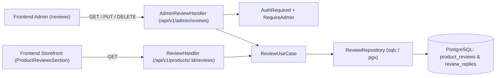

# Tài liệu thiết kế: Phản hồi đánh giá của quản trị viên (Admin Review Reply)

## Overview

Tài liệu thiết kế này mô tả kiến trúc kỹ thuật, hợp đồng giao tiếp liên ranh giới (shared contracts) và chiến lược kiểm thử (bao gồm xác minh E2E bằng Playwright) cho tính năng **Phản hồi đánh giá của quản trị viên (Admin Review Reply)**, bao phủ toàn bộ các yêu cầu `1.1–1.5`, `2.1–2.7` và `3.1–3.5` trong [requirements.md](file:///E:/v3-v3-singleagent/.dream/specs/admin-review-reply/requirements.md).

Tính năng cho phép quản trị viên (admin) xem danh sách đánh giá sản phẩm trên toàn hệ thống, lọc theo số sao và trạng thái phản hồi, đồng thời thêm mới, chỉnh sửa hoặc xóa phản hồi chính thức của cửa hàng. Phản hồi của quản trị viên được hiển thị công khai trên trang chi tiết sản phẩm ngay bên dưới đánh giá tương ứng của khách hàng mà không làm lộ thông tin định danh cá nhân nội bộ của quản trị viên.

## Architecture

Hệ thống mở rộng miền nghiệp vụ Đánh giá sản phẩm (`Review` domain) qua 4 tầng:



- **Database (`PostgreSQL`)**: Bổ sung khả năng lưu trữ nội dung phản hồi và thời điểm phản hồi gắn với từng đánh giá (`000014_add_admin_reply_to_reviews` và chuẩn hóa sang bảng `review_replies` tại `000015_create_review_replies_and_votes` có khóa ngoại `review_id UNIQUE REFERENCES product_reviews(id) ON DELETE CASCADE`).
- **Backend (`backend/`)**:
  - `AdminReviewHandler` phục vụ nhóm route `/api/v1/admin/reviews` đứng sau middleware `AuthRequired` và `RequireAdmin()`.
  - `ReviewUseCase` và `ReviewRepository` xử lý truy vấn danh sách đánh giá toàn hệ thống (kèm bộ lọc `rating`, `has_reply`, phân trang) và thao tác tạo/cập nhật/xóa phản hồi.
  - `ReviewHandler` (`GET /api/v1/products/:id/reviews`) ánh xạ `adminReply` và `adminRepliedAt` vào `PublicReview`.
- **Frontend Admin (`frontend-admin/`)**: Trang `ReviewsPage` tại route `/reviews` hiển thị bảng danh sách đánh giá, bộ lọc số sao & trạng thái phản hồi, phân trang, hộp thoại thêm/sửa phản hồi và hộp thoại xác nhận xóa phản hồi.
- **Frontend Storefront (`frontend/`)**: Component `ProductReviewsSection` trên trang chi tiết sản phẩm (`/products/:id`) hiển thị khối phản hồi của cửa hàng với nhãn `"Phản hồi từ người bán"` ngay bên dưới nội dung đánh giá của khách hàng khi `adminReply` tồn tại.

## Components And Interfaces

### Shared Contracts

#### Contract DB-REVIEW-REPLIES (rev 1)

- **Mục đích**: Lưu trữ phản hồi của quản trị viên gắn với từng đánh giá sản phẩm và cung cấp dữ liệu `admin_reply` (text, `1..1000` ký tự) cùng `admin_replied_at` (`timestamptz`) cho các truy vấn đọc/ghi.
- **Ràng buộc toàn vẹn**:
  - Mỗi đánh giá (`product_reviews.id`) có tối đa 1 phản hồi quản trị viên.
  - Nội dung phản hồi không vượt quá `1000` ký tự.
  - Khi chưa có phản hồi hoặc sau khi xóa phản hồi, các cột chiếu (`admin_reply`, `admin_replied_at`) trả về `NULL`.
  - Không lưu hoặc liên kết khóa ngoại tới `user_id` của admin để đảm bảo mọi admin đều có quyền thêm/sửa/xóa phản hồi chung của cửa hàng (`Req 2.6`) và không lộ danh tính nội bộ (`Req 3.4`).

#### Contract API-ADMIN-REVIEWS (rev 1)

Tất cả các endpoint dưới `/api/v1/admin/reviews` yêu cầu JWT hợp lệ với vai trò `admin` (`AuthRequired` + `RequireAdmin()`) và tuân thủ chuẩn Full Status Envelope.

1. **`GET /api/v1/admin/reviews`**
   - **Query Parameters**:
     - `page` (int, optional, mặc định `1`, nếu `< 1` tính là `1`).
     - `limit` (int, optional, mặc định `10`, tối đa `50`).
     - `rating` (int, optional, `1..5`; `0` hoặc bỏ trống để lấy tất cả số sao).
     - `has_reply` (string, optional: `"yes"` lọc đánh giá đã có phản hồi, `"no"` lọc đánh giá chưa có phản hồi, `""` lấy tất cả).
   - **Success Response (`HTTP 200`)**:
     - `data`: `AdminReview[]` sắp xếp theo `created_at DESC, id DESC`:
       ```json
       [
         {
           "id": "uuid",
           "orderItemId": "uuid",
           "rating": 5,
           "comment": "Sản phẩm rất tốt",
           "editCount": 0,
           "media": [],
           "createdAt": "2026-08-28T00:00:00Z",
           "updatedAt": "2026-08-28T00:00:00Z",
           "adminReply": "Cảm ơn bạn đã ủng hộ!",
           "adminRepliedAt": "2026-08-28T01:00:00Z",
           "reviewerEmail": "customer@example.com",
           "product": {
             "id": "uuid",
             "name": "iPhone 15 Pro Max",
             "brandName": "Apple",
             "model": "A3106",
             "imageUrl": "https://...",
             "options": []
           }
         }
       ]
       ```
     - `meta.pagination`: `PaginationMeta` (`page`, `limit`, `total`, `totalPages`, `hasNext`, `hasPrev`).

2. **`PUT /api/v1/admin/reviews/:id/reply`**
   - **Path Parameters**: `id` (UUID của đánh giá).
   - **Request Body (`application/json`)**:
     ```json
     {
       "reply": "Nội dung phản hồi từ cửa hàng"
     }
     ```
   - **Validation**: `reply` sau khi `TrimSpace` không được rỗng và có độ dài `<= 1000` ký tự.
   - **Success Response (`HTTP 200`)**: Full Status Envelope với `message: "Cập nhật phản hồi thành công"` và `data` là đối tượng `Review` đã cập nhật (`id`, `adminReply`, `adminRepliedAt`, ...).

3. **`DELETE /api/v1/admin/reviews/:id/reply`**
   - **Path Parameters**: `id` (UUID của đánh giá).
   - **Success Response (`HTTP 200`)**: Full Status Envelope với `message: "Xóa phản hồi thành công"` và `data` là đối tượng `Review` sau khi gỡ phản hồi (`adminReply` và `adminRepliedAt` được lược bỏ/`nil`).

#### Contract API-PUBLIC-REVIEWS (rev 1)

- **Endpoint**: `GET /api/v1/products/:id/reviews`
- **Mở rộng Payload (`PublicReview`)**:
  - Bổ sung hai trường tùy chọn vào từng phần tử `reviews` trong `data.reviews`:
    - `adminReply?: string` (chỉ xuất hiện khi đánh giá có phản hồi).
    - `adminRepliedAt?: string` (ISO 8601 timestamp, chỉ xuất hiện khi đánh giá có phản hồi).
  - Tuyệt đối không trả về `adminId` hay `adminEmail` trong `PublicReview` (`Req 3.4`).

### Frontend Components

1. **Frontend Admin (`frontend-admin/`)**:
   - `src/api/reviews.ts`: Cung cấp `getAdminReviews`, `updateAdminReply`, `deleteAdminReply` thông qua `apiClientWithMeta`.
   - `src/pages/ReviewsPage.tsx` (đăng ký tại route `/reviews` trong `App.tsx` và liên kết `"Đánh giá"` trên thanh điều hướng `AdminLayout.tsx`):
     - Hiển thị bảng danh sách đánh giá gồm: Sản phẩm (`name`, `model`, `imageUrl`), Khách hàng (`reviewerEmail`), Đánh giá (`rating` sao), Nội dung (`comment`, `createdAt`), Trạng thái (`"Đã phản hồi"` / `"Chưa phản hồi"`), và Hành động (`"Phản hồi"` / `"Sửa"` / xóa).
     - Bộ lọc theo số sao (`Tất cả`, `1 Sao` – `5 Sao`) và trạng thái phản hồi (`Tất cả`, `Đã phản hồi`, `Chưa phản hồi`), tự động đưa `page` về `1` khi đổi bộ lọc.
     - Hộp thoại thêm/chỉnh sửa phản hồi với bộ đếm ký tự `.../1000` và kiểm tra không để trống.
     - Hộp thoại xác nhận xóa phản hồi.

2. **Frontend Storefront (`frontend/`)**:
   - `src/api/types.ts`: Cập nhật interface `PublicReview` và `UserReview` bổ sung `adminReply?: string` và `adminRepliedAt?: string`.
   - `src/components/ProductReviewsSection.tsx`:
     - Khi `rev.adminReply` có giá trị, hiển thị khối phản hồi bên dưới đánh giá khách hàng với nhãn `"Phản hồi từ người bán"`, thời gian `formatDateTime(rev.adminRepliedAt)`, và nội dung `rev.adminReply`.
     - Khi `rev.adminReply` rỗng/không tồn tại, không hiển thị vùng phản hồi.

## Data Models

### Database Schema

1. Migration `000014_add_admin_reply_to_reviews.up.sql`:
   ```sql
   ALTER TABLE product_reviews
   ADD COLUMN admin_reply text DEFAULT NULL CHECK (admin_reply IS NULL OR char_length(admin_reply) <= 1000),
   ADD COLUMN admin_replied_at timestamptz DEFAULT NULL;
   ```
2. Chuẩn hóa tương thích với `000015_create_review_replies_and_votes.up.sql`:
   - Tách dữ liệu phản hồi sang bảng `review_replies (id, review_id UNIQUE, content, created_at, updated_at)` và giữ nguyên các trường chiếu `admin_reply`, `admin_replied_at` thông qua `LEFT JOIN review_replies rr ON rr.review_id = pr.id` trong `backend/db/queries/reviews.sql`.

### Domain Models (`backend/internal/domain/review.go`)

```go
type Review struct {
    AdminReply     *string       `json:"adminReply,omitempty"`
    AdminRepliedAt *time.Time    `json:"adminRepliedAt,omitempty"`
    ID             string        `json:"id"`
    OrderItemID    string        `json:"orderItemId,omitempty"`
    Rating         int16         `json:"rating"`
    Comment        string        `json:"comment"`
    EditCount      int16         `json:"editCount"`
    Media          []ReviewMedia `json:"media"`
    CreatedAt      time.Time     `json:"createdAt"`
    UpdatedAt      time.Time     `json:"updatedAt"`
    Edited         bool          `json:"edited"`
    CanEdit        bool          `json:"canEdit"`
}

type AdminReview struct {
    ID             string            `json:"id"`
    OrderItemID    string            `json:"orderItemId"`
    Rating         int16             `json:"rating"`
    Comment        string            `json:"comment"`
    EditCount      int16             `json:"editCount"`
    Media          []ReviewMedia     `json:"media"`
    CreatedAt      time.Time         `json:"createdAt"`
    UpdatedAt      time.Time         `json:"updatedAt"`
    AdminReply     *string           `json:"adminReply,omitempty"`
    AdminRepliedAt *time.Time        `json:"adminRepliedAt,omitempty"`
    ReviewerEmail  *string           `json:"reviewerEmail,omitempty"`
    Product        UserReviewProduct `json:"product"`
}
```

## Error Handling

| Tình huống | HTTP Status | `error.code` | Hành vi / Chi tiết |
|---|---:|---|---|
| Request body sai định dạng JSON | `400` | `validation_error` | `error.fields.body = "Định dạng không hợp lệ"` |
| Nội dung `reply` rỗng (chỉ khoảng trắng) hoặc `> 1000` bytes/ký tự | `400` | `validation_error` | `error.fields.reply = "Nội dung phản hồi không hợp lệ"` |
| Chưa đăng nhập hoặc token không hợp lệ | `401` | `unauthorized` / `invalid_token` | Middleware `AuthRequired` từ chối yêu cầu; UI admin điều hướng về `/login` |
| Người dùng đã đăng nhập nhưng không có quyền `admin` | `403` | `forbidden` | Middleware `RequireAdmin()` từ chối yêu cầu |
| `id` đánh giá không tồn tại hoặc sai UUID | `404` | `review_not_found` | Trả về thông báo lỗi tiếng Việt qua Full Status Envelope |
| Lỗi hệ thống / cơ sở dữ liệu | `500` | `internal` | Log lỗi qua `log/slog`, ẩn chi tiết nội bộ khỏi response |

## Testing Strategy

### 1. Backend Unit & Integration Tests
- **Repository Integration Tests (`backend/internal/repository`)**: Kiểm tra `GetAdminReviews` với phân trang, lọc `rating` (`1..5`), lọc `has_reply` (`yes`, `no`, `""`), sắp xếp mới nhất trước (`created_at DESC`), và `UpdateAdminReply` (thêm mới, chỉnh sửa, xóa phản hồi, đánh giá không tồn tại).
- **UseCase & HTTP Handler Tests (`backend/internal/usecase/review`, `backend/internal/delivery/http`)**:
  - Kiểm tra guard phân quyền `401`/`403` cho tất cả các route `/api/v1/admin/reviews*` (`Req 1.5, 2.7`).
  - Kiểm tra validation `400` khi `reply` chỉ chứa khoảng trắng hoặc dài hơn 1.000 ký tự (`Req 2.1, 2.3`).
  - Kiểm tra `PUT` tạo mới và cập nhật phản hồi bởi bất kỳ admin nào (`Req 2.2, 2.4, 2.6`) và `DELETE` xóa phản hồi (`Req 2.5`).
  - Kiểm tra `GET /api/v1/products/:id/reviews` trả về `adminReply` và `adminRepliedAt` khi có phản hồi, ẩn khi không có phản hồi, và không chứa thông tin định danh cá nhân của admin (`Req 3.1, 3.3, 3.4, 3.5`).

### 2. Frontend Component Tests (Vitest + React Testing Library)
- **Admin UI (`frontend-admin/src/pages/ReviewsPage.test.tsx`)**: Kiểm tra hiển thị bảng đánh giá, bộ lọc số sao và trạng thái phản hồi, mở modal thêm/sửa phản hồi, gửi cập nhật và xác nhận xóa phản hồi (`Req 1.1–1.4, 2.1–2.5`).
- **Storefront UI (`frontend/src/components/ProductReviewsSection.test.tsx`)**: Kiểm tra hiển thị khối `"Phản hồi từ người bán"` khi có `adminReply`, ẩn khối khi không có `adminReply`, và không rò rỉ thông tin nội bộ của admin (`Req 3.1–3.4`).

### 3. End-to-End (E2E) Verification (Playwright — `e2e-testing`)
Vì tính năng thay đổi giao diện người dùng ở cả `frontend-admin/` (`:15174`) và `frontend/` (`:15173`), kế hoạch triển khai bắt buộc có một leaf task xác minh E2E cuối cùng (`verifier` contract role) chạy trên toàn bộ stack thực tế (`backend` `:18080`, `frontend` `:15173`, `frontend-admin` `:15174`):
- **Xác thực thực tế (Real Login)**:
  - Đăng nhập tài khoản quản trị viên thật qua `/login` hoặc API bootstrap (`POST /api/v1/auth/login` với `ADMIN_BOOTSTRAP_EMAIL` / `ADMIN_BOOTSTRAP_PASSWORD`) trên `frontend-admin` (`:15174`).
  - Kiểm tra chặn truy cập (`Req 1.5, 2.7`) khi chưa đăng nhập hoặc dùng tài khoản `customer`.
  - Đảm bảo có dữ liệu đánh giá sản phẩm thực tế từ khách hàng trên hệ thống để kiểm thử xuyên suốt hai cổng.
- **Kịch bản E2E xuyên ranh giới (Cross-Boundary Scenarios)**:
  1. **Quản lý & Lọc danh sách đánh giá (`Req 1.1, 1.2, 1.3, 1.4`)**: Admin điều hướng tới `/reviews`, xác nhận bảng hiển thị email người đánh giá, số sao, nhận xét, thời gian, trạng thái `"Chưa phản hồi"` / `"Đã phản hồi"`; thực hiện lọc theo số sao và trạng thái phản hồi.
  2. **Thêm phản hồi & Kiểm tra ràng buộc (`Req 2.1, 2.2, 2.3`)**: Mở hộp thoại phản hồi trên một đánh giá chưa phản hồi, kiểm tra từ chối nội dung rỗng, nhập phản hồi hợp lệ và lưu (`PUT /api/v1/admin/reviews/:id/reply` -> `200 OK`), xác nhận trạng thái trên bảng chuyển thành `"Đã phản hồi"`.
  3. **Hiển thị công khai trên trang sản phẩm (`Req 3.1, 3.2, 3.3, 3.4`)**: Truy cập trang chi tiết sản phẩm tương ứng trên `frontend` (`:15173/products/:id`), cuộn tới phần đánh giá, xác nhận khối `"Phản hồi từ người bán"` hiển thị ngay dưới đánh giá của khách hàng kèm nội dung vừa nhập, không lộ email/ID admin, và kiểm tra bố cục ở cả viewport Desktop (`1440x900`) và Mobile (`375x812`).
  4. **Chỉnh sửa & Xóa phản hồi (`Req 2.4, 2.5, 3.5`)**: Admin chỉnh sửa nội dung phản hồi trên `frontend-admin`, tải lại trang sản phẩm trên `frontend` để xác nhận nội dung mới được cập nhật; sau đó admin xóa phản hồi (`DELETE /api/v1/admin/reviews/:id/reply` -> `200 OK`), xác nhận trạng thái trở về `"Chưa phản hồi"` và vùng phản hồi biến mất trên trang sản phẩm sau khi tải lại.
- **Bằng chứng thực thi (Execution Evidence Artifacts)**:
  - Lưu ảnh chụp màn hình từng bước vào `.dream/specs/admin-review-reply/imgs/`.
  - Tổng hợp báo cáo kết quả chạy E2E, danh sách hợp đồng/yêu cầu đã kiểm chứng và liên kết ảnh chụp màn hình tại `.dream/specs/admin-review-reply/report.md`.

## Requirement Traceability

| Requirement | Design Elements | Verification |
|---|---|---|
| 1.1 | `Contract API-ADMIN-REVIEWS@1`, `ReviewsPage` (`/reviews`) | Repository/HTTP tests (`ListReviews`); Vitest `ReviewsPage.test.tsx`; Playwright E2E admin list |
| 1.2 | `AdminReview` payload (`reviewerEmail`, `rating`, `comment`, `createdAt`, `adminReply`), `ReviewsPage` | HTTP test `TestAdminReviewHandler_ListReviews`; Vitest `ReviewsPage.test.tsx`; Playwright E2E |
| 1.3 | `PaginationMeta` trong `GET /api/v1/admin/reviews`, điều khiển phân trang `ReviewsPage` | Repository & HTTP pagination tests; Playwright E2E |
| 1.4 | Query params `rating`, `has_reply` trong `GET /api/v1/admin/reviews`, bộ lọc `ReviewsPage` | Repository filter tests; Vitest filter test; Playwright E2E filter flow |
| 1.5 | `ProtectedRoute` (`frontend-admin`), `AuthRequired` + `RequireAdmin()` (`backend`) | HTTP test `TestAdminReviewHandler_AuthGuards`; Playwright E2E auth guard |
| 2.1 | Hộp thoại phản hồi trong `ReviewsPage` (`maxLength={1000}`), `ReviewUseCase.UpdateAdminReply` | Vitest dialog test; HTTP validation test; Playwright E2E reply dialog |
| 2.2 | `PUT /api/v1/admin/reviews/:id/reply`, `ReviewRepository.UpdateAdminReply`, `DB-REVIEW-REPLIES@1` | Repository integration test; HTTP test `TestAdminReviewHandler_UpdateReply`; Playwright E2E |
| 2.3 | Kiểm tra `TrimSpace` và giới hạn 1.000 ký tự tại `ReviewUseCase.UpdateAdminReply` & `ReviewsPage` | HTTP 400 validation tests (empty & >1000 chars); Playwright E2E validation check |
| 2.4 | `PUT /api/v1/admin/reviews/:id/reply` (upsert/update), nút `"Sửa"` trong `ReviewsPage` | Repository update test; Vitest & Playwright E2E edit reply flow |
| 2.5 | `DELETE /api/v1/admin/reviews/:id/reply`, hộp thoại xóa trong `ReviewsPage` | Repository delete test; HTTP test `TestAdminReviewHandler_DeleteReply`; Vitest & Playwright E2E delete flow |
| 2.6 | `DB-REVIEW-REPLIES@1` và `UpdateAdminReply` không khóa theo `admin_user_id` | UseCase/HTTP tests cho phép mọi token `admin` cập nhật/xóa phản hồi |
| 2.7 | Middleware `AuthRequired` + `RequireAdmin()` trên nhóm `/api/v1/admin/reviews` | HTTP test `TestAdminReviewHandler_AuthGuards` (401/403) |
| 3.1 | `Contract API-PUBLIC-REVIEWS@1`, `ProductReviewsSection.tsx` | HTTP public review test; Vitest `ProductReviewsSection.test.tsx`; Playwright E2E storefront check |
| 3.2 | Nhãn `"Phản hồi từ người bán"` và khung phân biệt trực quan trong `ProductReviewsSection.tsx` | Vitest `ProductReviewsSection.test.tsx`; Playwright E2E visual screenshot (desktop & mobile) |
| 3.3 | Render có điều kiện `{rev.adminReply && (...)}` trong `ProductReviewsSection.tsx` | Vitest test khi `adminReply` là `undefined`; Playwright E2E trước khi phản hồi / sau khi xóa |
| 3.4 | `PublicReview` struct chỉ xuất `adminReply`, `adminRepliedAt` (không có email/ID admin) | HTTP payload assertion; Vitest & Playwright E2E |
| 3.5 | `GET /api/v1/products/:id/reviews` đọc trạng thái mới nhất từ DB khi tải lại trang | Repository/HTTP test; Playwright E2E sửa/xóa phản hồi rồi reload trang sản phẩm |

## Existing System Integration

### Supporting Dependencies
- **Xác thực & Phân quyền (`AuthContext`, JWT Guard)**: Tái sử dụng middleware `guard.AuthRequired` và `guard.RequireAdmin()` sẵn có trong `backend/internal/delivery/http/router.go` cùng `ProtectedRoute` trong `frontend-admin/`.
- **Đánh giá sản phẩm của khách hàng (`purchased-product-reviews`)**: Dữ liệu đầu vào của danh sách quản trị viên lấy trực tiếp từ bảng `product_reviews` kết hợp thông tin `order_items`, `orders`, và `users` đã có. Không tạo bản sao dữ liệu đánh giá.
- **API Client & Chuẩn Envelope**: Tái sử dụng `apiClientWithMeta` ở cả `frontend/` và `frontend-admin/` cùng các helper `writeSuccess`, `writePaginatedSuccess`, `writeError` tại backend.

### Downstream Impacts & Compatibility
- **Trang chi tiết sản phẩm (`frontend/src/components/ProductReviewsSection.tsx`)**: Mở rộng tương thích ngược (additive) cho `PublicReview`; các đánh giá chưa có phản hồi (`adminReply == nil`) giữ nguyên cách hiển thị trước đó.
- **Lịch sử đánh giá của khách hàng (`review-history` — `GET /api/v1/reviews/me`)**: `UserReview` cũng ánh xạ `adminReply` và `adminRepliedAt` từ cùng nguồn dữ liệu phản hồi, đảm bảo tính nhất quán khi khách hàng xem lại đánh giá của mình.
- **Bình chọn độ hữu ích (`review-helpfulness-voting`)**: Thao tác thêm/sửa/xóa phản hồi của admin thông qua `UpdateAdminReply` hoạt động trực tiếp trên thực thể `review_replies` (sửa phản hồi giữ nguyên UUID và lượt bình chọn; xóa phản hồi xóa bản ghi `review_replies` và cascade xóa bình chọn của phản hồi đó), hoàn toàn tương thích với luồng bình chọn công khai.
