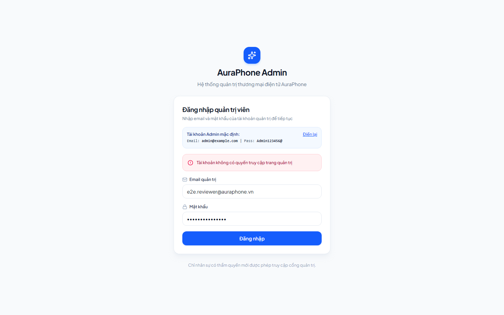
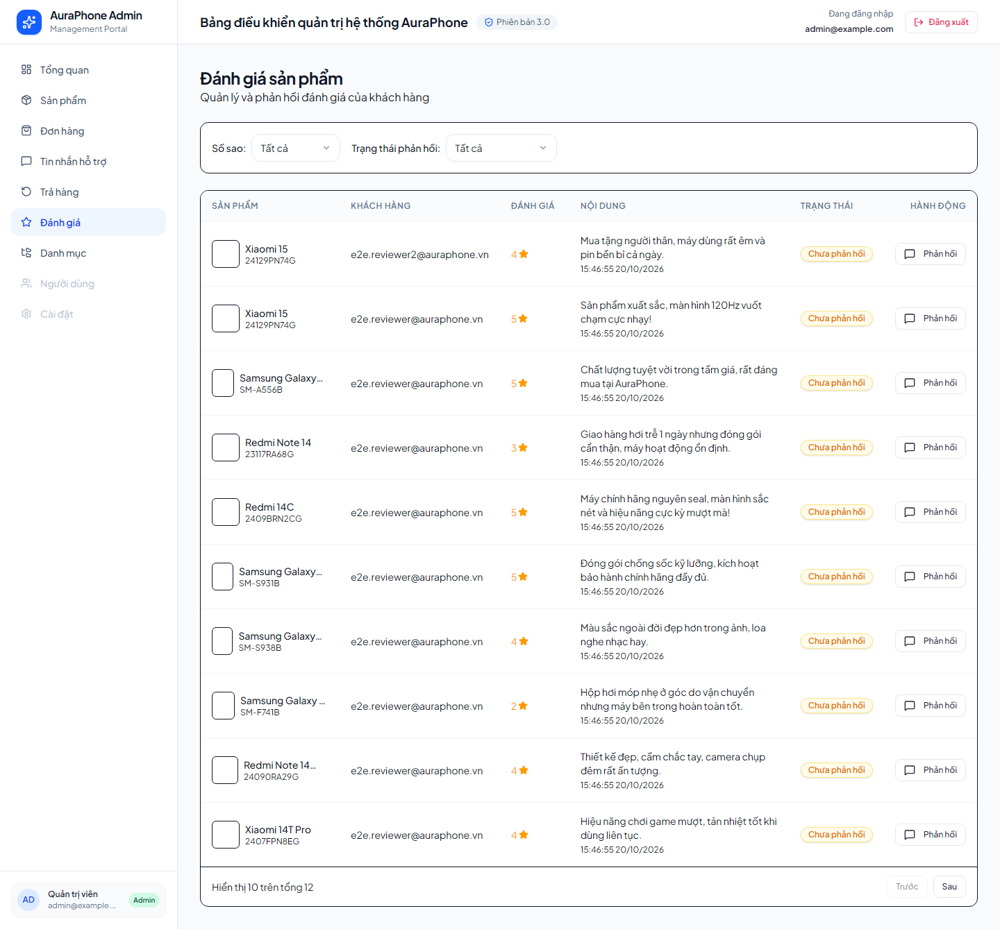
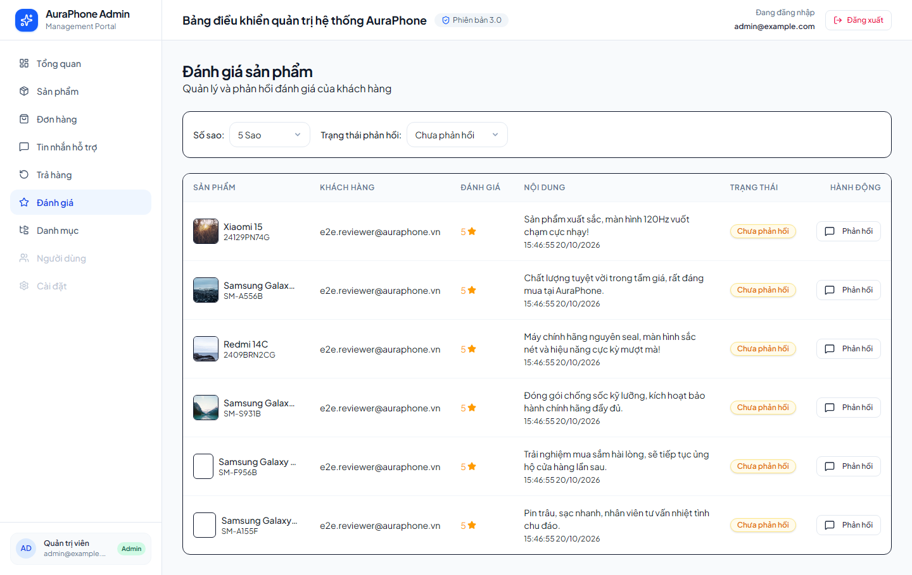
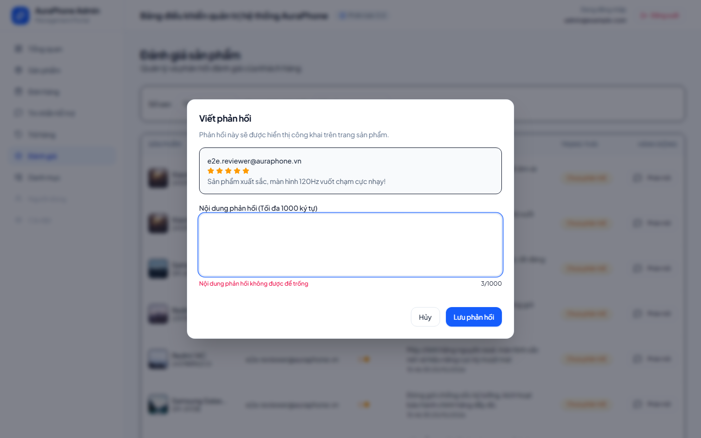
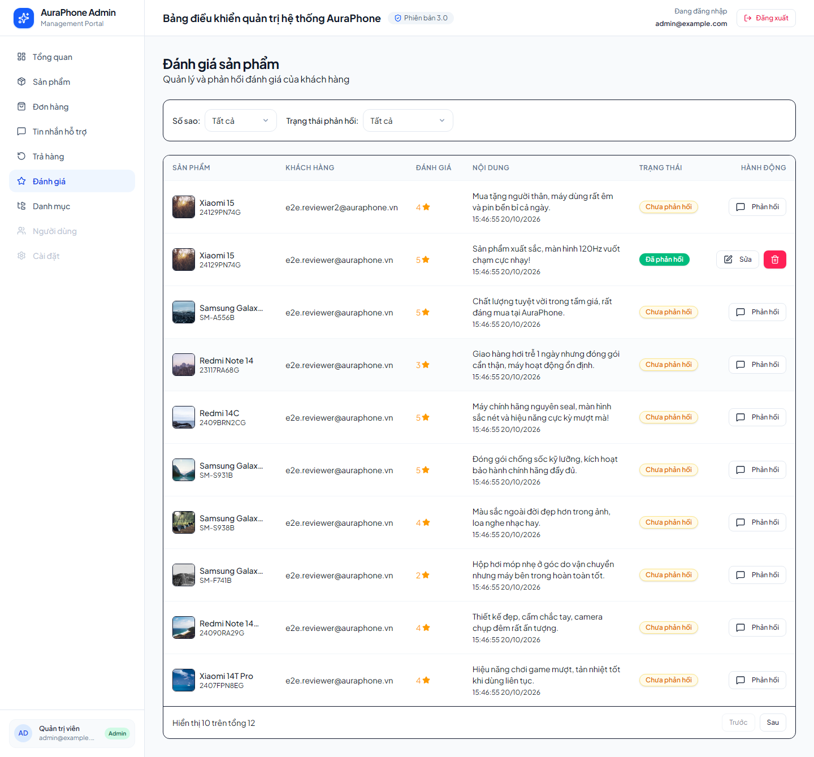
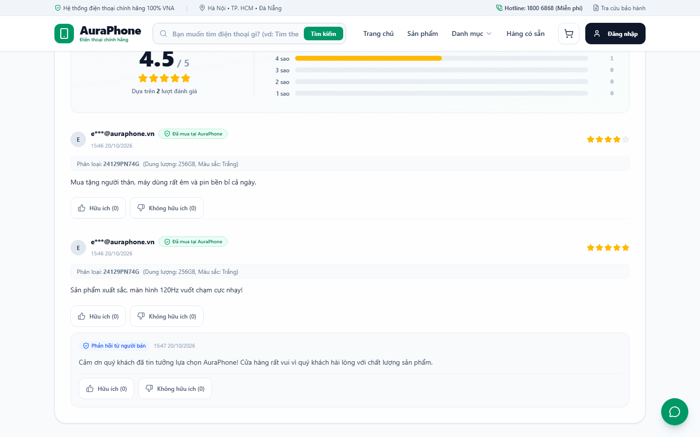
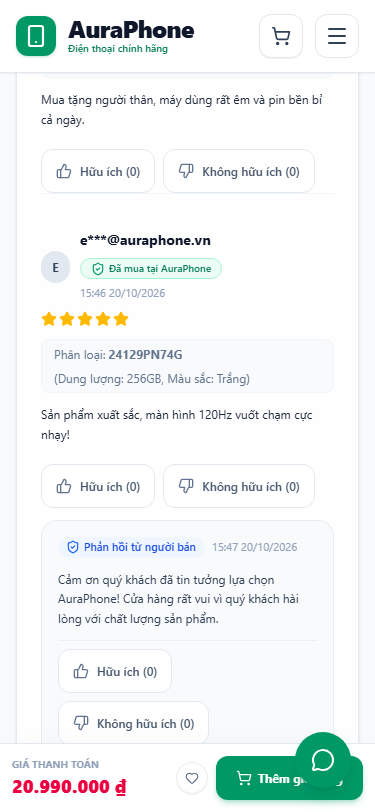
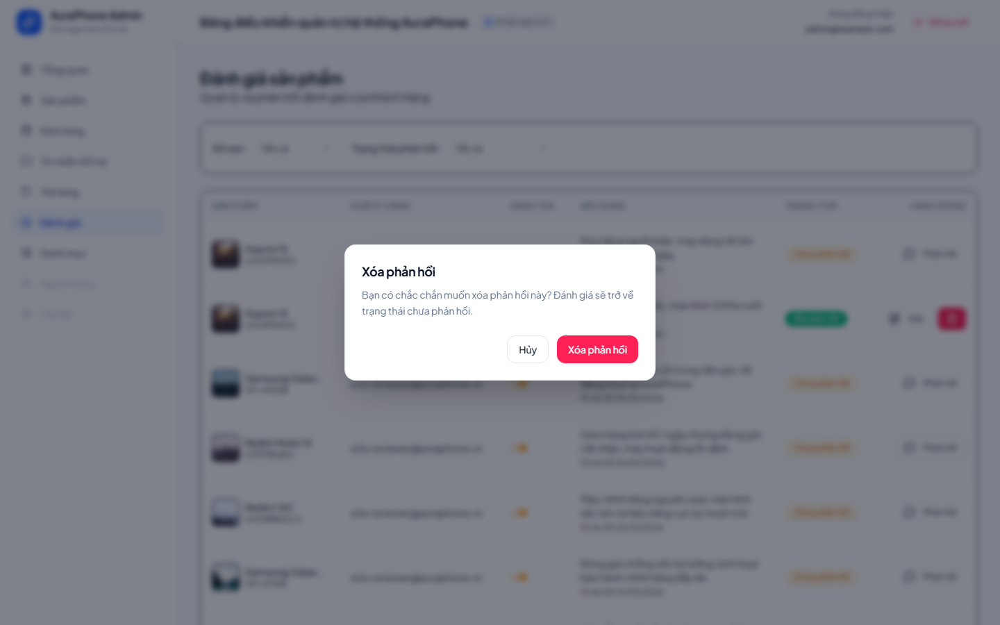
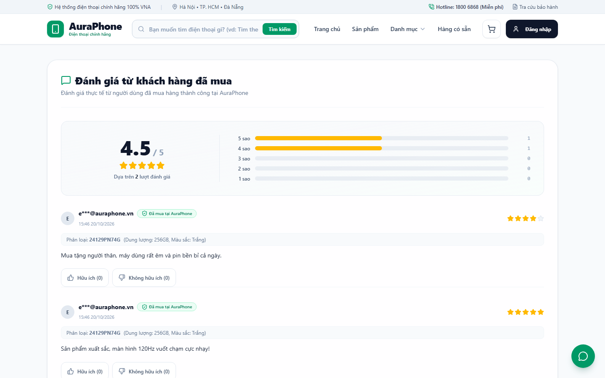

# E2E Verification Report — admin-review-reply

- **Status:** PASS (`2/2` Playwright tests passing across Desktop `1440x900` and Mobile `375x812`)
- **Command:** `npx playwright test e2e/admin-review-reply.spec.ts` (executed from `frontend/`)
- **Contracts Verified:** `API-ADMIN-REVIEWS@1 (verifier)`, `API-PUBLIC-REVIEWS@1 (verifier)`, `DB-REVIEW-REPLIES@1 (verifier)`
- **Requirements Covered:** `1.1, 1.2, 1.3, 1.4, 1.5, 2.1, 2.2, 2.3, 2.4, 2.5, 2.6, 2.7, 3.1, 3.2, 3.3, 3.4, 3.5`

## Contract & Requirement Traceability Matrix

| Requirement / Contract | Verification Method & Assertion | Status |
| --- | --- | --- |
| `Req 1.1`, `1.2`, `1.3` (`API-ADMIN-REVIEWS@1`) | Admin logs in via `POST /api/v1/auth/login` (`200 OK`) and navigates to `/reviews` (`:15174`). Table displays masked/customer email, product name, star rating, comment, formatted timestamp, and reply status badge (`"Chưa phản hồi"` / `"Đã phản hồi"`). Paginated `GET /api/v1/admin/reviews?page=1&limit=10` returns `<= 10` items ordered newest first (`createdAt DESC`) with `meta.pagination`, and clicking `"Sau"` loads page 2 (`page=2`). | PASS |
| `Req 1.4` (`API-ADMIN-REVIEWS@1`) | Filtering by star rating (`rating=5`) and reply status (`has_reply=no`, `has_reply=yes`) triggers `GET /api/v1/admin/reviews` with matching query parameters and updates the table rows. Invalid filter parameters (`rating=6`, `has_reply=invalid`) return `HTTP 400` (`error.code = "invalid_filter"`). | PASS |
| `Req 1.5`, `2.7` (`API-ADMIN-REVIEWS@1`) | Unauthenticated browser navigation to `/reviews` redirects to `/login`. Unauthenticated requests to `GET /api/v1/admin/reviews`, `PUT /api/v1/admin/reviews/:id/reply`, and `DELETE /api/v1/admin/reviews/:id/reply` return `HTTP 401`. Customer (`role = "customer"`) requests to all `/api/v1/admin/reviews*` endpoints return `HTTP 403` (`error.code = "forbidden"`). | PASS |
| `Req 2.1`, `2.2`, `2.3` (`API-ADMIN-REVIEWS@1`, `DB-REVIEW-REPLIES@1`) | Admin opens the reply dialog (`maxLength=1000`, live character counter `0/1000`). Submitting whitespace-only text in UI is blocked with `"Nội dung phản hồi không được để trống"`; API calls with whitespace or `>1000` characters return `HTTP 400` (`error.code = "validation_error"`). Submitting a valid reply calls `PUT /api/v1/admin/reviews/:id/reply` (`200 OK`), persists `adminReply` and `adminRepliedAt`, and updates the row badge to `"Đã phản hồi"`. | PASS |
| `Req 2.4`, `2.5`, `2.6` (`API-ADMIN-REVIEWS@1`, `DB-REVIEW-REPLIES@1`) | Admin reopens the dialog (`"Chỉnh sửa phản hồi"`), edits the reply (`PUT /api/v1/admin/reviews/:id/reply` -> `200 OK`), and subsequently deletes the reply via confirmation modal (`DELETE /api/v1/admin/reviews/:id/reply` -> `200 OK`), returning the review row to `"Chưa phản hồi"`. Non-existent review IDs return `HTTP 404` (`error.code = "review_not_found"`). | PASS |
| `Req 3.1`, `3.2`, `3.3`, `3.4`, `3.5` (`API-PUBLIC-REVIEWS@1`) | Storefront product detail page (`/products/:id` on `:15173`) fetches `GET /api/v1/products/:id/reviews` and renders `"Phản hồi từ người bán"` with reply content and formatted `adminRepliedAt` directly beneath the customer review on both Desktop (`1440x900`) and Mobile (`375x812`). Unreplied sibling reviews do not render a reply container. Public JSON payload and DOM never expose internal `adminId` or `adminEmail`. Editing or deleting the reply in Admin Portal immediately reflects on Storefront reload. | PASS |

---

## Scenario Walkthrough & Visual Evidence

### 1. Chặn truy cập trái phép vào Admin Portal & Admin Review APIs (`Req 1.5, 2.7`)
- Truy cập `/reviews` khi chưa đăng nhập tự động chuyển hướng về `/login`.
- Kiểm thử API trực tiếp xác nhận `401 Unauthorized` khi không có token và `403 Forbidden` khi dùng token của tài khoản `customer` cho cả 3 endpoint `GET /api/v1/admin/reviews`, `PUT /api/v1/admin/reviews/:id/reply`, và `DELETE /api/v1/admin/reviews/:id/reply`.
- Ảnh bằng chứng:
  

### 2. Danh sách đánh giá khách hàng & Phân trang trên Admin Portal (`Req 1.1, 1.2, 1.3`)
- Đăng nhập bằng tài khoản Admin thật (`POST /api/v1/auth/login` -> `200 OK`) và điều hướng tới `/reviews`.
- Bảng hiển thị danh sách đánh giá sắp xếp từ mới nhất đến cũ nhất (`10` đánh giá/trang) đầy đủ thông tin: sản phẩm, khách hàng (email), số sao, nội dung bình luận, thời gian gửi, và trạng thái phản hồi (`"Chưa phản hồi"`).
- Ảnh bằng chứng:
  

### 3. Lọc đánh giá theo số sao và trạng thái phản hồi (`Req 1.4`)
- Kết hợp bộ lọc `5 sao` (`rating=5`) và `Chưa phản hồi` (`has_reply=no`) trên trang `/reviews`, gọi `GET /api/v1/admin/reviews?page=1&limit=10&rating=5&has_reply=no` (`200 OK`) và chỉ hiển thị các đánh giá thỏa điều kiện.
- Ảnh bằng chứng:
  

### 4. Kiểm tra ràng buộc dữ liệu (Validation) khi gửi phản hồi rỗng (`Req 2.1, 2.3`)
- Mở hộp thoại `"Viết phản hồi"` (hiển thị bộ đếm ký tự `0/1000` và giới hạn `maxLength=1000`).
- Nhập chuỗi khoảng trắng và bấm `"Lưu phản hồi"`, giao diện chặn gửi và hiển thị cảnh báo tiếng Việt `"Nội dung phản hồi không được để trống"`. Đồng thời kiểm chứng API `PUT /api/v1/admin/reviews/:id/reply` trả về `400 Bad Request` (`validation_error`) với chuỗi rỗng hoặc vượt quá `1000` ký tự.
- Ảnh bằng chứng:
  

### 5. Tạo phản hồi thành công & Cập nhật trạng thái `"Đã phản hồi"` (`Req 2.2`)
- Nhập nội dung phản hồi hợp lệ và lưu (`PUT /api/v1/admin/reviews/:id/reply` -> `200 OK`).
- Dòng đánh giá trong bảng tự động cập nhật huy hiệu sang `"Đã phản hồi"`, hiển thị khung xem trước nội dung phản hồi và chuyển nút thao tác thành `"Sửa"` kèm nút xóa.
- Ảnh bằng chứng:
  

### 6. Hiển thị phản hồi trên Storefront ở Desktop (`1440x900`) & Bảo mật thông tin Admin (`Req 3.1, 3.2, 3.3, 3.4`)
- Trên trang chi tiết sản phẩm (`/products/:id`), đánh giá đã được trả lời hiển thị khung `"Phản hồi từ người bán"` cùng thời gian và nội dung phản hồi ngay bên dưới bình luận của khách hàng.
- Đánh giá cùng sản phẩm chưa được trả lời hoàn toàn không hiển thị khung phản hồi rỗng (`Req 3.3`).
- Payload JSON từ `GET /api/v1/products/:id/reviews` và giao diện công khai tuyệt đối không chứa `adminId` hay `adminEmail` (`Req 3.4`).
- Ảnh bằng chứng Desktop (`1440x900`):
  

### 7. Hiển thị phản hồi trên Storefront ở Mobile (`375x812`) (`Req 3.1, 3.2`)
- Kiểm tra giao diện responsive ở kích thước Mobile (`375x812`): khung `"Phản hồi từ người bán"` hiển thị rõ ràng, xuống dòng tự nhiên, không tràn lề ngang.
- Ảnh bằng chứng Mobile (`375x812`):
  

### 8. Chỉnh sửa phản hồi & Đồng bộ tức thì trên Storefront (`Req 2.4, 2.6, 3.5`)
- Admin mở hộp thoại `"Chỉnh sửa phản hồi"`, cập nhật nội dung mới (`PUT /api/v1/admin/reviews/:id/reply` -> `200 OK`).
- Tải lại trang sản phẩm trên Storefront xác nhận nội dung phản hồi mới được hiển thị ngay lập tức.
- Ảnh bằng chứng:
  

### 9. Xác nhận xóa phản hồi trên Admin Portal (`Req 2.5`)
- Admin bấm nút xóa phản hồi trên dòng đánh giá, hộp thoại xác nhận `"Xóa phản hồi"` hiển thị thông báo rõ ràng trước khi thực thi `DELETE /api/v1/admin/reviews/:id/reply` (`200 OK`).
- Ảnh bằng chứng:
  

### 10. Gỡ bỏ khối phản hồi trên Storefront sau khi Admin xóa (`Req 2.5, 3.3, 3.5`)
- Sau khi xóa phản hồi thành công, trạng thái trên Admin Portal trở về `"Chưa phản hồi"` và khi tải lại trang chi tiết sản phẩm trên Storefront, khối `"Phản hồi từ người bán"` đã được gỡ bỏ hoàn toàn khỏi đánh giá của khách hàng.
- Ảnh bằng chứng:
  
