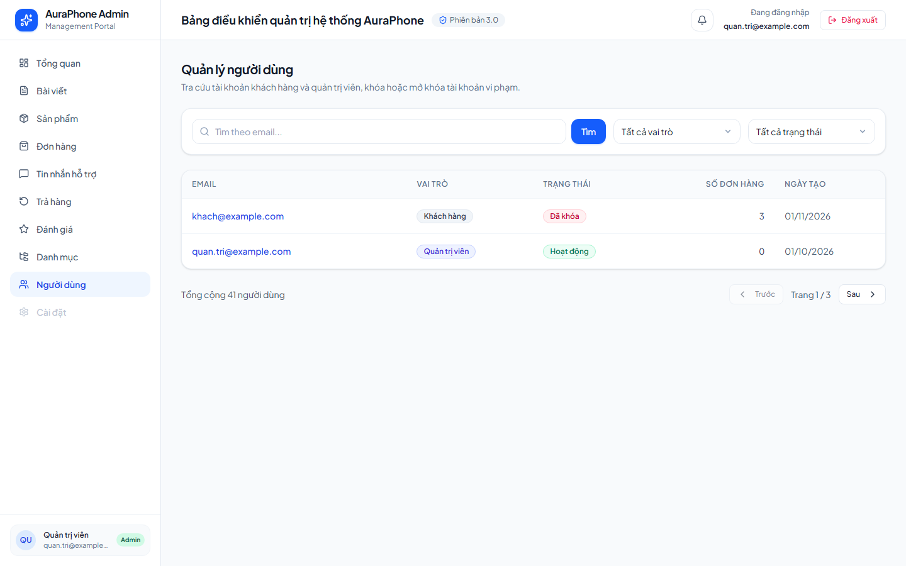
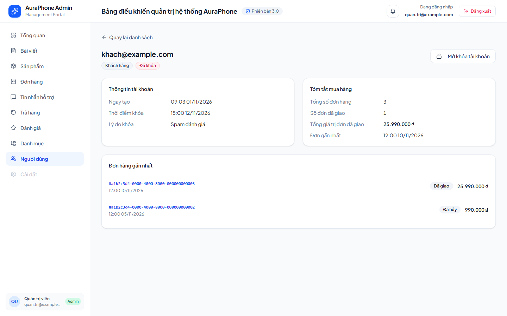
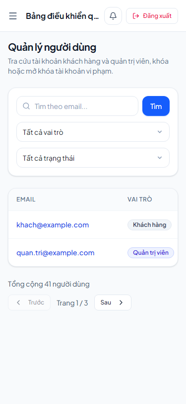
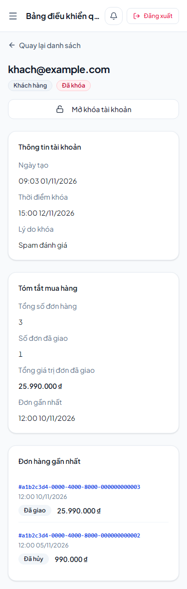

# E2E Verification Report — admin-user-management

- **Status:** PASS
- **Execution Mode:** `Mode 2: Shape-Locked Mock E2E`
- **Evidence Level:** `visual`
- **Suite:** `frontend/e2e/admin-user-management.spec.ts` (Page Object `frontend/e2e/pages/AdminUsersPage.ts`)
- **Command** (from `frontend/`): `npx playwright test e2e/admin-user-management.spec.ts`
- **Result:** 1 passed (Chromium; viewports `1440x900` and `375x812`)
- **Contracts Verified:** `API-ADMIN-USERS@1 (verifier)`, replies fulfilled from `.dream/specs/admin-user-management/contract-snapshots.json` through `mountContractRoutes`
- **Requirements Covered:** `8.2`

This report covers frontend layout against shape-locked mocks. Backend behavior (filters, lock/unlock, session revocation, performance) is proven separately by the use case, repository integration, and handler tests.

## Mocked routes

| Route | Kind | Source |
|---|---|---|
| `GET /api/v1/admin/users` | shape-locked, `auth: 'bearer'` | `list_users_200` |
| `GET /api/v1/admin/users/:id` | shape-locked, `auth: 'bearer'` | `get_user_200`; any other id → `user_not_found_404` |
| `GET /api/v1/auth/me`, `GET /api/v1/notifications`, `GET /api/v1/admin/chat/conversations` | stub | admin layout shell |

## Contract Shape Verification Matrix

| Contract ID | Endpoint | Go Handler & Test Source | Inbound Request Assertions | Outbound Envelope & State Assertions |
|---|---|---|---|---|
| `API-ADMIN-USERS@1` | `GET /api/v1/admin/users` | `backend/internal/delivery/http/admin_user_handler.go` (`admin_user_handler_test.go`) | Bearer token required (unauthenticated → `unauthenticated_401`) | `200` Full Status Envelope with `AdminUserSummary[]` and `meta.pagination` |
| `API-ADMIN-USERS@1` | `GET /api/v1/admin/users/:id` | same | Bearer token required | `200` envelope with `AdminUserDetail` (locked customer, two recent orders) |

## Results by criterion

| Req | Scenario | Result | Evidence |
|---|---|---|---|
| 8.2 | Users list at `375x812`: `document.documentElement.scrollWidth <= clientWidth`; the table scrolls horizontally inside its own container. | Pass | [03-users-list-mobile-375.png](./imgs/03-users-list-mobile-375.png) |
| 8.2 | User detail at `375x812`: no page-level horizontal scroll; account, purchase summary and recent orders stack in one column. | Pass | [04-user-detail-mobile-375.png](./imgs/04-user-detail-mobile-375.png) |
| 8.2 | Desktop reference at `1440x900` for both pages. | Pass | [01-users-list-desktop-1440.png](./imgs/01-users-list-desktop-1440.png), [02-user-detail-desktop-1440.png](./imgs/02-user-detail-desktop-1440.png) |

## Defect found and fixed during the run

The first run passed the scroll assertion, but the `375x812` screenshot showed the list table squeezed into the viewport: emails broke after every few characters and role/status badges wrapped. The email column now has a minimum width and the badge cells use `whitespace-nowrap`, so the table scrolls inside its container as 8.2 allows. `UsersPage.test.tsx` (9 tests) and the E2E suite were re-run green, and the screenshots were refreshed.

## Visual Evidence

