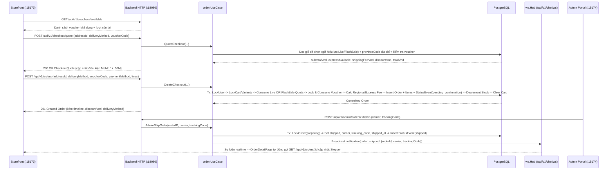
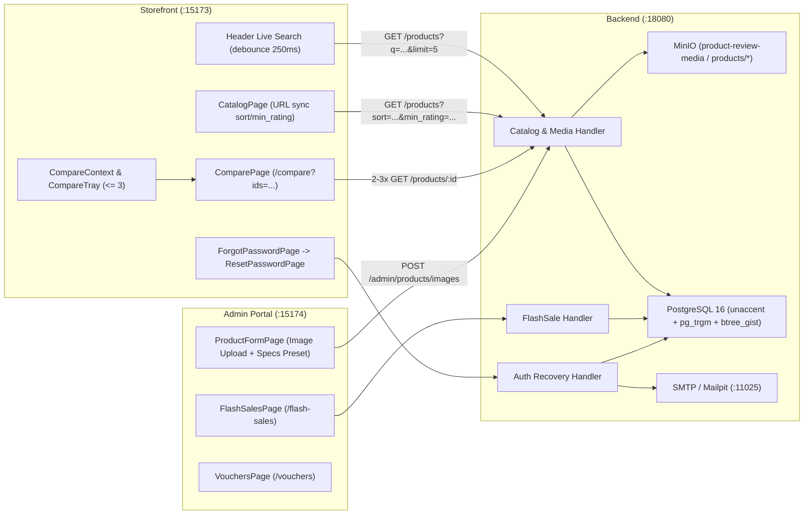
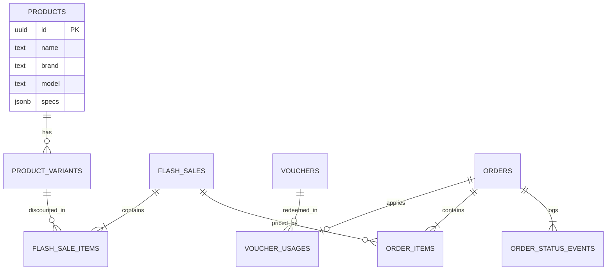

# Tài liệu Thiết kế Kỹ thuật (Design Document)

## Tổng quan (Overview)

Tài liệu này xác định kiến trúc, ranh giới mô-đun, hợp đồng chia sẻ (`rev 1`), mô hình dữ liệu PostgreSQL, ngữ nghĩa xử lý lỗi và chiến lược kiểm chứng cho đặc tả **`commerce-platform-enhancements`**, bao phủ toàn bộ 41 tiêu chí chấp nhận từ `1.1` đến `7.6` trong `requirements.md`.

### Các quyết định kỹ thuật trọng tâm (`TD-*`)

- **TD-1 (Báo giá tập trung phía máy chủ qua `POST /api/v1/checkout/quote`):** Do mã giảm giá loại `'freeship'` phụ thuộc trực tiếp vào `shippingFeeVnd` (vốn phụ thuộc vào `provinceCode` của địa chỉ và `deliveryMethod` là `'standard'` hay `'express_2h'`), hệ thống cung cấp một endpoint báo giá hợp nhất `POST /api/v1/checkout/quote`. Storefront không tự nhân chia công thức khuyến mãi hay phí vùng mà nhận kết quả chính xác từ máy chủ cho cả xem trước lẫn kiểm tra điều kiện Ví MoMo (`1.000 ₫ <= totalVnd <= 50.000.000 ₫`).
- **TD-2 (Bảo toàn tương thích ngược cho `domain.OrderRepository` qua Optional Interfaces):** Giữ nguyên chữ ký `OrderRepository.Create` và `MomoOrderRepository.CreateWithPaymentMethod` để toàn bộ fake/mock repository trong các bài kiểm thử hiện có tiếp tục biên dịch và giữ nguyên hành vi. Bổ sung interface mở rộng `domain.CheckoutOrderRepository` và `domain.FulfillmentOrderRepository` trên `*repository.OrderRepository` để xử lý báo giá, đặt đơn kèm `deliveryMethod` + `voucherCode`, xuất kho kèm `carrier` + `trackingCode`, hoàn lượt dùng voucher / suất Flash Sale khi hủy đơn và thực thi **Mua lại** (`BuyAgain`).
- **TD-3 (Ràng buộc không chồng lấn khung giờ Flash Sale ở cấp độ PostgreSQL `EXCLUDE USING gist`):** Sử dụng extension chuẩn `btree_gist` với ràng buộc `EXCLUDE USING gist (tstzrange(starts_at, ends_at, '[)') WITH &&) WHERE (active = true)` trên bảng `flash_sales`. Nhờ đó tại mọi thời điểm chỉ có tối đa một chiến dịch đang bật, view `flash_sale_active_variant_prices` luôn trả tối đa 1 dòng cho mỗi `variant_id`, và quy tắc chọn mức giá thấp hơn giữa `live_active_variant_prices` và `flash_sale_active_variant_prices` (`PD-4`) diễn ra hoàn toàn xác định ngay trong câu lệnh SQL của Catalog, Cart và Order.
- **TD-4 (Khôi phục mật khẩu chống dò tài khoản bằng bảng `password_reset_otps` định danh theo `citext email`):** Mọi yêu cầu `POST /api/v1/auth/forgot-password` (kể cả khi email không tồn tại hoặc tài khoản bị khóa) đều ghi nhận bản ghi theo `email` (`user_id` và `otp_hash` là `NULL` nếu tài khoản không hợp lệ) trước khi kiểm tra giới hạn `5 yêu cầu / 15 phút`. Nhờ vậy ngưỡng `429 otp_rate_limited` và phản hồi `200 OK` hoạt động đồng nhất tuyệt đối, loại bỏ hoàn toàn kênh rò rỉ sự tồn tại tài khoản; mã OTP 6 chữ số sinh bằng `crypto/rand` chỉ lưu băm HMAC-SHA256 (với khóa dẫn xuất từ `JWT_ACCESS_SECRET`) và gửi qua adapter `net/smtp` (tương thích Mailpit `:11025` ở môi trường dev).
- **TD-5 (Tái sử dụng `reviewmedia.Store` và tuyến `/media/products/:imageKey` cho ảnh sản phẩm):** Tận dụng bucket `MINIO_BUCKET` (`product-review-media`) đã được khởi tạo riêng tư trong `compose.minio.yml` và `deployment/docker-compose.yml`, lưu đối tượng dưới tiền tố `products/<uuid>.<ext>` và phục vụ công khai qua `GET|HEAD /media/products/:imageKey`. Do cả Vite (`:15173`, `:15174`) lẫn Nginx (`deployment/nginx/default.conf.template`) đã cấu hình proxy sẵn tiền tố `/media/`, ảnh tải lên hoạt động tức thì ở mọi môi trường mà vẫn giữ nguyên kiểu `imageUrls: string[]` tương thích với URL `https://...` trong dữ liệu seed.
- **TD-6 (Lưu `products.specs` dạng `jsonb` có thứ tự và tái sử dụng `GET /api/v1/products/:id` cho trang So sánh):** Thông số kỹ thuật thuộc sở hữu 1–1 của sản phẩm, luôn đọc/ghi trọn vẹn theo thứ tự nhóm và dòng nên được lưu trong cột `products.specs jsonb`. Trang So sánh (`/compare?ids=...`) gọi song song `GET /api/v1/products/:id` (tối đa 3 sản phẩm) để lấy trọn vẹn `specs`, `variants`, giá hiệu lực và thống kê đánh giá mà không sinh thêm API trùng lặp.
- **TD-7 (Tìm kiếm tiếng Việt không dấu với hàm bất biến `f_unaccent(text)` + chỉ mục GIN `pg_trgm`):** Tạo extension `unaccent` và `pg_trgm` cùng hàm `IMMUTABLE` `f_unaccent(text)` chuyển chữ thường, bỏ dấu và quy đổi `đ`/`Đ -> d`. Nhờ tính chất `IMMUTABLE`, PostgreSQL cho phép đánh chỉ mục `GIN (... gin_trgm_ops)` trực tiếp trên biểu thức văn bản gộp của sản phẩm để phục vụ cả trang Danh mục lẫn khung Gợi ý tức thì (`GET /api/v1/products?q=...&limit=5`).
- **TD-8 (Lịch sử hành trình đơn hàng chuẩn hóa qua bảng `order_status_events` + làm mới thời gian thực qua WebSocket hiện hữu):** Mỗi lần tạo mới hoặc chuyển trạng thái đơn hàng ghi thêm một bản ghi bất biến vào `order_status_events` trong cùng giao dịch PostgreSQL; dữ liệu đơn hàng cũ được backfill tự động trong migration. Trên giao diện Chi tiết đơn hàng của Khách hàng và Quản trị viên, tái sử dụng `useChatSocket` / `useAdminChatSocket` (`/api/v1/chat/ws`) lắng nghe sự kiện thông báo đơn hàng trùng `metadata.orderId` để tự động tải lại đơn hàng và cập nhật thanh tiến trình ngay lập tức.
- **TD-9 (Chế độ kiểm thử trình duyệt):** Khóa chế độ kiểm thử E2E ở **`Mode 2: Shape-Locked Mock E2E`** (`mock-e2e` & `visual`) sử dụng `.dream/specs/commerce-platform-enhancements/contract-snapshots.json` và `mountContractRoutes`.

### Các phương án kiến trúc đã cân nhắc

| Vấn đề | Phương án A | Phương án B | Lựa chọn & Lý do |
|---|---|---|---|
| **Lưu trữ thông số kỹ thuật (`specs`)** | Tách 2 bảng quan hệ `product_spec_groups` và `product_spec_items` | Lưu cột `specs jsonb NOT NULL DEFAULT '[]'::jsonb` trực tiếp trên bảng `products` | **Chọn Phương án B:** Không có yêu cầu lọc SQL theo từng dòng thông số rời rạc; `jsonb` bảo toàn thứ tự mảng tự nhiên, giảm 2 truy vấn phụ khi đọc chi tiết sản phẩm và đơn giản hóa cập nhật nguyên tử. |
| **API báo giá Vận chuyển & Voucher tại Checkout** | Tách 2 endpoint rời `/shipping/quote` và `/vouchers/preview` để client tự cộng trừ | Hợp nhất vào `POST /api/v1/checkout/quote` trả trọn gói `subtotalVnd`, `shippingFeeVnd`, `discountVnd`, `totalVnd`, `expressAvailable` | **Chọn Phương án B:** Mã `'freeship'` phụ thuộc trực tiếp vào `shippingFeeVnd` của địa chỉ + phương thức giao hàng; tính tập trung 1 lượt loại bỏ sai lệch làm tròn và giữ một nguồn chân lý duy nhất ở Backend. |
| **API phục vụ Gợi ý tìm kiếm & So sánh sản phẩm** | Tạo mới `/products/autocomplete` và `/products/compare` riêng biệt | Mở rộng `GET /api/v1/products` (`q`, `limit=5`, `sort`, thống kê sao/bán) và tái sử dụng `GET /api/v1/products/:id` cho tối đa 3 máy so sánh | **Chọn Phương án B:** Tuân thủ nguyên tắc không nhân bản hợp đồng song song khi endpoint chuẩn đã cung cấp đúng dữ liệu cần thiết với độ trễ thấp. |
| **Thực thi hành động "Mua lại"** | Frontend lặp qua từng `OrderItem` gọi tuần tự `POST /api/v1/cart/items` + `PUT /cart/items/:id` | Cung cấp endpoint giao dịch `POST /api/v1/orders/:id/buy-again` xử lý gộp số lượng và lọc tồn kho trong 1 lần gọi | **Chọn Phương án B:** `POST /cart/items` hiện chỉ cộng 1 đơn vị/lần gọi; xử lý nguyên tử ở máy chủ trong 1 round-trip giúp kẹp trần tồn kho chính xác và trả danh sách sản phẩm hết hàng/điều chỉnh rõ ràng. |

---

## Kiến trúc & Luồng Dữ liệu (Architecture)

### 1. Luồng Báo giá, Đặt hàng (Voucher + Flash Sale/Live + Phí vùng/Hỏa tốc 2h) & Hành trình Đơn hàng



### 2. Luồng Tìm kiếm Không dấu, Thông số Kỹ thuật, So sánh & Khôi phục Mật khẩu



---

## Thành phần & Giao diện (Components And Interfaces)

#### Contract CONFIG-PLATFORM (rev 1)

- **Chủ sở hữu:** `backend/internal/config/config.go`, `backend/.env.example`, `compose.mailpit.yml`, `deployment/docker-compose.yml`, `Makefile`.
- **Các khóa cấu hình nạp qua Viper (biến môi trường tiến trình ghi đè `.env`):**

| Biến môi trường | Trường trong `config.Config` | Mặc định | Quy tắc xác thực lúc khởi động |
|---|---|---|---|
| `SMTP_HOST` | `SMTPHost string` | `"localhost"` | Chuỗi không rỗng sau cắt khoảng trắng |
| `SMTP_PORT` | `SMTPPort int` | `11025` | Số nguyên trong khoảng `1..65535` |
| `SMTP_USERNAME` | `SMTPUsername string` | `""` | Chuỗi tùy chọn |
| `SMTP_PASSWORD` | `SMTPPassword string` | `""` | Chuỗi tùy chọn; **tuyệt đối không ghi ra `slog`** |
| `SMTP_FROM` | `SMTPFrom string` | `"noreply@auraphone.local"` | Địa chỉ email hợp lệ (`net/mail.ParseAddress`) |
| `PASSWORD_RESET_OTP_TTL` | `PasswordResetOTPTTL time.Duration` | `10m` | Khoảng thời gian Go hợp lệ trong đoạn `[1m, 60m]` |
| `SHIPPING_STANDARD_HN_HCM_VND` | `ShippingStandardHNHCMVND domain.MoneyVND` | `"25000"` | Chuỗi tiền tệ VNĐ chính tắc không âm (`IsCanonical()`) |
| `SHIPPING_STANDARD_MAJOR_CITY_VND` | `ShippingStandardMajorCityVND domain.MoneyVND` | `"30000"` | Chuỗi tiền tệ VNĐ chính tắc không âm |
| `SHIPPING_STANDARD_OTHER_VND` | `ShippingStandardOtherVND domain.MoneyVND` | `"40000"` | Chuỗi tiền tệ VNĐ chính tắc không âm |
| `SHIPPING_EXPRESS_2H_VND` | `ShippingExpress2HVND domain.MoneyVND` | `"60000"` | Chuỗi tiền tệ VNĐ chính tắc không âm |
| `FREE_SHIPPING_THRESHOLD_VND` | `FreeShippingThresholdVND domain.MoneyVND` | `"5000000"` | Chuỗi tiền tệ VNĐ chính tắc không âm |

- **Hạ tầng Mailpit phát triển:** `compose.mailpit.yml` khởi chạy `axllent/mailpit:v1.21` ánh xạ cổng SMTP `11025:1025` và giao diện web `18025:8025`, kèm target `make mailpit-up` / `make mailpit-down` trong `Makefile` gốc và dịch vụ `mailpit` trong `deployment/docker-compose.yml`.

---

#### Contract DB-AUTH-RECOVERY (rev 1)

- **Chủ sở hữu:** Migration `backend/db/migrations/000025_auth_password_recovery.{up,down}.sql`, `backend/db/queries/password_reset.sql`, `backend/internal/repository/user_repository.go` (hoặc `password_reset_repository.go`).
- **Bảng `password_reset_otps`:**
  - `id uuid PRIMARY KEY DEFAULT gen_random_uuid()`
  - `email citext NOT NULL`
  - `user_id uuid NULL REFERENCES users(id) ON DELETE CASCADE`
  - `otp_hash text NULL` *(HMAC-SHA256 hex của `<emailLower>:<otp>` với khóa `JWT_ACCESS_SECRET`; `NULL` khi `user_id IS NULL` hoặc tài khoản bị khóa)*
  - `attempts smallint NOT NULL DEFAULT 0 CHECK (attempts >= 0 AND attempts <= 5)`
  - `expires_at timestamptz NOT NULL`
  - `consumed_at timestamptz NULL`
  - `created_at timestamptz NOT NULL DEFAULT now()`
- **Chỉ mục:**
  - `password_reset_otps_email_created_idx ON password_reset_otps (email, created_at DESC)` *(phục vụ kiểm tra tần suất `<= 5` yêu cầu trong `15 phút` và khóa dòng mã mới nhất)*.
  - `password_reset_otps_user_active_idx ON password_reset_otps (user_id) WHERE consumed_at IS NULL` *(vô hiệu hóa nhanh các OTP cũ khi cấp mã mới hoặc sau khi đặt lại mật khẩu)*.

---

#### Contract API-AUTH-RECOVERY (rev 1)

- **Chủ sở hữu:** Adapter `backend/internal/mail/smtp` (`domain.Mailer`), `backend/internal/usecase/auth`, `backend/internal/delivery/http/auth_handler.go`.
- **Interface `domain.Mailer`:**
  ```go
  type Mailer interface {
      SendPasswordResetOTP(ctx context.Context, toEmail, otp string, ttl time.Duration) error
  }
  ```
- **Endpoints (Công khai, không yêu cầu JWT):**
  1. `POST /api/v1/auth/forgot-password`
     - **Request Body:** `{"email": "customer@example.com"}`
     - **Validation (`400 validation_error`):** `fields.email` nếu sai định dạng email.
     - **Rate Limit (`429 otp_rate_limited`):** khi số bản ghi `password_reset_otps` của `email` trong `15 phút` gần nhất `>= 5`.
     - **SMTP Error (`502 email_delivery_failed`):** khi gửi thư tới máy chủ SMTP thất bại (nếu gửi thất bại, xóa/hủy bản ghi OTP vừa tạo để không giam hạn mức oan của người dùng).
     - **Success (`200 OK`):** `{"success": true, "message": "Nếu email tồn tại trong hệ thống, mã xác thực đặt lại mật khẩu đã được gửi.", "data": {"cooldownSeconds": 60}, "error": null, "meta": {"timestamp": "..."}}`.
  2. `POST /api/v1/auth/reset-password`
     - **Request Body:** `{"email": "customer@example.com", "otp": "123456", "newPassword": "NewPassword123@"}`
     - **Validation (`400 validation_error`):** `fields.email` (định dạng email), `fields.otp` (bắt buộc đúng 6 chữ số `^[0-9]{6}$`), `fields.newPassword` (`8..72` byte).
     - **Business Failure (`400 invalid_or_expired_otp`):** khi không có OTP hợp lệ chưa dùng/chưa hết hạn, tài khoản bị khóa, `attempts >= 5`, hoặc `otp` không khớp `hmac.Equal` (tăng `attempts = attempts + 1`, nếu chạm `5` thì đặt `consumed_at = now()`, commit trước khi trả lỗi).
     - **Success (`200 OK`):** Trong một giao dịch PostgreSQL duy nhất: cập nhật `users.password_hash`, đặt `consumed_at = now()` cho OTP, gọi `RevokeRefreshTokensByUserID` thu hồi toàn bộ `refresh_tokens` đang mở của `user_id`; tầng HTTP xóa cookie `refresh_token` (`MaxAge = -1`) và trả `{"success": true, "message": "Đặt lại mật khẩu thành công. Vui lòng đăng nhập bằng mật khẩu mới.", "data": {"reset": true}, "error": null, "meta": {"timestamp": "..."}}`.

---

#### Contract DB-CATALOG-DISCOVERY (rev 1)

- **Chủ sở hữu:** Migration `backend/db/migrations/000026_catalog_specs_search_flash_sales.{up,down}.sql`, `backend/db/seed/catalog.sql`.
- **Extensions & Hàm chuẩn hóa tìm kiếm tiếng Việt:**
  ```sql
  CREATE EXTENSION IF NOT EXISTS unaccent;
  CREATE EXTENSION IF NOT EXISTS pg_trgm;
  CREATE EXTENSION IF NOT EXISTS btree_gist;

  CREATE OR REPLACE FUNCTION f_unaccent(text)
  RETURNS text
  LANGUAGE sql
  IMMUTABLE PARALLEL SAFE STRICT
  AS $func$
      SELECT replace(replace(public.unaccent('public.unaccent', lower($1)), 'đ', 'd'), 'Đ', 'd');
  $func$;
  ```
- **Cột `products.specs` và Chỉ mục tìm kiếm:**
  - `ALTER TABLE products ADD COLUMN specs jsonb NOT NULL DEFAULT '[]'::jsonb CONSTRAINT products_specs_array_check CHECK (jsonb_typeof(specs) = 'array');`
  - `CREATE INDEX products_search_trgm_idx ON products USING gin ((f_unaccent(name || ' ' || brand || ' ' || model)) gin_trgm_ops) WHERE active;`
- **Bảng `flash_sales` và `flash_sale_items`:**
  - `flash_sales`:
    - `id uuid PRIMARY KEY DEFAULT gen_random_uuid()`
    - `name text NOT NULL CHECK (char_length(btrim(name)) BETWEEN 1 AND 120)`
    - `starts_at timestamptz NOT NULL`
    - `ends_at timestamptz NOT NULL CHECK (ends_at > starts_at)`
    - `active boolean NOT NULL DEFAULT true`
    - `created_by uuid NULL REFERENCES users(id) ON DELETE SET NULL`
    - `created_at timestamptz NOT NULL DEFAULT now()`
    - `updated_at timestamptz NOT NULL DEFAULT now()`
    - Ràng buộc loại trừ chồng lấn khung giờ khi đang bật:
      `CONSTRAINT flash_sales_no_active_overlap EXCLUDE USING gist (tstzrange(starts_at, ends_at, '[)') WITH &&) WHERE (active = true)`
  - `flash_sale_items`:
    - `flash_sale_id uuid NOT NULL REFERENCES flash_sales(id) ON DELETE CASCADE`
    - `product_id uuid NOT NULL REFERENCES products(id) ON DELETE CASCADE`
    - `variant_id uuid NOT NULL REFERENCES product_variants(id) ON DELETE CASCADE`
    - `flash_price_vnd numeric NOT NULL CHECK (flash_price_vnd = trunc(flash_price_vnd) AND flash_price_vnd > 0)`
    - `quota integer NOT NULL CHECK (quota BETWEEN 1 AND 100000)`
    - `sold_quantity integer NOT NULL DEFAULT 0 CHECK (sold_quantity >= 0 AND sold_quantity <= quota)`
    - `position integer NOT NULL DEFAULT 0 CHECK (position >= 0)`
    - `PRIMARY KEY (flash_sale_id, variant_id)`
  - **View `flash_sale_running_variants`** *(mọi biến thể thuộc chiến dịch đang trong khung giờ diễn ra, kể cả khi `sold_quantity == quota` để hiển thị `"Đã hết suất"`)* và **View `flash_sale_active_variant_prices`** *(chỉ các biến thể còn suất `sold_quantity < quota` dùng để tính giá hiệu lực giỏ hàng & đơn hàng)*:
    ```sql
    CREATE VIEW flash_sale_running_variants AS
    SELECT fs.id AS flash_sale_id, fs.name AS campaign_name, fs.starts_at, fs.ends_at,
           fsi.product_id, fsi.variant_id, fsi.flash_price_vnd, fsi.quota, fsi.sold_quantity, fsi.position
    FROM flash_sale_items fsi
    JOIN flash_sales fs ON fs.id = fsi.flash_sale_id
    JOIN product_variants v ON v.id = fsi.variant_id
    WHERE fs.active = true
      AND fs.starts_at <= now()
      AND now() < fs.ends_at
      AND fsi.flash_price_vnd < v.price_vnd;

    CREATE VIEW flash_sale_active_variant_prices AS
    SELECT flash_sale_id, campaign_name, starts_at, ends_at,
           product_id, variant_id, flash_price_vnd, quota, sold_quantity
    FROM flash_sale_running_variants
    WHERE sold_quantity < quota;
    ```

---

#### Contract API-CATALOG-MEDIA-SPECS (rev 1)

- **Chủ sở hữu:** `backend/internal/usecase/catalog`, `backend/internal/delivery/http/{catalog_handler,admin_catalog_handler,router}.go`.
- **Cấu trúc `SpecGroup` (`TYPE-PRODUCT-SPECS`):**
  ```json
  {
    "group": "Màn hình",
    "items": [
      { "label": "Kích thước & Tấm nền", "value": "6.3 inch, LTPO Super Retina XDR OLED, 120Hz" }
    ]
  }
  ```
  - Ràng buộc xác thực khi tạo/cập nhật sản phẩm (`POST|PUT /api/v1/admin/products`): `specs` tùy chọn (mặc định `[]`), tối đa `12` nhóm; `group` dài `1..80` ký tự (không trùng tên nhóm không phân biệt hoa thường trong cùng sản phẩm); mỗi nhóm có `1..20` dòng; mỗi dòng có `label` `1..80` ký tự và `value` `1..300` ký tự.
- **Mở rộng `ProductSummary` (`GET /api/v1/products`, `GET /api/v1/products/featured`, `GET /api/v1/admin/products`):**
  - Bổ sung 3 trường luôn có mặt:
    - `averageRating`: `number` (`float64`, làm tròn 1 chữ số thập phân, `0` khi `reviewCount == 0`)
    - `reviewCount`: `number` (`int64 >= 0`)
    - `soldCount`: `number` (`int64 >= 0`, tổng `order_items.quantity` từ các đơn hàng có `orders.status IN ('delivered', 'partially_returned')`)
- **Tham số lọc & sắp xếp trên `GET /api/v1/products`:**
  - `q`: đối sánh `f_unaccent(field) LIKE '%' || f_unaccent(q) || '%'` trên `name`, `brand`, `model`, `category.name` HOẶC `word_similarity(f_unaccent(q), f_unaccent(name || ' ' || brand || ' ' || model)) >= 0.35` (cho từ khóa dài `>= 3` ký tự).
  - `min_rating`: số thực/nguyên tùy chọn trong đoạn `[1, 5]`; lọc các sản phẩm có `review_count > 0 AND average_rating >= min_rating`. Sai định dạng hoặc ngoài `[1, 5]` trả `400 invalid_filter` (`fields.min_rating`).
  - `sort`: chuỗi tùy chọn thuộc tập `{"", "bestselling", "newest", "price_asc", "price_desc", "rating_desc"}`. Sai giá trị trả `400 invalid_filter` (`fields.sort`).
    - `""` (mặc định): `p.name ASC, p.model ASC, p.id ASC` (bảo toàn tương thích ngược).
    - `"bestselling"`: `sold_count DESC, average_rating DESC, p.name ASC, p.id ASC`.
    - `"newest"`: `p.created_at DESC, p.id DESC`.
    - `"price_asc"`: `min_active_price_vnd ASC, p.name ASC, p.id ASC` (tính trên `MIN(v.price_vnd) FILTER (WHERE v.active)` đồng nhất với `minPriceVnd` trên thẻ).
    - `"price_desc"`: `min_active_price_vnd DESC, p.name ASC, p.id ASC`.
    - `"rating_desc"`: `average_rating DESC, review_count DESC, p.name ASC, p.id ASC`.
- **Mở rộng `ProductDetail`:**
  - Admin `GET|POST|PUT /api/v1/admin/products(/:id)` bổ sung `specs: SpecGroup[]`.
  - Storefront `GET /api/v1/products/:id` bổ sung `specs: SpecGroup[]`, `averageRating: number`, `reviewCount: number`, `soldCount: number`, và trên từng phần tử `variants[]` bổ sung trường `flashSale: VariantFlashSale | null`:
    ```json
    {
      "flashSaleId": "uuid",
      "campaignName": "Flash Sale Giờ Vàng",
      "flashPriceVnd": "25990000",
      "quota": 20,
      "soldQuantity": 7,
      "endsAt": "2026-11-18T15:00:00Z"
    }
    ```
- **Tải và Phục vụ Ảnh sản phẩm qua Object Storage:**
  1. `POST /api/v1/admin/products/images` (`guard.AuthRequired`, `guard.RequireAdmin()`, `multipart/form-data`, trường `file`):
     - Giới hạn đọc `10 MB` (`10 * 1024 * 1024` byte); kiểm tra chữ ký magic bytes bằng `http.DetectContentType` chỉ chấp nhận `image/jpeg`, `image/png`, `image/webp` (từ chối nếu `Content-Type` khai báo mâu thuẫn).
     - Lưu vào `reviewmedia.Store` tại khóa `products/<uuid>.<ext>` (`jpg`/`png`/`webp`).
     - Phản hồi HTTP `201`: `data: {"key": "<uuid>.<ext>", "url": "/media/products/<uuid>.<ext>", "mimeType": "image/webp", "sizeBytes": 184320}`.
  2. `GET /media/products/:imageKey` và `HEAD /media/products/:imageKey` (ngoài `/api/v1`, công khai):
     - Kiểm tra `imageKey` khớp biểu thức chính quy `^[0-9a-f]{8}-[0-9a-f]{4}-[0-9a-f]{4}-[0-9a-f]{4}-[0-9a-f]{12}\.(jpg|png|webp)$`.
     - Phản hồi nhị phân với `Content-Type`, `Content-Length`, `Cache-Control: public, max-age=86400`, `X-Content-Type-Options: nosniff`; nếu không hợp lệ hoặc không tồn tại trả HTTP `404` (`product_image_not_found`).
  3. `SaveProductInput.ImageURLs`: chấp nhận phần tử là đường dẫn nội bộ `/media/products/<uuid>.(jpg|png|webp)` hoặc URL tuyệt đối `http(s)://...`.

---

#### Contract API-FLASH-SALES (rev 1)

- **Chủ sở hữu:** `backend/internal/usecase/flashsale`, `backend/internal/delivery/http/{flash_sale_handler,admin_flash_sale_handler}.go`.
- **1. Storefront — Chiến dịch đang diễn ra (`GET /api/v1/flash-sales/current`, công khai):**
  - Trả HTTP `200` với `data: FlashSaleCampaignPublic | null`. Khi có chiến dịch đang `active = true` và `starts_at <= now() < ends_at`:
    ```json
    {
      "id": "uuid",
      "name": "Deal Chớp Nhoáng 12H",
      "startsAt": "2026-11-18T05:00:00Z",
      "endsAt": "2026-11-18T08:00:00Z",
      "items": [
        {
          "productId": "uuid",
          "variantId": "uuid",
          "productName": "iPhone 16 Pro",
          "brand": "Apple",
          "model": "A3294",
          "imageUrl": "/media/products/...",
          "optionLabel": "256GB / Titan Tự Nhiên",
          "regularPriceVnd": "28990000",
          "flashPriceVnd": "25990000",
          "discountPercent": 10,
          "quota": 20,
          "soldQuantity": 12,
          "inStock": true
        }
      ]
    }
    ```
  - Chỉ bao gồm các sản phẩm & biến thể đang `active = true`.
- **2. Mở rộng `CartItem` (`GET /api/v1/cart` và các thao tác giỏ hàng):**
  - Bổ sung `isFlashSalePrice: boolean` bên cạnh `isLivePrice: boolean`. Giá `unitPriceVnd` tuân theo quy tắc `PD-4`: nếu biến thể có cả `live_active_variant_prices` và `flash_sale_active_variant_prices`, chọn mức giá nhỏ hơn (bằng nhau ưu tiên `isLivePrice = true`).
- **3. Admin CRUD (`/api/v1/admin/flash-sales`, `guard.AuthRequired`, `guard.RequireAdmin()`):**
  - Quy tắc suy diễn trường `"status"` (kiểu `"scheduled" | "running" | "ended" | "inactive"`): `"inactive"` khi `!active`; `"scheduled"` khi `active && now < startsAt`; `"running"` khi `active && startsAt <= now && now < endsAt`; `"ended"` khi `active && now >= endsAt`.
  - `GET /api/v1/admin/flash-sales?status=&page=&limit=`: trả `writePaginatedSuccess` với `data: AdminFlashSaleSummary[]` (tất cả khóa luôn hiện diện, không dùng `omitempty`):
    ```json
    {
      "id": "uuid",
      "name": "Deal Chớp Nhoáng 12H",
      "startsAt": "2026-11-18T05:00:00Z",
      "endsAt": "2026-11-18T08:00:00Z",
      "active": true,
      "status": "running",
      "variantCount": 4,
      "totalQuota": 80,
      "totalSold": 23,
      "createdAt": "2026-11-18T01:00:00Z",
      "updatedAt": "2026-11-18T01:00:00Z"
    }
    ```
  - `GET /api/v1/admin/flash-sales/:id`, `POST /api/v1/admin/flash-sales` (`201 Created`) & `PUT /api/v1/admin/flash-sales/:id` (`200 OK`):
    - Request (`POST`/`PUT`): `{ "name": string, "startsAt": RFC3339, "endsAt": RFC3339, "active": boolean, "items": [{ "variantId": string, "flashPriceVnd": string, "quota": number }] }`.
    - Kiểm tra: `1..50` biến thể không trùng lặp, biến thể và sản phẩm đang `active`, `0 < flashPriceVnd < variant.priceVnd`, `1 <= quota <= 100000` (khi cập nhật `quota >= soldQuantity`), và không giao khung giờ `[startsAt, endsAt)` với chiến dịch `active = true` khác (`409 flash_sale_time_overlap`).
    - Response `data: AdminFlashSaleDetail` (tất cả khóa luôn hiện diện, không dùng `omitempty`):
      ```json
      {
        "id": "uuid",
        "name": "Deal Chớp Nhoáng 12H",
        "startsAt": "2026-11-18T05:00:00Z",
        "endsAt": "2026-11-18T08:00:00Z",
        "active": true,
        "status": "running",
        "createdAt": "2026-11-18T01:00:00Z",
        "updatedAt": "2026-11-18T01:00:00Z",
        "items": [
          {
            "productId": "uuid",
            "variantId": "uuid",
            "productName": "iPhone 16 Pro",
            "brand": "Apple",
            "model": "A3294",
            "imageUrl": "/media/products/...",
            "optionLabel": "256GB / Titan Tự Nhiên",
            "variantActive": true,
            "regularPriceVnd": "28990000",
            "flashPriceVnd": "25990000",
            "quota": 20,
            "soldQuantity": 12,
            "position": 0
          }
        ]
      }
      ```
  - `DELETE /api/v1/admin/flash-sales/:id`: trả `204 No Content` nếu tổng `soldQuantity == 0`; ngược lại trả `409 flash_sale_has_orders`.

---

#### Contract DB-CHECKOUT-FULFILLMENT (rev 1)

- **Chủ sở hữu:** Migration `backend/db/migrations/000027_vouchers_shipping_timeline.{up,down}.sql`, `backend/db/queries/{vouchers,orders,returns}.sql`.
- **1. Bảng `vouchers` và `voucher_usages`:**
  - `vouchers`:
    - `id uuid PRIMARY KEY DEFAULT gen_random_uuid()`
    - `code text NOT NULL UNIQUE CHECK (code = upper(btrim(code)) AND code ~ '^[A-Z0-9_-]{3,32}$')`
    - `title text NOT NULL CHECK (char_length(btrim(title)) BETWEEN 1 AND 120)`
    - `description text NOT NULL DEFAULT '' CHECK (char_length(description) <= 500)`
    - `voucher_type text NOT NULL CHECK (voucher_type IN ('percent', 'fixed_amount', 'freeship'))`
    - `discount_value numeric NOT NULL CHECK (discount_value = trunc(discount_value) AND ((voucher_type = 'percent' AND discount_value BETWEEN 1 AND 100) OR (voucher_type = 'fixed_amount' AND discount_value > 0) OR (voucher_type = 'freeship' AND discount_value = 0)))`
    - `max_discount_vnd numeric NULL CHECK ((voucher_type = 'fixed_amount' AND max_discount_vnd IS NULL) OR (voucher_type IN ('percent', 'freeship') AND (max_discount_vnd IS NULL OR (max_discount_vnd = trunc(max_discount_vnd) AND max_discount_vnd > 0))))`
    - `min_order_vnd numeric NOT NULL DEFAULT 0 CHECK (min_order_vnd = trunc(min_order_vnd) AND min_order_vnd >= 0)`
    - `usage_limit integer NULL CHECK (usage_limit IS NULL OR usage_limit >= 1)`
    - `used_count integer NOT NULL DEFAULT 0 CHECK (used_count >= 0 AND (usage_limit IS NULL OR used_count <= usage_limit))`
    - `per_user_limit integer NOT NULL DEFAULT 1 CHECK (per_user_limit >= 1)`
    - `starts_at timestamptz NOT NULL`
    - `ends_at timestamptz NOT NULL CHECK (ends_at > starts_at)`
    - `active boolean NOT NULL DEFAULT true`
    - `created_at timestamptz NOT NULL DEFAULT now()`
    - `updated_at timestamptz NOT NULL DEFAULT now()`
  - `voucher_usages`:
    - `id uuid PRIMARY KEY DEFAULT gen_random_uuid()`
    - `voucher_id uuid NOT NULL REFERENCES vouchers(id) ON DELETE RESTRICT`
    - `user_id uuid NOT NULL REFERENCES users(id) ON DELETE CASCADE`
    - `order_id uuid NOT NULL UNIQUE REFERENCES orders(id) ON DELETE CASCADE`
    - `discount_vnd numeric NOT NULL CHECK (discount_vnd = trunc(discount_vnd) AND discount_vnd >= 0)`
    - `status text NOT NULL DEFAULT 'applied' CHECK (status IN ('applied', 'restored'))`
    - `created_at timestamptz NOT NULL DEFAULT now()`
    - `restored_at timestamptz NULL`
    - Chỉ mục: `voucher_usages_voucher_user_active_idx ON voucher_usages (voucher_id, user_id) WHERE status = 'applied'`.
- **2. Mở rộng bảng `orders`, `order_items`, `return_requests` và bảng `order_status_events`:**
  - `orders` bổ sung:
    - `voucher_id uuid NULL REFERENCES vouchers(id) ON DELETE SET NULL`
    - `voucher_code text NULL`
    - `voucher_type text NULL CHECK (voucher_type IS NULL OR voucher_type IN ('percent', 'fixed_amount', 'freeship'))`
    - `discount_vnd numeric NOT NULL DEFAULT 0 CHECK (discount_vnd = trunc(discount_vnd) AND discount_vnd >= 0)`
    - `delivery_method text NOT NULL DEFAULT 'standard' CHECK (delivery_method IN ('standard', 'express_2h'))`
    - `shipping_carrier text NULL`
    - `tracking_code text NULL`
    - `preparing_at timestamptz NULL`
    - `shipped_at timestamptz NULL`
  - `order_items` bổ sung:
    - `flash_sale_id uuid NULL REFERENCES flash_sales(id) ON DELETE SET NULL`
    - `CONSTRAINT order_items_single_promo_source_check CHECK (NOT (live_session_id IS NOT NULL AND flash_sale_id IS NOT NULL))`
  - `return_requests` mở rộng ràng buộc tiền hoàn không âm (`>= 0`) để hỗ trợ trả hàng trên đơn áp voucher `100%` hoặc `discountVnd == subtotalVnd`:
    - Thay thế `return_requests_refund_amount_vnd_check` bằng `CHECK (refund_amount_vnd = trunc(refund_amount_vnd) AND refund_amount_vnd >= 0)`.
    - Thay thế `return_requests_expected_refund_amount_vnd_check` bằng `CHECK (expected_refund_amount_vnd = trunc(expected_refund_amount_vnd) AND expected_refund_amount_vnd >= 0)`.
    - Trong `.down.sql`: chuẩn hóa an toàn các dòng `0` (nếu phát sinh khi rollback) trước khi khôi phục ràng buộc `> 0` ban đầu.
  - `order_status_events`:
    - `id uuid PRIMARY KEY DEFAULT gen_random_uuid()`
    - `order_id uuid NOT NULL REFERENCES orders(id) ON DELETE CASCADE`
    - `status text NOT NULL CHECK (status IN ('pending_confirmation', 'confirmed', 'preparing', 'cancel_requested', 'shipped', 'delivered', 'cancelled', 'partially_returned', 'returned'))`
    - `actor_type text NOT NULL CHECK (actor_type IN ('customer', 'admin', 'system'))`
    - `note text NOT NULL DEFAULT ''`
    - `created_at timestamptz NOT NULL DEFAULT now()`
    - Chỉ mục: `order_status_events_order_created_idx ON order_status_events (order_id, created_at ASC, id ASC)`.
  - **Backfill dữ liệu hiện có trong migration `000027`:**
    - Đặt `shipped_at = COALESCE(delivered_at, updated_at)` cho các đơn có `status IN ('shipped', 'delivered', 'partially_returned', 'returned')` và `preparing_at = COALESCE(confirmed_at, created_at)` cho các đơn đã qua bước chuẩn bị.
    - Khởi tạo các dòng `order_status_events` tương ứng từ `created_at` (`pending_confirmation`), `confirmed_at` (`confirmed`), `shipped_at` (`shipped`), `delivered_at` (`delivered`), `cancelled_at` (`cancelled`) cho mọi đơn hàng hiện hữu.

---

#### Contract API-VOUCHERS-CHECKOUT-FULFILLMENT (rev 1)

- **Chủ sở hữu:** `backend/internal/usecase/{voucher,order,returns}`, `backend/internal/delivery/http/{voucher_handler,admin_voucher_handler,order_handler,admin_order_handler}.go`.
- **Công thức tính `discountVnd` chính tắc:**
  - Nếu `voucherType == "percent"`: `raw = trunc(subtotalVnd * discountValue / 100)`; nếu `maxDiscountVnd != null` thì `raw = min(raw, maxDiscountVnd)`; `discountVnd = min(raw, subtotalVnd)`.
  - Nếu `voucherType == "fixed_amount"`: `maxDiscountVnd` bắt buộc là `null` (nếu gửi khác `null` trả `400 validation_error` trên `fields.maxDiscountVnd`); `discountVnd = min(discountValue, subtotalVnd)`.
  - Nếu `voucherType == "freeship"`: `discountValue` bằng `"0"`; `discountVnd = min(shippingFeeVnd, COALESCE(maxDiscountVnd, shippingFeeVnd))`.
- **1. Admin Quản lý Voucher (`/api/v1/admin/vouchers`, `guard.AuthRequired`, `guard.RequireAdmin()`):**
  - Quy tắc suy diễn `"effectiveStatus"` (`"scheduled" | "active" | "exhausted" | "expired" | "inactive"`): `"inactive"` khi `!active`; `"expired"` khi `active && now > endsAt`; `"scheduled"` khi `active && now < startsAt`; `"exhausted"` khi `active && startsAt <= now <= endsAt && usageLimit != null && usedCount >= usageLimit`; `"active"` trong trường hợp còn lại.
  - `GET /api/v1/admin/vouchers?q=&status=&page=&limit=` (`writePaginatedSuccess` với `data: AdminVoucher[]`), `GET /api/v1/admin/vouchers/:id`, `POST /api/v1/admin/vouchers` (`201 Created`), `PUT /api/v1/admin/vouchers/:id` (`200 OK`):
    - Request (`POST`/`PUT`): `{ "code": string, "title": string, "description": string, "voucherType": "percent"|"fixed_amount"|"freeship", "discountValue": string, "maxDiscountVnd": string|null, "minOrderVnd": string, "usageLimit": number|null, "perUserLimit": number, "startsAt": RFC3339, "endsAt": RFC3339, "active": boolean }`.
    - Nếu `usedCount > 0` khi `PUT`: từ chối thay đổi `code` hoặc `voucherType` với `409 voucher_immutable_fields`, từ chối `usageLimit != null && usageLimit < usedCount` với `409 voucher_usage_limit_too_low`.
    - Cấu trúc JSON `AdminVoucher` (mọi khóa luôn hiện diện, `maxDiscountVnd` và `usageLimit` xuất `null` tường minh không dùng `omitempty`):
      ```json
      {
        "id": "uuid",
        "code": "AURA500K",
        "title": "Giảm 500K đơn từ 10 triệu",
        "description": "Áp dụng toàn bộ điện thoại chính hãng",
        "voucherType": "fixed_amount",
        "discountValue": "500000",
        "maxDiscountVnd": null,
        "minOrderVnd": "10000000",
        "usageLimit": 100,
        "usedCount": 14,
        "perUserLimit": 1,
        "startsAt": "2026-11-01T00:00:00Z",
        "endsAt": "2026-12-31T23:59:59Z",
        "active": true,
        "effectiveStatus": "active",
        "createdAt": "2026-11-01T00:00:00Z",
        "updatedAt": "2026-11-01T00:00:00Z"
      }
      ```
  - `DELETE /api/v1/admin/vouchers/:id`: trả `204 No Content` nếu `usedCount == 0`; trả `409 voucher_in_use` nếu `usedCount > 0`.
- **2. Storefront Danh sách Voucher & Báo giá Thanh toán (`guard.AuthRequired`):**
  - `GET /api/v1/vouchers/available`: trả `data: AvailableVoucher[]` gồm các voucher đang có `effectiveStatus == "active"` mà khách hàng hiện tại còn lượt dùng (`userUsedCount < perUserLimit`), sắp xếp theo `ends_at ASC, created_at DESC` (mọi khóa luôn hiện diện, `maxDiscountVnd` và `usageLimit` xuất `null` tường minh):
    ```json
    {
      "id": "uuid",
      "code": "AURA500K",
      "title": "Giảm 500K đơn từ 10 triệu",
      "description": "Áp dụng toàn bộ điện thoại chính hãng",
      "voucherType": "fixed_amount",
      "discountValue": "500000",
      "maxDiscountVnd": null,
      "minOrderVnd": "10000000",
      "usageLimit": 100,
      "usedCount": 14,
      "perUserLimit": 1,
      "userRemainingUses": 1,
      "startsAt": "2026-11-01T00:00:00Z",
      "endsAt": "2026-12-31T23:59:59Z"
    }
    ```
  - `POST /api/v1/checkout/quote`:
    - Request: `{ "addressId": string, "deliveryMethod"?: "standard"|"express_2h", "voucherCode"?: string }`.
    - Tính `subtotalVnd` từ các dòng `selected = true` đang khả dụng trong giỏ của khách; kiểm tra `addressId` thuộc khách hàng (`404 address_not_found`); xác định `expressAvailable = (addr.provinceCode == 1 || addr.provinceCode == 79)`, `standardShippingFeeVnd` (`0` nếu `subtotalVnd >= FREE_SHIPPING_THRESHOLD_VND`, ngược lại `25000` / `30000` / `40000` theo `PD-8`), `expressShippingFeeVnd = "60000"`. Nếu `deliveryMethod == "express_2h"` nhưng `!expressAvailable` -> trả `409 express_delivery_unavailable`.
    - Nếu truyền `voucherCode` khác rỗng: chuẩn hóa `UPPER(TRIM(voucherCode))`, kiểm tra tồn tại (`404 voucher_not_found`), đang bật (`409 voucher_inactive`), đã tới giờ (`409 voucher_not_started`), chưa hết hạn (`409 voucher_expired`), còn tổng lượt (`409 voucher_exhausted`), còn lượt cá nhân (`409 voucher_user_limit_reached`), `subtotalVnd >= minOrderVnd` (`409 voucher_min_order_not_met`), sau đó tính `discountVnd` theo công thức chính tắc và `totalVnd = subtotalVnd + shippingFeeVnd - discountVnd`. Khi không truyền `voucherCode`, `"voucherCode"` và `"voucherType"` trả `null` tường minh (không dùng `omitempty`), `"discountVnd": "0"`.
    - Response `200 OK` (khai báo `nullable: ["maxDiscountVnd", "usageLimit", "voucherCode", "voucherType", "flashSale"]` khi nạp `loadContractSnapshots` ở Mode 2):
      ```json
      {
        "subtotalVnd": "28990000",
        "deliveryMethod": "standard",
        "expressAvailable": true,
        "standardShippingFeeVnd": "0",
        "expressShippingFeeVnd": "60000",
        "freeShippingThresholdVnd": "5000000",
        "shippingFeeVnd": "0",
        "voucherCode": "AURA500K",
        "voucherType": "fixed_amount",
        "discountVnd": "500000",
        "totalVnd": "28490000"
      }
      ```
- **3. Mở rộng Tạo đơn, Xem đơn, Xuất kho & Mua lại:**
  - `POST /api/v1/orders`: Request bổ sung trường tùy chọn `"deliveryMethod"` (`"standard"` mặc định, hoặc `"express_2h"`) và `"voucherCode"` (`string`, tùy chọn).
  - Mở rộng `orderResponse` và `adminOrderResponse`:
    - Luôn có mặt: `"discountVnd": string` (`"0"` nếu không có mã), `"deliveryMethod": "standard"|"express_2h"`, `"timeline": OrderTimelineEvent[]` (`[{ "id", "status", "actorType", "note", "createdAt" }]`).
    - Tùy chọn (`omitempty` khi `nil`): `"voucherCode"`, `"voucherType"`, `"carrier"`, `"trackingCode"`, `"preparingAt"`, `"shippedAt"`.
  - `POST /api/v1/admin/orders/:id/ship`:
    - **Thay đổi hợp đồng có chủ đích:** Request body JSON bắt buộc `{"carrier": string, "trackingCode": string}` (`carrier` sau cắt khoảng trắng dài `1..80` ký tự; `trackingCode` khớp `^[A-Za-z0-9_-]{3,64}$`). Thiếu body hoặc sai ràng buộc trả `400 validation_error` (`fields.carrier` / `fields.trackingCode`).
  - `POST /api/v1/orders/:id/buy-again` (`guard.AuthRequired`):
    - Chỉ chấp nhận đơn thuộc sở hữu người gọi (`404 order_not_found`) có `status` thuộc `{"delivered", "partially_returned", "returned", "cancelled"}` (sai trạng thái trả `409 order_action_not_allowed`).
    - Với từng dòng hàng, nếu sản phẩm & biến thể còn `active` và `stock_quantity > 0`: gộp vào `cart_items` (`selected = true`) với số lượng mới `newQty = min(curCartQty + item.quantity, variant.stock_quantity)` và tăng bộ đếm số dòng biến thể khả dụng được gộp/chọn `addedCount += 1` (nếu `newQty < curCartQty + item.quantity` thì ghi vào `adjustedItems` với `addedQuantity = newQty - curCartQty`).
    - Nếu không có dòng biến thể nào còn hoạt động và còn hàng (`addedCount == 0`) -> trả `409 buy_again_all_unavailable`.
    - Ngược lại trả `200 OK`: `data: { "cart": Cart, "addedCount": number, "adjustedItems": [{ "variantId", "productName", "requestedQuantity", "addedQuantity" }], "skippedItems": [{ "variantId", "productName", "reason": "out_of_stock"|"unavailable" }] }`.

---

#### Contract TYPE-STOREFRONT-ADMIN-SHARED (rev 1)

- **Chủ sở hữu:** `frontend/src/api/types.ts` và `frontend-admin/src/api/types.ts`.
- Đồng bộ đầy đủ các kiểu TypeScript (`SpecGroup`, `SpecItem`, `VariantFlashSale`, `FlashSaleCampaign`, `Voucher`, `CheckoutQuote`, `DeliveryMethod`, `OrderTimelineEvent`, `BuyAgainResult`, cùng các trường mở rộng trên `ProductSummary`, `ProductDetail`, `CartItem`, `Order`, `AdminOrder`, `CreateOrderInput`, `ShipOrderInput`). Các trường mới trên `Order` và `ProductSummary` trong fixture kiểm thử đơn vị của Frontend dùng kiểu tùy chọn nơi cần thiết (`discountVnd?: string`, `deliveryMethod?: DeliveryMethod`, `timeline?: OrderTimelineEvent[]`, `averageRating?: number`, `reviewCount?: number`, `soldCount?: number`) hoặc giá trị mặc định an toàn để không phá vỡ các bài test component cũ.

---

## Mô hình Dữ liệu & Chuyển Trạng thái (Data Models)



### Bất biến đồng thời (Concurrency Invariants) trong Giao dịch Đặt hàng (`OrderRepository.CreateCheckoutOrder`)

Thứ tự khóa và kiểm tra bên trong một giao dịch PostgreSQL duy nhất:
1. `LockUser(userID)` (`FOR UPDATE` trên `users`) — tuần tự hóa mọi yêu cầu đặt hàng đồng thời từ cùng một khách hàng (ngăn vượt `per_user_limit` của voucher và xung đột giỏ hàng).
2. `LockSubmittedCartItems` (`FOR UPDATE OF ci, v`) + `ReconcileCart` + `RefreshCartSnapshots` — đọc tồn kho thực tế và mức giá hiệu lực tốt nhất giữa `live_active_variant_prices` và `flash_sale_active_variant_prices`.
3. Kiểm tra tồn kho (`out_of_stock`, `stock_limit`) và độ lệch snapshot (`ProductChangedError`).
4. Đọc địa chỉ `GetAddressByID(addressID, userID)` -> tính phí vận chuyển theo `province_code` và `deliveryMethod` (`409 express_delivery_unavailable` nếu `express_2h` ngoài `{1, 79}`).
5. Nếu có `voucherCode`: `LockVoucherByCode(code)` (`FOR UPDATE` trên `vouchers`), kiểm tra trạng thái/thời hạn/`min_order_vnd`/`used_count < usage_limit` và đếm `voucher_usages` (`status = 'applied'`) của `(voucher_id, user_id) < per_user_limit`, tính `discount_vnd` và `total_vnd`.
6. Kiểm tra hạn mức MoMo (`1.000 <= total_vnd <= 50.000.000`) nếu `paymentMethod == "momo"` **trước khi** ghi bất kỳ thay đổi nào.
7. Trừ suất khuyến mãi của từng dòng: gọi `consumeLiveQuota` nếu dòng mang `live_session_id`, hoặc gọi `consumeFlashSaleQuota` (`UPDATE flash_sale_items SET sold_quantity = sold_quantity + @qty WHERE flash_sale_id = @fs_id AND variant_id = @variant_id AND sold_quantity + @qty <= quota` kèm kiểm tra chiến dịch còn trong khung giờ) nếu dòng mang `flash_sale_id`.
8. Tăng `vouchers.used_count = used_count + 1` (nếu có voucher), chèn `orders`, chèn `voucher_usages (status = 'applied')`, chèn `order_items`, chèn `order_status_events (status = 'pending_confirmation', actor_type = 'customer')`, trừ `product_variants.stock_quantity`, xóa dòng giỏ hàng đã chọn và `Commit`.

### Bất biến Hoàn trả khi Hủy đơn (`Cancel`, `AdminTransition(approve_cancel)`, `AutoCancelExpiredMomoOrders`)

Trong cùng giao dịch chuyển `orders.status` sang `'cancelled'`:
1. Hoàn `product_variants.stock_quantity` cho từng dòng.
2. Gọi `RestoreLiveQuotaForOrder(orderID)` (cho các dòng có `live_session_id IS NOT NULL`).
3. Gọi `RestoreFlashSaleQuotaForOrder(orderID)` (`UPDATE flash_sale_items SET sold_quantity = GREATEST(sold_quantity - oi.quantity, 0)` cho các dòng có `flash_sale_id IS NOT NULL`).
4. Nếu tồn tại `voucher_usages` của `order_id` đang ở `status = 'applied'`: chuyển sang `status = 'restored', restored_at = now()` (`RETURNING voucher_id`) và giảm `vouchers.used_count = GREATEST(used_count - 1, 0)` (đảm bảo idempotent tuyệt đối).
5. Ghi sự kiện `cancelled` vào `order_status_events`.

---

## Xử lý Lỗi & Quan sát Hệ thống (Error Handling)

| Tình huống lỗi | Domain Error | HTTP | `error.code` | Thông điệp tiếng Việt (User-facing) |
|---|---|---|---|---|
| Vượt 5 yêu cầu gửi OTP / 15 phút trên cùng email | `domain.ErrOTPRateLimited` | `429` | `otp_rate_limited` | `Bạn đã yêu cầu mã xác thực quá nhiều lần. Vui lòng thử lại sau 15 phút.` |
| Lỗi kết nối / gửi thư SMTP | `domain.ErrEmailDeliveryFailed` | `502` | `email_delivery_failed` | `Không thể gửi email xác thực lúc này. Vui lòng thử lại sau.` |
| OTP sai, hết hạn, đã dùng hoặc quá 5 lần thử | `domain.ErrInvalidOrExpiredOTP` | `400` | `invalid_or_expired_otp` | `Mã xác thực không chính xác hoặc đã hết hạn` |
| Trùng mã `code` voucher | `domain.ErrVoucherCodeInUse` | `409` | `voucher_code_in_use` | `Mã giảm giá này đã tồn tại` |
| Xóa voucher đã có lượt dùng | `domain.ErrVoucherInUse` | `409` | `voucher_in_use` | `Không thể xóa mã giảm giá đã có đơn hàng sử dụng` |
| Đổi `code`/`voucherType` khi `usedCount > 0` | `domain.ErrVoucherImmutableFields` | `409` | `voucher_immutable_fields` | `Không thể thay đổi mã hoặc loại giảm giá sau khi đã có lượt sử dụng` |
| Hạ `usageLimit < usedCount` | `domain.ErrVoucherUsageLimitTooLow` | `409` | `voucher_usage_limit_too_low` | `Giới hạn tổng lượt dùng không được nhỏ hơn số lượt đã sử dụng` |
| Không tìm thấy mã giảm giá | `domain.ErrVoucherNotFound` | `404` | `voucher_not_found` | `Mã giảm giá không tồn tại` |
| Mã giảm giá đang tạm ngưng | `domain.ErrVoucherInactive` | `409` | `voucher_inactive` | `Mã giảm giá hiện không hoạt động` |
| Mã giảm giá chưa tới thời gian mở | `domain.ErrVoucherNotStarted` | `409` | `voucher_not_started` | `Mã giảm giá chưa đến thời gian áp dụng` |
| Mã giảm giá đã hết hạn | `domain.ErrVoucherExpired` | `409` | `voucher_expired` | `Mã giảm giá đã hết hạn sử dụng` |
| Mã giảm giá đã hết tổng lượt dùng | `domain.ErrVoucherExhausted` | `409` | `voucher_exhausted` | `Mã giảm giá đã hết lượt sử dụng` |
| Khách đã dùng hết lượt cá nhân của mã | `domain.ErrVoucherUserLimitReached` | `409` | `voucher_user_limit_reached` | `Bạn đã sử dụng hết số lượt cho phép của mã giảm giá này` |
| Tiền hàng chưa đạt `minOrderVnd` | `*domain.VoucherMinOrderError` | `409` | `voucher_min_order_not_met` | `Đơn hàng chưa đạt giá trị tối thiểu <X> ₫ để áp dụng mã này` |
| Trùng khung giờ chiến dịch Flash Sale đang bật | `domain.ErrFlashSaleTimeOverlap` | `409` | `flash_sale_time_overlap` | `Khung giờ chiến dịch bị trùng với một chiến dịch Flash Sale đang bật khác` |
| Không tìm thấy chiến dịch Flash Sale | `domain.ErrFlashSaleNotFound` | `404` | `flash_sale_not_found` | `Không tìm thấy chiến dịch Flash Sale` |
| Xóa chiến dịch Flash Sale đã bán | `domain.ErrFlashSaleHasOrders` | `409` | `flash_sale_has_orders` | `Không thể xóa chiến dịch Flash Sale đã phát sinh lượt mua` |
| Đặt vượt số suất Flash Sale còn lại (`>= 1`) | `*domain.FlashSaleQuotaExceededError` | `409` | `flash_sale_quota_exceeded` | `Sản phẩm <Tên> chỉ còn <N> suất giá Flash Sale` |
| Không tìm thấy ảnh sản phẩm `/media/products/:key` | `domain.ErrProductImageNotFound` | `404` | `product_image_not_found` | `Không tìm thấy ảnh sản phẩm` |
| Toàn bộ sản phẩm đơn Mua lại đều hết hàng/ngừng bán | `domain.ErrBuyAgainAllUnavailable` | `409` | `buy_again_all_unavailable` | `Tất cả sản phẩm trong đơn hàng hiện đã hết hàng hoặc ngừng kinh doanh` |
| Chọn Giao hỏa tốc 2h ngoài Hà Nội & TP.HCM | `domain.ErrExpressDeliveryUnavailable` | `409` | `express_delivery_unavailable` | `Giao hàng hỏa tốc 2 giờ hiện chỉ áp dụng tại Hà Nội và TP. Hồ Chí Minh` |
| Tham số `sort` hoặc `min_rating` sai | `*domain.FilterValidationError` | `400` | `invalid_filter` | `Tiêu chí lọc sản phẩm không hợp lệ` (`fields.sort` / `fields.min_rating`) |

- **Quy tắc bảo mật nhật ký (`slog`):** Tuyệt đối không ghi `SMTPPassword`, mã `otp` dạng rõ, `otp_hash`, `MinioSecretKey`, `MomoSecretKey`, JWT hay `DB_URL` vào bất kỳ dòng log nào.

---

## Chiến lược Kiểm thử & Xác minh (Testing Strategy)

Chế độ thực thi E2E cho đặc tả này được khóa ở: **`Mode 2: Shape-Locked Mock E2E`**.

1. **`unit`:**
   - `backend/internal/config/config_test.go`: Kiểm chứng đọc và xác thực các biến `SMTP_*`, `PASSWORD_RESET_OTP_TTL`, `SHIPPING_*`, `FREE_SHIPPING_THRESHOLD_VND`, cùng kiểm tra không rò rỉ `SMTPPassword` trên log.
   - `backend/internal/mail/smtp/mailer_test.go`: Kiểm chứng giao thức gửi thư SMTP cục bộ qua listener giả lập và lọc sạch OTP khỏi log.
   - `backend/internal/usecase/{auth,catalog,flashsale,voucher,order,returns}/*_test.go`: Kiểm chứng logic OTP (chống dò tài khoản, giới hạn 5 lần sai, thu hồi phiên), xác thực `specs` & ảnh sản phẩm, sắp xếp/lọc trong fake catalog, tính toán voucher (`percent` có trần, `fixed_amount`, `freeship`), phí vận chuyển 3 vùng + hỏa tốc 2h, ưu tiên giá Live vs Flash Sale, Mua lại đơn cũ và công thức hoàn tiền trả hàng có giảm giá.
2. **`integration-db`:**
   - `backend/internal/repository/*_integration_test.go`: Kiểm chứng 3 cặp migration `000025`–`000027` (`up`/`down` round-trip & backfill `order_status_events`), tìm kiếm tiếng Việt không dấu `f_unaccent` (`"dien thoai"`, `"điện thoại"`, `"d"` <-> `"đ"`), sắp xếp `bestselling`/`rating_desc`/`price_asc`/`price_desc`/`newest` trên PostgreSQL thực, ràng buộc `EXCLUDE USING gist` chống chồng lấn Flash Sale, khóa đồng thời nhiều goroutine tranh chấp cùng 1 suất Flash Sale và cùng 1 lượt Voucher cuối cùng (không bao giờ bán/áp vượt hạn mức), hoàn lại suất Flash Sale + lượt Voucher trên cả 3 luồng hủy đơn, và hoàn tiền trả hàng một phần / toàn phần trên đơn có voucher.
3. **`handler`:**
   - `backend/internal/delivery/http/*_handler_test.go`: Kiểm chứng HTTP status, Full Status Envelope, phân quyền khách/admin, luồng tải/đọc ảnh `/media/products/:imageKey`, và ghi nhận `.dream/specs/commerce-platform-enhancements/contract-snapshots.json` cho toàn bộ các endpoint phục vụ `mountContractRoutes` ở bước kiểm thử trình duyệt (đồng thời cập nhật có kiểm soát các tệp `contract-snapshots.json` hiện hữu bị ảnh hưởng bởi trường bổ sung trên `Order`, `ProductSummary`, `ProductDetail`, `Cart`).
4. **`component`:**
   - `frontend/src/**/*.test.tsx` & `frontend-admin/src/**/*.test.tsx`: Kiểm chứng riêng từng thành phần giao diện: hộp chọn/nhập mã giảm giá & phương thức vận chuyển trên `CheckoutPage`, khu vực Flash Sale đếm ngược trên `HomePage` & `ProductDetailPage`, luồng `ForgotPasswordPage` / `ResetPasswordPage`, nút `Mua lại`, tab `specs` & `CompareTray` / `ComparePage` (công tắc `"Chỉ hiện điểm khác biệt"`, đổi phiên bản dung lượng), `ProductCard` hiển thị sao/lượt bán, `Header` gợi ý tìm kiếm bàn phím, `OrderDetailPage` Stepper/Timeline realtime, cùng các trang quản trị `VouchersPage`, `FlashSalesPage`, `ProductFormPage` (upload ảnh + mẫu Điện thoại) và modal xuất kho `AdminOrderDetailPage`.
5. **`mock-e2e` & `visual` (`Mode 2: Shape-Locked Mock E2E`):**
   - `frontend/e2e/commerce-platform-enhancements.spec.ts` sử dụng `mountContractRoutes` đối chiếu hình dạng với `.dream/specs/commerce-platform-enhancements/contract-snapshots.json` trên cả Storefront (`:15173`) và Admin Portal (`:15174`):
     - Điều hướng thực tế trên trình duyệt cho: Gợi ý tìm kiếm bàn phím trên `Header` -> đồng bộ URL lọc/sắp xếp trên `/products` -> ghim 3 máy vào `CompareTray` sang `/compare` lọc điểm khác biệt; xem Flash Sale trên `/` -> `/products/:id`; chọn Hỏa tốc 2h + áp Voucher tại `/checkout` -> xem Stepper/Timeline & cập nhật realtime qua WebSocket giả lập trên `/orders/:id` -> bấm `Mua lại` chuyển sang `/cart`; luồng `/login` -> `/forgot-password` -> `/reset-password`; và luồng Admin quản trị Voucher, Flash Sale, Upload ảnh + Preset Specs sản phẩm, nhập mã vận đơn khi xuất kho.
     - Chụp ảnh bằng chứng trực quan vào `.dream/specs/commerce-platform-enhancements/imgs/` ở desktop (`1440x900`) và mobile (`375x812`), kiểm tra không tràn ngang (`scrollWidth <= innerWidth`) và xuất báo cáo `.dream/specs/commerce-platform-enhancements/report.md`.

---

## Bảng Truy vết Yêu cầu (Requirement Traceability)

| Requirement | Design Elements | Verification |
|---|---|---|
| **1.1** | `DB-CHECKOUT-FULFILLMENT@1`, `API-VOUCHERS-CHECKOUT-FULFILLMENT@1`, Admin `VouchersPage.tsx` | `unit`, `integration-db`, `handler`, `component` |
| **1.2** | `API-VOUCHERS-CHECKOUT-FULFILLMENT@1` (`voucher_code_in_use`, `voucher_in_use`, `voucher_immutable_fields`, `voucher_usage_limit_too_low`) | `unit`, `integration-db`, `handler` |
| **1.3** | `GET /api/v1/vouchers/available`, `CheckoutPage.tsx` hộp chọn/nhập mã giảm giá | `handler`, `component`, `mock-e2e` |
| **1.4** | `TD-1`, `POST /api/v1/checkout/quote`, ánh xạ mã lỗi voucher tiếng Việt trên `CheckoutPage.tsx` | `unit`, `handler`, `component`, `mock-e2e` |
| **1.5** | `DB-CHECKOUT-FULFILLMENT@1`, khóa `FOR UPDATE` trên `vouchers` + `LockUser`, hiển thị giảm giá trên `OrderDetailPage` & `AdminOrderDetailPage` | `integration-db`, `handler`, `component` |
| **1.6** | Hoàn trả `voucher_usages` & giảm `used_count` trong `Cancel`, `AdminTransition(approve_cancel)`, `AutoCancelExpiredMomoOrders` | `unit`, `integration-db` |
| **1.7** | `PD-2`, công thức `expectedRefundVnd` trong `ReturnRepository.CreateReturnRequest` & `ReturnRequestDialog.tsx` | `unit`, `integration-db`, `component` |
| **2.1** | `DB-CATALOG-DISCOVERY@1`, `API-FLASH-SALES@1`, Admin `FlashSalesPage.tsx` | `unit`, `integration-db`, `handler`, `component` |
| **2.2** | `TD-3` (`EXCLUDE USING gist` `flash_sale_time_overlap`), bảo vệ xóa `flash_sale_has_orders` | `unit`, `integration-db`, `handler` |
| **2.3** | View `flash_sale_active_variant_prices`, quy tắc giá hiệu lực tốt nhất giữa Live và Flash Sale trong Catalog/Cart/Order | `unit`, `integration-db` |
| **2.4** | `GET /api/v1/flash-sales/current`, khu vực Flash Sale đếm ngược + thanh `"Đã bán X/Y"` trên `HomePage.tsx` | `handler`, `component`, `mock-e2e` |
| **2.5** | `variants[].flashSale` trong `API-CATALOG-MEDIA-SPECS@1`, khung Flash Sale trên `ProductDetailPage.tsx` | `handler`, `component`, `mock-e2e` |
| **2.6** | `consumeFlashSaleQuota` nguyên tử trong giao dịch tạo đơn (`flash_sale_quota_exceeded` / `product_changed`) | `unit`, `integration-db`, `handler` |
| **2.7** | `RestoreFlashSaleQuotaForOrder` trên cả 3 luồng hủy đơn | `unit`, `integration-db` |
| **3.1** | `CONFIG-PLATFORM@1`, `smtp.Mailer`, quy tắc không ghi log `SMTPPassword` / OTP | `unit` |
| **3.2** | `TD-4`, `DB-AUTH-RECOVERY@1`, `POST /api/v1/auth/forgot-password` chống dò tài khoản & gửi OTP qua SMTP | `unit`, `integration-db`, `handler` |
| **3.3** | Giới hạn tần suất `5 yêu cầu / 15 phút` (`429 otp_rate_limited`) và lỗi SMTP (`502 email_delivery_failed`) | `unit`, `integration-db`, `handler` |
| **3.4** | `POST /api/v1/auth/reset-password` giới hạn 5 lần sai, đổi mật khẩu + `RevokeRefreshTokensByUserID` nguyên tử & xóa cookie | `unit`, `integration-db`, `handler` |
| **3.5** | Liên kết `"Quên mật khẩu?"` trên `LoginPage.tsx`, `ForgotPasswordPage.tsx` -> `ResetPasswordPage.tsx` -> `/login` | `component`, `mock-e2e` |
| **4.1** | `TD-5`, `POST /api/v1/admin/products/images` kiểm tra magic bytes JPEG/PNG/WebP `<= 10MB` lưu vào MinIO | `unit`, `handler` |
| **4.2** | `GET|HEAD /media/products/:imageKey` phục vụ ảnh kèm header cache & `nosniff` | `handler` |
| **4.3** | Trình tải ảnh kéo-thả, sắp xếp, chọn ảnh đại diện trên Admin `ProductFormPage.tsx` | `component`, `mock-e2e` |
| **4.4** | Nút `"Mua lại"` trên `OrderHistoryPage.tsx` và `OrderDetailPage.tsx` | `component` |
| **4.5** | `POST /api/v1/orders/:id/buy-again`, kẹp trần tồn kho, bỏ qua hàng ngừng bán, làm mới `CartContext` và điều hướng `/cart` | `unit`, `integration-db`, `handler`, `component`, `mock-e2e` |
| **5.1** | `DB-CATALOG-DISCOVERY@1` (`products.specs`), xác thực `SaveProductInput.Specs`, dữ liệu mẫu `backend/db/seed/catalog.sql` | `unit`, `integration-db`, `handler` |
| **5.2** | Trình biên tập `specs` và nút `"Áp dụng mẫu Điện thoại"` trên Admin `ProductFormPage.tsx` | `component`, `mock-e2e` |
| **5.3** | Tab **Thông số kỹ thuật** trên `ProductDetailPage.tsx` hiển thị `product.specs` thực tế (xóa `getPhoneTechSpecs`) | `component` |
| **5.4** | `CompareContext`, nút `"So sánh"` trên `ProductCard`/`ProductDetailPage`, thanh `CompareTray` tối đa 3 máy | `component`, `mock-e2e` |
| **5.5** | `TD-6`, `ComparePage.tsx` (`/compare?ids=...`) đối chiếu cấu hình, chọn dung lượng/phiên bản từng cột & Thêm vào giỏ | `component`, `mock-e2e` |
| **5.6** | Công tắc lọc `"Chỉ hiện điểm khác biệt"` trên `ComparePage.tsx` | `component`, `mock-e2e` |
| **6.1** | `TD-7`, `f_unaccent(text)` + `pg_trgm` tìm kiếm tiếng Việt không dấu (`đ`/`Đ` <-> `d`) | `unit`, `integration-db` |
| **6.2** | `averageRating`, `reviewCount`, `soldCount` trên `GET /products`, `/products/featured`, `/products/:id` | `unit`, `integration-db`, `handler` |
| **6.3** | Tham số `sort` (`bestselling`, `newest`, `price_asc`, `price_desc`, `rating_desc`) và `min_rating` (`1..5`) phía máy chủ | `unit`, `integration-db`, `handler` |
| **6.4** | Hiển thị điểm sao, số đánh giá và `"Đã bán X"` trên `ProductCard.tsx` | `component` |
| **6.5** | Đồng bộ hai chiều bộ lọc & `sort` với URL `searchParams` trên `CatalogPage.tsx` (desktop & mobile) | `component`, `mock-e2e` |
| **6.6** | Khung gợi ý tìm kiếm tức thì trên `Header.tsx` (debounce `250ms`, điều hướng bàn phím, đóng `Escape`/click ngoài) | `component`, `mock-e2e` |
| **7.1** | `CONFIG-PLATFORM@1`, tính phí vận chuyển 3 vùng + ngưỡng miễn phí + mở Hỏa tốc 2h cho `provinceCode IN (1, 79)` trên `CheckoutPage.tsx` | `unit`, `handler`, `component`, `mock-e2e` |
| **7.2** | Xác thực `deliveryMethod` trên `POST /api/v1/orders` (`409 express_delivery_unavailable`, mặc định `"standard"`) | `unit`, `integration-db`, `handler` |
| **7.3** | `POST /api/v1/admin/orders/:id/ship` bắt buộc `{carrier, trackingCode}`, lưu `shippedAt` & bắn thông báo `order_shipped` | `unit`, `integration-db`, `handler`, `component`, `mock-e2e` |
| **7.4** | `TD-8`, ghi nhận `order_status_events` đầy đủ trên mọi nhánh tạo/chuyển trạng thái đơn hàng | `unit`, `integration-db` |
| **7.5** | Hiển thị phương thức giao, mã vận đơn (sao chép), `OrderStepper` & `OrderTimeline` + cập nhật realtime qua WebSocket trên `OrderDetailPage.tsx` & `AdminOrderDetailPage.tsx` | `component`, `mock-e2e` |
| **7.6** | Bố cục chuẩn hệ thống thiết kế, điều hướng bàn phím và không tràn ngang ở desktop (`1440x900`) & mobile (`375x812`) trên Storefront và Admin Portal | `mock-e2e`, `visual` |

---

## Tích hợp Hệ thống Hiện có (Existing System Integration)

1. **Tương thích Thanh toán MoMo (`momo-payment`):**
   - `order.UseCase` và `CheckoutPage.tsx` tính toán điều kiện hạn mức Ví MoMo (`1.000 ₫ <= totalVnd <= 50.000.000 ₫`) dựa trên `totalVnd` cuối cùng sau khi cộng `shippingFeeVnd` theo khu vực/hỏa tốc và trừ `discountVnd` của voucher. Nếu khách chọn voucher làm `totalVnd < 1.000 ₫`, `CheckoutPage.tsx` tự động chuyển `paymentMethod` sang `'cod'`.
   - Khi tiến trình nền `AutoCancelExpiredMomoOrders` hủy đơn MoMo quá hạn 30 phút, giao dịch tự động hoàn lại cả tồn kho biến thể, suất giá Livestream, suất giá Flash Sale lẫn lượt dùng Voucher và ghi nhận mốc `cancelled` (`actor_type = 'system'`) vào `order_status_events`.
2. **Tương thích Livestream Shopping (`livestream-shopping`):**
   - Quy tắc giá hiệu lực trên `CatalogRepository`, `CartRepository` và `OrderRepository` kết hợp cả hai view `live_active_variant_prices` và `flash_sale_active_variant_prices`: chương trình đang hiệu lực có giá thấp hơn được chọn (bằng nhau ưu tiên Livestream), và `order_items` chỉ gắn đúng một khóa nguồn khuyến mãi (`live_session_id` hoặc `flash_sale_id`) để hoàn suất chính xác khi hủy đơn.
3. **Tương thích Trả hàng / Hoàn tiền (`order-returns`):**
   - `ReturnRepository.CreateReturnRequest` và `ReturnRequestDialog.tsx` cập nhật công thức tính `expectedRefundVnd` khi `order.discountVnd > 0` theo `PD-2` (hoàn đúng `totalVnd` khi trả toàn bộ đơn; hoàn tổng dòng hàng khi áp mã `'freeship'` hoặc hoàn phân bổ tỷ lệ khi áp mã giảm tiền hàng). Với các đơn không áp voucher (`discountVnd == "0"`), kết quả hoàn tiền giữ nguyên 100% như trước. Khi `ReturnRepository.RefundAdmin` chuyển đơn sang `'partially_returned'` hoặc `'returned'`, hệ thống đồng thời ghi mốc sự kiện tương ứng vào `order_status_events`.
4. **Tương thích Giỏ hàng (`CartPage.tsx`) & Hành động Xuất kho Admin (`admin_order_handler_test.go`):**
   - `GET /api/v1/cart` giữ nguyên trường `shippingFeeVnd` để không phá vỡ hợp đồng wire hiện tại, nhưng trên `CartPage.tsx` dòng phí vận chuyển hiển thị nhãn `"Tính ở bước thanh toán"` (kèm chú thích miễn phí giao tiêu chuẩn từ `5.000.000 ₫`) vì địa chỉ và phương thức vận chuyển được chọn tại `/checkout`.
   - Endpoint `POST /api/v1/admin/orders/:id/ship` chuyển sang yêu cầu JSON `{ "carrier", "trackingCode" }` có chủ đích theo Yêu cầu `7.3`; bài kiểm thử hiện hữu `TestAdminOrderHandler_Transitions` trong `backend/internal/delivery/http/admin_order_handler_test.go` và giao diện `AdminOrderDetailPage.tsx` được cập nhật đồng bộ.
5. **Tương thích Thông báo Thời gian thực (`system-notifications`) & Bộ Snapshot Hợp đồng E2E:**
   - `notification.Service.NotifyOrderTransition` khi xử lý `OrderAdminActionShip` bổ sung `carrier` và `trackingCode` vào `metadata` cũng như nội dung tóm tắt thông báo `order_shipped`.
   - Việc bổ sung các trường luôn có mặt trên `orderResponse` (`discountVnd`, `deliveryMethod`, `timeline`), `productSummaryResponse` (`averageRating`, `reviewCount`, `soldCount`), `storefrontProductDetailResponse` (`specs`, `variants[].flashSale`) và `cartItemResponse` (`isFlashSalePrice`) ảnh hưởng trực tiếp tới hình dạng JSON được kiểm tra bởi `assertOrRecordContractSnapshot` trong các tệp `.dream/specs/{momo-payment,livestream-shopping,product-referral-posts}/contract-snapshots.json` và các spec Playwright Mode 2 tương ứng. Các task cung cấp hợp đồng Backend có trách nhiệm ghi lại (`UPDATE_CONTRACT_SNAPSHOTS=1`) và kiểm chứng toàn bộ các snapshot liên đới để bộ test toàn kho lưu trữ luôn xanh.
6. **Tương thích Thống kê Quản trị (`admin-dashboard` & `admin-user-management`):**
   - Các truy vấn doanh thu trong `dashboard.sql` và `user_admin.sql` tính tổng `orders.total_vnd` trên đơn đã giao, nên tự động phản ánh chính xác doanh thu thực thu sau khi trừ `discount_vnd` và cộng phí vận chuyển vùng/hỏa tốc mà không cần sửa câu lệnh SQL thống kê.
