# E2E Verification Report — commerce-platform-enhancements

- **Status:** PASS
- **Execution Mode:** `Mode 2: Shape-Locked Mock E2E`
- **Evidence Level:** `mock-e2e`, `visual`
- **Primary Spec Command:** `npx playwright test e2e/commerce-platform-enhancements.spec.ts --reporter=line` (5/5 passed, `frontend/`)
- **Mode 2 Regression Command:** `npx playwright test e2e/commerce-platform-enhancements.spec.ts e2e/contract-fixture.spec.ts e2e/admin-dashboard.spec.ts e2e/customer-account.spec.ts e2e/livestream-shopping.spec.ts e2e/momo-payment.spec.ts e2e/product-referral-posts.spec.ts e2e/review-history.spec.ts e2e/system-notifications.spec.ts --reporter=line` (47/47 passed)
- **Contracts Verified:** `API-AUTH-RECOVERY@1 (verifier)`, `API-CATALOG-MEDIA-SPECS@1 (verifier)`, `API-FLASH-SALES@1 (verifier)`, `API-VOUCHERS-CHECKOUT-FULFILLMENT@1 (verifier)`, `TYPE-STOREFRONT-ADMIN-SHARED@1 (verifier)`
- **Requirements Covered (Browser Level):** `1.3, 1.4, 2.4, 2.5, 3.5, 4.3, 4.5, 5.2, 5.4, 5.5, 5.6, 6.5, 6.6, 7.1, 7.3, 7.5, 7.6`
- **Visual Criteria:** `7.6` (Storefront desktop `1440x900` & mobile `375x812`; Admin Portal desktop `1440x900`)

> **Scope Note (Mode 2):** These browser tests prove Storefront (`:15173`) and Admin Portal (`:15174`) frontend rendering, interactions, state synchronization, WebSocket UI updates, and responsive layouts against shape-locked backend golden snapshots in `.dream/specs/commerce-platform-enhancements/contract-snapshots.json`. Backend business rules, SQL concurrency, SMTP delivery, and PostgreSQL constraints are verified separately by `backend/` `unit`, `integration-db`, and `handler` suites.

---

## Contract Shape Verification Matrix (Mode 2)

Every `/api/v1/**` HTTP call in `frontend/e2e/commerce-platform-enhancements.spec.ts` is routed exclusively through `mountContractRoutes` in `frontend/e2e/fixtures/contract.ts` (zero direct `page.route` calls on `/api/v1/*` HTTP endpoints; WebSocket `/api/v1/chat/ws` is intercepted via `page.routeWebSocket`).

| Contract ID | Endpoint | Go Handler & Test Source | Inbound Request Assertions | Outbound Envelope & State Assertions |
|---|---|---|---|---|
| `API-AUTH-RECOVERY@1` | `POST /api/v1/auth/forgot-password` | `auth_handler.go` (`auth_recovery_handler_test.go`) | Validated against `auth_forgot_password_200.requestBody` (`email`) | Shape-locked `200 OK` `{cooldownSeconds: 60}` triggers `/reset-password` navigation and `60s` resend cooldown |
| `API-AUTH-RECOVERY@1` | `POST /api/v1/auth/reset-password` | `auth_handler.go` (`auth_recovery_handler_test.go`) | Validated against `auth_reset_password_200.requestBody` (`email`, `otp`, `newPassword`) | `400 invalid_or_expired_otp` on `000000` renders Vietnamese alert; `200 OK` redirects to `/login` with status banner |
| `API-CATALOG-MEDIA-SPECS@1` | `GET /api/v1/products`, `/products/featured`, `/products/:id` | `catalog_handler.go` (`catalog_discovery_handler_test.go`) | Query sync verified (`q`, `limit`, `min_rating`, `sort`) on desktop & mobile | Shape-locked `ProductSummary` (`averageRating`, `reviewCount`, `soldCount`) and `ProductDetail` (`specs`, `variants[].flashSale`) |
| `API-CATALOG-MEDIA-SPECS@1` | `POST /api/v1/admin/products/images`, `POST /api/v1/admin/products` | `admin_catalog_handler.go` (`catalog_discovery_handler_test.go`) | Bearer auth + `admin_product_create_201.requestBody` (`imageUrls`, `specs`) | Multi-file upload returns `/media/products/<uuid>.webp`, primary reorder verified, product created (`201`) |
| `API-FLASH-SALES@1` | `GET /api/v1/flash-sales/current`, `/api/v1/cart` | `flash_sale_handler.go`, `cart_handler.go` (`flash_sale_handler_test.go`) | Public `GET /flash-sales/current`; stateful `GET /cart` + `POST /cart/items` | Active countdown window & `"Đã bán 12/20"` on `/` & PDP; stateful `"Giá Flash Sale"` item in `/cart` |
| `API-FLASH-SALES@1` | `/api/v1/admin/flash-sales` (`GET`, `GET /:id`, `POST`, `PUT /:id`, `DELETE /:id`) | `admin_flash_sale_handler.go` (`flash_sale_handler_test.go`) | Bearer auth + `requestBody` parity on `POST` and `PUT` | In-memory campaign list updates across create, edit, and `204` delete |
| `API-VOUCHERS-CHECKOUT-FULFILLMENT@1` | `GET /api/v1/vouchers/available`, `POST /api/v1/checkout/quote`, `POST /api/v1/orders` | `voucher_handler.go`, `order_handler.go` (`voucher_handler_test.go`, `order_handler_test.go`) | `checkout_quote_200` and `checkout_order_create_201` `requestBody` parity | Express 2h enabled for Hà Nội (`provinceCode: 1`) & disabled for Đà Nẵng (`48`); invalid voucher `404` alert; `AURA10` quote preview |
| `API-VOUCHERS-CHECKOUT-FULFILLMENT@1` | `GET /api/v1/orders/:id`, `POST /api/v1/orders/:id/buy-again` | `order_handler.go` (`voucher_handler_test.go`) | Bearer auth | Tracking copy, `OrderStepper` + `OrderTimeline` realtime refresh on `notification:new` WS event, stateful Buy Again -> `/cart` |
| `API-VOUCHERS-CHECKOUT-FULFILLMENT@1` | `/api/v1/admin/vouchers*`, `GET /api/v1/admin/orders/:id`, `POST /api/v1/admin/orders/:id/ship` | `admin_voucher_handler.go`, `admin_order_handler.go` (`voucher_handler_test.go`, `admin_order_handler_test.go`) | Bearer auth + `requestBody` parity on voucher `POST`/`PUT` and `ship` (`carrier`, `trackingCode`) | Voucher create/toggle/delete (`204`); Ship modal empty validation + `GHN` / `GHN-123456` submit + realtime WS timeline refresh |
| `WS-NOTIFICATIONS@3` | `WS /api/v1/chat/ws` (`notification:new`) | `notification_handler.go` (`.dream/specs/system-notifications/contract-snapshots.json` `ws_notification_new`) | Frame & `NotificationItem` payload validated via `assertMatchesContractShape` (`notificationType`, `excerpt`, `metadata`, `actorCount`, `createdAt`, `updatedAt`, nullable fields) | Broadcast to all open sockets updates `OrderDetailPage` / `AdminOrderDetailPage` AND increments `NotificationBell` / `AdminNotificationBell` unread badge (`1`) without reload |

---

## Scenario Walkthrough & Visual Evidence

### Scenario 1: Keyboard Search Autocomplete, Catalog URL Sync, CompareTray & ComparePage (`Req 5.4, 5.5, 5.6, 6.5, 6.6, 7.6`)
- Exercised `Header` instant search debounce (`250ms`), keyboard `ArrowDown` / `ArrowUp` / `Escape` / `Enter` direct product navigation, `"Xem tất cả kết quả"` navigation to `/products?q=Samsung`, two-way URL query sync (`min_rating=4`, `sort=price_desc`) across reload on desktop and `mobile-sort-select` (`sort=bestselling`) on mobile `375x812`.
- Pinned 3 devices (`iPhone 16 Pro`, `Samsung Galaxy S25 Đặc Biệt`, `Xiaomi 15`), verified 4th item (`OPPO Find X8 Pro`) triggers the 3-product limit banner and toast without overlapping `CompareTray` or `ChatWidget` (`assertChatAndCompareNoOverlap` passed on `1440x900` and `375x812`).
- On `/compare`, verified `"Chỉ hiện điểm khác biệt"` hides identical rows (`Tần số quét: 120Hz`) while keeping differing rows (`Kích thước & Tấm nền`), switched `iPhone 16 Pro` from `256GB` to `512GB` (`34.990.000 ₫`), and added to cart.

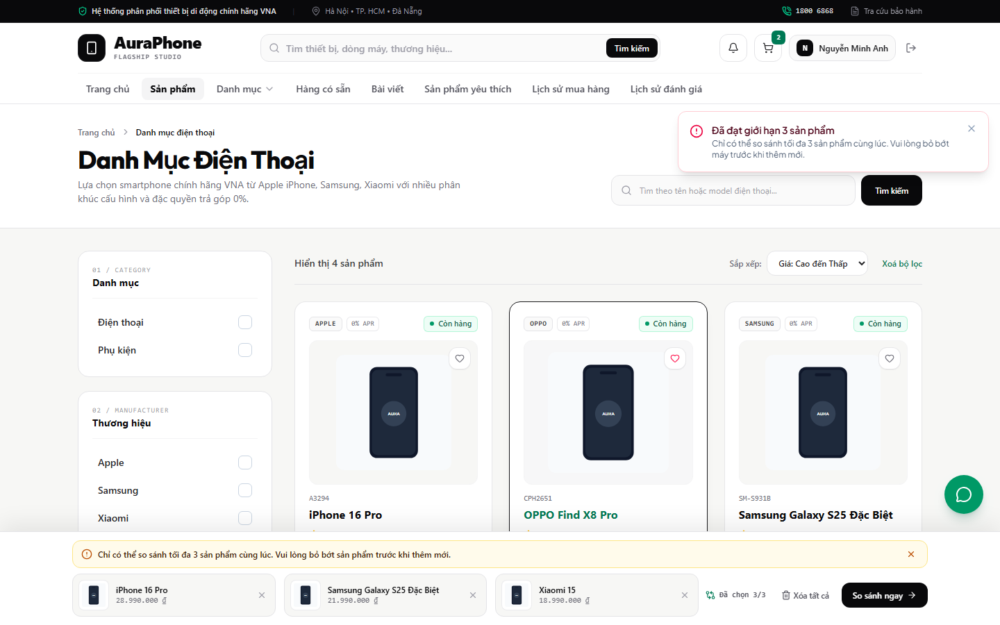
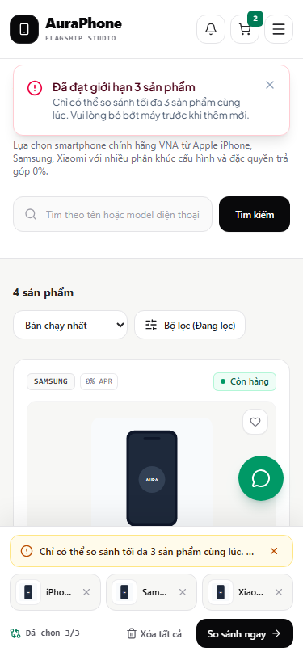
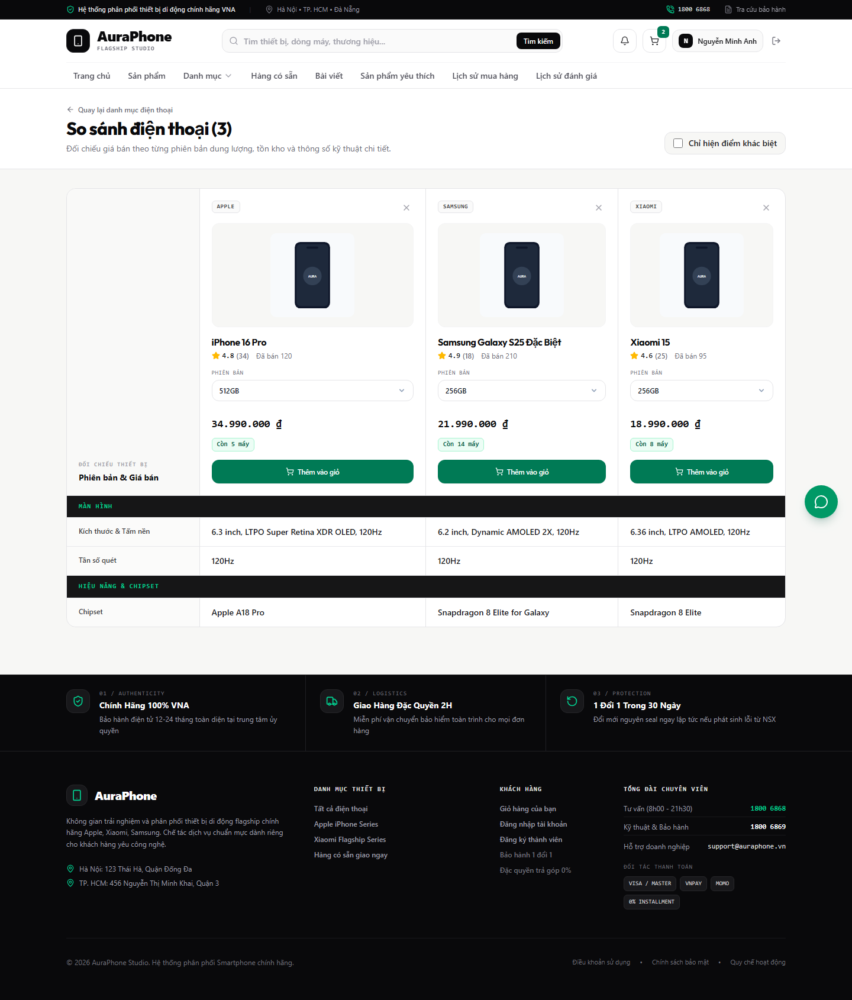
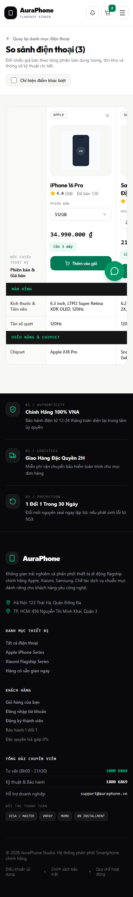

### Scenario 2: Flash Sale Countdown, Quota Progress & Structured Product Specs (`Req 2.4, 2.5, 7.6`)
- Verified active Flash Sale section on `/` (`Deal Chớp Nhoáng 12H`, live countdown, `25.990.000 ₫` vs `28.990.000 ₫`, `"Đã bán 12/20"`) on desktop `1440x900` and mobile `375x812`.
- Verified `/products/:id` displays the Flash Sale box for the discounted `256GB` variant alongside structured `specs` (`Màn hình`, `Hiệu năng & Chipset`), and hides the Flash Sale box when switching to `512GB` (`34.990.000 ₫`).

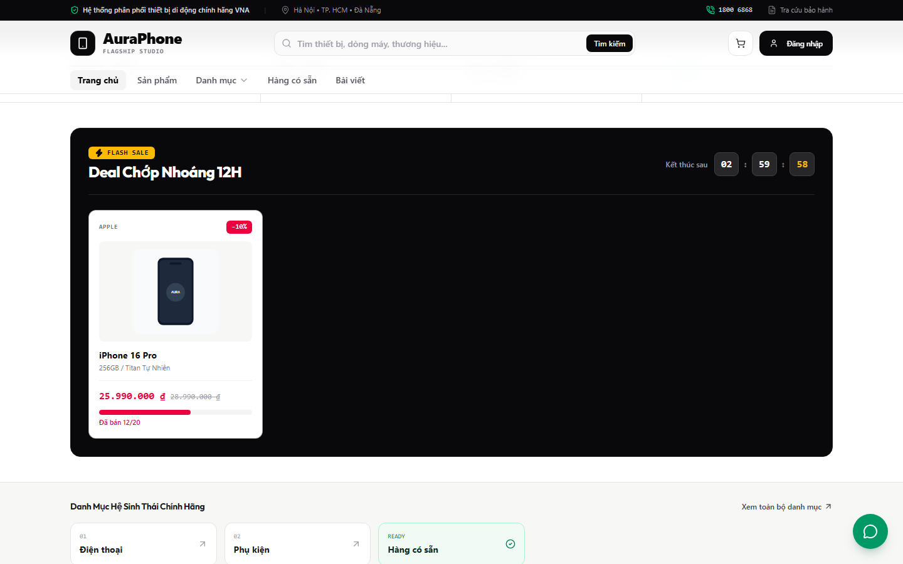
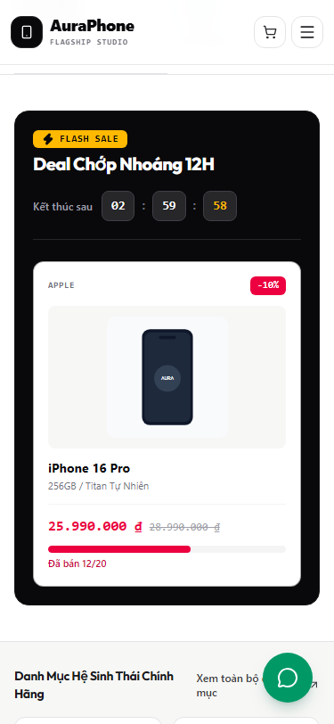
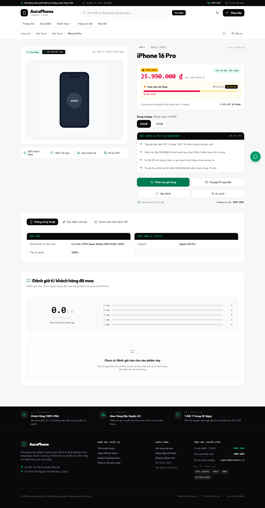

### Scenario 3: Email OTP Password Recovery Flow (`Req 3.5, 7.6`)
- Navigated `/login` -> `"Quên mật khẩu?"` -> `/forgot-password`, requested OTP for `recovery@example.com`, transitioned to `/reset-password` with `60s` resend cooldown active, verified `400 invalid_or_expired_otp` alert on `000000`, then submitted valid OTP `025431` redirecting back to `/login` with confirmation banner.

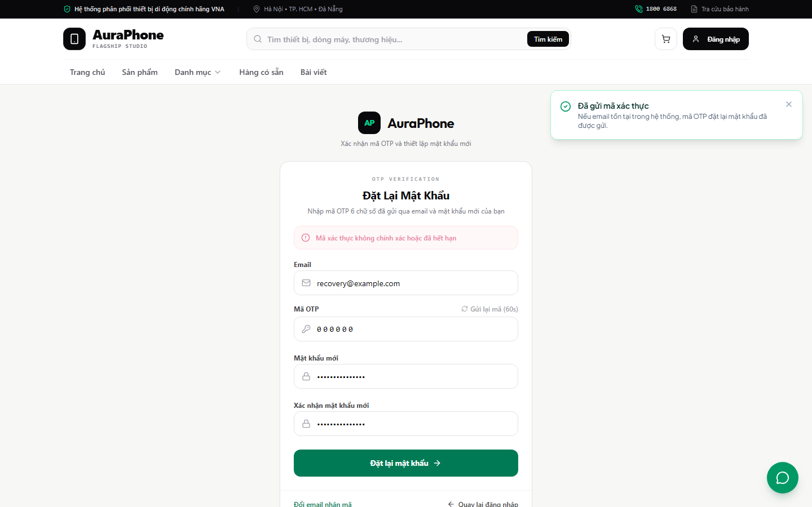

### Scenario 4: Checkout Express 2h vs Regional Lock, Vouchers, Realtime Order Timeline & Buy Again (`Req 1.3, 1.4, 4.5, 7.1, 7.5, 7.6`)
- On `/checkout`, verified Hà Nội (`provinceCode: 1`) enables `Giao hỏa tốc 2 giờ` (`60.000 ₫`), switching to Đà Nẵng (`provinceCode: 48`) disables `express_2h` and resets to `standard`, rejected manual invalid code `BADCODE` with Vietnamese error (`Mã giảm giá không tồn tại`), and applied `AURA10` (`-1.000.000 ₫`, final total `28.050.000 ₫`).
- Placed order -> `/orders/:id`: verified `OrderStepper`, `Giao hỏa tốc 2 giờ`, `Ahamove 2h`, copyable `AHA-20261118`, realtime WebSocket `notification:new` auto-refresh upgrading status to `delivered` (`Giao hàng thành công đến người nhận`) without reload, and `"Mua lại"` merging Flash Sale items into `/cart`.

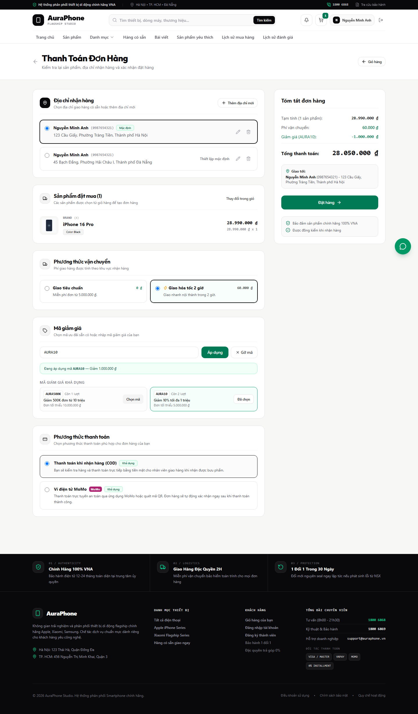
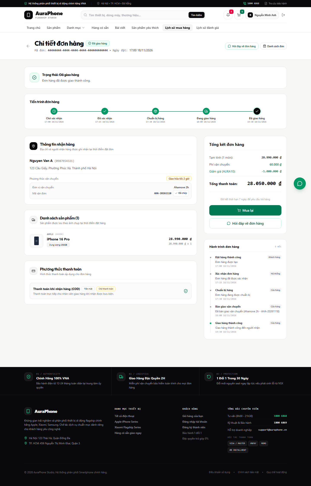
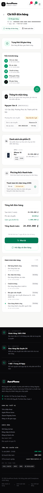
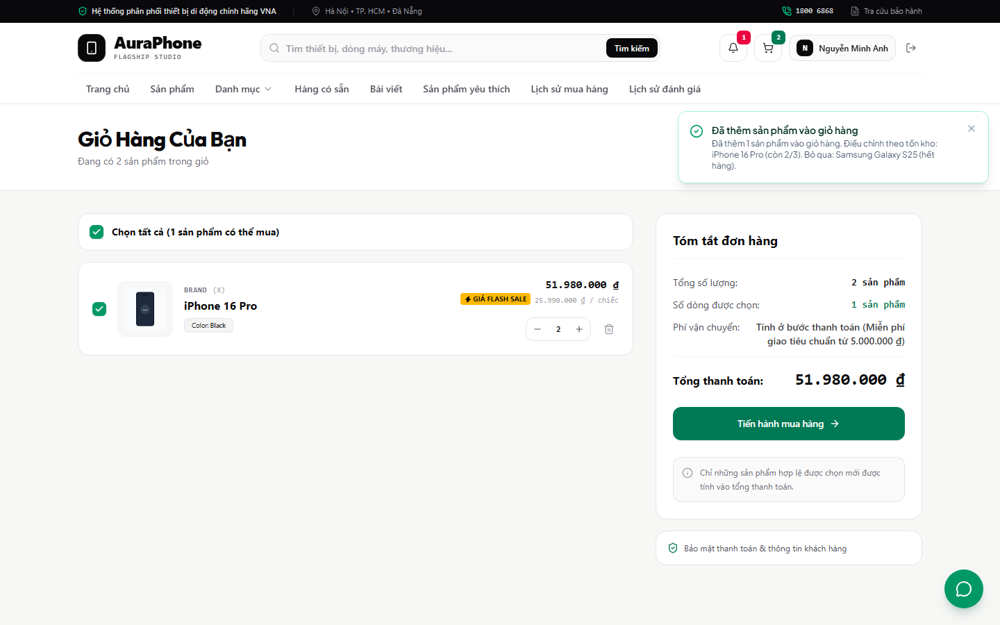

### Scenario 5: Admin Portal Product Media/Specs, Voucher CRUD, Flash Sale CRUD & Fulfillment (`Req 4.3, 5.2, 7.3, 7.5, 7.6`)
- `/products/new`: Uploaded multiple PNG images via Object Storage endpoint, verified `"Ảnh đại diện"` badge and primary image promotion (`Đặt ảnh 2 làm ảnh đại diện`), applied `"Áp dụng mẫu Điện thoại"` (6 standard spec groups), and created product (`201`).
- `/vouchers`: Created `TET2026`, toggled active state on `AURA10` (`PUT`), and deleted `TET2026` (`204`).
- `/flash-sales`: Created `Flash Sale Cuối Tuần` (`201`), edited `Deal Chớp Nhoáng 12H` (`PUT`), and deleted `Flash Sale Cuối Tuần` (`204`).
- `/orders/:id`: Triggered empty validation on `"Bàn giao vận chuyển"`, submitted `GHN` + `GHN-123456` (`POST .../ship`), then pushed WebSocket `notification:new` event refreshing `OrderStepper` & `OrderTimeline` (`delivered`) immediately.

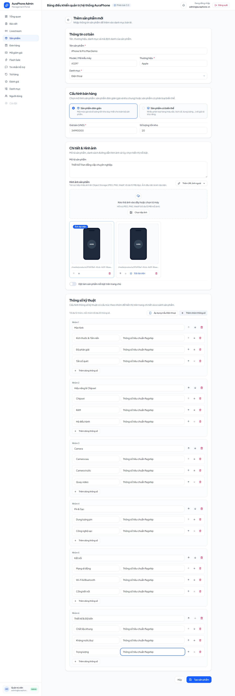
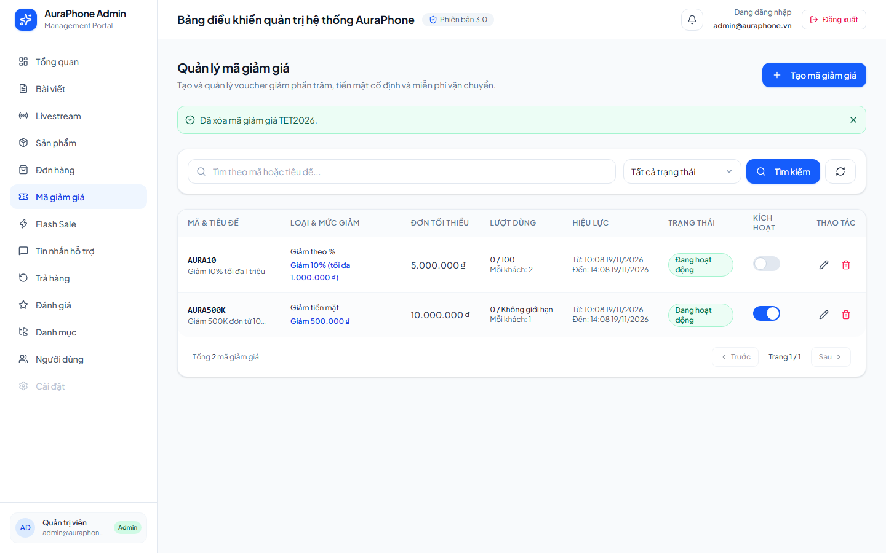
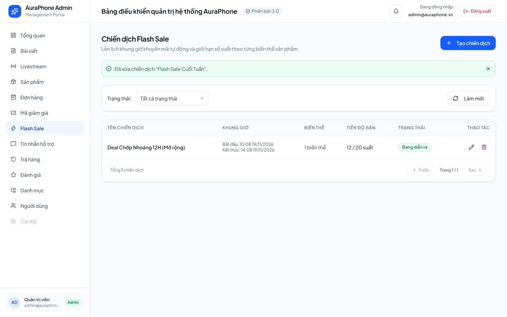
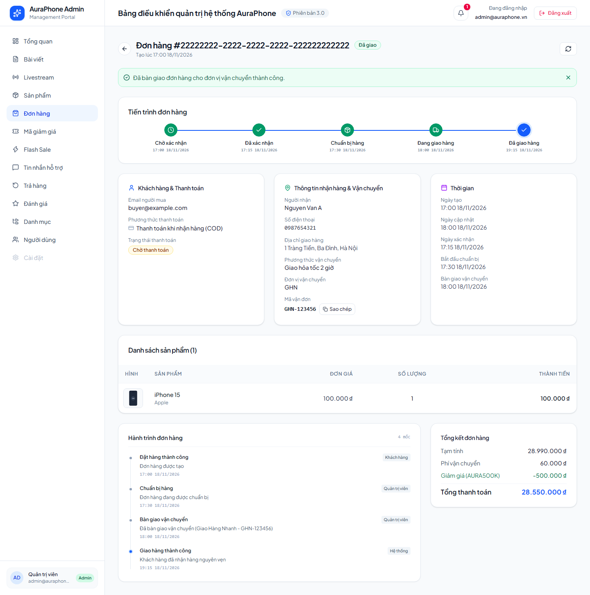

---

## Layout & Package Verification Summary

- **Layout Invariants:** All 16 captured states passed `scrollWidth <= innerWidth` (`1440x900` and `375x812`), zero broken `` elements (`naturalWidth > 0`), and `CompareTray` vs `ChatWidget` bounding-box non-overlap checks.
- **Root-Cause UI Fixes Applied During Visual Audit:**
  - `frontend/src/context/ToastContext.tsx`: Repositioned toast container from `bottom-4 right-4` (where toasts covered `CompareTray`'s `"So sánh ngay"` CTA and `ChatWidget`'s floating launcher) to `top-20 md:top-28 xl:top-40 right-4` below the sticky header, and added `aria-label="Đóng thông báo"`.
  - `frontend/src/pages/ComparePage.tsx`: Reduced mobile specification label column width (`w-28 sm:w-44 lg:w-56`) and table minimum widths (`min-w-[660px]` / `min-w-[500px]`) so the first product column and `"Thêm vào giỏ"` CTA remain unclipped at `375x812`.
- **Package Quality Gates (After Final Edits):**
  - `frontend/`: `npm run lint` (0 errors), `npm test` (71 files, 515 tests passed), `npm run build` (passed).
  - `frontend-admin/`: `npm run lint` (0 warnings/errors), `npm test` (52 files, 407 tests passed), `npm run build` (passed).
  - Playwright Mode 2 Suite (`frontend/`): 9/9 Mode 2 suites (47/47 tests) passed. *(Pre-existing unrelated WIP `admin-user-management.spec.ts` and Mode-1 `admin-review-reply.spec.ts` requiring `E2E_MODE=1` are outside this feature's Mode 2 scope.)*
