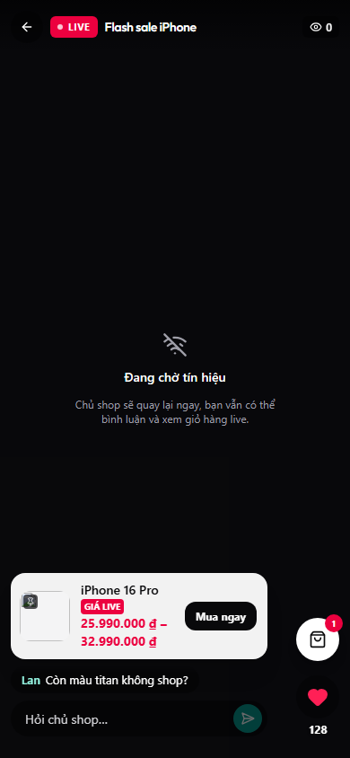
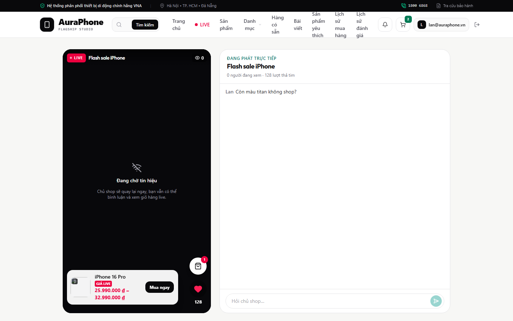

# E2E Verification Report — livestream-shopping

- **Status:** PASS
- **Execution Mode:** `Mode 2: Shape-Locked Mock E2E`
- **Evidence Level:** `mock-e2e` (frontend behaviour against backend-recorded response and frame shapes; backend behaviour is proven by the `unit`, `integration-db` and `handler` suites, not by this run)
- **Command:** `CI=1 npx playwright test e2e/livestream-shopping.spec.ts` (from `frontend/`; `CI=1` so Playwright starts its own dev servers instead of reusing any already running)
- **Result:** 4/4 passed; stable over `--repeat-each=3` (12/12)
- **Contracts Verified:** `API-LIVE-PUBLIC@1 (verifier)`, `WS-LIVE-ROOM@1 (verifier)`, `TYPE-LIVE@1 (verifier)`
- **Requirements Covered:** `3.1, 3.2, 3.7, 4.1, 6.1, 6.2`
- **Visual Criteria:** `3.7`

## Contract Shape Verification Matrix

| Contract | Endpoint / frame | Go handler & test source | Inbound request assertions | Outbound shape & state assertions |
|---|---|---|---|---|
| `API-LIVE-PUBLIC@1` | `GET /api/v1/live/current` | `live_handler.go` (`live_handler_test.go`, key `live_current_200`) | public, no bearer required | header LIVE link and home banner point to `/live/{id}` |
| `API-LIVE-PUBLIC@1` | `GET /api/v1/live/sessions/:id` | `live_handler.go` (`live_session_200`, `unauthenticated_401`) | `auth: 'bearer'`; without a token the recorded 401 is served | title, viewers, comments, pinned card and live cart render from the snapshot |
| `API-LIVE-PUBLIC@1` | `POST /api/v1/live/sessions/:id/comments` | `live_handler.go` (`live_comment_create_201`) | body checked against the recorded request `{content}` | comment shown, input cleared |
| `WS-LIVE-ROOM@1` | `live:viewers`, `live:signal`, `live:comment`, client `live:heart` | `livews` hub (`live_ws_test.go`, keys `ws_live_*`) | socket URL carries `token=`; client heart frames are `{type:'live:heart', payload:{count}}` and sum to the taps | recorded frames pushed by the mock room update viewers and comments |
| `TYPE-LIVE@1` | `GET /api/v1/products/:id` | `catalog_handler.go` (`live_pricing_handler_test.go`, key `product_detail_live_200`) | — | variant picker shows the live price and "Còn 7 suất giá live" |
| `TYPE-LIVE@1` | `POST /api/v1/cart/items` | `cart_handler.go` (`cart_add_item_200`) | body checked against the recorded `{variantId}` | toast "Đã thêm sản phẩm vào giỏ hàng"; the posted variant is the chosen live variant |

Endpoints outside the feature (auth, categories, cart, favourites, chat, notifications) are declared as stubs through `mountContractRoutes`. The WHEP URL answers 404 (no publisher) and `RTCPeerConnection` is replaced by an offline stub, so the player shows "Đang chờ tín hiệu".

## Scenario Walkthrough

### 1. LIVE entry → login → back to the live (`Req 3.1, 3.2`)
- A visitor on `/` sees the LIVE link and the "Xem ngay" banner pointing to `/live/11111111-…`.
- Opening it without a session redirects to `/login?redirect=%2Flive%2F…`; after logging in the visitor lands back on the live page, the room socket connects (viewer count from `ws_live_viewers`) and the player shows "Đang chờ tín hiệu".

### 2. Comments and hearts (`Req 4.1`)
- Posting "Còn size M không shop?" sends exactly `{content}` and shows the comment; the input is cleared.
- A `live:comment` frame from the room ("Chào cả nhà" by "Chủ shop") appears immediately.
- Two heart taps are sent to the room as batched `live:heart` frames totalling 2.

### 3. Live cart (`Req 6.1, 6.2`)
- The sheet lists the product with "Giá live", the live price and a product-name link opening in a new tab, while the live stage stays mounted.
- Choosing it loads the variant picker with "Còn 7 suất giá live"; "Thêm vào giỏ" posts the live variant and shows the success toast.

### 4. Vertical phone layout (`Req 3.7`, visual)
- At 390×844 the stage occupies the whole viewport (`y=0`, `390×844`); the heart and cart buttons pass Playwright's occlusion check (trial clicks).
- Desktop 1440×900 shows the 9:16 stage beside the comments panel.

## Defect found and fixed during this run
- On phones the storefront's floating chat button (`ChatWidget`, `fixed bottom-6 right-6 z-50`) covered the heart button. Confirmed by the occlusion check failing with "… Mở khung trò chuyện hỗ trợ … intercepts pointer events". Fix: `AppContent` no longer renders `ChatWidget` on `/live/*`. Unit suite (56 files / 403 tests), `tsc -b` and this E2E suite pass after the fix.

## Related regression check
- `e2e/review-history.spec.ts` (gains a `/api/v1/live/current` layout stub): 7 passed, 1 failed — "Mobile drawer … 320x720 without horizontal overflow". The same test fails identically on the base commit `bc557e2` (checked in a separate baseline worktree), so it is pre-existing and unrelated to this feature.
