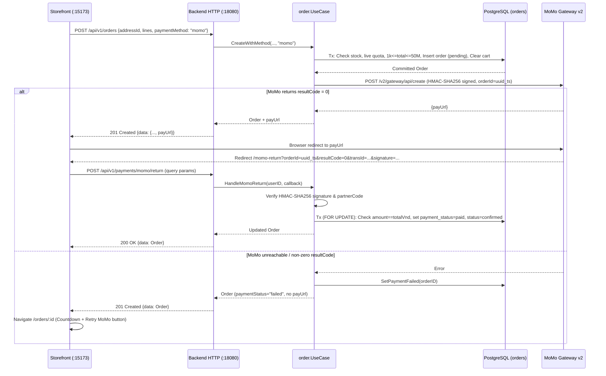

# Tài liệu Thiết kế Kỹ thuật (Design Document)

## Tổng quan (Overview)

Tài liệu này thiết kế kiến trúc, hợp đồng chia sẻ ranh giới, mô hình dữ liệu, xử lý lỗi và chiến lược kiểm chứng cho tính năng **Thanh toán trực tuyến qua Ví MoMo (`momo-payment`)**, bao phủ toàn bộ các tiêu chí chấp nhận `1.1`–`6.2` trong `requirements.md`.

Các quyết định kỹ thuật trọng tâm (`TD-*`):

- **TD-1 (Không giữ khóa cơ sở dữ liệu qua lời gọi mạng ra ngoài):** Trong `POST /api/v1/orders` với `paymentMethod = "momo"`, việc kiểm tra tồn kho, giá sản phẩm, suất giá Livestream và hạn mức MoMo (`1.000 <= totalVnd <= 50.000.000`) diễn ra bên trong giao dịch PostgreSQL và commit ngay với `status = 'pending_confirmation'`, `payment_status = 'pending'`. Sau khi giải phóng toàn bộ khóa dòng, tầng UseCase mới gọi HTTP tới cổng MoMo v2 để lấy `payUrl`; nếu cổng MoMo lỗi mạng hoặc từ chối, UseCase cập nhật `payment_status = 'failed'` và vẫn trả HTTP `201` (không kèm `payUrl`) để Storefront điều hướng khách sang `/orders/:id` bấm **Thanh toán lại**.
- **TD-2 (Dùng chung lõi xác thực HMAC-SHA256 và cập nhật Idempotent cho cả Redirect Return lẫn Webhook IPN):** Cả `POST /api/v1/payments/momo/return` (do trình duyệt gọi từ `/momo-return` trong môi trường dev chưa có public tunnel) và `POST /api/v1/payments/momo/ipn` (do máy chủ MoMo gọi trực tiếp) đều đi qua cùng một hàm xác thực chữ ký phản hồi MoMo v2 bằng `hmac.Equal` (constant-time) và cùng một phương thức giao dịch `ApplyMomoCallback` có `SELECT ... FOR UPDATE`. Nhờ vậy luồng Redirect đóng vai trò như callback IPN thực thụ khi dev mà không mở lỗ hổng giả mạo trạng thái thanh toán, đồng thời an toàn tuyệt đối khi cả hai luồng cùng gọi về một đơn hàng.
- **TD-3 (Định danh giao dịch MoMo `<orderUUID>_<unixMilli>`):** MoMo v2 yêu cầu `orderId` và `requestId` duy nhất cho mỗi lượt tạo liên kết thanh toán. Hệ thống ghép `<order.ID>_<time.Now().UnixMilli()>` (dài ~50 ký tự, nằm gọn trong giới hạn 100 ký tự của MoMo v2) khi tạo mới hoặc thanh toán lại, và tách phần trước dấu `_` đầu tiên khi nhận callback để ánh xạ về `orders.id` gốc.
- **TD-4 (Bảo toàn tương thích ngược cho interface `domain.OrderRepository` và `order.UseCase`):** Giữ nguyên chữ ký `OrderRepository.Create` và `order.UseCase.Create` hiện hữu (mặc định `paymentMethod = "cod"`), bổ sung optional interface `domain.MomoOrderRepository` trên `*repository.OrderRepository` để toàn bộ các fake/mock repository trong bộ test hiện có tiếp tục biên dịch và chạy xanh không cần chỉnh sửa hàng loạt.
- **TD-5 (Phân tách rõ tiến trình nền `AutoConfirmDue`):** Cập nhật truy vấn tự động xác nhận đơn chỉ áp dụng cho `payment_method = 'cod'`, đồng thời bổ sung bước quét các đơn `payment_method = 'momo'` có `status = 'pending_confirmation'`, `payment_status IN ('pending', 'failed')` và `created_at <= cutoff` bằng `FOR UPDATE SKIP LOCKED` để hủy đơn, hoàn lại tồn kho biến thể, hoàn lại suất giá Livestream và phát thông báo `order_payment_expired` tới khách hàng.
- **TD-6 (Chế độ kiểm thử trình duyệt):** Khóa chế độ kiểm thử E2E ở **`Mode 2: Shape-Locked Mock E2E`** (`mock-e2e` & `visual`) sử dụng `.dream/specs/momo-payment/contract-snapshots.json` kết hợp `mountContractRoutes` để kiểm chứng toàn trình luồng Checkout -> MoMo Return -> Order Detail / Retry Payment trên Storefront (`:15173`) và hiển thị thông tin thanh toán trên Admin Portal (`:15174`).

### Các phương án kiến trúc đã cân nhắc

| Vấn đề | Phương án A | Phương án B | Lựa chọn & Lý do |
|---|---|---|---|
| **Lưu trữ thông tin thanh toán** | Tạo bảng riêng `payments` (1–N theo mỗi lượt retry) | Bổ sung các cột `payment_status`, `payment_transaction_id`, `paid_at` trực tiếp trên bảng `orders` | **Chọn Phương án B:** Mỗi đơn hàng chỉ có tối đa một giao dịch thanh toán thành công; lưu trực tiếp trên `orders` giúp khóa dòng nguyên tử cùng `orders.status`, không cần JOIN thêm trên mọi truy vấn danh sách đơn hàng của Customer/Admin và tuân thủ nguyên tắc YAGNI. |
| **Truyền `payUrl` khi đặt đơn MoMo** | Tách endpoint riêng `POST /api/v1/orders/momo` có cấu trúc response khác `POST /api/v1/orders` | Mở rộng `POST /api/v1/orders` nhận `paymentMethod` tùy chọn và thêm trường `payUrl,omitempty` trực tiếp trên `Order` JSON | **Chọn Phương án B:** Tái sử dụng trọn vẹn luồng kiểm tra địa chỉ, giỏ hàng, tồn kho, giá Livestream và giữ hợp đồng `Order` thống nhất cho cả tạo mới lẫn thanh toán lại. |

---

## Kiến trúc & Luồng Dữ liệu (Architecture)



---

## Thành phần & Giao diện (Components And Interfaces)

#### Contract CONFIG-MOMO (rev 1)

- **Chủ sở hữu:** `backend/internal/config/config.go`, `backend/.env`, `backend/.env.example`.
- **Các khóa cấu hình nạp qua Viper (biến môi trường tiến trình ghi đè `.env`):**

| Biến môi trường | Trường trong `config.Config` | Mặc định khi trống | Ràng buộc xác thực lúc khởi động | Giá trị cấu hình trong `backend/.env` (từ `DacSanSocTrang`) |
|---|---|---|---|---|
| `MOMO_PARTNER_CODE` | `MomoPartnerCode string` | `"MOMO"` | Chuỗi đã cắt khoảng trắng | `MOMO` |
| `MOMO_ACCESS_KEY` | `MomoAccessKey string` | `""` | Chuỗi đã cắt khoảng trắng (bắt buộc khác rỗng khi gọi cổng MoMo) | `F8BBA842ECF85` |
| `MOMO_SECRET_KEY` | `MomoSecretKey string` | `""` | Chuỗi đã cắt khoảng trắng; **tuyệt đối không ghi ra `slog`** | `K951B6PE1waDMi640xX08PD3vg6EkVlz` |
| `MOMO_ENDPOINT` | `MomoEndpoint string` | `"https://test-payment.momo.vn/v2/gateway/api/create"` | URL tuyệt đối có scheme `http` hoặc `https` (`httpURLSetting`) | `https://test-payment.momo.vn/v2/gateway/api/create` |
| `MOMO_REDIRECT_URL` | `MomoRedirectURL string` | `"http://localhost:15173/momo-return"` | URL tuyệt đối có scheme `http` hoặc `https` (`httpURLSetting`) | `http://localhost:15173/momo-return` |
| `MOMO_IPN_URL` | `MomoIPNURL string` | `"http://localhost:18080/api/v1/payments/momo/ipn"` | URL tuyệt đối có scheme `http` hoặc `https` (`httpURLSetting`) | `http://localhost:18080/api/v1/payments/momo/ipn` |
| `MOMO_REQUEST_TYPE` | `MomoRequestType string` | `"payWithMethod"` | Chuỗi đã cắt khoảng trắng | `payWithMethod` |
| `MOMO_PARTNER_NAME` | `MomoPartnerName string` | `"Test"` | Chuỗi đã cắt khoảng trắng | `Test` |
| `MOMO_STORE_ID` | `MomoStoreID string` | `"MomoTestStore"` | Chuỗi đã cắt khoảng trắng | `MomoTestStore` |

---

#### Contract API-MOMO-GATEWAY (rev 1)

- **Chủ sở hữu:** Adapter hạ tầng `backend/internal/payment/momo` cài đặt interface `domain.MomoGateway`:
  ```go
  type MomoCreateInput struct {
      OrderID   string
      AmountVND int64
      OrderInfo string
  }

  type MomoCallbackPayload struct {
      PartnerCode  string
      OrderID      string
      RequestID    string
      Amount       string
      OrderInfo    string
      OrderType    string
      TransID      string
      ResultCode   int
      Message      string
      PayType      string
      ResponseTime string
      ExtraData    string
      Signature    string
  }

  type MomoGateway interface {
      CreatePaymentURL(ctx context.Context, input MomoCreateInput) (payURL string, err error)
      VerifyCallbackSignature(payload MomoCallbackPayload) bool
  }
  ```
- **Quy tắc ký số Request tạo liên kết (`POST MOMO_ENDPOINT`, timeout HTTP 15 giây):**
  - `momoOrderID = fmt.Sprintf("%s_%d", input.OrderID, nowUnixMilli)` và `requestID = momoOrderID`, `extraData = ""`, `autoCapture = true`, `lang = "vi"`.
  - Chuỗi `rawSignature` (sắp xếp đúng thứ tự khóa a–z chuẩn MoMo v2):
    ```text
    accessKey=<accessKey>&amount=<amount>&extraData=<extraData>&ipnUrl=<ipnUrl>&orderId=<momoOrderID>&orderInfo=<orderInfo>&partnerCode=<partnerCode>&redirectUrl=<redirectUrl>&requestId=<requestID>&requestType=<requestType>
    ```
  - `signature = hex(HMAC_SHA256(secretKey, rawSignature))`.
  - Body JSON gửi MoMo: `{partnerCode, partnerName, storeId, requestId, amount (int64), orderId, orderInfo, redirectUrl, ipnUrl, lang: "vi", requestType, autoCapture: true, extraData: "", orderGroupId: "", signature}`.
  - Phản hồi MoMo hợp lệ khi HTTP `200` và `resultCode == 0` kèm `payUrl != ""`.
- **Quy tắc xác thực chữ ký Callback (dùng chung cho Redirect Return và IPN):**
  - Kiểm tra `payload.PartnerCode == cfg.MomoPartnerCode`, `cfg.MomoAccessKey != ""`, `cfg.MomoSecretKey != ""` và `payload.Signature != ""`.
  - Chuỗi `rawSignature` phản hồi chuẩn MoMo v2:
    ```text
    accessKey=<cfg.MomoAccessKey>&amount=<Amount>&extraData=<ExtraData>&message=<Message>&orderId=<OrderID>&orderInfo=<OrderInfo>&orderType=<OrderType>&partnerCode=<PartnerCode>&payType=<PayType>&requestId=<RequestID>&responseTime=<ResponseTime>&resultCode=<ResultCode>&transId=<TransID>
    ```
  - So sánh chữ ký bằng `hmac.Equal([]byte(strings.ToLower(payload.Signature)), []byte(expectedHex))`.

---

#### Contract API-ORDER-MOMO (rev 1)

Tuân thủ Full Status Envelope của `/api/v1` (riêng IPN trả `204 No Content` khi thành công):

1. **Tạo đơn hàng (`POST /api/v1/orders`, `guard.AuthRequired`):**
   - **Request Body:**
     ```json
     {
       "addressId": "uuid",
       "paymentMethod": "cod | momo",
       "lines": [
         {
           "variantId": "uuid",
           "quantity": 1,
           "productName": "string",
           "unitPriceVnd": "3190000"
         }
       ]
     }
     ```
     - `paymentMethod` tùy chọn; nếu rỗng hoặc không gửi -> mặc định `"cod"`. Nếu khác `"cod"` và `"momo"` -> HTTP `400` (`validation_error`, `error.fields.paymentMethod = "Phương thức thanh toán không hợp lệ"`).
   - **Lỗi hạn mức MoMo:** Khi `paymentMethod == "momo"` và `totalVnd < 1000` hoặc `totalVnd > 50000000` -> HTTP `409`, `error.code = "momo_amount_out_of_range"`, `message = "Cổng thanh toán MoMo chỉ hỗ trợ đơn hàng từ 1.000 ₫ đến 50.000.000 ₫"`.
   - **Phản hồi thành công (`201 Created`):** `data` là đối tượng `Order` (theo `TYPE-ORDER-PAYMENT@1`). Với `"momo"`: chứa `payUrl` nếu tạo link thành công, hoặc `paymentStatus = "failed"` (không có `payUrl`) nếu cổng MoMo lỗi kết nối sau khi tạo đơn.

2. **Thanh toán lại đơn hàng MoMo (`POST /api/v1/orders/:id/momo/retry`, `guard.AuthRequired`):**
   - **Điều kiện hợp lệ:** Đơn thuộc `callerUserID` (không khớp hoặc không tồn tại -> HTTP `404 order_not_found`); `paymentMethod == "momo"`, `status == "pending_confirmation"`, `paymentStatus` thuộc `{"pending", "failed"}` và `now <= createdAt + ORDER_CONFIRM_TIMEOUT` (vi phạm bất kỳ điều kiện nào -> trả `domain.ErrPaymentRetryNotAllowed` ánh xạ HTTP `409`, `error.code = "payment_retry_not_allowed"`, `message = "Đơn hàng không đủ điều kiện để thanh toán lại qua MoMo"`).
   - **Xử lý:** Gọi `MomoGateway.CreatePaymentURL`; nếu cổng MoMo lỗi -> trả HTTP `502`, `error.code = "momo_gateway_error"`, `message = "Không thể kết nối cổng thanh toán MoMo. Vui lòng thử lại sau."`; nếu thành công -> đặt `paymentStatus = "pending"` (nếu trước đó là `"failed"`) và trả HTTP `200 OK` với `data` là `Order` kèm `payUrl` mới.

3. **Xác nhận kết quả từ Redirect URL (`POST /api/v1/payments/momo/return`, `guard.AuthRequired`):**
   - **Request Body:** Các tham số từ URL `/momo-return` (chấp nhận số hoặc chuỗi cho `amount`, `resultCode`, `transId`, `responseTime` để tương thích đồng nhất):
     ```json
     {
       "partnerCode": "MOMO",
       "orderId": "<orderUUID>_<timestamp>",
       "requestId": "<orderUUID>_<timestamp>",
       "amount": "3190000",
       "orderInfo": "string",
       "orderType": "string",
       "transId": "4088812345",
       "resultCode": 0,
       "message": "Thành công.",
       "payType": "qr",
       "responseTime": "1763281800000",
       "extraData": "",
       "signature": "hex-hmac-sha256"
     }
     ```
   - **Xác thực & kết quả:**
     - Sai chữ ký, sai `partnerCode`, sai định dạng `orderId`, hoặc `amount != order.totalVnd` -> HTTP `400`, `error.code = "invalid_momo_callback"`.
     - Không tìm thấy đơn hoặc đơn không thuộc `callerUserID` -> HTTP `404`, `error.code = "order_not_found"`.
     - Hợp lệ -> áp dụng cập nhật idempotent và trả HTTP `200 OK` với `data` là đối tượng `Order` mới nhất.

4. **Webhook IPN từ máy chủ MoMo (`POST /api/v1/payments/momo/ipn`, không yêu cầu JWT, xác thực bằng chữ ký HMAC-SHA256):**
   - Nhận cùng cấu trúc payload phản hồi chuẩn MoMo v2 như mục 3.
   - Nếu chữ ký không hợp lệ, đơn không tồn tại hoặc `amount != order.totalVnd` -> HTTP `400`, `error.code = "invalid_momo_callback"`.
   - Nếu hợp lệ -> thực thi cùng logic cập nhật idempotent (kèm phát thông báo nếu đơn vừa chuyển sang `confirmed`) và phản hồi HTTP `204 No Content` (body rỗng).

---

#### Contract TYPE-ORDER-PAYMENT (rev 1)

- **Kiểu dữ liệu dùng chung (`frontend/src/api/types.ts`, `frontend-admin/src/api/types.ts`, `orderResponse`, `adminOrderResponse`):**
  ```ts
  export type PaymentMethod = 'cod' | 'momo'
  export type PaymentStatus = 'pending' | 'paid' | 'failed' | 'refunded'
  ```
- **Các trường bổ sung trên `Order` JSON (cả API khách hàng `/api/v1/orders*` và Admin `/api/v1/admin/orders*`):**
  - `paymentMethod`: `'cod' | 'momo'` trên JSON wire payload từ backend (trên interface TypeScript `Order` khai báo `paymentMethod: PaymentMethod | (string & {})` và `paymentStatus?: PaymentStatus` với fallback hiển thị `'pending'` để không làm gãy `tsc -b` trên các fixture kiểm thử cũ ngoài phạm vi task).
  - `paymentStatus`: `'pending' | 'paid' | 'failed' | 'refunded'` (luôn hiện diện trên mọi JSON wire payload từ backend)
  - `paymentTransactionId?: string` (`omitempty`, có giá trị khi MoMo đã trả `transId`)
  - `paidAt?: string` (ISO 8601 UTC, `omitempty`, có giá trị khi đã thu tiền)
  - `payUrl?: string` (`omitempty`, chỉ trả trên phản hồi `POST /api/v1/orders` và `POST /api/v1/orders/:id/momo/retry` của khách hàng)
- **Mở rộng loại thông báo đơn hàng (`NotificationType`):**
  - Tái sử dụng `order_confirmed` khi thanh toán MoMo thành công (`excerpt`: `"Thanh toán MoMo thành công. Đơn hàng #XXXXXXXX đã được xác nhận."`).
  - Bổ sung `order_payment_expired` (`category = "order"`, `actorId = null`, `metadata: {orderId, orderShortCode, status: "cancelled", totalVnd, targetPath: "/orders/<orderId>"}`, `excerpt`: `"Đơn hàng #XXXXXXXX đã tự động hủy do quá thời hạn thanh toán MoMo."`).

---

### Tổ chức Thành phần theo Gói

1. **Backend (`backend/`):**
   - `internal/payment/momo/client.go`: Cài đặt `domain.MomoGateway` sử dụng `net/http.Client` chuẩn với timeout `15s`, ký và kiểm tra HMAC-SHA256, không log `MomoSecretKey`.
   - `internal/domain/order.go` & `errors.go` & `notification.go`: Bổ sung `PaymentMethodMomo = "momo"`, `PaymentStatus` (`pending`, `paid`, `failed`, `refunded`), các trường trên `domain.Order`, `domain.MomoGateway`, `domain.MomoOrderRepository`, các sentinel error (`ErrMomoAmountOutOfRange`, `ErrMomoInvalidCallback`, `ErrMomoGateway`, `ErrPaymentRetryNotAllowed`), và `NotifyOrderMomoPaid` / `NotifyOrderPaymentExpired` (qua interface mở rộng hoặc method trên `notification.Service`).
   - `internal/usecase/order/order.go`: Điều phối `CreateWithMethod`, `RetryMomoPayment`, `HandleMomoReturn`, `HandleMomoIPN` và mở rộng `AutoConfirmDue`.
   - `internal/delivery/http/order_handler.go`, `payment_handler.go` (hoặc trên `orderHandler`), `admin_order_handler.go`, `error.go`, `router.go`, `cmd/server/{app,wire,wire_gen}.go`: Ánh xạ DTO, mã lỗi tiếng Việt và đăng ký Wire provider cho `momo.Client`.

2. **Storefront (`frontend/`):**
   - `src/api/types.ts` & `src/api/orders.ts`: Bổ sung `PaymentMethod`, `PaymentStatus`, `retryMomoPayment(orderId)` và `confirmMomoReturn(payload)`.
   - `src/pages/CheckoutPage.tsx`: Vùng chọn Radio giữa `Thanh toán khi nhận hàng (COD)` và `Ví điện tử MoMo` (tự động vô hiệu hóa lựa chọn MoMo kèm giải thích nếu `totalVnd` ngoài khoảng `1.000 ₫ – 50.000.000 ₫`); điều hướng `window.location.assign(order.payUrl)` khi có `payUrl` hoặc `navigate('/orders/' + order.id)` kèm toast cảnh báo nếu cổng MoMo lỗi lúc tạo link.
   - `src/pages/MomoReturnPage.tsx` (đăng ký route `/momo-return` trong `src/App.tsx`): Đọc `useSearchParams`, đợi `AuthContext` hoàn tất khôi phục phiên (`!authLoading`), dùng `useRef` gọi `ordersApi.confirmMomoReturn` đúng 1 lần, gọi `refreshCart()`, và hiển thị giao diện kết quả thành công/thất bại rõ ràng theo ngôn ngữ thiết kế editorial.
   - `src/pages/OrderHistoryPage.tsx` & `src/pages/OrderDetailPage.tsx`: Hiển thị nhãn phương thức thanh toán, huy hiệu `paymentStatus` tiếng Việt, mã giao dịch `paymentTransactionId`, đồng hồ đếm ngược thời hạn thanh toán và nút **Thanh toán lại qua MoMo** khi đủ điều kiện.
   - `src/components/notifications/NotificationBell.tsx` & `src/api/posts.ts`: Hỗ trợ hiển thị nhãn cho `order_payment_expired`.

3. **Admin Portal (`frontend-admin/`):**
   - `src/api/types.ts`, `src/pages/OrdersPage.tsx`, `src/pages/AdminOrderDetailPage.tsx`: Hiển thị phương thức thanh toán (`COD` / `Ví điện tử MoMo`), huy hiệu trạng thái thanh toán tiếng Việt, mã giao dịch MoMo và thời điểm thanh toán `paidAt`.

---

## Mô hình Dữ liệu & Migration (Data Models)

#### Contract DB-MOMO-PAYMENT (rev 1)

- **Tệp migration:** `backend/db/migrations/000024_add_momo_payment.up.sql` và `000024_add_momo_payment.down.sql`.
- **Thay đổi lược đồ trên bảng `orders`:**
  ```sql
  ALTER TABLE orders DROP CONSTRAINT IF EXISTS orders_payment_method_check;
  ALTER TABLE orders ADD CONSTRAINT orders_payment_method_check
      CHECK (payment_method IN ('cod', 'momo'));

  ALTER TABLE orders
      ADD COLUMN payment_status text NOT NULL DEFAULT 'pending'
          CONSTRAINT orders_payment_status_check
          CHECK (payment_status IN ('pending', 'paid', 'failed', 'refunded')),
      ADD COLUMN payment_transaction_id text NULL,
      ADD COLUMN paid_at timestamptz NULL;

  UPDATE orders
  SET payment_status = 'paid',
      paid_at = COALESCE(delivered_at, updated_at)
  WHERE status IN ('delivered', 'partially_returned');

  UPDATE orders
  SET payment_status = 'refunded',
      paid_at = COALESCE(delivered_at, updated_at)
  WHERE status = 'returned';

  CREATE INDEX orders_pending_payment_timeout_idx
      ON orders (payment_method, created_at)
      WHERE status = 'pending_confirmation';
  ```
- **Bảng chuyển trạng thái `payment_status`:**
  - Tạo đơn mới (`cod` hoặc `momo`): `'pending'`.
  - Gọi cổng MoMo tạo link lúc đặt đơn thất bại, hoặc callback MoMo trả `resultCode != 0` khi đang `'pending'`, hoặc đơn `momo` hết hạn 30 phút tự động hủy: `'failed'`.
  - Khách bấm `POST /api/v1/orders/:id/momo/retry` lấy được `payUrl` mới: `'pending'`.
  - Callback MoMo hợp lệ với `resultCode == 0` (trên đơn `momo` đang `'pending_confirmation'`): `'paid'`, ghi `payment_transaction_id`, `paid_at = now()`, đồng thời chuyển `orders.status = 'confirmed'`, `confirmed_at = now()`.
  - Admin đánh dấu `deliver` cho đơn `'cod'`: `'paid'`, `paid_at = now()`.
  - Mọi đơn hàng đang có `payment_status = 'paid'` chuyển sang `status = 'cancelled'` (khách tự hủy ở `'confirmed'` hoặc Admin duyệt hủy từ `'cancel_requested'`) hoặc chuyển sang `status = 'returned'` (Admin hoàn tiền trả hàng toàn bộ qua `ReturnRepository.RefundAdmin`, áp dụng đồng nhất cho cả đơn `'momo'` lẫn `'cod'` đã giao): `'refunded'`.

---

## Xử lý Lỗi & Quan sát Hệ thống (Error Handling)

| Tình huống lỗi | Domain Error | HTTP Status | `error.code` | Thông điệp tiếng Việt (User-facing) |
|---|---|---|---|---|
| `paymentMethod` ngoài `cod`, `momo` | `*domain.ValidationError` | `400` | `validation_error` | `Dữ liệu không hợp lệ` (`fields.paymentMethod`) |
| Chữ ký MoMo sai, `partnerCode` lệch, `orderId` sai định dạng hoặc `amount != totalVnd` | `domain.ErrMomoInvalidCallback` | `400` | `invalid_momo_callback` | `Dữ liệu xác thực thanh toán MoMo không hợp lệ` |
| Tổng đơn MoMo `< 1.000` hoặc `> 50.000.000` VNĐ | `domain.ErrMomoAmountOutOfRange` | `409` | `momo_amount_out_of_range` | `Cổng thanh toán MoMo chỉ hỗ trợ đơn hàng từ 1.000 ₫ đến 50.000.000 ₫` |
| Retry thanh toán cho đơn không phải MoMo, đã thanh toán, đã hủy/xác nhận hoặc quá hạn 30 phút | `domain.ErrPaymentRetryNotAllowed` | `409` | `payment_retry_not_allowed` | `Đơn hàng không đủ điều kiện để thanh toán lại qua MoMo` |
| Lỗi kết nối / cổng MoMo từ chối khi bấm Thanh toán lại | `domain.ErrMomoGateway` | `502` | `momo_gateway_error` | `Không thể kết nối cổng thanh toán MoMo. Vui lòng thử lại sau.` |
| Đơn không tồn tại hoặc không thuộc khách hàng gọi API | `domain.ErrOrderNotFound` | `404` | `order_not_found` | `Không tìm thấy đơn hàng` |

- **Bảo mật log (`slog`):** Mọi bản ghi log tại `momo.Client`, `order.UseCase` và `payment_handler` chỉ được phép ghi `order_id`, `momo_order_id`, `result_code`, `trans_id`, `http_status`; nghiêm cấm ghi `MomoSecretKey`, `rawSignature` chứa khóa, JWT hay `DB_URL`.

---

## Chiến lược Kiểm thử & Xác minh (Testing Strategy)

Chế độ thực thi E2E cho tính năng này được khóa ở: **`Mode 2: Shape-Locked Mock E2E`**.

- **`unit`:**
  - `backend/internal/config/config_test.go`: Kiểm chứng nạp 9 biến `MOMO_*`, độ ưu tiên biến môi trường tiến trình so với `.env`, mặc định hợp lệ và từ chối URL sai định dạng (`1.1`, `1.2`).
  - `backend/internal/payment/momo/client_test.go`: Kiểm chứng sinh `rawSignature` & HMAC-SHA256 khi tạo link (`httptest.Server` giả lập cổng MoMo), tách `<orderUUID>_<timestamp>`, xác thực chữ ký callback hợp lệ/giả mạo, và kiểm tra output `slog` không rò rỉ `MomoSecretKey` (`1.3`, `2.2`, `3.1`, `3.2`).
  - `backend/internal/usecase/order/order_test.go`: Kiểm chứng `CreateWithMethod` (`cod` mặc định, `momo` thành công trả `payUrl`, `momo` khi gateway lỗi đánh dấu `failed` vẫn trả đơn, từ chối ngoài hạn mức), `RetryMomoPayment` (còn hạn vs hết hạn/sai trạng thái/lỗi gateway), `HandleMomoReturn` & `HandleMomoIPN` (thành công chuyển `confirmed` + bắn thông báo 1 lần, thất bại chuyển `failed`, lặp lại idempotent), và `AutoConfirmDue` tách biệt `cod` vs `momo`.
- **`integration-db`:**
  - `backend/internal/repository/order_repository_test.go` (và tích hợp trả hàng): Kiểm chứng migration `000024` (up/down, backfill, check constraints), kiểm tra hạn mức MoMo trước khi chạm tồn kho/giỏ hàng, `ApplyMomoCallback` khóa dòng nguyên tử chống đua tranh (`FOR UPDATE`), `AutoConfirmDueOrdersReturning` chỉ xác nhận đơn `cod`, `AutoCancelExpiredMomoOrders` hủy đơn `momo` quá hạn + hoàn kho + hoàn suất giá Livestream, cập nhật `payment_status = 'paid'` khi giao đơn `cod` và `'refunded'` khi đơn đã thanh toán (`payment_status = 'paid'`) bị hủy hoặc hoàn trả toàn phần (`RefundAdmin`).
- **`handler`:**
  - `backend/internal/delivery/http/order_handler_test.go` & `admin_order_handler_test.go`: Kiểm chứng toàn bộ HTTP status, Full Status Envelope, HTTP `204` cho IPN, phân quyền JWT, và ghi nhận `.dream/specs/momo-payment/contract-snapshots.json` bao phủ đầy đủ mọi hình dạng khóa JSON (kể cả biến thể `omitempty` và `auth: 'bearer'`) cho `mountContractRoutes`: `unauthenticated_401`, `create_order_momo_201` (có `requestBody` & `payUrl`), `create_order_momo_gateway_failed_201` (không có `payUrl`), `create_order_momo_limit_409`, `retry_momo_200` (có `payUrl`), `retry_momo_not_allowed_409`, `momo_return_paid_200` (có `requestBody`, `confirmedAt`, `paidAt`, `paymentTransactionId`), `momo_return_failed_200` (có `cancellableUntil`), `momo_return_invalid_sig_400`, `momo_ipn_204`, `get_order_momo_pending_200`, `get_order_momo_paid_200`, `list_orders_200` (`data: Order[]` chứa cả phần tử đại diện trạng thái chờ thanh toán và đã thanh toán), `admin_list_orders_200` (`data: AdminOrder[]` kèm `meta.pagination` chứa cả hai biến thể khóa), `admin_order_detail_momo_pending_200` và `admin_order_detail_momo_paid_200`.
- **`component`:**
  - `frontend/src/pages/CheckoutPage.test.tsx`, `MomoReturnPage.test.tsx`, `OrderDetailPage.test.tsx`, `OrderHistoryPage.test.tsx` và `frontend-admin/src/pages/OrdersPage.test.tsx`, `AdminOrderDetailPage.test.tsx`: Kiểm chứng chọn `COD`/`MoMo`, khóa lựa chọn MoMo khi tổng đơn vượt 50 triệu VNĐ, xử lý redirect/fallback khi tạo đơn, gọi API xác nhận kết quả 1 lần trên `/momo-return`, hiển thị huy hiệu trạng thái thanh toán, mã giao dịch, đếm ngược và bấm **Thanh toán lại**.
- **`mock-e2e` & `visual` (`Mode 2: Shape-Locked Mock E2E`):**
  - `frontend/e2e/momo-payment.spec.ts` sử dụng `mountContractRoutes` bám sát hình dạng từ `.dream/specs/momo-payment/contract-snapshots.json` trên cả Storefront (`:15173`) và Admin Portal (`:15174`):
    1. Chọn Ví MoMo trên `/checkout`, kiểm chứng luồng điều hướng về `/momo-return?...` cập nhật thành công và mở sang `/orders/:id` với trạng thái `Đã xác nhận` / `Đã thanh toán`.
    2. Luồng kết quả thất bại trên `/momo-return` -> chuyển sang `/orders/:id` hiển thị đếm ngược và nút **Thanh toán lại qua MoMo**.
    3. Kiểm chứng Admin Portal hiển thị phương thức `Ví điện tử MoMo`, `Đã thanh toán` và mã giao dịch.
    4. Kiểm tra bố cục responsive (`scrollWidth <= innerWidth`), chụp ảnh bằng chứng trực quan vào `.dream/specs/momo-payment/imgs/` cho desktop (`1440x900`) và mobile (`375x812`), và xuất báo cáo `.dream/specs/momo-payment/report.md`.

---

## Bảng Truy vết Yêu cầu (Requirement Traceability)

| Requirement |Design Elements | Verification |
|---|---|---|
| **1.1** | `CONFIG-MOMO@1`, `config.LoadWithFile`, `backend/.env`, `backend/.env.example` | `unit` |
| **1.2** | `CONFIG-MOMO@1` (`httpURLSetting` cho `MOMO_ENDPOINT`, `MOMO_REDIRECT_URL`, `MOMO_IPN_URL`) | `unit` |
| **1.3** | `API-MOMO-GATEWAY@1`, `momo.Client` quy tắc lọc secret khỏi `slog` | `unit` |
| **2.1** | `API-ORDER-MOMO@1`, `order.UseCase.CreateWithMethod` (`cod` default), `OrderRepository` | `unit`, `integration-db`, `handler` |
| **2.2** | `API-ORDER-MOMO@1`, `API-MOMO-GATEWAY@1`, `CreateWithPaymentMethod`, `momo.Client.CreatePaymentURL` | `unit`, `integration-db`, `handler` |
| **2.3** | `API-ORDER-MOMO@1`, kiểm tra `paymentMethod` trả `400 validation_error` | `unit`, `handler` |
| **2.4** | `API-ORDER-MOMO@1`, kiểm tra hạn mức `1.000..50.000.000` trước khi ghi DB/xóa giỏ | `unit`, `integration-db`, `handler` |
| **2.5** | `TD-1`, `SetPaymentFailed` khi `CreatePaymentURL` lỗi, trả HTTP `201` với `paymentStatus = "failed"` | `unit`, `integration-db`, `handler` |
| **3.1** | `API-MOMO-GATEWAY@1`, `API-ORDER-MOMO@1`, `VerifyCallbackSignature`, tách `<orderUUID>_<ts>`, khớp `amount` | `unit`, `handler` |
| **3.2** | `API-ORDER-MOMO@1`, từ chối callback sai chữ ký / `partnerCode` / `amount` với HTTP `400` | `unit`, `handler` |
| **3.3** | `DB-MOMO-PAYMENT@1`, `ApplyMomoCallback` (`resultCode = 0` -> `paid` + `confirmed` + `NotifyOrderMomoPaid`) | `unit`, `integration-db`, `handler` |
| **3.4** | `DB-MOMO-PAYMENT@1`, `ApplyMomoCallback` (`resultCode != 0` -> `failed`, giữ `pending_confirmation`) | `unit`, `integration-db`, `handler` |
| **3.5** | `TD-2`, `ApplyMomoCallback` idempotent trên đơn đã `paid` hoặc đã `cancelled` | `unit`, `integration-db`, `handler` |
| **3.6** | `API-ORDER-MOMO@1`, `POST /api/v1/payments/momo/ipn` phản hồi HTTP `204 No Content` | `handler` |
| **4.1** | `API-ORDER-MOMO@1`, `POST /api/v1/orders/:id/momo/retry`, sinh `<orderUUID>_<newTs>` | `unit`, `integration-db`, `handler` |
| **4.2** | `API-ORDER-MOMO@1`, kiểm tra quyền sở hữu đơn trên `/momo/retry` -> HTTP `404` | `unit`, `handler` |
| **4.3** | `API-ORDER-MOMO@1`, từ chối retry khi sai phương thức/trạng thái hoặc quá hạn -> HTTP `409` | `unit`, `handler` |
| **4.4** | `TD-5`, `AutoConfirmDueOrdersReturning` (`cod` only) & `AutoCancelExpiredMomoOrders` + hoàn kho/live quota + `order_payment_expired` | `unit`, `integration-db` |
| **4.5** | `DB-MOMO-PAYMENT@1`, `OrderRepository.Cancel`, `AdminTransition(approve_cancel)`, `ReturnRepository.RefundAdmin` -> `refunded` | `integration-db` |
| **4.6** | `DB-MOMO-PAYMENT@1`, `OrderRepository.AdminTransition(deliver)` cho `cod` -> `paid` + `paid_at` | `integration-db` |
| **5.1** | `CheckoutPage.tsx` chọn `COD`/`MoMo` và khóa `MoMo` khi ngoài hạn mức `1.000..50.000.000` | `component`, `mock-e2e` |
| **5.2** | `CheckoutPage.tsx` chuyển hướng `payUrl` hoặc fallback `/orders/:id` khi `payUrl` trống | `component`, `mock-e2e` |
| **5.3** | `MomoReturnPage.tsx` (`/momo-return`) gọi xác nhận 1 lần, làm mới giỏ, hiển thị thành công/thất bại | `component`, `mock-e2e` |
| **5.4** | `OrderHistoryPage.tsx` & `OrderDetailPage.tsx` hiển thị phương thức, trạng thái thanh toán, `transId` | `component`, `mock-e2e` |
| **5.5** | `OrderHistoryPage.tsx` & `OrderDetailPage.tsx` đếm ngược và nút **Thanh toán lại qua MoMo** | `component`, `mock-e2e` |
| **5.6** | Bố cục Storefront trên `/checkout`, `/momo-return`, `/orders`, `/orders/:id` ở `1440x900` & `375x812` | `mock-e2e`, `visual` |
| **6.1** | Admin `OrdersPage.tsx` cột phương thức & trạng thái thanh toán | `component`, `mock-e2e`, `visual` |
| **6.2** | Admin `AdminOrderDetailPage.tsx` hiển thị phương thức, trạng thái thanh toán, `paidAt`, `paymentTransactionId` | `component`, `mock-e2e`, `visual` |

---

## Tích hợp Hệ thống Hiện có (Existing System Integration)

1. **Phân hệ Đặt hàng & Giỏ hàng (`order` & `cart`):** Tái sử dụng nguyên vẹn quy trình khóa dòng người dùng, đối chiếu giỏ hàng (`LockSubmittedCartItems`, `ReconcileCart`, `RefreshCartSnapshots`), kiểm tra biến động sản phẩm (`ProductChangedError`), trừ tồn kho biến thể và xóa sản phẩm đã chọn trong cùng giao dịch tạo đơn của `OrderRepository`. Các caller hiện hữu gọi `POST /api/v1/orders` không truyền `paymentMethod` tiếp tục nhận hành vi `cod` không đổi.
2. **Phân hệ Livestream Shopping (`livestream-shopping`):** Đơn `momo` tiêu thụ suất giá phiên Live qua `consumeLiveQuota` khi tạo đơn và hoàn trả qua `RestoreLiveQuotaForOrder` + `LiveQuotaObserver.LiveQuotaChanged` cả khi khách hủy đơn, Admin duyệt hủy lẫn khi tiến trình nền tự động hủy đơn `momo` quá hạn thanh toán.
3. **Phân hệ Trả hàng / Hoàn tiền (`order-returns`):** Trong giao dịch `ReturnRepository.RefundAdmin`, khi yêu cầu trả hàng hoàn tất hoàn tiền toàn bộ (`newOrderStatus == 'returned'`) trên đơn có `payment_status = 'paid'` (bao gồm cả đơn `momo` lẫn đơn `cod` đã giao), hệ thống cập nhật đồng thời `orders.payment_status = 'refunded'` trong cùng giao dịch cơ sở dữ liệu.
4. **Phân hệ Thông báo Realtime (`system-notifications`):** Tái sử dụng `notification.Service` và `ws.Hub` (`/api/v1/chat/ws`) theo cơ chế best-effort sau khi commit DB để gửi thông báo `admin_order_created` cho Admin lúc tạo đơn, `order_confirmed` cho khách hàng ngay khi callback MoMo xác nhận thanh toán thành công, và `order_payment_expired` khi đơn `momo` bị tự động hủy do quá thời hạn 30 phút.
5. **Phân hệ Thống kê Quản trị (`admin-dashboard` & `admin-user-management`):** Các truy vấn doanh thu trong `dashboard.sql` và `user_admin.sql` tính trên các đơn `status IN ('delivered', 'partially_returned', 'returned')` và loại trừ `status = 'cancelled'` cho top sản phẩm bán chạy, nên hoàn toàn tương thích tự nhiên với vòng đời đơn hàng MoMo mà không cần thay đổi câu lệnh thống kê.
