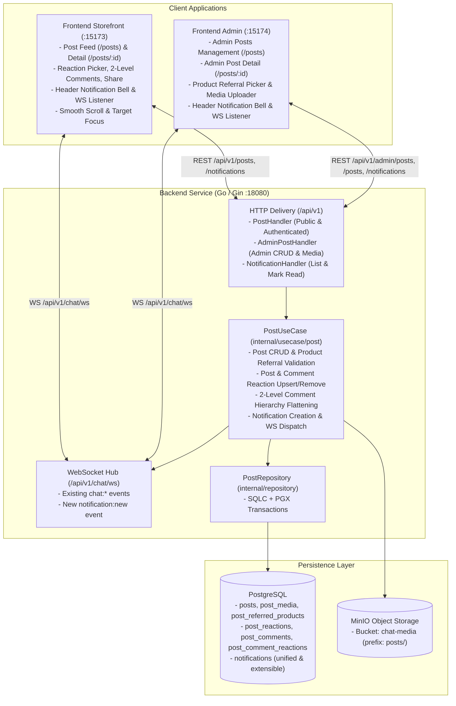
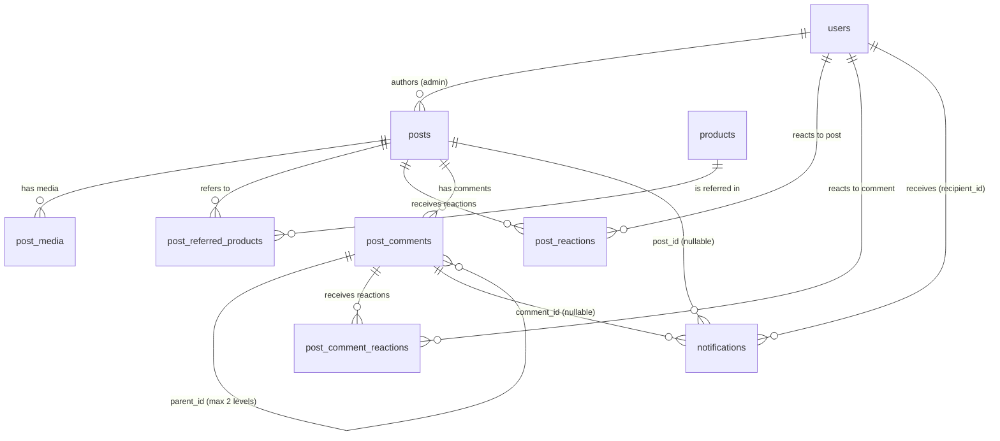

# Design Document: Bài viết giới thiệu sản phẩm, Tương tác cảm xúc, Bình luận phân cấp và Thông báo thời gian thực (Product Referral Posts)

## Overview

Tài liệu thiết kế này đặc tả kiến trúc, ranh giới mô-đun, hợp đồng giao tiếp (HTTP REST, WebSocket, Database Schema) và chiến lược kiểm thử cho tính năng **Product Referral Posts**, bao phủ toàn bộ các yêu cầu từ `1.1` đến `8.3` trong [requirements.md](file:///E:/v3-v3-singleagent/.dream/specs/product-referral-posts/requirements.md):

- **Yêu cầu 1 (`1.1` – `1.9`):** Quản trị viên tạo, chỉnh sửa, xóa bài viết kèm văn bản, tệp hình ảnh/video (tải lên MinIO) và danh sách sản phẩm giới thiệu từ danh mục cửa hàng.
- **Yêu cầu 2 (`2.1` – `2.7`):** Hiển thị bảng tin bài viết, trang chi tiết bài viết, thẻ sản phẩm giới thiệu (liên kết tới trang chi tiết sản phẩm) và nút Chia sẻ (sao chép liên kết vào clipboard).
- **Yêu cầu 3 (`3.1` – `3.6`):** Bày tỏ cảm xúc đa trạng thái (`like`, `love`, `haha`, `wow`, `sad`, `angry`) cho bài viết với tính toàn vẹn đồng thời.
- **Yêu cầu 4 (`4.1` – `4.8`):** Bình luận và trả lời bình luận phân cấp tối đa 2 cấp (tự động làm phẳng phản hồi cấp 2 vào bình luận gốc cấp 1 kèm tham chiếu người được trả lời).
- **Yêu cầu 5 (`5.1` – `5.3`):** Bày tỏ cảm xúc đa trạng thái độc lập cho từng bình luận gốc và bình luận phản hồi.
- **Yêu cầu 6 (`6.1` – `6.7`):** Lưu trữ thông báo vào bảng `notifications` dùng chung có khả năng mở rộng và phát thông báo thời gian thực qua WebSocket (`ws.Hub`) tới chủ bài viết (Admin) và chủ bình luận (Admin hoặc Customer) trên cả `frontend-admin` và `frontend`.
- **Yêu cầu 7 (`7.1` – `7.5`):** Điều hướng sâu (deep-link) khi nhấp vào thông báo tới trang chi tiết bài viết, tự động mở nhánh phản hồi, cuộn mượt (`smooth scroll`) và làm nổi bật kèm tiêu điểm (`focus`/`highlight`) vào đúng đối tượng mục tiêu.
- **Yêu cầu 8 (`8.1` – `8.3`):** Tuân thủ chuẩn Full Status Envelope `/api/v1`, tương thích ngược với WebSocket chat hiện có, và đảm bảo khả năng tiếp cận (accessibility) trên mọi kích thước màn hình.

---

## Architecture

Hệ thống mở rộng trên 3 gói hiện có của kho mã nguồn (`backend`, `frontend`, `frontend-admin`) và tái sử dụng hạ tầng PostgreSQL, MinIO (`chatmedia.Store`), xác thực JWT và `ws.Hub`.



### Các quyết định kiến trúc trọng tâm (Material Design Decisions)

1. **Bảng `notifications` dùng chung có khả năng mở rộng và gom nhóm thông báo chưa đọc (Unified, Extensible & Rollup Notification Schema):**
   - Thay vì tạo bảng riêng chỉ gắn chặt với bài viết (`post_notifications` có `post_id NOT NULL`), hệ thống định nghĩa bảng `notifications` dùng chung cho toàn ứng dụng với phân loại `category` (hiện tại là `'post'`, tương lai mở rộng cho `'order'`, `'return'`, `'system'`), `notification_type`, khóa gom nhóm `group_key` (`post_reaction:<post_id>`, `comment_reaction:<comment_id>`, `post_comment:<post_id>`, `comment_reply:<parent_comment_id>`), bộ đếm số người tương tác duy nhất `actor_count`, khóa ngoại tùy chọn `actor_id NULL`, `post_id NULL`, `comment_id NULL`, cột `metadata jsonb NOT NULL DEFAULT '{}'::jsonb` (lưu `recentActors`: tối đa 2 người tương tác gần nhất `[{ id, name, role }]`) và `updated_at`.
   - Ràng buộc `CHECK (category <> 'post' OR post_id IS NOT NULL)` và chỉ mục duy nhất một phần `CREATE UNIQUE INDEX idx_notifications_unread_group ON notifications (recipient_id, group_key) WHERE is_read = false AND group_key <> ''` bảo đảm mọi tương tác mới cùng `(recipient_id, group_key)` khi thông báo chưa đọc được gộp nguyên tử (`UPSERT`) vào đúng 1 bản ghi thông báo, hiển thị theo định dạng `"A, B và X người khác"`, tự động dọn dẹp (`ON DELETE CASCADE`) khi xóa bài viết/bình luận.
2. **Tái sử dụng MinIO Store hiện có cho phương tiện bài viết:**
   - Thay vì yêu cầu biến môi trường mới hoặc tạo bucket MinIO mới chưa được khởi tạo trong `compose.minio.yml`, tính năng tái sử dụng `chatmedia.Store` (interface `domain.PostMediaStore` tương thích với `PutObject`, `GetObject`, `GetObjectRange`, `RemoveObjects`) với khóa đối tượng có tiền tố tách biệt `posts/{mediaId}/{filename}`.
   - Endpoint phân phối `GET /api/v1/posts/media/:id` là công khai (không yêu cầu JWT) để khách vãng lai chưa đăng nhập vẫn xem được hình ảnh và phát được video với HTTP `Range` (`206 Partial Content`) theo Yêu cầu `2.2`.
3. **Làm phẳng bình luận 2 cấp tại tầng Use Case & Database:**
   - Bảng `post_comments` lưu `parent_id` (chỉ trỏ tới bình luận gốc cấp 1 có `parent_id IS NULL`) và `reply_to_user_id` (người được trả lời).
   - Khi người dùng trả lời một bình luận `target`:
     - Nếu `target.ParentID == nil` (trả lời bình luận cấp 1): bình luận mới nhận `parent_id = target.ID` và `reply_to_user_id = target.AuthorID`.
     - Nếu `target.ParentID != nil` (trả lời bình luận cấp 2): bình luận mới nhận `parent_id = *target.ParentID` và `reply_to_user_id = target.AuthorID`.
   - Cấu trúc này bảo đảm độ sâu cây bình luận luôn tối đa 2 cấp ở mọi đường dẫn dữ liệu.
4. **Đồng bộ cảm xúc an toàn đồng thời bằng `PUT` trạng thái đích:**
   - Cả hai API bày tỏ cảm xúc cho bài viết và bình luận đều nhận trạng thái đích (`{"reaction": "like"|"love"|"haha"|"wow"|"sad"|"angry"|null}`).
   - Trong giao dịch PostgreSQL, repository khóa dòng `posts` hoặc `post_comments` mục tiêu bằng `SELECT ... FOR UPDATE`, thực hiện `INSERT ... ON CONFLICT (target_id, user_id) DO UPDATE` (hoặc `DELETE` khi `reaction == null`), rồi tính tổng theo từng loại cảm xúc trực tiếp từ bảng cảm xúc. Không dùng bộ đếm rời rạc để tránh lệch số liệu hoặc giá trị âm.
5. **Mở rộng kênh WebSocket `/api/v1/chat/ws` hiện có cho thông báo thời gian thực:**
   - Tái sử dụng kết nối WebSocket `/api/v1/chat/ws?token=<jwt>` và `ws.Hub` (`h.userClients[recipientID]`).
   - Bổ sung sự kiện `notification:new` gửi tới đúng `recipientID` mà không ảnh hưởng tới các sự kiện `chat:new_message`, `chat:messages_read`, `chat:presence` hiện có.

---

## Components And Interfaces

### Shared Contracts

#### Contract DB-POSTS (rev 2)

Migration `backend/db/migrations/000017_create_posts_comments_notifications.up.sql` (và `.down.sql`) cùng migration mở rộng gom nhóm thông báo `backend/db/migrations/000018_add_notification_grouping.up.sql` (và `.down.sql`):

```sql
-- Bảng bài viết do Admin đăng
CREATE TABLE posts (
    id         uuid PRIMARY KEY DEFAULT gen_random_uuid(),
    author_id  uuid NOT NULL REFERENCES users(id) ON DELETE RESTRICT,
    content    text NOT NULL CHECK (char_length(btrim(content)) >= 1 AND char_length(content) <= 5000),
    created_at timestamptz NOT NULL DEFAULT now(),
    updated_at timestamptz NOT NULL DEFAULT now()
);

CREATE INDEX idx_posts_created_at_id ON posts (created_at DESC, id DESC);

-- Bảng phương tiện (ảnh/video) của bài viết (hỗ trợ upload trước khi lưu bài viết với post_id NULL)
CREATE TABLE post_media (
    id          uuid PRIMARY KEY DEFAULT gen_random_uuid(),
    post_id     uuid NULL REFERENCES posts(id) ON DELETE CASCADE,
    uploader_id uuid NOT NULL REFERENCES users(id) ON DELETE RESTRICT,
    object_key  text NOT NULL UNIQUE,
    file_type   text NOT NULL CHECK (file_type IN ('image', 'video')),
    file_name   text NOT NULL,
    file_size   bigint NOT NULL CHECK (
        file_size > 0 AND (
            (file_type = 'image' AND file_size <= 10485760) OR
            (file_type = 'video' AND file_size <= 52428800)
        )
    ),
    mime_type   text NOT NULL CHECK (mime_type IN ('image/jpeg', 'image/png', 'image/webp', 'image/gif', 'video/mp4', 'video/webm')),
    position    integer NOT NULL DEFAULT 0 CHECK (position >= 0),
    created_at  timestamptz NOT NULL DEFAULT now()
);

CREATE INDEX idx_post_media_post_position ON post_media (post_id, position ASC) WHERE post_id IS NOT NULL;
CREATE INDEX idx_post_media_uploader ON post_media (uploader_id);

-- Bảng liên kết sản phẩm giới thiệu (referred products) trong bài viết
CREATE TABLE post_referred_products (
    post_id    uuid NOT NULL REFERENCES posts(id) ON DELETE CASCADE,
    product_id uuid NOT NULL REFERENCES products(id) ON DELETE CASCADE,
    position   integer NOT NULL DEFAULT 0 CHECK (position >= 0),
    PRIMARY KEY (post_id, product_id)
);

CREATE INDEX idx_post_referred_products_post_pos ON post_referred_products (post_id, position ASC);

-- Bảng cảm xúc trên bài viết
CREATE TABLE post_reactions (
    id            uuid PRIMARY KEY DEFAULT gen_random_uuid(),
    post_id       uuid NOT NULL REFERENCES posts(id) ON DELETE CASCADE,
    user_id       uuid NOT NULL REFERENCES users(id) ON DELETE CASCADE,
    reaction_type text NOT NULL CHECK (reaction_type IN ('like', 'love', 'haha', 'wow', 'sad', 'angry')),
    created_at    timestamptz NOT NULL DEFAULT now(),
    updated_at    timestamptz NOT NULL DEFAULT now(),
    UNIQUE (post_id, user_id)
);

CREATE INDEX idx_post_reactions_post_id ON post_reactions (post_id);

-- Bảng bình luận bài viết (phân cấp tối đa 2 cấp: parent_id NULL là cấp 1, parent_id NOT NULL là cấp 2)
CREATE TABLE post_comments (
    id               uuid PRIMARY KEY DEFAULT gen_random_uuid(),
    post_id          uuid NOT NULL REFERENCES posts(id) ON DELETE CASCADE,
    author_id        uuid NOT NULL REFERENCES users(id) ON DELETE RESTRICT,
    parent_id        uuid NULL REFERENCES post_comments(id) ON DELETE CASCADE,
    reply_to_user_id uuid NULL REFERENCES users(id) ON DELETE SET NULL,
    content          text NOT NULL CHECK (char_length(btrim(content)) >= 1 AND char_length(content) <= 1000),
    created_at       timestamptz NOT NULL DEFAULT now(),
    updated_at       timestamptz NOT NULL DEFAULT now(),
    CHECK (parent_id IS NULL OR parent_id <> id)
);

CREATE INDEX idx_post_comments_post_created ON post_comments (post_id, created_at ASC, id ASC);
CREATE INDEX idx_post_comments_parent_created ON post_comments (parent_id, created_at ASC, id ASC) WHERE parent_id IS NOT NULL;

-- Bảng cảm xúc trên bình luận
CREATE TABLE post_comment_reactions (
    id            uuid PRIMARY KEY DEFAULT gen_random_uuid(),
    comment_id    uuid NOT NULL REFERENCES post_comments(id) ON DELETE CASCADE,
    user_id       uuid NOT NULL REFERENCES users(id) ON DELETE CASCADE,
    reaction_type text NOT NULL CHECK (reaction_type IN ('like', 'love', 'haha', 'wow', 'sad', 'angry')),
    created_at    timestamptz NOT NULL DEFAULT now(),
    updated_at    timestamptz NOT NULL DEFAULT now(),
    UNIQUE (comment_id, user_id)
);

CREATE INDEX idx_post_comment_reactions_comment_id ON post_comment_reactions (comment_id);

-- Bảng thông báo dùng chung toàn hệ thống (hỗ trợ bài viết/bình luận hiện tại và mở rộng cho đơn hàng/giao hàng trong tương lai)
CREATE TABLE notifications (
    id                uuid PRIMARY KEY DEFAULT gen_random_uuid(),
    recipient_id      uuid NOT NULL REFERENCES users(id) ON DELETE CASCADE,
    actor_id          uuid NULL REFERENCES users(id) ON DELETE CASCADE,
    category          text NOT NULL DEFAULT 'post' CHECK (btrim(category) <> ''),
    notification_type text NOT NULL CHECK (btrim(notification_type) <> ''),
    post_id           uuid NULL REFERENCES posts(id) ON DELETE CASCADE,
    comment_id        uuid NULL REFERENCES post_comments(id) ON DELETE CASCADE,
    reaction_type     text NULL CHECK (reaction_type IS NULL OR reaction_type IN ('like', 'love', 'haha', 'wow', 'sad', 'angry')),
    excerpt           text NOT NULL DEFAULT '',
    metadata          jsonb NOT NULL DEFAULT '{}'::jsonb CHECK (jsonb_typeof(metadata) = 'object'),
    is_read           boolean NOT NULL DEFAULT false,
    created_at        timestamptz NOT NULL DEFAULT now(),
    CHECK (category <> 'post' OR post_id IS NOT NULL)
);

CREATE INDEX idx_notifications_recipient_created ON notifications (recipient_id, created_at DESC, id DESC);
CREATE INDEX idx_notifications_recipient_unread ON notifications (recipient_id) WHERE is_read = false;

-- Migration 000018_add_notification_grouping.up.sql: Gom nhóm thông báo chưa đọc theo (recipient_id, group_key)
ALTER TABLE notifications
    ADD COLUMN group_key   text NOT NULL DEFAULT '',
    ADD COLUMN actor_count integer NOT NULL DEFAULT 1 CHECK (actor_count >= 1),
    ADD COLUMN updated_at  timestamptz NOT NULL DEFAULT now();

CREATE INDEX idx_notifications_recipient_updated ON notifications (recipient_id, updated_at DESC, id DESC);
CREATE UNIQUE INDEX idx_notifications_unread_group
    ON notifications (recipient_id, group_key)
    WHERE is_read = false AND group_key <> '';
```

---

#### Contract TYPE-POST-DOMAIN (rev 2)

Các kiểu dữ liệu dùng chung trên JSON wire format giữa Backend, `frontend` và `frontend-admin`:

```typescript
export type ReactionType = 'like' | 'love' | 'haha' | 'wow' | 'sad' | 'angry'

export interface ReactionCounts {
  like: number
  love: number
  haha: number
  wow: number
  sad: number
  angry: number
}

export interface ReactionSummary {
  totalCount: number
  counts: ReactionCounts
  viewerReaction: ReactionType | null
}

export interface PostMediaAttachment {
  id: string
  fileUrl: string        // "/api/v1/posts/media/" + id
  fileType: 'image' | 'video'
  fileName: string
  fileSize: number
  mimeType: string
  position: number
}

export interface ReferredProductCard {
  id: string
  name: string
  brand: string
  price: string          // Canonical VND string, e.g. "25990000"
  currency: string       // "VND"
  imageUrl: string
  inStock: boolean
  active: boolean
}

export interface PostItem {
  id: string
  authorId: string
  authorName: string
  authorRole: 'admin' | 'customer'
  content: string
  media: PostMediaAttachment[]
  referredProducts: ReferredProductCard[]
  reactions: ReactionSummary
  commentCount: number
  createdAt: string      // ISO 8601 UTC
  updatedAt: string      // ISO 8601 UTC
}

export interface PostComment {
  id: string
  postId: string
  authorId: string
  authorName: string
  authorRole: 'admin' | 'customer'
  parentId: string | null
  replyToUserId: string | null
  replyToUserName: string | null
  content: string
  reactions: ReactionSummary
  createdAt: string
  updatedAt: string
}

export interface PostCommentThread extends PostComment {
  replies: PostComment[] // Luôn là các bình luận cấp 2 có parentId === thread.id
}

export interface PostDetail extends PostItem {
  comments: PostCommentThread[]
}

export type NotificationCategory = 'post' | string

export type PostNotificationType =
  | 'post_reaction'
  | 'post_comment'
  | 'comment_reaction'
  | 'comment_reply'

export interface NotificationActorSummary {
  id: string
  name: string
  role: 'admin' | 'customer'
}

export interface NotificationItem {
  id: string
  recipientId: string
  actorId: string | null
  actorName: string | null
  actorRole: 'admin' | 'customer' | null
  groupKey?: string
  actorCount?: number
  category: NotificationCategory
  notificationType: PostNotificationType | string
  postId: string | null
  commentId: string | null
  reactionType: ReactionType | null
  excerpt: string
  metadata: {
    recentActors?: NotificationActorSummary[]
    [key: string]: unknown
  }
  isRead: boolean
  createdAt: string
  updatedAt?: string
}

export type PostNotification = NotificationItem
```

**Quy tắc hiển thị tên người dùng (`authorName`, `replyToUserName`, `actorName`):**
- Nếu vai trò của user là `'admin'`: trả về `"Quản trị viên"` kèm `authorRole: "admin"` để giao diện hiển thị huy hiệu `"Quản trị viên"`.
- Nếu vai trò của user là `'customer'`: ưu tiên `recipient_name` từ đơn hàng gần nhất (`orders.recipient_name`), tiếp theo là địa chỉ mặc định (`addresses.recipient_name`), và fallback về phần ký tự trước `@` trong `users.email`.

---

#### Contract API-POST-MEDIA (rev 1)

1. **`POST /api/v1/admin/posts/media`**
   - **Auth:** `guard.AuthRequired`, `guard.RequireAdmin()`.
   - **Content-Type:** `multipart/form-data` (trường `file`).
   - **Validation:**
     - `image/jpeg` (chuẩn hóa `image/jpg` -> `image/jpeg`), `image/png`, `image/webp`, `image/gif`: kích thước `1 .. 10485760` bytes (10MB).
     - `video/mp4`, `video/webm`: kích thước `1 .. 52428800` bytes (50MB).
   - **Response (`201 Created`):** Full Status Envelope với `data` là `PostMediaAttachment`.
2. **`GET /api/v1/posts/media/:id` & `HEAD /api/v1/posts/media/:id`**
   - **Auth:** Công khai (không yêu cầu đăng nhập).
   - **Behavior:**
     - Ảnh (`fileType == "image"`): trả `200 OK`, `Content-Type: <mimeType>`, `Cache-Control: public, max-age=86400`, `Content-Disposition: inline`.
     - Video (`fileType == "video"`): hỗ trợ header `Range: bytes=start-end` trả về `206 Partial Content`, `Accept-Ranges: bytes`, `Content-Range: bytes start-end/total`, hoặc `200 OK` nếu không có header `Range`.
     - Nếu `:id` không hợp lệ hoặc không tồn tại: trả về HTTP 404 Full Status Envelope với `error.code = "post_media_not_found"`.

---

#### Contract API-POSTS-ADMIN (rev 1)

Tất cả các endpoint dưới `/api/v1/admin/posts` yêu cầu `guard.AuthRequired` và `guard.RequireAdmin()`:

1. **`POST /api/v1/admin/posts`**
   - **Request Body:**
     ```json
     {
       "content": "Đánh giá chi tiết flagship mới...",
       "mediaIds": ["uuid-1", "uuid-2"],
       "referredProductIds": ["prod-uuid-1", "prod-uuid-2"]
     }
     ```
   - **Validation:**
     - `content`: sau khi `strings.TrimSpace` phải có độ dài từ `1` đến `5000` ký tự Unicode (`utf8.RuneCountInString`); nếu vi phạm trả HTTP 400 `validation_error` với `fields.content`.
     - `referredProductIds`: mảng bắt buộc chứa từ `1` đến `10` UUID sản phẩm (loại bỏ trùng lặp giữ nguyên thứ tự); nếu rỗng trả HTTP 400 `validation_error` với `fields.referredProductIds = "Vui lòng chọn từ 1 đến 10 sản phẩm giới thiệu"`. Nếu bất kỳ ID nào không phải UUID hợp lệ hoặc không tồn tại/đã xóa mềm (`active = false`) trong bảng `products`, trả HTTP 404 `product_not_found` (`"Không tìm thấy sản phẩm"`).
     - `mediaIds` (tùy chọn, tối đa 10 tệp): mỗi phần tử phải tồn tại trong `post_media` với `uploader_id == callerAdminID` và `post_id IS NULL`; nếu không hợp lệ trả HTTP 400 `validation_error` với `fields.mediaIds`.
   - **Response (`201 Created`):** Full Status Envelope với `data` là `PostDetail`.

2. **`PUT /api/v1/admin/posts/:id`**
   - **Request Body:** Giống `POST /api/v1/admin/posts` (`content`, `mediaIds`, `referredProductIds`).
   - **Behavior:**
     - Kiểm tra bài viết `:id` tồn tại (nếu không tồn tại trả HTTP 404 `post_not_found`).
     - Chấp nhận `mediaIds` thuộc về chính bài viết `:id` (`post_id == :id`) hoặc mới tải lên bởi admin (`post_id IS NULL AND uploader_id == callerAdminID`). Các media cũ của bài viết không nằm trong `mediaIds` mới sẽ bị xóa khỏi bài viết.
     - Cập nhật `content`, `updated_at`, danh sách `post_referred_products` và `post_media` trong một giao dịch; bảo toàn nguyên vẹn toàn bộ `post_reactions` và `post_comments` hiện có của bài viết.
   - **Response (`200 OK`):** Full Status Envelope với `data` là `PostDetail`.

3. **`DELETE /api/v1/admin/posts/:id`**
   - **Behavior:** Xóa bài viết `:id` (cascade xóa `post_media`, `post_referred_products`, `post_reactions`, `post_comments`, `post_comment_reactions`, và các bản ghi `notifications` gắn với `post_id = :id`). Nếu bài viết không tồn tại trả HTTP 404 `post_not_found`.
   - **Response (`200 OK`):** Full Status Envelope với `data: { "id": "<postId>" }`.

---

#### Contract API-POSTS-PUBLIC (rev 2)

1. **`GET /api/v1/posts?page=1&limit=10`**
   - **Auth:** `guard.OptionalAuth` (cho phép cả khách chưa đăng nhập và người dùng đã đăng nhập; nếu có Bearer token hợp lệ sẽ tính `viewerReaction` cho từng bài viết).
   - **Query Params:** `page` (mặc định `1`, `>= 1`), `limit` (mặc định `10`, `1..50`).
   - **Response (`200 OK`):** Full Status Envelope có `meta.pagination` (`page`, `limit`, `totalItems`, `totalPages`) và `data: PostItem[]` sắp xếp theo `created_at DESC, id DESC`.

2. **`GET /api/v1/posts/:id`**
   - **Auth:** `guard.OptionalAuth`.
   - **Response (`200 OK`):** Full Status Envelope với `data: PostDetail` (bao gồm mảng `comments: PostCommentThread[]`, trong đó các bình luận gốc cấp 1 sắp xếp theo `created_at ASC, id ASC` và mỗi bình luận gốc chứa mảng `replies` cấp 2 sắp xếp theo `created_at ASC, id ASC`, kèm `viewerReaction` cho bài viết và từng bình luận/phản hồi).
   - **Error:** Nếu `:id` không phải UUID hợp lệ hoặc bài viết không tồn tại, trả HTTP 404 `post_not_found` (`"Bài viết không tồn tại hoặc đã bị xóa"`).

3. **`PUT /api/v1/posts/:id/reactions`**
   - **Auth:** `guard.AuthRequired` (hỗ trợ cả `customer` và `admin`).
   - **Request Body:**
     ```json
     { "reaction": "love" }
     ```
     *(hoặc `{ "reaction": null }` để gỡ bỏ cảm xúc hiện tại).*
   - **Validation & Behavior:**
     - `reaction` phải là `null` hoặc một trong 6 giá trị `'like' | 'love' | 'haha' | 'wow' | 'sad' | 'angry'`; nếu giá trị chuỗi khác trả HTTP 400 `validation_error` với `fields.reaction`.
     - Nếu bài viết `:id` không tồn tại trả HTTP 404 `post_not_found`.
     - Khóa dòng `posts` bằng `FOR UPDATE`, upsert hoặc xóa dòng trong `post_reactions`, trả về `ReactionSummary` mới nhất.
     - Nếu `reaction != null`, cảm xúc thực tế thay đổi so với trước đó và `callerUserID != post.AuthorID`, thực hiện gom nhóm (`UPSERT`) vào bản ghi chưa đọc trong bảng `notifications` theo khóa `(recipient_id = post.AuthorID, group_key = "post_reaction:" + post.ID)` (`category = 'post'`, `notification_type = 'post_reaction'`, `post_id = post.ID`, `comment_id = nil`, `reaction_type = reaction`, cập nhật `actor_count` là số người tương tác duy nhất trong nhóm chưa đọc, lưu tối đa 2 người tương tác gần nhất vào `metadata.recentActors`, cập nhật `updated_at = now()`) và phát sự kiện WebSocket `notification:new`. Nếu `reaction == null` (người dùng gỡ cảm xúc) và `callerUserID != post.AuthorID`, cập nhật lại thông báo chưa đọc của nhóm `post_reaction:<post_id>` (nếu không còn người tương tác nào trong nhóm chưa đọc thì xóa thông báo chưa đọc đó; nếu còn người khác thì cập nhật lại `actor_count`, `actor_id` và `metadata.recentActors`).
   - **Response (`200 OK`):** Full Status Envelope với `data: ReactionSummary`.

4. **`POST /api/v1/posts/:id/comments`**
   - **Auth:** `guard.AuthRequired` (hỗ trợ cả `customer` và `admin`).
   - **Request Body:**
     ```json
     {
       "content": "Sản phẩm này còn màu Titan tự nhiên không shop?",
       "parentCommentId": "optional-comment-uuid"
     }
     ```
   - **Validation & Behavior:**
     - `content`: sau khi `strings.TrimSpace` phải từ `1` đến `1000` ký tự Unicode; nếu rỗng hoặc vượt quá 1000 ký tự trả HTTP 400 `validation_error` với `fields.content`.
     - Nếu bài viết `:id` không tồn tại trả HTTP 404 `post_not_found`.
     - Nếu `parentCommentId` được truyền:
       - Phải là UUID hợp lệ và tồn tại trong `post_comments` thuộc cùng `post_id == :id`; nếu không tồn tại hoặc thuộc bài viết khác trả HTTP 404 `comment_not_found` (`"Bình luận không tồn tại hoặc đã bị xóa"`).
       - Nếu bình luận mục tiêu có `parent_id == NULL` (cấp 1): lưu bình luận mới với `parent_id = target.ID`, `reply_to_user_id = target.AuthorID`.
       - Nếu bình luận mục tiêu có `parent_id != NULL` (cấp 2): làm phẳng (flatten) bằng cách lưu bình luận mới với `parent_id = target.ParentID` (cùng nhánh gốc cấp 1) và `reply_to_user_id = target.AuthorID`.
     - Tạo mới hoặc gộp (`UPSERT`) thông báo chưa đọc vào bảng `notifications` (`category = 'post'`, `group_key = "post_comment:" + post.ID` cho bình luận bài viết hoặc `group_key = "comment_reply:" + rootCommentID` cho phản hồi bình luận, cập nhật `actor_count`, `metadata.recentActors`, `updated_at = now()`) và phát qua WebSocket theo đúng quy tắc tại Yêu cầu `6.1` – `6.4`.
   - **Response (`201 Created`):** Full Status Envelope với `data: PostComment`.

5. **`DELETE /api/v1/posts/:id/comments/:commentId`**
   - **Auth:** `guard.AuthRequired`.
   - **Authorization:** Chỉ tác giả của bình luận (`comment.AuthorID == callerUserID`) hoặc Quản trị viên (`callerRole == 'admin'`) được phép xóa; nếu người dùng khác gọi sẽ trả HTTP 403 `forbidden` (`"Bạn không có quyền thực hiện thao tác này"`).
   - **Response (`200 OK`):** Full Status Envelope với `data: { "deletedCommentId": string, "commentCount": number }`.

6. **`PUT /api/v1/post-comments/:commentId/reactions`**
   - **Auth:** `guard.AuthRequired` (hỗ trợ cả `customer` và `admin`).
   - **Request Body:** `{ "reaction": "like" | "love" | "haha" | "wow" | "sad" | "angry" | null }`.
   - **Validation & Behavior:**
     - Kiểm tra bình luận `:commentId` tồn tại; nếu không tồn tại trả HTTP 404 `comment_not_found` (`"Bình luận không tồn tại hoặc đã bị xóa"`).
     - Khóa dòng `post_comments` bằng `FOR UPDATE`, upsert hoặc xóa dòng trong `post_comment_reactions`, trả về `ReactionSummary` của bình luận đó.
     - Nếu `reaction != null`, cảm xúc thay đổi so với trước đó và `callerUserID != comment.AuthorID`, thực hiện gom nhóm (`UPSERT`) vào bản ghi chưa đọc trong bảng `notifications` theo khóa `(recipient_id = comment.AuthorID, group_key = "comment_reaction:" + comment.ID)` (`category = 'post'`, `notification_type = 'comment_reaction'`, `post_id = comment.PostID`, `comment_id = comment.ID`, `reaction_type = reaction`, cập nhật `actor_count`, `metadata.recentActors`, `updated_at = now()`) và phát sự kiện WebSocket `notification:new`. Nếu `reaction == null` (gỡ cảm xúc) và `callerUserID != comment.AuthorID`, cập nhật lại hoặc xóa thông báo chưa đọc của nhóm `comment_reaction:<comment_id>` nếu không còn người tương tác nào.
   - **Response (`200 OK`):** Full Status Envelope với `data: ReactionSummary`.

---

#### Contract API-NOTIFICATIONS (rev 2)

Tất cả các endpoint dưới `/api/v1/notifications` yêu cầu `guard.AuthRequired` (dùng chung cho cả Admin trên `frontend-admin` và Customer/Admin trên `frontend`):

1. **`GET /api/v1/notifications?limit=20&offset=0`**
   - **Response (`200 OK`):** Full Status Envelope với `data` (danh sách sắp xếp theo `updated_at DESC, id DESC`):
     ```json
     {
       "items": [
         {
           "id": "notif-uuid",
           "recipientId": "user-uuid",
           "actorId": "actor-uuid",
           "actorName": "customer2",
           "actorRole": "customer",
           "groupKey": "comment_reply:parent-comment-uuid",
           "actorCount": 2,
           "category": "post",
           "notificationType": "comment_reply",
           "postId": "post-uuid",
           "commentId": "comment-uuid",
           "reactionType": null,
           "excerpt": "Dạ cảm ơn shop nhiều ạ!",
           "metadata": {
             "recentActors": [
               { "id": "actor-uuid", "name": "customer2", "role": "customer" },
               { "id": "actor-uuid-1", "name": "customer1", "role": "customer" }
             ]
           },
           "isRead": false,
           "createdAt": "2026-10-20T16:30:00Z",
           "updatedAt": "2026-10-20T16:35:00Z"
         }
       ],
       "unreadCount": 3
     }
     ```
2. **`POST /api/v1/notifications/:id/read`**
   - **Behavior:** Đánh dấu thông báo `:id` thuộc `recipient_id == callerUserID` thành `is_read = true`. Nếu thông báo không tồn tại hoặc không thuộc người gọi trả HTTP 404 `notification_not_found`.
   - **Response (`200 OK`):** Full Status Envelope với `data: { "id": string, "isRead": true, "unreadCount": number }`.
3. **`POST /api/v1/notifications/read-all`**
   - **Behavior:** Đánh dấu toàn bộ thông báo chưa đọc của `callerUserID` thành `is_read = true`.
   - **Response (`200 OK`):** Full Status Envelope với `data: { "unreadCount": 0 }`.

---

#### Contract WS-NOTIFICATIONS (rev 2)

Mở rộng giao thức sự kiện trên kết nối WebSocket hiện có `GET /api/v1/chat/ws?token=<jwt>`:

```typescript
export type WSEventNotificationNew = {
  type: 'notification:new'
  payload: NotificationItem
}
```

- **Server-side (`internal/delivery/ws/hub.go`):**
  - `Hub` cài đặt thêm interface `domain.NotificationBroadcaster`:
    ```go
    type NotificationBroadcaster interface {
        BroadcastNotification(ctx context.Context, recipientID string, notification *NotificationItem) error
    }
    ```
  - Khi `BroadcastNotification` được gọi, `Hub` lấy danh sách kết nối đang mở trong `h.userClients[recipientID]` và gửi frame JSON `{"type": "notification:new", "payload": notification}` tới tất cả tab/phiên đang kết nối của `recipientID`.
- **Client-side (`frontend` & `frontend-admin`):**
  - Mở rộng `useChatSocket` (trên `frontend`) và `useAdminChatSocket` (trên `frontend-admin`) để lắng nghe `case 'notification:new': onNotification?.(data.payload)`.
  - Khi nhận sự kiện `notification:new`, chuông thông báo trên Header (`NotificationBell` và `AdminNotificationBell`) kiểm tra xem đã có thông báo cùng `id` trong danh sách hay chưa:
    - Nếu đã tồn tại thông báo cùng `id`: thay thế bằng `payload` mới và đưa lên đầu danh sách; chỉ tăng `unreadCount` nếu bản ghi cũ trước đó đang ở trạng thái `isRead === true` (không cộng trùng `unreadCount` khi bản ghi cũ vốn đang `isRead === false`).
    - Nếu chưa tồn tại trong danh sách: thêm `payload` lên đầu danh sách và tăng `unreadCount` thêm 1 (nếu `payload.isRead === false`).
  - Hiển thị nội dung thông báo gom nhóm tiếng Việt từ `metadata.recentActors` (fallback về `actorName`) và `actorCount`:
    - `actorCount === 1`: **"{Actor 1}"**
    - `actorCount === 2`: **"{Actor 1} và {Actor 2}"**
    - `actorCount >= 3`: **"{Actor 1}, {Actor 2} và {actorCount - 2} người khác"**

---

### Frontend & Frontend-Admin Components and Navigation Flow

#### 1. Giao diện Cửa hàng (`frontend` - `:15173`)
- **Định tuyến (`frontend/src/App.tsx` & `Header.tsx`):**
  - Thêm liên kết điều hướng `"Bài viết"` (`/posts`) trên thanh Header (cả desktop và mobile drawer).
  - Thêm route `/posts` (`PostsFeedPage.tsx`) và `/posts/:id` (`PostDetailPage.tsx`).
  - Thêm `NotificationBell.tsx` trên Header (hiển thị khi `isAuthenticated === true`), kết nối với `useChatSocket` để nhận sự kiện `notification:new` theo thời gian thực.
- **Các thành phần UI chính (`frontend/src/components/posts/`):**
  - `PostCard.tsx`: Hiển thị thông tin tác giả (kèm nhãn `"Quản trị viên"`), thời gian đăng, nội dung văn bản, bộ trình chiếu ảnh/video (`PostMediaGallery.tsx` với lightbox cho ảnh và trình phát `<video controls>` cho video), danh sách thẻ sản phẩm giới thiệu (`ReferredProductCardList.tsx` dẫn tới `/products/:id`), thanh tổng hợp cảm xúc + bộ chọn 6 cảm xúc (`ReactionBar.tsx`: 👍 Thích, ❤️ Yêu thích, 😆 Haha, 😮 Wow, 😢 Buồn, 😡 Phẫn nộ), nút Bình luận và nút Chia sẻ (sao chép URL `${window.location.origin}/posts/${post.id}` vào clipboard + toast `"Đã sao chép liên kết bài viết"`).
  - `PostCommentsSection.tsx`: Hiển thị danh sách bình luận 2 cấp (`PostCommentThread`), bộ chọn 6 cảm xúc cho từng bình luận gốc và từng phản hồi, nút `"Trả lời"` mở ô nhập phản hồi ngay dưới nhánh bình luận, và nút thu gọn/mở rộng các phản hồi cấp 2.

#### 2. Giao diện Quản trị viên (`frontend-admin` - `:15174`)
- **Định tuyến (`frontend-admin/src/App.tsx` & `AdminLayout.tsx`):**
  - Thêm mục `"Bài viết"` (`/posts`) trên Sidebar của `AdminLayout.tsx`.
  - Thêm `AdminNotificationBell.tsx` trên thanh Header của `AdminLayout.tsx`, nhận sự kiện `notification:new` từ `useAdminChatSocket`.
  - Thêm các route:
    - `/posts` (`AdminPostsPage.tsx`): Danh sách bài viết, tạo bài viết mới, chỉnh sửa hoặc xóa bài viết, nút xem chi tiết và nút sao chép link chia sẻ.
    - `/posts/:id` (`AdminPostDetailPage.tsx`): Xem chi tiết bài viết, xem sản phẩm refer (liên kết tới `/products/:id`), bày tỏ cảm xúc, bình luận và trả lời bình luận trực tiếp với tư cách Quản trị viên.
  - **Biểu mẫu tạo/chỉnh sửa bài viết:**
    - Nhập nội dung bài viết (1–5.000 ký tự).
    - Tải lên hình ảnh/video qua `POST /api/v1/admin/posts/media` kèm xem trước và xóa tệp.
    - Tìm kiếm và chọn đính kèm 1–10 sản phẩm giới thiệu từ API danh mục sản phẩm hiện có (`GET /api/v1/admin/products?q=...`).

#### 3. Cơ chế Điều hướng từ Thông báo, Cuộn mượt (Smooth Scroll) & Focus/Highlight (`Requirement 7.1` – `7.5`)
- Khi người dùng nhấp vào một thông báo có `category === 'post'` trong `NotificationBell`:
  1. Gọi `POST /api/v1/notifications/:id/read` (nếu `isRead === false`) và giảm `unreadCount`.
  2. Điều hướng tới:
     - `/posts/${notification.postId}?commentId=${notification.commentId}&focusTs=${Date.now()}` nếu `notification.commentId` khác `null`.
     - `/posts/${notification.postId}?focus=post&focusTs=${Date.now()}` nếu `notification.commentId === null`.
- Tại `PostDetailPage.tsx` (`frontend`) và `AdminPostDetailPage.tsx` (`frontend-admin`):
  - Lắng nghe thay đổi của `postDetail`, `searchParams.get('commentId')`, `searchParams.get('focus')` và `searchParams.get('focusTs')`:
  - **Trường hợp `focus=post`:**
    - Sau khi dữ liệu bài viết render xong, tìm phần tử `#post-article-${post.id}` (`tabIndex={-1}`), gọi `scrollIntoView({ behavior: 'smooth', block: 'center' })`, gọi `focus({ preventScroll: true })`, và kích hoạt state `highlightedTargetId = 'post'` trong 3.000ms (hiển thị viền ring nổi bật `ring-2 ring-emerald-500 bg-emerald-50/40` kèm hiệu ứng chuyển tiếp mượt).
  - **Trường hợp `commentId=<uuid>`:**
    - Kiểm tra xem `commentId` có nằm trong danh sách bình luận cấp 1 hoặc danh sách `replies` cấp 2 của `postDetail.comments` hay không.
    - Nếu `commentId` là một bình luận phản hồi cấp 2 thuộc bình luận gốc `root.id`, tự động thêm `root.id` vào tập `expandedThreadIds` để nhánh phản hồi mở ra trước khi cuộn (`Requirement 7.3`).
    - Sau khi phần tử `#comment-${commentId}` (`tabIndex={-1}`) xuất hiện trong DOM, gọi `scrollIntoView({ behavior: 'smooth', block: 'center' })`, gọi `focus({ preventScroll: true })`, và kích hoạt state `highlightedTargetId = commentId` trong 3.000ms.
    - Nếu `commentId` không còn tồn tại trong `postDetail.comments` (do đã bị xóa trước đó - `Requirement 7.5`), hiển thị thông báo tiếng Việt `"Bình luận mục tiêu không còn tồn tại hoặc đã bị xóa"`.

---

## Data Models

### Quan hệ thực thể (Entity Relationships)



### Các bất biến dữ liệu (Data Invariants)

1. **Giới hạn phân cấp bình luận 2 cấp:** Mọi dòng trong `post_comments` nếu có `parent_id IS NOT NULL` thì dòng cha `parent` bắt buộc phải có `parent.parent_id IS NULL`. Quy tắc này được cưỡng chế tại `PostUseCase.CreateComment` bằng cách tự động quy chiếu mọi phản hồi vào bình luận gốc cấp 1 của nhánh đó.
2. **Tính duy nhất của cảm xúc trên mỗi đối tượng:** `UNIQUE (post_id, user_id)` trên `post_reactions` và `UNIQUE (comment_id, user_id)` trên `post_comment_reactions` bảo đảm mỗi người dùng chỉ có tối đa 1 cảm xúc hiện hành trên một bài viết hoặc một bình luận.
3. **Không tự thông báo (No Self-Notification):** `PostUseCase` không bao giờ tạo bản ghi `notifications` khi `actor_id == recipient_id`.
4. **Chống trùng lặp thông báo khi phản hồi bình luận (`Requirement 6.3`):** Khi người dùng `A` trả lời bình luận của `B` trên bài viết của Admin `C`:
   - Nếu `B != A`, tạo 1 thông báo `comment_reply` cho `B`.
   - Nếu `C != A` và `C != B`, tạo 1 thông báo `post_comment` cho `C`.
   - Nếu `B == C` (tức Admin đăng bài cũng chính là chủ bình luận được trả lời), Admin `C` chỉ nhận đúng 1 thông báo `comment_reply`.

---

## Error Handling

Mọi điểm cuối HTTP dưới `/api/v1` sử dụng `writeSuccess`, `writePaginatedSuccess` và `writeError` trong `backend/internal/delivery/http/`, đảm bảo Full Status Envelope chuẩn:

| Tình huống lỗi | Domain Error | HTTP Status | `error.code` | Thông báo tiếng Việt (`message` / `fields`) |
|---|---|---|---|---|
| Nội dung bài viết rỗng hoặc > 5.000 ký tự | `ValidationError` | `400 Bad Request` | `validation_error` | `fields.content`: `"Nội dung bài viết phải từ 1 đến 5.000 ký tự"` |
| Chưa chọn sản phẩm giới thiệu hoặc > 10 sản phẩm | `ValidationError` | `400 Bad Request` | `validation_error` | `fields.referredProductIds`: `"Vui lòng chọn từ 1 đến 10 sản phẩm giới thiệu"` |
| Tệp media sai định dạng MIME | `ValidationError` | `400 Bad Request` | `validation_error` | `fields.file_type`: `"Định dạng tệp không được hỗ trợ (chỉ chấp nhận JPEG, PNG, WebP, GIF, MP4, WebM)"` |
| Tệp media vượt quá dung lượng (10MB ảnh / 50MB video) | `ValidationError` | `400 Bad Request` | `validation_error` | `fields.file`: `"Dung lượng tệp vượt quá giới hạn cho phép (tối đa 10MB cho ảnh, 50MB cho video)"` |
| Loại cảm xúc không hợp lệ | `ValidationError` | `400 Bad Request` | `validation_error` | `fields.reaction`: `"Loại cảm xúc không hợp lệ"` |
| Nội dung bình luận rỗng hoặc > 1.000 ký tự | `ValidationError` | `400 Bad Request` | `validation_error` | `fields.content`: `"Nội dung bình luận phải từ 1 đến 1.000 ký tự"` |
| Chưa đăng nhập hoặc token hết hạn | `ErrInvalidToken` | `401 Unauthorized` | `unauthorized` / `invalid_token` | `"Phiên đăng nhập không hợp lệ hoặc đã hết hạn"` |
| Không có quyền Admin hoặc xóa bình luận của người khác | `ErrForbidden` | `403 Forbidden` | `forbidden` | `"Bạn không có quyền thực hiện thao tác này"` |
| Bài viết không tồn tại hoặc đã xóa | `ErrPostNotFound` | `404 Not Found` | `post_not_found` | `"Bài viết không tồn tại hoặc đã bị xóa"` |
| Sản phẩm giới thiệu không tồn tại | `ErrProductNotFound` | `404 Not Found` | `product_not_found` | `"Không tìm thấy sản phẩm"` |
| Bình luận mục tiêu không tồn tại hoặc đã xóa | `ErrPostCommentNotFound` | `404 Not Found` | `comment_not_found` | `"Bình luận không tồn tại hoặc đã bị xóa"` |
| Tệp phương tiện bài viết không tồn tại | `ErrPostMediaNotFound` | `404 Not Found` | `post_media_not_found` | `"Không tìm thấy tệp đính kèm"` |
| Thông báo không tồn tại | `ErrNotificationNotFound` | `404 Not Found` | `notification_not_found` | `"Không tìm thấy thông báo"` |

---

## Testing Strategy

### 1. Backend Automated Tests (`backend/`)
- **Domain & UseCase Unit Tests (`internal/usecase/post/post_test.go`):**
  - Kiểm tra tạo, sửa, xóa bài viết của Admin: xác thực độ dài `content` (1..5000), kiểm tra `referredProductIds` tồn tại trong catalog, kiểm tra gắn kết `mediaIds`.
  - Kiểm tra bày tỏ cảm xúc trên bài viết và bình luận: thêm mới, đổi loại cảm xúc, gỡ cảm xúc (`reaction: null`), từ chối loại cảm xúc ngoài tập 6 giá trị.
  - Kiểm tra bình luận phân cấp 2 cấp: tạo bình luận cấp 1, trả lời bình luận cấp 1 -> tạo cấp 2, trả lời bình luận cấp 2 -> tự động làm phẳng về cùng `parent_id` cấp 1 và gán `replyToUserId` chính xác.
  - Kiểm tra sinh thông báo trong bảng `notifications` (`category = 'post'`) và phát sự kiện WebSocket `notification:new`:
    - Không sinh thông báo khi tự react/comment bài viết hoặc bình luận của chính mình.
    - Sinh thông báo đúng cho Admin khi khách react/comment bài viết.
    - Sinh thông báo đúng cho chủ bình luận (Admin hoặc Customer) khi có người react/reply bình luận, và chống trùng lặp thông báo khi Admin vừa là chủ bài viết vừa là chủ bình luận.
- **HTTP Delivery & Contract Snapshot Tests (`internal/delivery/http/post_handler_test.go`):**
  - Kiểm tra phân quyền `RequireAdmin` cho các route `/api/v1/admin/posts*`.
  - Kiểm tra `OptionalAuth` cho `GET /api/v1/posts` và `GET /api/v1/posts/:id` (khách chưa đăng nhập xem được đầy đủ bài viết và sản phẩm refer; người dùng đã đăng nhập thấy `viewerReaction`).
  - Kiểm tra streaming media `GET /api/v1/posts/media/:id` với header `Range` (`206 Partial Content`).
  - Ghi và xác thực tệp `.dream/specs/product-referral-posts/contract-snapshots.json` khóa cứng cấu trúc phản hồi thực tế của Backend.

### 2. Frontend & Frontend-Admin Component Tests (`frontend/` & `frontend-admin/`)
- **Storefront (`frontend/`):**
  - Kiểm tra hiển thị bảng tin bài viết (`PostsFeedPage`), thẻ sản phẩm giới thiệu kèm link tới `/products/:id`, nút Chia sẻ sao chép link và hiển thị toast tiếng Việt.
  - Kiểm tra chọn/đổi/gỡ 6 cảm xúc trên bài viết và trên từng bình luận.
  - Kiểm tra gửi bình luận cấp 1, trả lời bình luận cấp 1 và cấp 2 (hiển thị đúng tối đa 2 cấp).
  - Kiểm tra `NotificationBell` nhận sự kiện WebSocket `notification:new`, tăng badge chưa đọc, và khi click vào thông báo thì điều hướng tới `/posts/:id`, tự động mở nhánh phản hồi, gọi `scrollIntoView({ behavior: 'smooth', block: 'center' })` và làm nổi bật (`focus`/`highlight`) đúng bài viết hoặc bình luận mục tiêu.
- **Admin Portal (`frontend-admin/`):**
  - Kiểm tra trang quản lý bài viết (`AdminPostsPage`), biểu mẫu chọn sản phẩm giới thiệu, tải lên ảnh/video, trang chi tiết bài viết (`AdminPostDetailPage`) và điều hướng thông báo realtime kèm hiệu ứng cuộn mượt + focus/highlight.

### 3. End-to-End Playwright Verification (`e2e-testing`)
- **Chế độ thực thi E2E được khóa (Locked E2E Execution Mode):** **`Mode 2: Contract-Verified Mock E2E (1:1 Backend Contract Lock)`**.
- **Quy trình xác thực E2E:**
  - Backend HTTP handler tests xuất và kiểm tra `.dream/specs/product-referral-posts/contract-snapshots.json`.
  - Bộ kiểm thử Playwright E2E nạp trực tiếp `contract-snapshots.json` để kiểm chứng 1:1 hợp đồng API và sự kiện WebSocket `notification:new` trên trình duyệt thực cho cả `frontend` (`:15173`) và `frontend-admin` (`:15174`).
  - Kiểm tra đầy đủ các luồng: Admin tạo bài viết kèm ảnh/video và sản phẩm refer -> Khách hàng xem bài viết, nhấp thẻ sản phẩm refer, sao chép link chia sẻ, bày tỏ cảm xúc, bình luận và trả lời bình luận 2 cấp -> Admin/Customer nhận thông báo realtime qua WebSocket -> Nhấp thông báo điều hướng tới trang chi tiết bài viết kèm hiệu ứng kéo (`smooth scroll`) và làm nổi bật (`focus`/`highlight`) đối tượng tương ứng.
  - Lưu ảnh chụp màn hình từng bước tại `.dream/specs/product-referral-posts/imgs/` và tạo báo cáo tổng hợp tại `.dream/specs/product-referral-posts/report.md`.

---

## Requirement Traceability

| Requirement | Design Elements | Verification |
|---|---|---|
| **1.1, 1.2, 1.3** | `Contract API-POSTS-ADMIN@1`, `Contract API-POST-MEDIA@1`, `Contract DB-POSTS@2`, `AdminPostsPage.tsx` | Backend unit & handler tests cho upload media và tạo bài viết kèm sản phẩm refer; Vitest test biểu mẫu tạo bài viết Admin; Playwright E2E |
| **1.4, 1.5** | `PUT /api/v1/admin/posts/:id`, `DELETE /api/v1/admin/posts/:id` trong `Contract API-POSTS-ADMIN@1` | Backend unit & handler tests kiểm tra sửa bài viết giữ nguyên cảm xúc/bình luận và xóa bài viết cascade; Vitest test Admin CRUD |
| **1.6, 1.7, 1.8, 1.9** | Validation trong `PostUseCase` & `postMediaHandler`, `guard.RequireAdmin()` | Backend tests kiểm tra lỗi 400 (content rỗng/>5000, thiếu sản phẩm, sai MIME/size), 404 (sản phẩm không tồn tại), 401/403 (không phải admin) |
| **2.1, 2.2** | `Contract API-POSTS-PUBLIC@2`, `GET /api/v1/posts`, `GET /api/v1/posts/:id`, `GET /api/v1/posts/media/:id`, `PostsFeedPage.tsx`, `PostDetailPage.tsx` | Backend handler tests với anonymous & authenticated user; Vitest & Playwright E2E kiểm tra hiển thị bài viết và media |
| **2.3, 2.4** | `ReferredProductCard` trong `Contract TYPE-POST-DOMAIN@2`, `ReferredProductCardList.tsx` liên kết tới `/products/:id` | Backend test ánh xạ thông tin sản phẩm refer; Vitest & Playwright E2E kiểm tra click thẻ sản phẩm điều hướng sang `/products/:id` |
| **2.5** | Nút Chia sẻ trong `PostCard.tsx` / `PostDetailPage.tsx` sao chép URL vào clipboard và hiện toast tiếng Việt | Vitest component test & Playwright E2E kiểm tra sao chép liên kết và thông báo `"Đã sao chép liên kết bài viết"` |
| **2.6, 2.7** | Trạng thái trống trên `PostsFeedPage.tsx`; `ErrPostNotFound` (HTTP 404) trên `GET /api/v1/posts/:id` | Backend 404 test; Vitest test hiển thị empty state và not-found state bằng tiếng Việt |
| **3.1, 3.2, 3.3, 3.4, 3.5, 3.6** | `PUT /api/v1/posts/:id/reactions` trong `Contract API-POSTS-PUBLIC@2`, khóa `FOR UPDATE` trên `posts`, `ReactionBar.tsx` | Backend unit & concurrency tests cho thêm/đổi/gỡ 6 loại cảm xúc bài viết; Vitest & Playwright E2E kiểm tra chọn/đổi/gỡ cảm xúc và redirect login khi chưa đăng nhập |
| **4.1, 4.2, 4.3, 4.4** | `POST /api/v1/posts/:id/comments` trong `Contract API-POSTS-PUBLIC@2`, logic làm phẳng 2 cấp trong `PostUseCase`, `PostCommentsSection.tsx` | Backend unit tests kiểm tra bình luận cấp 1, cấp 2 và trả lời cấp 2 được gán về cùng `parent_id` cấp 1 kèm `replyToUserId`; Vitest & Playwright E2E |
| **4.5, 4.6, 4.7, 4.8** | `DELETE /api/v1/posts/:id/comments/:commentId`, validation độ dài 1..1000 ký tự, kiểm tra `ErrPostCommentNotFound` | Backend tests cho xóa bình luận (author/admin vs 403), lỗi 400 độ dài bình luận, lỗi 404 parent không tồn tại |
| **5.1, 5.2, 5.3** | `PUT /api/v1/post-comments/:commentId/reactions` trong `Contract API-POSTS-PUBLIC@2`, `post_comment_reactions` | Backend unit & handler tests cho thêm/đổi/gỡ 6 cảm xúc trên bình luận gốc và phản hồi, lỗi 404 khi bình luận đã xóa; Vitest & Playwright E2E |
| **6.1, 6.2, 6.3, 6.4** | `PostUseCase` gom nhóm (`UPSERT`) bản ghi `notifications` chưa đọc theo `(recipient_id, group_key)`, `Contract WS-NOTIFICATIONS@2` (`notification:new` qua `ws.Hub`) | Backend unit & WS hub tests kiểm tra sinh và gom nhóm thông báo đúng người nhận, cập nhật `actorCount` & `recentActors`, thu hồi khi gỡ cảm xúc cuối cùng, không tự thông báo, chống trùng lặp thông báo khi phản hồi |
| **6.5, 6.6, 6.7** | `Contract API-NOTIFICATIONS@2`, `NotificationBell.tsx`, `AdminNotificationBell.tsx`, mở rộng `useChatSocket.ts` và `useAdminChatSocket.ts` | Backend handler tests cho `GET /api/v1/notifications`, `POST .../read`, `POST .../read-all`; Vitest & Playwright E2E kiểm tra nhận thông báo gộp realtime qua socket và hiển thị `"A, B và X người khác"` |
| **7.1, 7.2, 7.3, 7.4, 7.5** | Deep-link `/posts/:id?commentId=...&focusTs=...` hoặc `?focus=post`, tự động mở nhánh phản hồi, `scrollIntoView({ behavior: 'smooth', block: 'center' })` + `focus()` + highlight ring | Vitest tests & Playwright E2E kiểm tra click thông báo điều hướng, tự động mở rộng phản hồi cấp 2, cuộn mượt và focus/highlight đúng đối tượng hoặc báo lỗi nếu bình luận đã xóa |
| **8.1, 8.2, 8.3** | Full Status Envelope `/api/v1`, bảo toàn sự kiện `chat:*` trên `ws.Hub`, thiết kế responsive & keyboard accessibility | Contract snapshot tests, existing chat WS regression tests, Vitest & Playwright E2E ở kích thước desktop và mobile |

---

## Existing System Integration

1. **Danh mục sản phẩm (`CatalogRepository` & `/products/:id`):**
   - **Nguồn dữ liệu:** Bảng `products` và `product_images`, cùng `CatalogRepository.GetProductByID` / truy vấn SQL lấy thông tin sản phẩm.
   - **Tích hợp phía Admin:** Khi tạo/chỉnh sửa bài viết trên `frontend-admin`, Admin tìm kiếm và chọn sản phẩm từ endpoint hiện có `GET /api/v1/admin/products`. Backend xác thực từng ID trong `referredProductIds` tồn tại và đang hoạt động (`active = true`) trong bảng `products`.
   - **Tích hợp phía Người xem:** Thẻ sản phẩm giới thiệu (`ReferredProductCard`) điều hướng trực tiếp tới `/products/:id` trên `frontend` (để khách xem chi tiết và thêm vào giỏ hàng) và `/products/:id` trên `frontend-admin`.
2. **Xác thực & Phân quyền (`jwt.Manager` & `guard` trong `internal/delivery/http/middleware.go`):**
   - Tái sử dụng `guard.OptionalAuth` cho các endpoint đọc bài viết công khai (`GET /api/v1/posts`, `GET /api/v1/posts/:id`), `guard.AuthRequired` cho các thao tác bày tỏ cảm xúc, bình luận và thông báo, và `guard.RequireAdmin()` cho các thao tác quản trị bài viết (`/api/v1/admin/posts*`).
   - Trên `frontend`, các request đọc bài viết công khai bật `retryWithoutAuthOnRefreshFailure: true` trong `apiClient` để nếu phiên hết hạn vẫn hiển thị được nội dung công khai.
3. **Kết nối WebSocket (`internal/delivery/ws/hub.go`, `useChatSocket.ts`, `useAdminChatSocket.ts`):**
   - Tái sử dụng endpoint `GET /api/v1/chat/ws?token=<jwt>` và cấu trúc `ws.Hub.userClients` hiện có.
   - Bổ sung phương thức `BroadcastNotification(ctx, recipientID, notification)` trên `ws.Hub` phát sự kiện `notification:new`. Các sự kiện `chat:new_message`, `chat:messages_read` và `chat:presence` giữ nguyên hoàn toàn cấu trúc và hành vi.
4. **Lưu trữ Đối tượng MinIO (`internal/storage/chatmedia`):**
   - Tái sử dụng `chatmedia.Store` hiện có được cấu hình qua `cfg.MinioChatBucket` (`chat-media`), lưu trữ các tệp ảnh/video của bài viết dưới tiền tố khóa `posts/{mediaId}/{fileName}` để không phát sinh biến môi trường bắt buộc mới và tương thích 100% với `compose.minio.yml`.
5. **Khởi tạo Dependency Injection (`backend/cmd/server/wire.go` & `app.go`):**
   - Bổ sung `providePostRepository` và `providePostUseCase` vào `appProviderSet` trong `wire.go` và sinh lại `wire_gen.go` qua công cụ Wire.
