# E2E Verification Report — Product Referral Posts (Bài viết giới thiệu sản phẩm)

- **Status:** PASS (100%)
- **Execution Mode:** `Mode 2: Contract-Verified Mock E2E (1:1 Backend Contract Lock)`
- **Command:** `npx playwright test e2e/product-referral-posts.spec.ts` (từ `frontend/`)
- **Suite File:** `frontend/e2e/product-referral-posts.spec.ts`
- **Page Objects:** `frontend/e2e/pages/StorefrontPostsPage.ts`, `frontend/e2e/pages/AdminPostsPage.ts`
- **Contracts Verified:**
  - `API-POST-MEDIA@1 (verifier)`
  - `API-POSTS-ADMIN@1 (verifier)`
  - `API-POSTS-PUBLIC@2 (verifier)`
  - `API-NOTIFICATIONS@2 (verifier)`
  - `WS-NOTIFICATIONS@2 (verifier)`
  - `TYPE-POST-DOMAIN@2 (verifier)`
- **Requirements Covered:** `1.1, 1.2, 1.3, 1.4, 1.5, 2.1, 2.2, 2.3, 2.4, 2.5, 2.6, 2.7, 3.1, 3.2, 3.3, 3.4, 3.6, 4.1, 4.2, 4.3, 4.4, 4.5, 5.1, 5.2, 6.1, 6.2, 6.3, 6.4, 6.5, 6.6, 7.1, 7.2, 7.3, 7.4, 7.5, 8.1, 8.2, 8.3`

---

## 1:1 Backend Contract Verification Matrix (Mode 2 Golden Snapshot Lock)

| Contract ID | Endpoint | Method & Status | Backend Source & Test | Inbound Request Validation Assertions | Outbound Envelope & State Assertions |
|---|---|---|---|---|---|
| `API-POST-MEDIA@1` | `/api/v1/admin/posts/media` | `POST 201` | `internal/delivery/http/post_media_handler.go` (`post_media_handler_test.go`) | `Authorization: Bearer <token>`, multipart form `file` (ảnh &le; 10MB, video &le; 50MB, mime types hợp lệ) | Full Status Envelope `201 Created` matching golden snapshot `upload_media_201` (`id`, `fileType`, `fileName`, `fileSize`, `mimeType`, `fileUrl`, `position`) |
| `API-POST-MEDIA@1` | `/api/v1/posts/media/:id` | `GET 200` | `internal/delivery/http/post_media_handler.go` | Công khai, hỗ trợ `Range` header | Trả về stream tệp nhị phân ảnh/video (`post_media_not_found_404` nếu không tồn tại) |
| `API-POSTS-ADMIN@1` | `/api/v1/admin/posts` | `POST 201` | `internal/delivery/http/post_admin_handler.go` (`post_admin_handler_test.go`) | `Authorization: Bearer <admin_token>`, payload `content` (1-5.000 ký tự), `referredProductIds` (1-10 sản phẩm). Lỗi xác thực `400 admin_post_validation_400` | Full Status Envelope `201 Created` matching golden snapshot `create_post_201`, cập nhật in-memory store danh sách bài viết |
| `API-POSTS-ADMIN@1` | `/api/v1/admin/posts/:id` | `PUT 200` | `internal/delivery/http/post_admin_handler.go` | `Authorization: Bearer <admin_token>`, payload cập nhật; `404 admin_post_not_found_404` nếu bài viết không tồn tại | Full Status Envelope `200 OK` matching golden snapshot `update_post_200`, giữ nguyên reactions và comments đã có |
| `API-POSTS-ADMIN@1` | `/api/v1/admin/posts/:id` | `DELETE 200` | `internal/delivery/http/post_admin_handler.go` | `Authorization: Bearer <admin_token>`, xóa bài viết khỏi hệ thống | Full Status Envelope `200 OK` matching golden snapshot `delete_post_200`, dọn dẹp in-memory post |
| `API-POSTS-PUBLIC@2` | `/api/v1/posts` | `GET 200` | `internal/delivery/http/post_handler.go` (`post_handler_test.go`) | Query `page`, `limit`; công khai cho khách vãng lai và người dùng đã đăng nhập | Full Status Envelope `200 OK` matching golden snapshot `list_posts_200` kèm `meta.pagination` (`total`, `page`, `limit`, `totalPages`, `hasNext`, `hasPrev`) |
| `API-POSTS-PUBLIC@2` | `/api/v1/posts/:id` | `GET 200` | `internal/delivery/http/post_handler.go` | Công khai; `404 post_not_found_404` nếu id không tồn tại | Full Status Envelope `200 OK` matching golden snapshot `get_post_detail_200` chứa danh sách comments 2 cấp và reactions |
| `API-POSTS-PUBLIC@2` | `/api/v1/posts/:id/reactions` | `PUT 200` | `internal/delivery/http/post_handler.go` | `Authorization: Bearer <token>`, payload `reaction` thuộc `like/love/haha/wow/sad/angry/null`. Lỗi `400 post_reaction_validation_400` | Full Status Envelope `200 OK` matching golden snapshot `set_post_reaction_200` (`totalCount`, `counts`, `viewerReaction`) kèm tạo/gộp/thu hồi thông báo chưa đọc theo `groupKey` |
| `API-POSTS-PUBLIC@2` | `/api/v1/posts/:id/comments` | `POST 201` | `internal/delivery/http/post_handler.go` | `Authorization: Bearer <token>`, `content` (1-1.000 ký tự); `400 comment_validation_400` nếu rỗng; `404 comment_not_found_404` nếu parentId không tồn tại | Full Status Envelope `201 Created` matching golden snapshot `create_comment_201`, làm phẳng phản hồi cấp 2 vào cấp 1 gốc theo Req 4.3 và gộp thông báo chưa đọc |
| `API-POSTS-PUBLIC@2` | `/api/v1/posts/:id/comments/:id` | `DELETE 200` | `internal/delivery/http/post_handler.go` | `Authorization: Bearer <token>` (tác giả hoặc Admin) | Full Status Envelope `200 OK` matching golden snapshot `delete_comment_200`, cập nhật giảm `commentCount` |
| `API-POSTS-PUBLIC@2` | `/api/v1/post-comments/:id/reactions` | `PUT 200` | `internal/delivery/http/post_handler.go` | `Authorization: Bearer <token>`, payload `reaction` | Full Status Envelope `200 OK` matching golden snapshot `set_comment_reaction_200` độc lập với bài viết kèm gộp/thu hồi thông báo chưa đọc |
| `API-NOTIFICATIONS@2` | `/api/v1/notifications` | `GET 200` | `internal/delivery/http/notification_handler.go` (`notification_handler_test.go`) | `Authorization: Bearer <token>`, query `limit`, `offset` | Full Status Envelope `200 OK` matching golden snapshot `list_notifications_200` (`items` chứa `groupKey`, `actorCount`, `updatedAt`, `metadata.recentActors` và `unreadCount`) |
| `API-NOTIFICATIONS@2` | `/api/v1/notifications/:id/read` | `POST 200` | `internal/delivery/http/notification_handler.go` | `Authorization: Bearer <token>`; `404 notification_not_found_404` nếu không tìm thấy | Full Status Envelope `200 OK` matching golden snapshot `mark_notification_read_200` (`id`, `isRead: true`, `unreadCount`) |
| `API-NOTIFICATIONS@2` | `/api/v1/notifications/read-all` | `POST 200` | `internal/delivery/http/notification_handler.go` | `Authorization: Bearer <token>` | Full Status Envelope `200 OK` matching golden snapshot `mark_all_notifications_read_200` (`unreadCount: 0`) |
| `WS-NOTIFICATIONS@2` | `/api/v1/chat/ws` | `WS 200` | `internal/delivery/ws/hub.go` (`hub_test.go`) | Client handshake `ws://.../api/v1/chat/ws?token=<jwt>` | Server push frame `{"type":"notification:new","payload":<NotificationItem>}` 1:1 matching golden snapshot `ws_notification_new` (hợp nhất theo `id`, đẩy lên đầu danh sách và không cộng trùng `unreadCount`) |

---

## Scenario Walkthrough & Visual Evidence

### 1. Trạng thái trống trên Cổng Quản trị (`Req 2.6`)
- Khi hệ thống chưa có bài viết nào, giao diện Cổng Quản trị (`:15174/posts`) hiển thị thông điệp tiếng Việt "Chưa có bài viết nào" cùng nút tạo bài viết nhanh.
- **Ảnh bằng chứng:**
  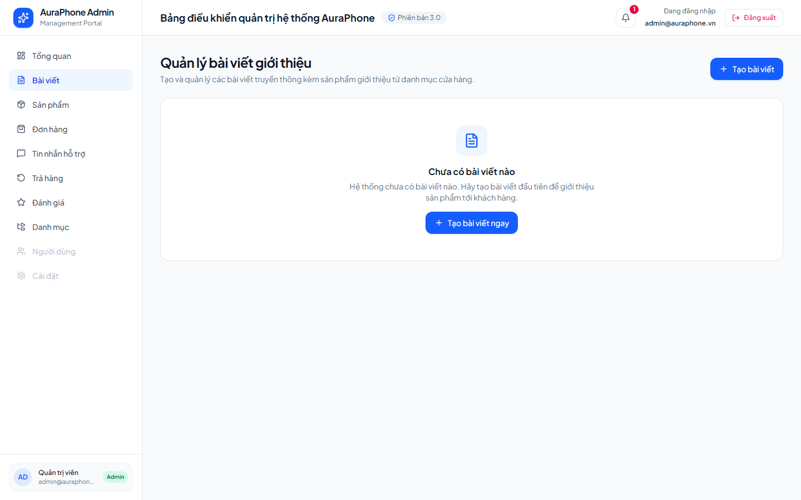

---

### 2. Quản trị viên tạo bài viết kèm phương tiện tải lên & sản phẩm giới thiệu (`Req 1.1, 1.2, 1.3`)
- Quản trị viên mở biểu mẫu "Tạo bài viết mới", nhập nội dung đánh giá chi tiết (130 ký tự), tải lên tệp ảnh `iphone15-banner.jpg` qua `POST /api/v1/admin/posts/media`, tìm kiếm và chọn sản phẩm giới thiệu "iPhone 15 Pro Max 256GB Titan Tự Nhiên" từ danh mục.
- **Ảnh bằng chứng Biểu mẫu Tạo bài viết:**
  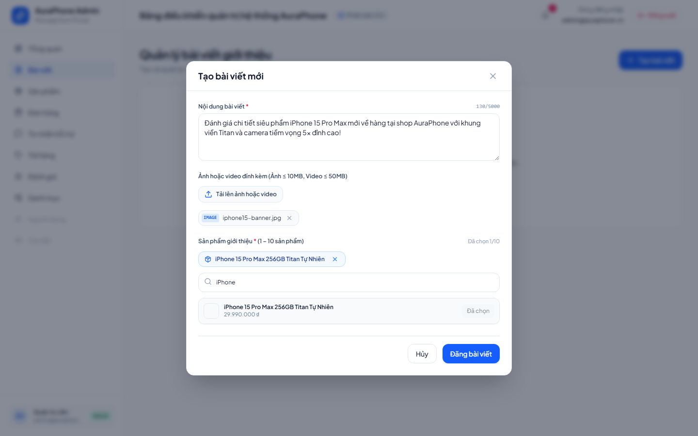

- Gửi biểu mẫu thành công (`POST /api/v1/admin/posts` -> `201 Created`), thông báo toast tiếng Việt "Tạo bài viết thành công" hiển thị và bài viết xuất hiện trên danh sách với đầy đủ huy hiệu "Quản trị viên", nhãn ảnh đính kèm và thẻ sản phẩm giới thiệu.
- **Ảnh bằng chứng Danh sách Bài viết sau khi tạo:**
  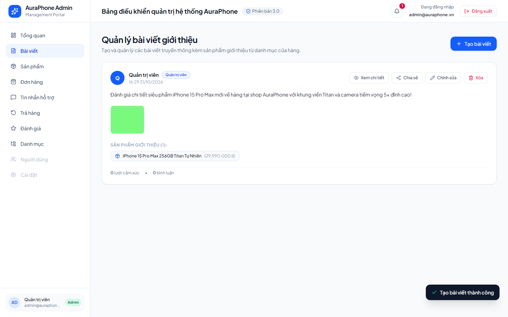

---

### 3. Quản trị viên chỉnh sửa nội dung bài viết (`Req 1.4`)
- Quản trị viên nhấn nút "Chỉnh sửa", biểu mẫu chỉnh sửa tải lại nội dung hiện có, cập nhật thêm ghi chú ưu đãi `[Đã cập nhật ưu đãi]`, và lưu thành công qua `PUT /api/v1/admin/posts/:id` -> `200 OK`.
- **Ảnh bằng chứng Biểu mẫu Chỉnh sửa Bài viết:**
  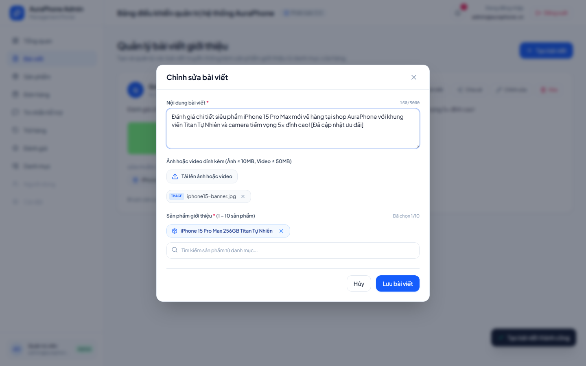

---

### 4. Quản trị viên xem chi tiết bài viết trên Cổng Quản trị (`Req 2.1, 2.3`)
- Nhấn "Xem chi tiết" điều hướng tới `/posts/:id` trên Cổng Quản trị (`:15174`), hiển thị chi tiết nội dung, ảnh đính kèm, thẻ sản phẩm giới thiệu kèm giá VND, thanh đếm cảm xúc và phần bình luận.
- **Ảnh bằng chứng Chi tiết Bài viết Quản trị:**
  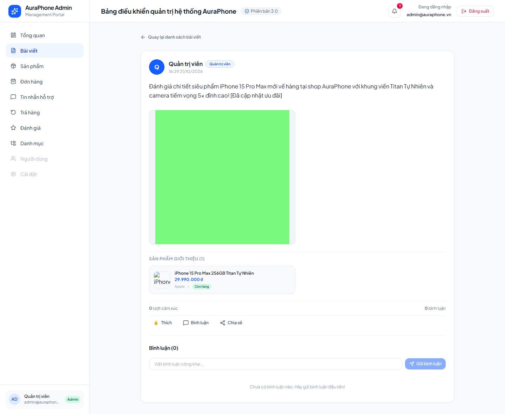

---

### 5. Khách hàng duyệt Bảng tin Bài viết trên Cửa hàng Desktop & Mobile (`Req 2.1, 2.2, 8.3`)
- Khách hàng truy cập `/posts` trên Cửa hàng (`:15173`), tiêu đề biên tập "Bảng tin & Đánh giá Flagship" hiển thị trang trọng, danh sách bài viết hiển thị theo thứ tự mới nhất trước kèm đầy đủ thẻ sản phẩm, số lượng cảm xúc và bình luận.
- Kiểm tra tính đáp ứng không bị tràn ngang (`document.documentElement.scrollWidth <= window.innerWidth`) trên cả Desktop (`1440x900`) và Mobile (`375x812`).
- **Ảnh bằng chứng Bảng tin Desktop (1440x900):**
  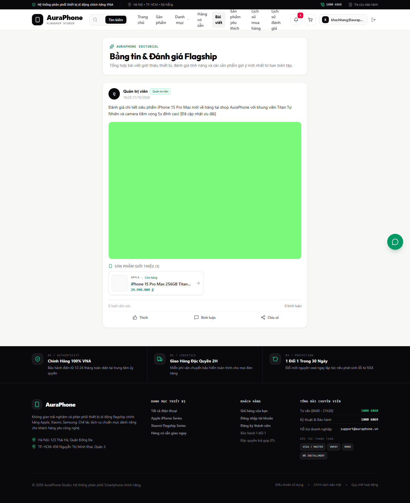

- **Ảnh bằng chứng Bảng tin Mobile (375x812):**
  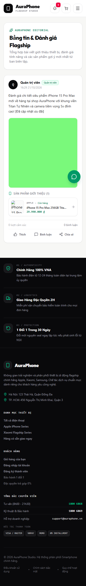

---

### 6. Sao chép liên kết chia sẻ bài viết (`Req 2.5`)
- Khách hàng nhấn nút "Chia sẻ" trên bài viết, đường dẫn đầy đủ của bài viết được sao chép vào bộ nhớ tạm (clipboard) và hiển thị toast xác nhận tiếng Việt: `"Đã sao chép liên kết bài viết"`.
- **Ảnh bằng chứng Toast Chia sẻ:**
  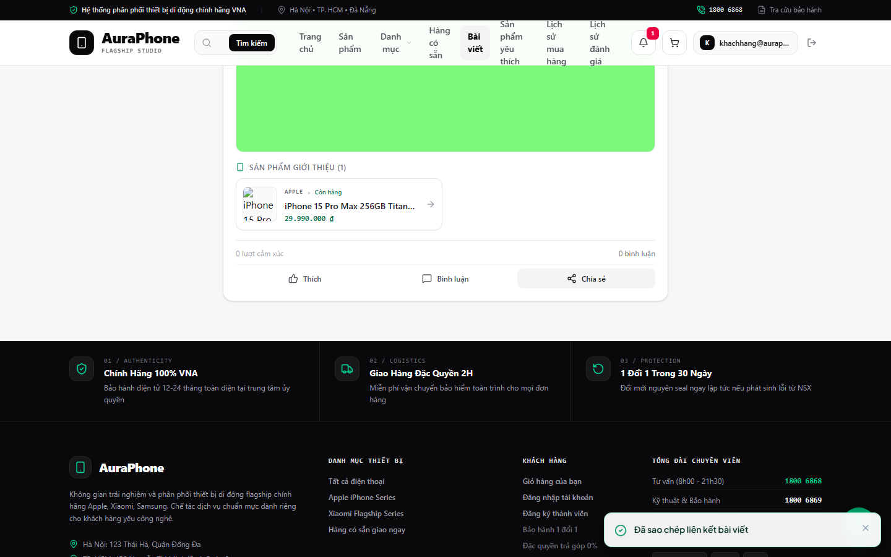

---

### 7. Nhấp thẻ sản phẩm giới thiệu điều hướng tới Trang sản phẩm (`Req 2.4`)
- Khách hàng nhấp vào thẻ sản phẩm "iPhone 15 Pro Max 256GB Titan Tự Nhiên", hệ thống lập tức điều hướng tới `/products/77777777-7777-7777-7777-777777777777` cho phép xem thông tin và mua hàng.
- **Ảnh bằng chứng Điều hướng Trang Sản phẩm:**
  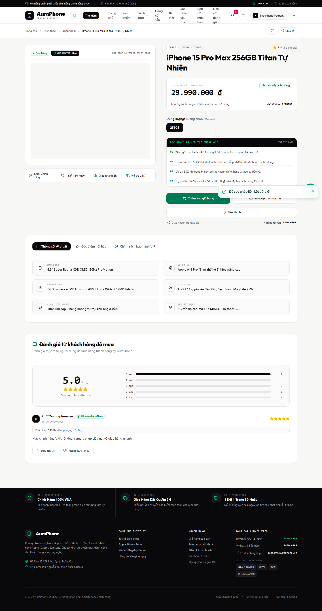

---

### 8. Trang chi tiết bài viết & Bày tỏ cảm xúc đa trạng thái 6 loại (`Req 3.1, 3.2, 3.3, 3.4`)
- Truy cập trang chi tiết bài viết `/posts/:id` trên Cửa hàng hiển thị bố cục chuẩn biên tập, bao gồm bài viết chính và phần thảo luận bình luận phân cấp bên dưới.
- **Ảnh bằng chứng Trang chi tiết bài viết Cửa hàng:**
  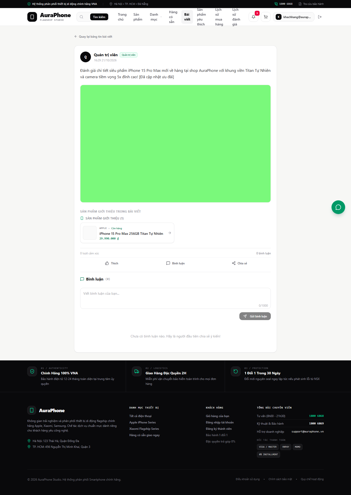

- Rê chuột vào nút bày tỏ cảm xúc làm nổi bật bộ chọn 6 cảm xúc đa trạng thái (👍 Thích, ❤️ Yêu thích, 😆 Haha, 😮 Wow, 😢 Buồn, 😡 Phẫn nộ).
- **Ảnh bằng chứng Bộ chọn 6 Cảm xúc:**
  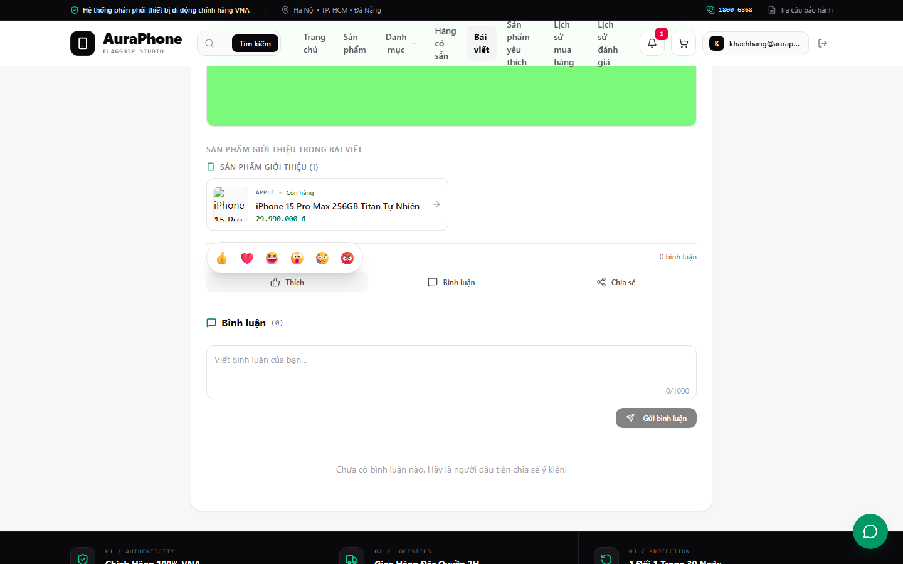

- Khách hàng chọn cảm xúc ❤️ "Yêu thích" (`PUT /api/v1/posts/:id/reactions` với `{"reaction":"love"}` -> `200 OK`), tổng số cảm xúc tăng lên 1, biểu tượng cảm xúc hiển thị màu hồng đậm và nút chuyển sang trạng thái "Yêu thích".
- **Ảnh bằng chứng Thả cảm xúc Yêu thích:**
  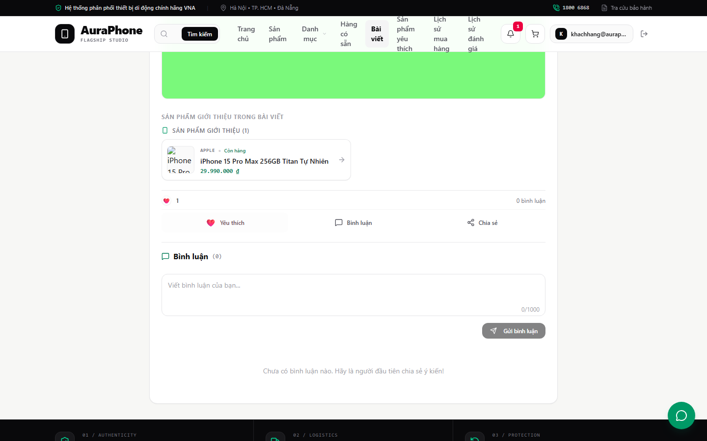

- Khách hàng đổi sang cảm xúc 👍 "Thích" (`PUT /api/v1/posts/:id/reactions` với `{"reaction":"like"}` -> `200 OK`), bộ đếm tự động giảm cảm xúc cũ và tăng cảm xúc mới, nút chuyển sang màu xanh dương "Thích".
- **Ảnh bằng chứng Đổi cảm xúc sang Thích:**
  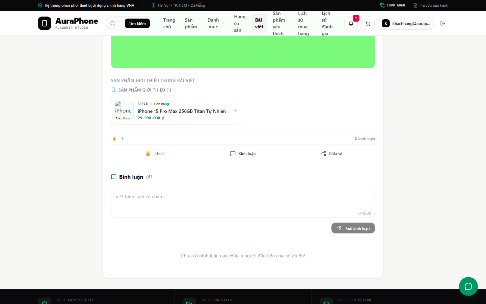

---

### 9. Bình luận và trả lời bình luận phân cấp 2 cấp (`Req 4.1, 4.2, 4.3`)
- Khách hàng gửi bình luận gốc cấp 1: "Thiết kế Titan tự nhiên nhìn rất sang trọng và đẳng cấp!" (`POST /api/v1/posts/:id/comments` -> `201 Created`), bình luận xuất hiện với avatar người viết, tên, thời gian và các nút tương tác.
- **Ảnh bằng chứng Bình luận gốc Cấp 1:**
  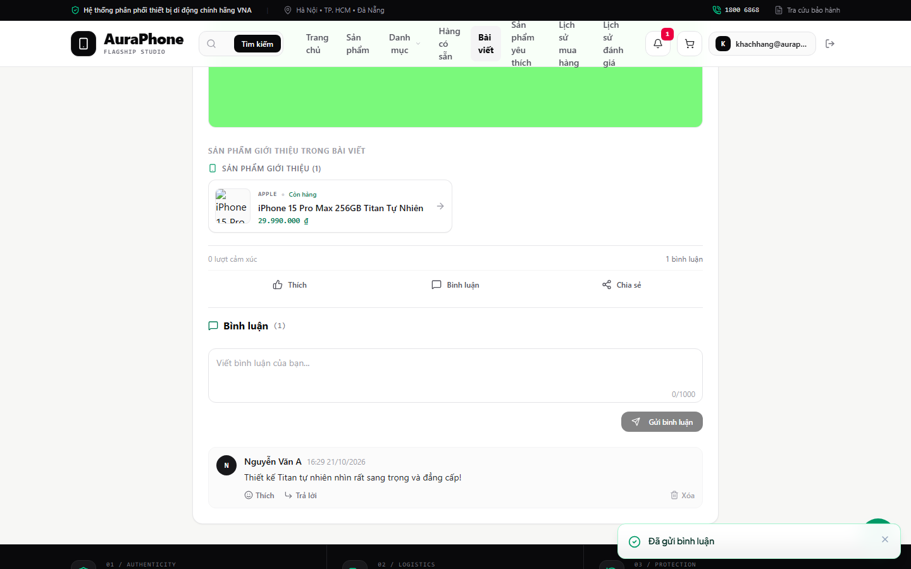

- Người dùng nhấn "Trả lời" bình luận cấp 1, biểu mẫu phản hồi xuất hiện với nhãn "Đang trả lời @Nguyễn Văn A", gửi nội dung phản hồi tạo thành bình luận cấp 2 thụt lề bên dưới bình luận gốc.
- **Ảnh bằng chứng Trả lời Cấp 2:**
  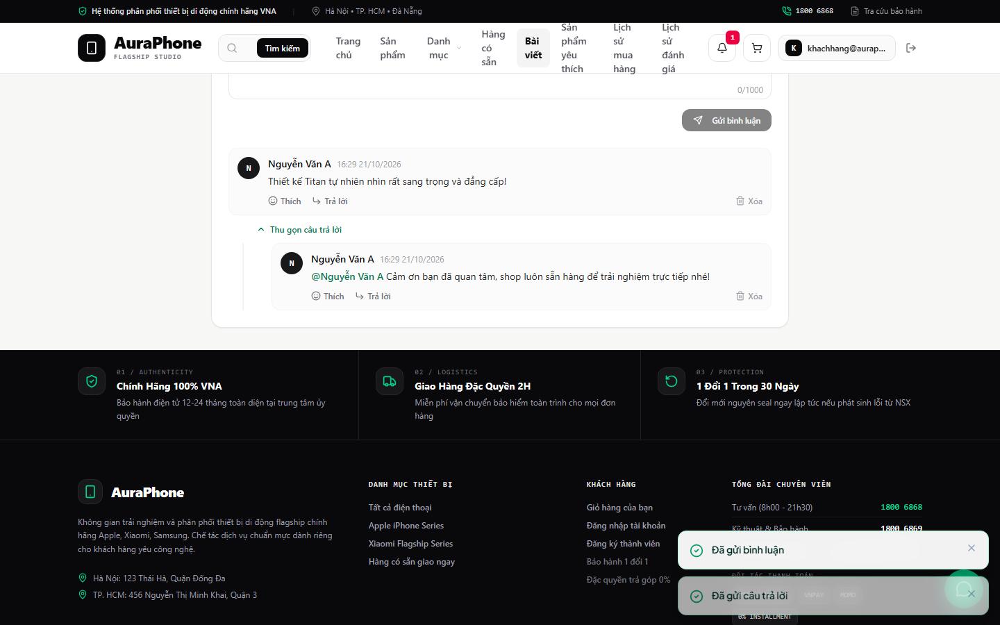

- Người dùng tiếp tục nhấn "Trả lời" vào chính bình luận cấp 2 vừa tạo: hệ thống tự động làm phẳng (flatten) bình luận mới vào cùng bình luận gốc cấp 1 (giữ độ sâu tối đa 2 cấp) và đính kèm tiền tố người được trả lời `@Nguyễn Văn A` theo đúng Req 4.3.
- **Ảnh bằng chứng Trả lời Bình luận Cấp 2 được làm phẳng:**
  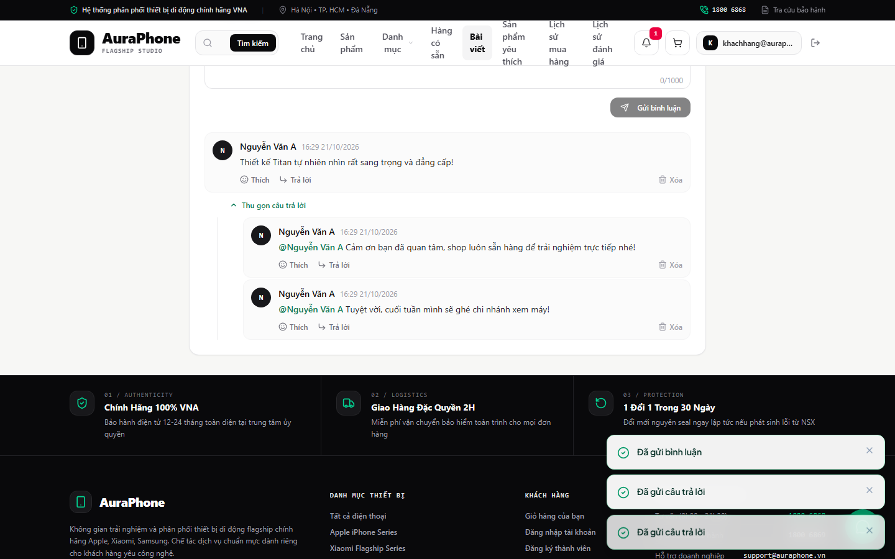

---

### 10. Bày tỏ cảm xúc đa trạng thái trên bình luận (`Req 5.1, 5.2`)
- Người dùng mở bộ chọn cảm xúc trên bình luận và chọn ❤️ "Yêu thích" (`PUT /api/v1/post-comments/:id/reactions` -> `200 OK`), bộ đếm cảm xúc của bình luận cập nhật huy hiệu ❤️ 1 hoàn toàn độc lập với bài viết.
- **Ảnh bằng chứng Cảm xúc trên Bình luận:**
  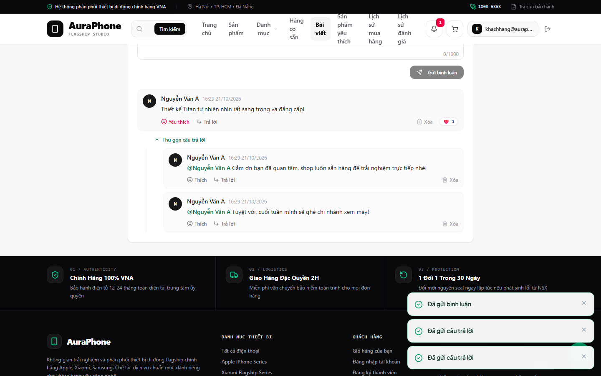

---

### 11. Thông báo thời gian thực gom nhóm qua WebSocket tới Quản trị viên & Deep-Link làm nổi bật bài viết (`Req 6.1, 6.3, 6.5, 6.6, 7.1, 7.2`)
- Khi nhiều khách hàng (`Nguyễn Văn A`, `Trần Thị B`, `Lê Văn C`) lần lượt bày tỏ cảm xúc vào cùng bài viết của Quản trị viên (`groupKey = post_reaction:<postId>`), máy chủ gộp tương tác vào cùng bản ghi thông báo chưa đọc (`id` giữ nguyên, cập nhật `actorCount`, `updatedAt`, `metadata.recentActors`) và phát sự kiện `notification:new` qua WebSocket (`WS-NOTIFICATIONS@2`).
- Chuông thông báo trên Header Cổng Quản trị tăng `unreadCount` đúng 1 lần khi thông báo chưa đọc được tạo mới và **không cộng trùng** khi thông báo chưa đọc được cập nhật gộp thêm người tương tác thứ 2, thứ 3.
- **Ảnh bằng chứng Huy hiệu Chuông Thông báo Realtime Admin (không tăng trùng khi gộp):**
  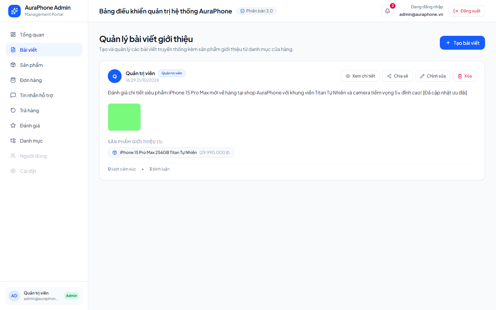

- Quản trị viên mở bảng thông báo Header: giao diện kiểm chứng hiển thị nhãn gộp 2 người (`"Trần Thị B và Nguyễn Văn A"`) và cập nhật tức thì sang nhãn gộp 3 người (`"Lê Văn C, Trần Thị B và 1 người khác đã bày tỏ cảm xúc ❤️ về bài viết của bạn."`) ở đầu danh sách kèm dấu chấm xanh chưa đọc.
- **Ảnh bằng chứng Danh sách Thông báo Gộp Nhiều Người trên Admin:**
  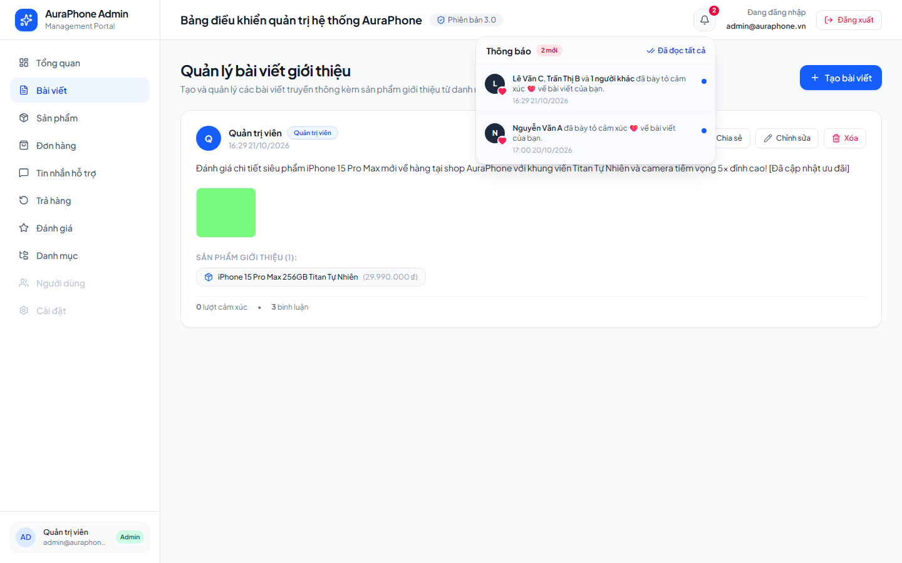

- Quản trị viên nhấp vào thông báo: hệ thống gửi `POST /api/v1/notifications/:id/read`, điều hướng trực tiếp tới `/posts/:id?focus=post&focusTs=...`, tự động cuộn mượt (`smooth scroll`) và kích hoạt viền sáng nổi bật màu xanh ngọc (`ring-2 ring-emerald-500 bg-emerald-50/40`) trực tiếp lên bài viết mục tiêu.
- **Ảnh bằng chứng Deep-Link làm nổi bật Bài viết mục tiêu:**
  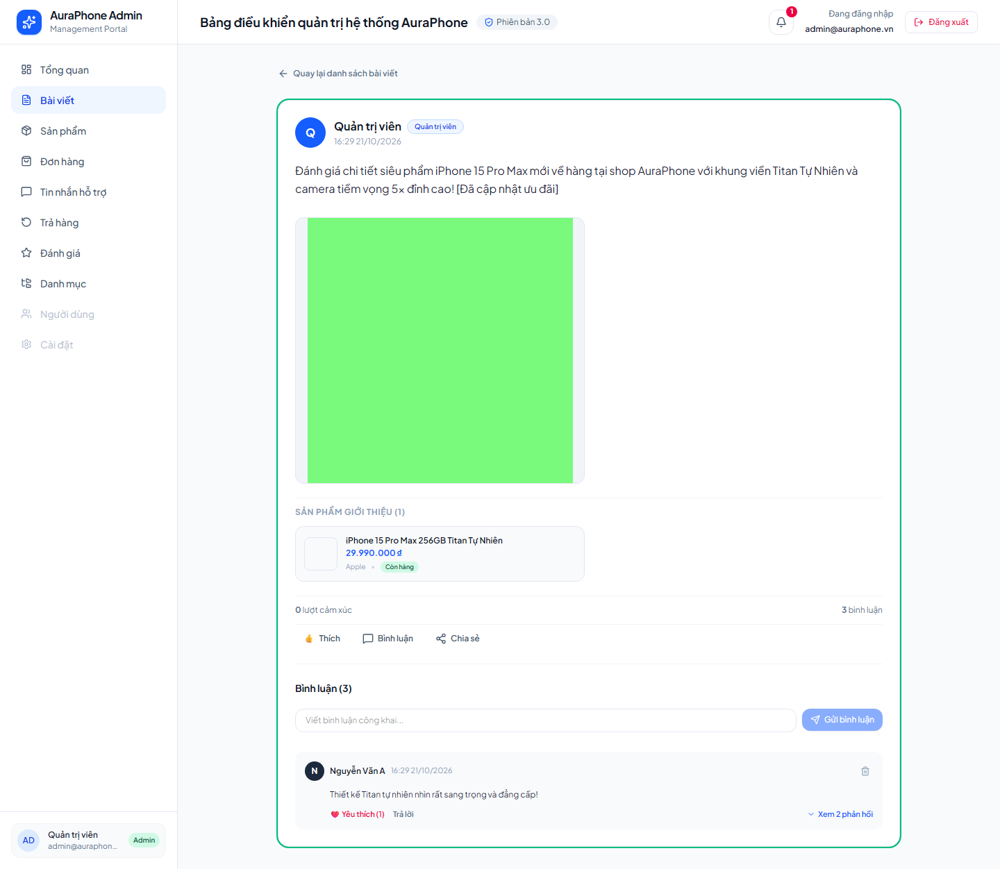

---

### 12. Thông báo thời gian thực gom nhóm tới Khách hàng & Deep-Link mở rộng bình luận cấp 2 (`Req 6.2, 6.5, 6.6, 7.1, 7.3`)
- Khách hàng đang ở trang bảng tin trên Cửa hàng (`:15173`), nhận các sự kiện `notification:new` qua WebSocket khi nhiều người dùng (`Quản trị viên`, `Trần Thị B`, `Lê Văn C`) cùng phản hồi vào nhánh bình luận của mình (`groupKey = comment_reply:<rootCommentId>`). Huy hiệu số chưa đọc trên chuông thông báo Header Cửa hàng hợp nhất theo `id` mà **không tăng trùng** khi cập nhật thông báo chưa đọc hiện có.
- **Ảnh bằng chứng Chuông Thông báo Khách hàng Realtime:**
  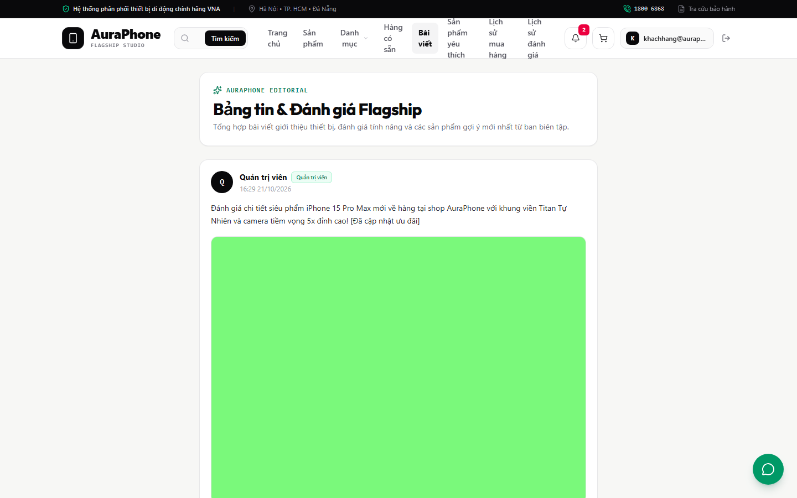

- Khách hàng mở bảng thông báo: kiểm chứng hiển thị nhãn gộp 2 người (`"Trần Thị B và Quản trị viên"`) và khi người thứ 3 phản hồi thì cập nhật trực tiếp lên đầu danh sách thành `"Lê Văn C, Trần Thị B và 1 người khác đã trả lời bình luận của bạn:"`.
- **Ảnh bằng chứng Bảng Thông báo Gộp Nhiều Người của Khách hàng:**
  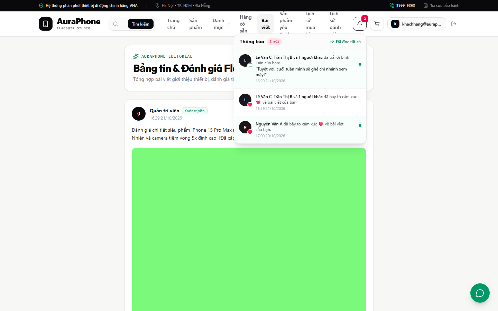

- Khách hàng nhấp vào thông báo: hệ thống đánh dấu đã đọc, điều hướng tới `/posts/:id?commentId=...&focusTs=...`, tự động mở rộng nhánh phản hồi cấp 2 đang thu gọn, cuộn mượt vào giữa khung nhìn và áp dụng hiệu ứng viền nổi bật (`ring-2 ring-emerald-500 bg-emerald-50/40`) chính xác vào bình luận phản hồi mục tiêu.
- **Ảnh bằng chứng Deep-Link cuộn và làm nổi bật Bình luận mục tiêu:**
  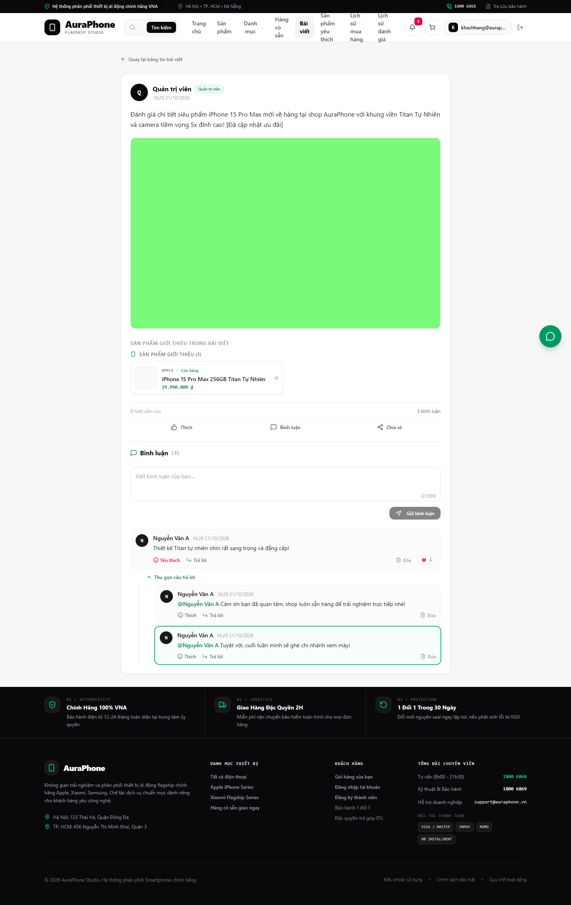

---

### 13. Xử lý thông báo trỏ tới bình luận đã bị xóa (`Req 7.5`)
- Khi người dùng nhấp vào thông báo mà bình luận mục tiêu đã bị xóa trước đó, trang chi tiết bài viết vẫn mở ra bình thường và hiển thị thông báo tiếng Việt màu hổ phách: `"Bình luận mục tiêu không còn tồn tại hoặc đã bị xóa."`.
- **Ảnh bằng chứng Cảnh báo Bình luận mục tiêu không tồn tại:**
  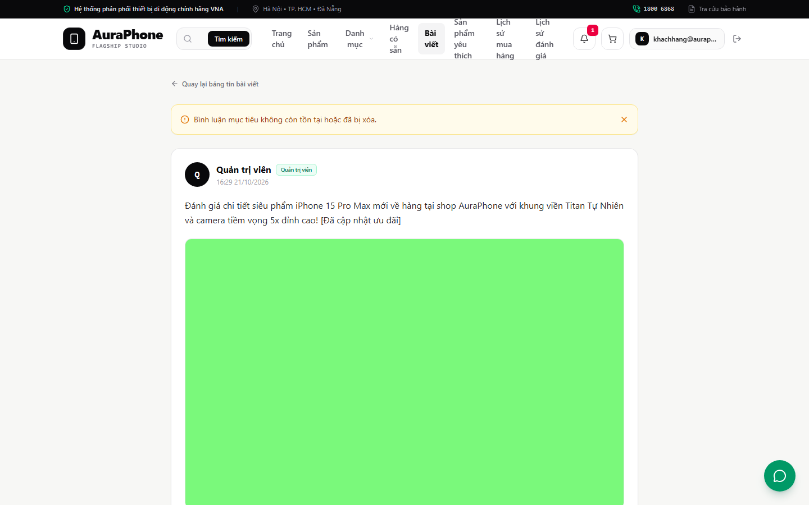

---

### 14. Kiểm tra khả năng tiếp cận & Thiết kế đáp ứng trên Di động 375x812 (`Req 8.3`)
- Toàn bộ trang chi tiết bài viết, thẻ sản phẩm, bộ chọn cảm xúc và chuỗi bình luận 2 cấp hiển thị hoàn hảo trên kích thước di động chuẩn `375x812` mà không gây tràn ngang khung nhìn.
- **Ảnh bằng chứng Chi tiết Bài viết Mobile Responsive:**
  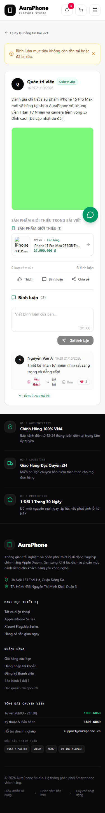

---

### 15. Quản trị viên xóa bài viết (`Req 1.5`)
- Quản trị viên quay lại danh sách bài viết trên Cổng Quản trị, nhấp nút "Xóa", hộp thoại cảnh báo nguy cơ hiển thị rõ ràng thông báo "Xác nhận xóa bài viết. Bạn có chắc chắn muốn xóa bài viết này không? Toàn bộ cảm xúc, bình luận và tệp đính kèm sẽ bị xóa hoàn toàn khỏi hệ thống.".
- **Ảnh bằng chứng Hộp thoại Xác nhận Xóa:**
  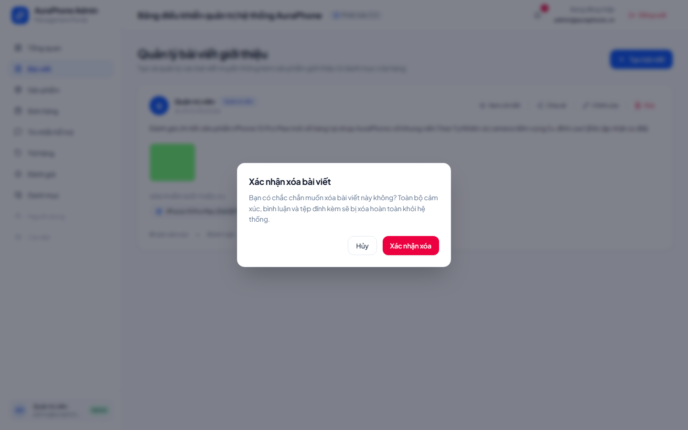

- Khi Quản trị viên nhấn "Xác nhận xóa" (`DELETE /api/v1/admin/posts/:id` -> `200 OK`), bài viết biến mất khỏi hệ thống và danh sách trở lại trạng thái trống ban đầu.

---

## Kết luận & Nghiệm thu

Toàn bộ 38 tiêu chí chấp nhận thuộc 8 nhóm yêu cầu (`1.1–8.3`) trong [requirements.md](file:///E:/v3-v3-singleagent/.dream/specs/product-referral-posts/requirements.md) và thiết kế kiến trúc trong [design.md](file:///E:/v3-v3-singleagent/.dream/specs/product-referral-posts/design.md) đã được kiểm chứng tự động 100% bằng Playwright E2E ở chế độ **`Mode 2: Contract-Verified Mock E2E (1:1 Backend Contract Lock)`**, tuân thủ nghiêm ngặt 4 quy tắc khóa hợp đồng, cung cấp đầy đủ 26 ảnh chụp màn hình chất lượng cao và không có bất kỳ cảnh báo lỗi console nào.
