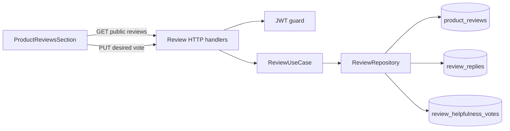

# Design Document

## Overview

Thiết kế bổ sung bình chọn `helpful`/`unhelpful` độc lập cho đánh giá khách hàng và phản hồi người bán trên trang chi tiết sản phẩm. Phạm vi đi qua ba ranh giới hiện có:

- backend review domain chịu trách nhiệm kiểm tra mục tiêu, lưu trạng thái duy nhất của từng khách hàng và trả tổng hợp;
- API `/api/v1` mở rộng danh sách đánh giá công khai và cung cấp hai thao tác bình chọn có xác thực;
- frontend khách hàng hiển thị số liệu, trạng thái đã chọn và xử lý đăng nhập, pending, thành công, thất bại.

Phản hồi người bán được nâng từ hai cột của đánh giá thành một thực thể có UUID riêng. UUID được giữ khi sửa, bị xóa khi xóa phản hồi và được tạo mới khi phản hồi được tạo lại. Đây là cơ sở để đáp ứng chính xác vòng đời tại 4.4-4.6, kể cả khi một yêu cầu từ giao diện cũ đến sau khi phản hồi đã được tạo lại.

Thiết kế giữ nguyên thứ tự mới nhất trước, phân trang, thống kê sao, API quản trị phản hồi và trang lịch sử đánh giá. Các yêu cầu được bao phủ: 1.1-7.4.

## Architecture



### Luồng tải danh sách

1. Frontend chờ `AuthContext` hoàn tất phục hồi phiên để tránh tải trạng thái cá nhân bằng access token cũ.
2. Frontend gọi `GET /api/v1/products/{productId}/reviews` qua `apiClientWithMeta`; client hiện có tự gắn bearer token nếu tài khoản đã đăng nhập.
3. Optional-auth middleware cho phép yêu cầu không có bearer token đi tiếp, nhưng xác thực token nếu header được cung cấp. Handler chỉ truyền `viewerUserId` vào use case khi token hợp lệ và vai trò là `customer`.
4. Repository lấy trang đánh giá theo thứ tự hiện có, lấy media, phản hồi, tổng vote và vote của người xem theo tập ID của trang. Không thực hiện truy vấn riêng cho từng đánh giá.
5. API giữ nguyên Full Status Envelope và pagination metadata hiện có, đồng thời bổ sung trạng thái hữu ích vào từng `PublicReview`.
6. Nếu request có token nhận 401 và refresh thất bại, API client xóa token, phát thông báo thay đổi phiên cho `AuthContext`, bỏ header `Authorization` và retry đúng một lần đối với request danh sách công khai. Request retry được xử lý như anonymous; không áp dụng anonymous retry cho endpoint ghi.

### Luồng cập nhật bình chọn

1. Frontend tính trạng thái mong muốn: chọn mới, chuyển lựa chọn hoặc `null` để gỡ lựa chọn hiện tại.
2. Frontend gửi `PUT` đến endpoint của đúng loại mục tiêu. Các endpoint bắt buộc JWT hợp lệ và vai trò `customer`.
3. Use case xác thực UUID và giá trị vote, sau đó yêu cầu repository đặt trạng thái tuyệt đối thay vì thực hiện một thao tác toggle không idempotent.
4. Repository mở transaction, khóa hàng `product_reviews` hoặc `review_replies` mục tiêu bằng `FOR UPDATE`, rồi mới xóa hoặc upsert hàng vote duy nhất và tính hai tổng từ các hàng vote đã lưu.
5. Frontend chỉ thay trạng thái đã xác nhận sau response thành công. Trong khi chờ, hai nút của đúng mục tiêu bị vô hiệu hóa; mục tiêu khác vẫn thao tác được.

### Luồng phản hồi người bán

- Tạo phản hồi: tạo một `review_replies` mới với UUID mới.
- Sửa phản hồi: cập nhật cùng hàng và giữ UUID, nên vote được giữ nguyên.
- Xóa phản hồi: xóa hàng; foreign key cascade xóa vote của phản hồi.
- Tạo lại sau khi xóa: tạo UUID khác. Yêu cầu vote cũ gửi đến UUID đã xóa nhận 404 và không thể tác động phản hồi mới.

### Tính nhất quán và concurrency

- Tổng vote được tính từ các hàng vote, không lưu bộ đếm biến đổi riêng; vì vậy tổng không âm và không có trạng thái counter lệch nguồn.
- Hai unique constraint theo loại mục tiêu bảo đảm mỗi khách hàng có tối đa một vote cho một đánh giá hoặc một phản hồi.
- Mọi vote writer khóa cùng hàng target trước mutation. Theo PostgreSQL `READ COMMITTED`, writer chờ khóa sẽ quan sát các commit trước đó ở các statement sau khi nhận khóa; response được tính trước commit và phản ánh operation cùng tất cả vote operation đã được serialize trước nó. Vote commit sau có thể làm số liệu thay đổi sau thời điểm response, nhưng không writer nào commit sau một writer trước đó rồi trả count bỏ sót writer trước.
- `PUT` nhận trạng thái mong muốn nên retry cùng request cho cùng kết quả. Với hai cập nhật đồng thời của cùng khách hàng và mục tiêu, cập nhật được serialize theo target; operation commit sau là trạng thái cuối và unique constraint vẫn giữ một hàng duy nhất.
- Foreign key và transaction bảo đảm vote không tồn tại cho mục tiêu đã bị xóa.
- Admin sửa/xóa reply khóa hàng reply theo cùng protocol với reply vote; delete chỉ thực hiện sau các writer đã được serialize trước và cascade vote. Tạo reply mới dùng UUID khác nên không tham gia khóa của target cũ.

## Components And Interfaces

### Domain và use case

Các kiểu dùng chung trong review domain:

```text
HelpfulnessVote = "helpful" | "unhelpful"

HelpfulnessState {
  helpfulCount: int64
  unhelpfulCount: int64
  viewerVote: HelpfulnessVote | null
}
```

`PublicReview` được mở rộng bằng:

```text
helpfulness: HelpfulnessState                         // luôn có
adminReplyId?: UUID                                  // có cùng adminReply
adminReplyHelpfulness?: HelpfulnessState             // có cùng adminReply
```

`ReviewRepository` nhận `viewerUserId` nullable khi lấy đánh giá công khai và cung cấp hai operation đặt trạng thái vote theo `reviewId` hoặc `replyId`. `ReviewUseCase` sở hữu validation giá trị vote và chuyển lỗi mục tiêu không tồn tại thành domain error ổn định. Danh tính khách hàng chỉ lấy từ JWT context, không nhận từ request body.

### API đọc danh sách công khai

`GET /api/v1/products/{productId}/reviews?page={page}&limit={limit}` giữ nguyên endpoint, payload và pagination hiện có. Route dùng optional authentication:

- không có `Authorization`: trả 200 với các tổng vote và mọi `viewerVote` là `null`;
- bearer token customer hợp lệ: trả 200 với `viewerVote` của khách hàng;
- bearer token admin hợp lệ: cho phép xem, nhưng mọi `viewerVote` là `null`;
- có header bearer nhưng token không hợp lệ hoặc hết hạn: trả 401 `invalid_token`, cho phép API client thực hiện refresh một lần và retry.

Phần mở rộng của một phần tử `reviews`:

```json
{
  "id": "review-uuid",
  "helpfulness": {
    "helpfulCount": 12,
    "unhelpfulCount": 2,
    "viewerVote": "helpful"
  },
  "adminReply": "Cảm ơn bạn đã phản hồi",
  "adminReplyId": "reply-uuid",
  "adminReplyHelpfulness": {
    "helpfulCount": 4,
    "unhelpfulCount": 0,
    "viewerVote": null
  }
}
```

`helpfulness` luôn hiện diện, kể cả khi hai tổng bằng 0. Ba trường `adminReply`, `adminReplyId` và `adminReplyHelpfulness` cùng bị lược bỏ khi không có phản hồi. Các trường đánh giá hiện có không đổi.

### API cập nhật vote

Hai endpoint mới:

```text
PUT /api/v1/reviews/{reviewId}/helpfulness
PUT /api/v1/review-replies/{replyId}/helpfulness
Authorization: Bearer <customer access token>
Content-Type: application/json

{ "vote": "helpful" }
{ "vote": "unhelpful" }
{ "vote": null }
```

Thuộc tính `vote` là bắt buộc; `null` có nghĩa gỡ vote. Giá trị chuỗi phân biệt chữ hoa/chữ thường và chỉ nhận đúng `helpful` hoặc `unhelpful`. Không nhận `userId` hay loại mục tiêu từ caller; endpoint xác định loại và path cung cấp ID đã nhận từ danh sách công khai.

Response thành công là HTTP 200 Full Status Envelope với `data` trực tiếp:

```json
{
  "helpfulCount": 13,
  "unhelpfulCount": 2,
  "viewerVote": "helpful"
}
```

Gửi lại cùng trạng thái là no-op về dữ liệu nhưng vẫn trả 200 cùng trạng thái hiện hành. Điều này làm operation idempotent và không tăng count hai lần.

### HTTP authentication

Guard hiện có được mở rộng bằng optional-auth middleware dùng cùng `jwt.Manager` và context keys:

- thiếu header: tiếp tục như anonymous;
- header sai định dạng hoặc token parse thất bại: trả 401 và abort;
- token hợp lệ: đặt user ID, role rồi tiếp tục.

Hai route ghi dùng `AuthRequired` và `RequireRole(customer)`. Cách này tái sử dụng JWT làm nguồn danh tính duy nhất, không tạo cookie hoặc device identity song song.

### Đồng bộ session frontend

`tokenStore` được mở rộng bằng subscription đồng bộ trong cùng tab. Mọi `setToken`/`clearToken` phát giá trị token hiện tại; `AuthProvider` đăng ký listener và thực hiện:

- token trở thành `null`: đặt `user`, `accessToken` về `null`, nên `isAuthenticated` chuyển thành `false`;
- token được thay bởi refresh: cập nhật `accessToken` nhưng giữ user đã xác thực hiện tại.

`apiClient` bổ sung request option dành riêng cho tài nguyên public có cá nhân hóa, ví dụ `retryWithoutAuthOnRefreshFailure`. Sau response 401, client vẫn thử refresh đúng một lần như hiện tại. Nếu refresh thất bại và option được bật, client xóa `Authorization` rồi retry request đúng một lần; không lặp refresh hoặc anonymous retry thêm. `getProductReviews` bật option này, còn hai PUT vote không bật.

Nếu PUT vote là request đầu tiên phát hiện phiên hết hạn, failed refresh vẫn xóa token và đồng bộ `AuthContext`; handler click nhận 401, giữ state đã xác nhận và chuyển ngay đến login với `pathname + search`. Sau login, trang được mount lại và GET cá nhân hóa khôi phục viewer state. Cơ chế này cũng bảo đảm sau một GET đã fallback anonymous, lần click kế tiếp đi thẳng qua nhánh unauthenticated thay vì gửi PUT bằng trạng thái React cũ.

### Frontend API và giao diện

`frontend/src/api/reviews.ts` bổ sung hai hàm đặt vote, đều qua `apiClient`. Wire types bổ sung `HelpfulnessVote`, `HelpfulnessState`, `adminReplyId` và hai trạng thái tổng hợp vào `PublicReview`.

`ProductReviewsSection`:

- chờ `AuthContext.isLoading === false` trước lần tải đầu để request công khai có trạng thái phiên ổn định;
- dùng `isAuthenticated`, `useLocation` và `useNavigate`; khách chưa đăng nhập được chuyển đến `/login?redirect=<pathname+search>` theo pattern yêu thích hiện có;
- hiển thị hai button cho đánh giá và, nếu có, hai button riêng trong khối phản hồi;
- button dùng `aria-pressed`, nhãn tiếng Việt có nghĩa đầy đủ, focus ring hiện hữu và trạng thái chọn ngoài màu sắc;
- giữ pending theo target ID, vô hiệu hóa cặp button của target đó và chỉ áp dụng response đã xác nhận;
- khi failed refresh của GET, nhận anonymous retry thành công và tiếp tục hiển thị public counts; khi PUT trả 401 sau failed refresh, chuyển đến login bằng redirect contract hiện có;
- với lỗi ghi khác, giữ state server gần nhất và hiển thị thông báo tiếng Việt qua cơ chế toast hiện có;
- không bổ sung vote vào `ReviewHistoryPage` hay frontend admin.

Các button được bố trí để wrap trên mobile, không tạo cuộn ngang và có kích thước tương tác tối thiểu 44 x 44 pixel. Không dùng optimistic update, nên failure không cần suy đoán hoặc hoàn tác count trung gian.

## Data Models

### `review_replies`

Nguồn dữ liệu phản hồi người bán mới:

```text
id          uuid primary key default gen_random_uuid()
review_id   uuid not null unique references product_reviews(id) on delete cascade
content     text not null check (length 1..1000)
created_at  timestamptz not null default now()
updated_at  timestamptz not null default now()
```

Một đánh giá có tối đa một phản hồi. API hiện có tiếp tục ánh xạ `content` thành `adminReply` và `updated_at` thành `adminRepliedAt` để không đổi wire contract. Admin create/update là upsert theo `review_id`; update giữ `id`. Delete xóa hàng thay vì đặt nội dung null.

### `review_helpfulness_votes`

Một bảng vote dùng hai foreign key nullable có constraint loại trừ:

```text
id          uuid primary key default gen_random_uuid()
user_id     uuid not null references users(id) on delete cascade
review_id   uuid null references product_reviews(id) on delete cascade
reply_id    uuid null references review_replies(id) on delete cascade
vote        text not null check (vote in ('helpful', 'unhelpful'))
created_at  timestamptz not null default now()
updated_at  timestamptz not null default now()

check (exactly one of review_id, reply_id is non-null)
unique (user_id, review_id)
unique (user_id, reply_id)
```

Các partial index `(review_id, vote)` và `(reply_id, vote)` trên hàng có target tương ứng hỗ trợ tổng hợp theo một trang đánh giá. Hai unique constraint hoạt động độc lập vì PostgreSQL không coi các giá trị `NULL` là trùng nhau.

### Migration

Một cặp migration số tiếp theo thực hiện theo transaction migration:

1. tạo `review_replies`;
2. backfill mỗi `product_reviews.admin_reply IS NOT NULL` thành một reply, dùng `COALESCE(admin_replied_at, updated_at)` cho cả mốc tạo và cập nhật do schema cũ không có định danh hoặc thời điểm tạo riêng;
3. tạo bảng vote và index;
4. xóa hai cột `admin_reply`, `admin_replied_at` khỏi `product_reviews` sau khi backfill;
5. down migration khôi phục hai cột, chép `content` và `updated_at` về đánh giá, rồi xóa bảng vote và reply.

Sau migration, queries trong `backend/db/queries/reviews.sql` join `review_replies` để giữ các payload hiện có. `sqlc generate` là nguồn tạo lại models và queriers; generated files không chỉnh tay. Dữ liệu vote bắt đầu rỗng, còn mọi phản hồi hiện có được bảo toàn nội dung và thời điểm hiển thị.

## Error Handling

| Trường hợp | HTTP | `error.code` | Hành vi |
|---|---:|---|---|
| Thiếu hoặc sai `vote` | 400 | `validation_error` | `fields.vote` mô tả giá trị hợp lệ |
| Thiếu token ở endpoint ghi | 401 | `unauthorized` | Không thay đổi vote |
| Token sai/hết hạn | 401 | `invalid_token` | API client refresh một lần; nếu thất bại thì đồng bộ anonymous, public GET retry không auth còn PUT giữ UI và đi đến login |
| Role không phải customer | 403 | `forbidden` | Thông báo tiếng Việt, không thay đổi vote |
| Review ID sai hoặc không tồn tại | 404 | `review_not_found` | Không thay đổi vote |
| Reply ID sai, đã xóa hoặc không tồn tại | 404 | `review_reply_not_found` | Không thay đổi vote; reply tạo lại không bị tác động |
| Lỗi persistence không phân loại | 500 | `internal` | Log lỗi kỹ thuật không chứa token; UI giữ state đã xác nhận |

Mọi lỗi dùng Full Status Envelope qua `writeError`/`respondError`; business message mới bằng tiếng Việt. Handler không trả lỗi database hoặc chi tiết constraint cho client. Request ghi không dùng optimistic state nên timeout, 5xx hoặc lỗi mạng không làm count hiển thị tự tăng/giảm. Failed refresh của public GET được retry anonymous đúng một lần; failed refresh của PUT đồng bộ trạng thái anonymous và kích hoạt login redirect. Một lần tải lại danh sách luôn đồng bộ từ nguồn đã lưu.

## Testing Strategy

### Backend domain và use case

- Xác minh chỉ nhận `helpful`, `unhelpful`, `null`; UUID mục tiêu sai ánh xạ thành not-found phù hợp.
- Xác minh trạng thái set mới, đổi, gỡ và gửi lặp cùng desired state.
- Xác minh customer được vote đánh giá của chính mình; admin bị route guard từ chối.
- Xác minh public list truyền viewer ID chỉ cho customer hợp lệ.

### Repository và migration

- Integration test backfill phản hồi cũ, join trả cùng `adminReply`/`adminRepliedAt`, và down migration khôi phục được dữ liệu phản hồi.
- Integration test unique invariant cho mỗi user-target, tổng 0, tổng nhiều user, viewer vote có/không có và tổng hợp theo tập ID của một trang.
- Integration test sửa review giữ vote; sửa reply giữ UUID/vote; xóa reply cascade vote; tạo lại có UUID mới và count 0; request dùng UUID cũ nhận not-found.
- Concurrency test cùng user-target kết thúc với đúng một hàng và count không âm.
- Concurrency test hai customer cùng vote một target chứng minh target lock serialization: hai response quan sát lần lượt tổng 1 và 2 theo thứ tự khóa/commit, và database cuối có tổng 2.
- Kiểm tra query danh sách không phát sinh N+1 theo số review của trang.

### HTTP contract

- Handler test anonymous GET, customer GET cá nhân hóa, admin GET không cá nhân hóa và invalid bearer 401.
- Handler test hai PUT cho đủ create/change/remove/idempotent, validation, 401, 403, 404 và Full Status Envelope.
- Regression test endpoint admin reply và user review history giữ wire shape hiện có.

### Frontend

- API unit test xác minh path, method, request body và response type của hai operation.
- Component test hiển thị count 0 và count có dữ liệu; selected state của review và reply độc lập.
- Component test khách chưa đăng nhập bấm vote được chuyển đến login với current path/query; sau đăng nhập quay lại đúng trang.
- API/AuthContext/component integration test phiên hết hạn: failed refresh xóa trạng thái xác thực; pagination/reload retry anonymous đúng một lần; lần click vote tiếp theo và PUT đầu tiên phát hiện expiry đều chuyển đến login với current path/query.
- Component test pending chỉ khóa đúng target, success áp dụng response server, failure giữ state cũ và hiện thông báo tiếng Việt.
- Component test không render reply controls khi không có reply và không bổ sung controls vào lịch sử đánh giá.
- Accessibility test `aria-pressed`, keyboard activation, focus visibility; kiểm tra trực quan ở chiều rộng 320px và desktop để xác nhận wrap, vùng chạm và không cuộn ngang.

### Verification commands

- Backend: focused review/domain/HTTP tests, `make gen`, `make test`, `make vet`; áp dụng migration bằng `make db-up` khi database local khả dụng.
- Frontend: focused `ProductReviewsSection` và API tests, `npm run lint`, `npm test`, `npm run build`; kiểm tra desktop/mobile bằng trình duyệt.
- Root: `make build` sau khi sqlc output và cả hai frontend contract đã ổn định.

## Requirement Traceability

| Requirement | Design Elements | Verification |
|---|---|---|
| 1.1 | `PublicReview.helpfulness`, review controls | Render counts component test |
| 1.2 | `adminReplyId`, `adminReplyHelpfulness`, reply controls | Independent reply render test |
| 1.3 | Row-derived aggregate defaults to zero | Empty-vote repository and UI tests |
| 1.4 | Optional-auth public GET | Anonymous handler test |
| 1.5 | Nullable `viewerVote`, `aria-pressed` | Personalized GET and selected UI tests |
| 2.1 | Authenticated explicit-state PUT | Create vote API/repository tests |
| 2.2 | Upsert desired opposite state | Change vote tests |
| 2.3 | Required `vote: null` | Remove vote tests |
| 2.4 | Per-target row lock, unique constraints, row-derived totals | Same-user và two-customer concurrency tests |
| 2.5 | Per-target pending state | Rapid interaction component test |
| 2.6 | Confirmed-state-only UI, Vietnamese errors | Failure component and HTTP tests |
| 3.1 | AuthContext plus existing login redirect contract | Redirect/return integration test |
| 3.2 | AuthRequired plus RequireRole(customer) | 401/403 handler tests |
| 3.3 | Không có owner restriction | Self-review vote use-case test |
| 3.4 | Target existence and stable reply UUID | Review/reply 404 tests |
| 3.5 | TokenStore subscription và anonymous retry option | Failed-refresh GET/pagination integration test |
| 3.6 | Synchronized anonymous state và 401 vote redirect | Post-expiry vote redirect test |
| 4.1 | `review_id` vote target | Review isolation test |
| 4.2 | `reply_id` vote target | Reply isolation test |
| 4.3 | Stable product review ID | Edit-review retention test |
| 4.4 | Reply update retains row UUID | Edit-reply retention test |
| 4.5 | Reply delete with cascade | Delete-reply test |
| 4.6 | New reply UUID after deletion | Recreate and stale-ID test |
| 5.1 | Batch aggregates included per page | Paginated repository/handler test |
| 5.2 | Customer viewer ID from optional auth | Personalized list test |
| 5.3 | Anonymous/admin viewer ID omitted | Anonymous/admin list test |
| 5.4 | PUT returns state at its serialized mutation point | Success contract and two-customer response-count test |
| 5.5 | Existing envelope helpers and direct data | Envelope serialization tests |
| 6.1 | Optional-auth route with no-token pass-through | Public regression test |
| 6.2 | Existing ordering and pagination retained | Ordering/pagination regression test |
| 6.3 | Vote queries separate from rating summary | Rating summary regression test |
| 6.4 | Stable review entity and existing create/edit paths | Review lifecycle regression tests |
| 6.5 | Compatible admin reply API over reply entity | Admin handler/API regression tests |
| 6.6 | Không đổi `ReviewHistoryPage`/`UserReview` contract | History regression test |
| 7.1 | Text labels plus `aria-pressed` | Accessible-name/state tests |
| 7.2 | Native buttons and visible focus | Keyboard test |
| 7.3 | 44px controls and wrapping layout | 320px/desktop visual verification |
| 7.4 | Auth restoration plus existing review loading state | Loading-state component test |

## Existing System Integration

### Supporting dependencies

- JWT access token, observable `tokenStore` và `AuthContext` là nguồn danh tính/trạng thái đăng nhập chuẩn. Thiết kế mở rộng guard và đồng bộ token state hiện có thay vì tạo định danh theo cookie hoặc thiết bị.
- `GET /products/{id}/reviews` tiếp tục cung cấp review ID; phản hồi mới cung cấp thêm `adminReplyId`, vì caller không được giả định biết ID nội bộ.
- Login page đã hỗ trợ `redirect`; controls tái sử dụng đúng `pathname + search` như favorite flow.
- Full Status Envelope, `apiClient`, `apiClientWithMeta`, `ApiError`, pagination metadata và error mapper hiện có tiếp tục là contract dùng chung.
- `product_reviews`, user ID và admin reply API hiện có là nguồn dữ liệu chuẩn; migration chuyển phản hồi chứ không tạo bản sao song song.

### Downstream impacts và compatibility

- Public product review consumer nhận thêm trường, không mất hoặc đổi nghĩa trường hiện có.
- User review history và admin review list vẫn nhận `adminReply`/`adminRepliedAt`; chúng join nguồn reply mới nhưng không nhận helpfulness fields.
- Admin update/delete reply giữ nguyên route, body và response shape. Chỉ persistence lifecycle đổi để edit giữ UUID và delete cascade vote.
- Review create/edit, media, eligibility, rating summary, newest-first ordering và pagination không đổi.
- Domain repository interface thay đổi tác động các fake repository trong review, order và HTTP tests; chúng phải được cập nhật đồng bộ nhưng không làm thay đổi hành vi order.
- Schema migration và query changes bắt buộc tái sinh sqlc output. Dependency injection không thêm provider mới nên không cần thay đổi Wire graph.

## Alternatives Considered

### Giữ phản hồi trong cột và thêm version

Có thể thêm một version hoặc UUID vào `product_reviews`, nhưng vote reply sẽ khó có foreign key trực tiếp và việc phân biệt request cũ sau delete/recreate phụ thuộc nhiều constraint ghép. Thực thể `review_replies` được chọn vì thể hiện đúng vòng đời, có referential integrity và làm cascade vote rõ ràng.

### Lưu hai bộ đếm trên nội dung

Counter giúp đọc nhanh hơn nhưng mọi create/change/remove cần cập nhật nhiều giá trị nguyên tử và có nguy cơ lệch khi sửa lỗi hoặc retry. Tính tổng từ hàng vote được chọn vì trang chỉ tối đa 10 đánh giá, index hỗ trợ aggregate và nguồn dữ liệu duy nhất bảo đảm count không âm.

### Endpoint toggle

Endpoint toggle ngắn hơn nhưng cùng request retry có thể đảo trạng thái lần thứ hai. `PUT` trạng thái tuyệt đối được chọn để idempotent, hỗ trợ rõ create/change/remove và đơn giản hóa phục hồi sau 401 refresh.
