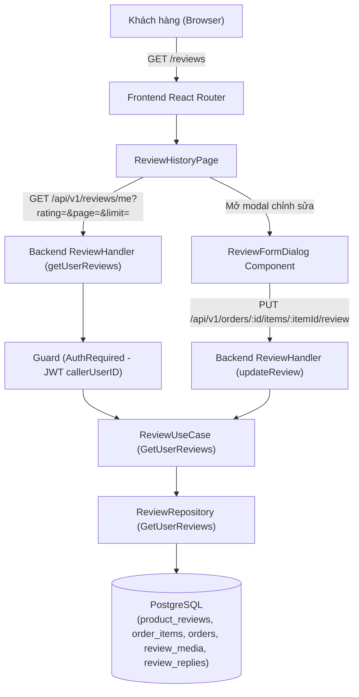

# Tài liệu thiết kế kỹ thuật

## Tổng quan (Overview)

Tài liệu này xác định kiến trúc kỹ thuật, hợp đồng giao tiếp liên ranh giới (shared contracts) và chiến lược kiểm thử (bao gồm xác minh E2E theo **Mode 2: Contract-Verified Mock E2E — 1:1 Backend Contract Lock**) cho tính năng **Lịch sử đánh giá** (`review-history`). Tính năng cung cấp giao diện và API cho phép khách hàng đã đăng nhập xem lại danh sách đánh giá sản phẩm của chính mình, lọc theo số sao, phân trang, xem chi tiết đa phương tiện (ảnh/video) và thực hiện chỉnh sửa đánh giá (nếu chưa từng chỉnh sửa).

Tính năng giải quyết toàn bộ các yêu cầu từ Yêu cầu 1 đến Yêu cầu 6 trong [requirements.md](file:///E:/v3-v3-singleagent/.dream/specs/review-history/requirements.md):
- **Yêu cầu 1 (1.1 - 1.6):** Truy cập và hiển thị danh sách đánh giá cá nhân, liên kết sản phẩm và đơn hàng, trạng thái trống.
- **Yêu cầu 2 (2.1 - 2.5):** Bộ lọc số sao (Tất cả, 1-5 sao), phân trang (tối đa 10 đánh giá/trang) và trạng thái rỗng theo bộ lọc.
- **Yêu cầu 3 (3.1 - 3.5):** Chỉnh sửa đánh giá (tối đa 1 lần khi `edit_count = 0`), từ chối chỉnh sửa lần hai bằng lỗi xung đột (`409`), không hỗ trợ xóa.
- **Yêu cầu 4 (4.1 - 4.3):** Xem ảnh phóng to trong modal/lightbox, phát video kèm điều khiển (không tự phát âm thanh), khung giữ chỗ thay thế khi media lỗi.
- **Yêu cầu 5 (5.1 - 5.3):** Điều hướng từ Header/Mobile Drawer, đồng bộ dữ liệu với trang chi tiết sản phẩm và lịch sử đơn hàng, tuân thủ chuẩn Full Status Envelope với thông báo lỗi nghiệp vụ tiếng Việt.
- **Yêu cầu 6 (6.1 - 6.4):** Cô lập dữ liệu người dùng (`callerUserID`), bố cục responsive (`>= 320px` không cuộn ngang ngoài ý muốn), skeleton/loading indicator, khả năng điều hướng bàn phím và focus rõ ràng.

## Kiến trúc (Architecture)



### Luồng dữ liệu chính:
1. **Truy vấn danh sách lịch sử đánh giá (`GET /api/v1/reviews/me`):**
   - Client gửi request `GET /api/v1/reviews/me?rating={0-5}&page={n}&limit={10}` kèm JWT access token (`Authorization: Bearer <token>`).
   - Middleware `guard.AuthRequired` xác thực token và trích xuất `callerUserID`. Nếu chưa đăng nhập hoặc token không hợp lệ, trả về `401 Unauthorized` và frontend chuyển hướng tới `/login?redirect=/reviews` (`Req 1.1`).
   - `ReviewUseCase.GetUserReviews` kiểm tra tính hợp lệ của `userID`, `ratingFilter` (`0..5`), chuẩn hóa `page` (`>= 1`) và `limit` (`1..10`).
   - `ReviewRepository.GetUserReviews` thực hiện truy vấn kết hợp (`JOIN`) giữa `product_reviews`, `order_items`, `orders` và `LEFT JOIN review_replies` theo điều kiện `orders.user_id = $userID` (`Req 6.1`) cùng bộ lọc `rating`, sắp xếp `pr.created_at DESC, pr.id DESC` (`Req 1.2`). Đồng thời batch-hydrate danh sách `review_media` qua `ListReviewMediaByReviewIDs` (không gây N+1 queries).
   - Handler trả về danh sách `UserReview` trong cấu trúc Full Status Envelope kèm `PaginationMeta` (`Req 2.3, 5.3`).
2. **Chỉnh sửa đánh giá từ trang lịch sử (`PUT /api/v1/orders/:id/items/:itemId/review`):**
   - Tái sử dụng endpoint cập nhật đánh giá và component `ReviewFormDialog` từ miền `purchased-product-reviews`.
   - Chỉ các mục có `canEdit === true` (`edit_count = 0`) mới hiển thị nút `"Sửa đánh giá"` (`Req 3.1`).
   - Sau khi cập nhật thành công (`200 OK`), client cập nhật trực tiếp mục đánh giá trong state cục bộ (`editCount = 1`, `canEdit = false`, `edited = true`, `updatedAt`, `rating`, `comment`, `media`), đóng modal và hiển thị toast thành công mà không cần tải lại toàn bộ trang (`Req 3.3`).
   - Mọi yêu cầu chỉnh sửa tiếp theo khi `edit_count >= 1` bị backend từ chối với `HTTP 409 Conflict` (`error.code = "review_edit_limit_reached"`, message tiếng Việt `"Đánh giá chỉ được chỉnh sửa một lần"`) (`Req 3.4`).

## Thành phần và Giao diện (Components And Interfaces)

### 1. Shared Contracts

#### Contract DB-USER-REVIEWS (rev 1)

- **Mục đích:** Truy vấn phân trang danh sách đánh giá thuộc quyền sở hữu của một khách hàng cụ thể cùng tổng số bản ghi khớp bộ lọc số sao và danh sách tệp đính kèm (`review_media`).
- **Ranh giới sở hữu:** `backend/db/queries/reviews.sql` (`CountUserReviews`, `ListUserReviews`, `ListReviewMediaByReviewIDs`) và `backend/internal/repository/review_repository.go` (`ReviewRepository.GetUserReviews`).
- **Ràng buộc dữ liệu & Bảo mật:**
  - Luôn lọc theo `orders.user_id = @user_id` để cô lập tuyệt đối dữ liệu giữa các khách hàng (`Req 6.1`).
  - Hỗ trợ `@rating_filter::smallint = 0` (tất cả số sao) hoặc `pr.rating = @rating_filter::smallint` (`1..5`).
  - Sắp xếp cố định theo `pr.created_at DESC, pr.id DESC` (`Req 1.2`).
  - Ánh xạ `CanEdit = (edit_count == 0)` và `Edited = (edit_count > 0)`.

#### Contract API-USER-REVIEWS (rev 1)

- **Endpoint:** `GET /api/v1/reviews/me`
- **Xác thực:** Bắt buộc (`guard.AuthRequired` — `Authorization: Bearer <accessToken>`).
- **Tham số Query:**
  - `rating` (int, optional): Số nguyên từ `0` đến `5` (mặc định `0` hoặc bỏ trống nghĩa là lấy tất cả số sao). Nếu truyền giá trị ngoài khoảng `0..5` hoặc không phải số nguyên hợp lệ, trả về `HTTP 400 Bad Request` (`error.code = "validation_error"`, `error.fields.rating = "Số sao lọc không hợp lệ, phải là số nguyên từ 0 đến 5"`).
  - `page` (int, optional): Số nguyên `>= 1` (mặc định `1` nếu bỏ trống hoặc `< 1`).
  - `limit` (int, optional): Số nguyên `1..10` (mặc định `10` nếu bỏ trống, `< 1` hoặc `> 10`).
- **Success Response (`HTTP 200 OK` — Full Status Envelope):**
  ```json
  {
    "success": true,
    "message": "Lấy lịch sử đánh giá thành công",
    "data": {
      "reviews": [
        {
          "id": "c1f72a44-8092-4112-9c17-f58c7365da51",
          "orderItemId": "e3012921-7299-4d26-bbda-7a63d91cf923",
          "order": {
            "id": "a90a4279-8db2-4876-8f3b-b236fa78dc71",
            "createdAt": "2026-08-20T10:15:30Z"
          },
          "product": {
            "id": "b11a9192-5632-44df-9e20-9118c8e19b52",
            "name": "iPhone 15 Pro Max",
            "brandName": "Apple",
            "model": "Titan Tự Nhiên 256GB",
            "imageUrl": "https://example.com/iphone-15.jpg",
            "options": [
              { "groupLabel": "Màu sắc", "valueLabel": "Titan Tự Nhiên" },
              { "groupLabel": "Dung lượng", "valueLabel": "256GB" }
            ]
          },
          "rating": 5,
          "comment": "Máy đẹp, giao nhanh, đóng gói rất cẩn thận.",
          "editCount": 0,
          "canEdit": true,
          "edited": false,
          "adminReply": "Cảm ơn bạn đã tin tưởng và mua sắm tại AuraPhone!",
          "adminRepliedAt": "2026-08-26T09:00:00Z",
          "media": [
            {
              "id": "d2e3f4a5-1122-3344-5566-778899aabbcc",
              "reviewId": "c1f72a44-8092-4112-9c17-f58c7365da51",
              "type": "image",
              "url": "/media/reviews/d2e3f4a5-1122-3344-5566-778899aabbcc",
              "mimeType": "image/jpeg",
              "sizeBytes": 102400,
              "position": 0,
              "createdAt": "2026-08-25T14:20:00Z"
            }
          ],
          "createdAt": "2026-08-25T14:20:00Z",
          "updatedAt": "2026-08-25T14:20:00Z"
        }
      ]
    },
    "error": null,
    "meta": {
      "timestamp": "2026-08-28T13:15:00Z",
      "pagination": {
        "page": 1,
        "limit": 10,
        "total": 1,
        "totalPages": 1,
        "hasNext": false,
        "hasPrev": false
      }
    }
  }
  ```
- **Quy tắc trường tùy chọn (`omitempty`):**
  - `adminReply` và `adminRepliedAt` chỉ xuất hiện khi đánh giá có phản hồi từ người bán; được lược bỏ khi chưa có phản hồi.
  - Trong `ReviewMedia`, các trường `reviewId`, `sizeBytes`, `createdAt` có tag `omitempty`.

#### Contract API-ORDER-ITEM-REVIEW (rev 1)

- **Nguồn cung cấp (Existing Provider):** Được cung cấp bởi miền `purchased-product-reviews` tại `backend/internal/delivery/http/review_handler.go` (`updateReview`).
- **Endpoint tái sử dụng:** `PUT /api/v1/orders/:id/items/:itemId/review`
- **Xác thực:** Bắt buộc (`guard.AuthRequired`).
- **Request (`multipart/form-data`):**
  - `rating` (bắt buộc): Số nguyên `"1"` đến `"5"`.
  - `comment` (tùy chọn): Chuỗi nhận xét, sau khi `TrimSpace` có độ dài `<= 1000` ký tự.
  - `retainedMediaIds` (tùy chọn, lặp lại): Danh sách UUID các tệp media hiện có muốn giữ lại.
  - `images` (tùy chọn): Tệp ảnh mới tải lên (tổng ảnh giữ lại + ảnh mới `<= 5`, mỗi ảnh `<= 5MB`, định dạng JPEG/PNG/WebP).
  - `video` (tùy chọn): Tệp video mới tải lên (tổng video giữ lại + video mới `<= 1`, `<= 50MB`, định dạng MP4/WebM).
- **Success Response (`HTTP 200 OK` — Full Status Envelope):**
  - `message`: `"Cập nhật đánh giá thành công"`
  - `data`: Đối tượng `Review` đã cập nhật với `editCount: 1`, `canEdit: false`, `edited: true`, `rating`, `comment`, `media`, `createdAt`, `updatedAt`.
- **Error Responses:**
  - `HTTP 400 Bad Request` (`error.code = "validation_error"`, `error.fields`): Khi thiếu `rating`, `rating` ngoài `1..5`, `comment > 1000` ký tự, hoặc media không hợp lệ.
  - `HTTP 401 Unauthorized` (`error.code = "unauthorized"` / `"invalid_token"`): Khi thiếu hoặc sai JWT token.
  - `HTTP 409 Conflict` (`error.code = "review_edit_limit_reached"`, `message = "Đánh giá chỉ được chỉnh sửa một lần"`): Khi đánh giá đã từng được chỉnh sửa (`edit_count >= 1`) (`Req 3.4`).
  - Không tồn tại route `DELETE` cho đánh giá; mọi yêu cầu `DELETE` trả về `404`/`405` (`Req 3.5`).

### 2. Backend Domain Interface

```go
// backend/internal/domain/review.go

type UserReviewProduct struct {
    ID        string       `json:"id"`
    Name      string       `json:"name"`
    BrandName string       `json:"brandName"`
    Model     string       `json:"model"`
    ImageURL  string       `json:"imageUrl"`
    Options   []CartOption `json:"options"`
}

type UserReviewOrder struct {
    ID        string    `json:"id"`
    CreatedAt time.Time `json:"createdAt"`
}

type UserReview struct {
    AdminReply     *string           `json:"adminReply,omitempty"`
    AdminRepliedAt *time.Time        `json:"adminRepliedAt,omitempty"`
    ID             string            `json:"id"`
    OrderItemID    string            `json:"orderItemId"`
    Order          UserReviewOrder   `json:"order"`
    Product        UserReviewProduct `json:"product"`
    Rating         int16             `json:"rating"`
    Comment        string            `json:"comment"`
    EditCount      int16             `json:"editCount"`
    CanEdit        bool              `json:"canEdit"`
    Edited         bool              `json:"edited"`
    Media          []ReviewMedia     `json:"media"`
    CreatedAt      time.Time         `json:"createdAt"`
    UpdatedAt      time.Time         `json:"updatedAt"`
}

type UserReviewsResult struct {
    Reviews []UserReview `json:"reviews"`
    Total   int64        `json:"total"`
}
```

### 3. Frontend Components & Client

#### Frontend API Client (`frontend/src/api/reviews.ts`):
- `getUserReviews(params: { rating?: number; page?: number; limit?: number } = {}): Promise<ApiResponseWithMeta<UserReviewsResponse>>` gọi `GET /api/v1/reviews/me` qua `apiClientWithMeta`.
- Tái sử dụng `updateOrderItemReview(orderId, itemId, input)` gọi `PUT /api/v1/orders/:orderId/items/:itemId/review`.

#### Frontend UI Component Structure (`frontend/src/pages/ReviewHistoryPage.tsx` & `frontend/src/components/Header.tsx`):
- `Header.tsx`:
  - Hiển thị liên kết `"Lịch sử đánh giá"` dẫn tới `/reviews` trên cả thanh điều hướng Desktop và Mobile Drawer khi `isAuthenticated === true` (`Req 5.1`).
- `ReviewHistoryPage.tsx` tại route `/reviews`:
  - **Auth Guard:** Tự động chuyển hướng tới `/login?redirect=/reviews` khi `!authLoading && !isAuthenticated` (`Req 1.1`).
  - **Header trang:** Tiêu đề `"Lịch sử đánh giá"`, mô tả, nút `"Đơn chờ đánh giá"` (`/orders?status=reviewable`) và `"Tiếp tục mua sắm"` (`/products`).
  - **Rating Tabs Filter (`role="tablist"`):** 6 tab (`"Tất cả"`, `"5 sao"`, `"4 sao"`, `"3 sao"`, `"2 sao"`, `"1 sao"`) đồng bộ với query param `?rating=`. Khi chọn một mức sao, đặt lại trang về trang 1 (`Req 2.1, 2.2`).
  - **Danh sách thẻ đánh giá (`ReviewHistoryCard`):**
    - Header thẻ: Liên kết mã đơn hàng (`/orders/:orderId`), ngày đặt mua (`order.createdAt`), ngày đánh giá (`createdAt`), và khi đánh giá đã chỉnh sửa (`edited === true`) hiển thị ngày cập nhật (`updatedAt`) cùng nhãn `"Đã chỉnh sửa"` (`Req 1.3, 1.5`).
    - Phần sản phẩm: Ảnh đại diện sản phẩm (có liên kết hoặc đặt cùng khối dẫn tới `/products/:productId`), thương hiệu (`brandName`), `model`, tên sản phẩm (link tới `/products/:productId`), và các tùy chọn phân loại đã mua (`options`) (`Req 1.3, 1.4`).
    - Phần nội dung đánh giá: Số sao (`1..5` sao kèm nhãn `{rating}/5 sao`), nội dung nhận xét (`comment`), danh sách ảnh thu nhỏ (nhấn vào mở modal lightbox xem ảnh phóng to — `Req 4.1`), khung phát video HTML5 có `controls`, `preload="metadata"`, không tự động phát âm thanh (`Req 4.2`), và xử lý sự kiện lỗi tải media (`onError`) để hiển thị khung giữ chỗ thay thế mà không làm gián đoạn các nội dung khác (`Req 4.3`).
    - Phần phản hồi người bán (nếu có `adminReply`): Hiển thị khối `"Phản hồi từ người bán"` đồng bộ với `admin-review-reply`.
    - Footer thẻ: Nút `"Sửa đánh giá"` chỉ hiển thị khi `canEdit === true` (`edit_count = 0`), mở `ReviewFormDialog` nạp sẵn dữ liệu hiện tại (`Req 3.1, 3.2`). Không có nút xóa đánh giá (`Req 3.5`).
  - **Pagination Controls:** Hiển thị khi `totalPages > 1` (tối đa 10 mục/trang), gồm nút `"Trang trước"`, `"Trang sau"`, số trang hiện tại và tổng số trang (`Req 2.3, 2.4`).
  - **Empty States:**
    - Khi chưa có đánh giá nào (`currentRating === 0` và `reviews.length === 0`): Hiển thị thông báo chưa có đánh giá kèm nút điều hướng tới `/orders?status=reviewable` hoặc `/products` (`Req 1.6`).
    - Khi lọc theo số sao không có kết quả (`currentRating > 0` và `reviews.length === 0`): Hiển thị thông báo không có đánh giá khớp bộ lọc kèm nút `"Xem tất cả đánh giá"` để đặt lại bộ lọc về `"Tất cả"` (`Req 2.5`).
  - **Loading & Accessibility:** Hiển thị `Skeleton` khi đang tải (`Req 6.3`), bố cục responsive từ `320px` không cuộn ngang ngoài ý muốn (`Req 6.2`), và hỗ trợ điều hướng bàn phím với chỉ báo focus rõ ràng trên bộ lọc, modal chỉnh sửa và lightbox xem ảnh (`Req 6.4`).

## Mô hình dữ liệu (Data Models)

### Truy vấn SQL trong `backend/db/queries/reviews.sql`:

```sql
-- name: CountUserReviews :one
SELECT COUNT(*)::bigint
FROM product_reviews pr
JOIN order_items oi ON oi.id = pr.order_item_id
JOIN orders o ON o.id = oi.order_id
WHERE o.user_id = $1
  AND ($2::smallint = 0 OR pr.rating = $2::smallint);

-- name: ListUserReviews :many
SELECT pr.id, pr.order_item_id, pr.rating, pr.comment, pr.edit_count, pr.created_at, pr.updated_at,
       rr.id AS admin_reply_id, rr.content AS admin_reply, rr.updated_at AS admin_replied_at,
       o.id AS order_id, o.created_at AS order_created_at,
       oi.product_id, oi.brand_name, oi.product_name, oi.model, oi.image_url, oi.options::text AS options,
       oi.unit_price_vnd, oi.quantity, oi.line_total_vnd
FROM product_reviews pr
JOIN order_items oi ON oi.id = pr.order_item_id
JOIN orders o ON o.id = oi.order_id
LEFT JOIN review_replies rr ON rr.review_id = pr.id
WHERE o.user_id = @user_id
  AND (@rating_filter::smallint = 0 OR pr.rating = @rating_filter::smallint)
ORDER BY pr.created_at DESC, pr.id DESC
LIMIT @limit_count OFFSET @offset_count;
```

### Cơ chế hydrate Media:
Tái sử dụng query `ListReviewMediaByReviewIDs` hiện có để lấy toàn bộ media cho các `review_id` trong trang kết quả theo một batch duy nhất (tránh N+1 queries).

## Xử lý lỗi (Error Handling)

| Tình huống | HTTP Status | `error.code` | Hành vi / Chi tiết |
|---|---:|---|---|
| Chưa đăng nhập hoặc thiếu/sai JWT token | `401` | `unauthorized` / `invalid_token` | Middleware `guard.AuthRequired` từ chối yêu cầu; Frontend điều hướng về `/login?redirect=/reviews` (`Req 1.1`) |
| Query param `rating` ngoài khoảng `0..5` hoặc không hợp lệ | `400` | `validation_error` | `error.fields.rating = "Số sao lọc không hợp lệ, phải là số nguyên từ 0 đến 5"` (`Req 5.3`) |
| Dữ liệu chỉnh sửa đánh giá không hợp lệ (`rating` ngoài `1..5`, `comment > 1000` ký tự, media lỗi) | `400` | `validation_error` | Trả về `error.fields` chi tiết để `ReviewFormDialog` hiển thị lỗi theo trường (`Req 3.2, 5.3`) |
| Chỉnh sửa đánh giá đã từng sửa (`edit_count >= 1`) | `409` | `review_edit_limit_reached` | Trả về thông báo nghiệp vụ tiếng Việt `"Đánh giá chỉ được chỉnh sửa một lần"` (`Req 3.4, 5.3`) |
| Yêu cầu xóa đánh giá (`DELETE`) | `404` / `405` | — | Không đăng ký route xóa đánh giá và không hiển thị nút xóa trên UI (`Req 3.5`) |
| Lỗi hệ thống / cơ sở dữ liệu | `500` | `internal` | Ghi log qua `log/slog`, trả về mã lỗi `"internal"` theo Full Status Envelope (`Req 5.3`) |
| Lỗi tải ảnh/video riêng lẻ trên trình duyệt | — | — | Bắt sự kiện `onError` trên phần tử ảnh/video, hiển thị khung giữ chỗ thay thế (fallback placeholder) mà không làm gián đoạn các nội dung khác của đánh giá (`Req 4.3`) |

## Chiến lược kiểm thử (Testing Strategy)

### 1. Backend Unit, Contract Snapshot & Integration Tests:
- **Repository Integration Test (`backend/internal/repository/review_repository_integration_test.go`):**
  - Kiểm thử `GetUserReviews` với dữ liệu thực: khách hàng có nhiều đánh giá ở các mức sao khác nhau, lọc theo từng số sao (`0..5`), phân trang chính xác (`page`, `limit`), sắp xếp mới nhất trước (`created_at DESC`).
  - Kiểm tra cô lập dữ liệu: chỉ trả về đánh giá thuộc `userID` đang truy vấn, tuyệt đối không trả về đánh giá của người dùng khác (`Req 6.1`).
  - Kiểm tra hydrate đúng danh sách `media` cho từng đánh giá.
- **UseCase Test (`backend/internal/usecase/review/review_test.go`):**
  - Kiểm thử logic xử lý tham số `ratingFilter`, chuẩn hóa `page`, `limit` và kiểm tra UUID `userID`.
- **HTTP Handler & Golden Contract Snapshot Test (`backend/internal/delivery/http/review_handler_test.go`):**
  - Kiểm thử `GET /api/v1/reviews/me` (`401` khi thiếu/sai token, `400` khi `rating` không hợp lệ, `200` khi thành công có dữ liệu và khi danh sách rỗng) và `PUT /api/v1/orders/:id/items/:itemId/review` (`200` khi cập nhật thành công, `400` khi lỗi validation, `409` khi vượt quá giới hạn 1 lần chỉnh sửa).
  - Ghi nhận và xác minh **Golden Contract Snapshots** vào `.dream/specs/review-history/contract-snapshots.json` bằng `httptest.NewRecorder()` để khóa cứng cấu trúc 1:1 giữa Backend Handler và Playwright Mode 2 E2E.

### 2. Frontend Unit & Component Tests (Vitest):
- **API Test (`frontend/src/api/reviews.test.ts`):**
  - Kiểm thử hàm `getUserReviews` với các tham số `rating`, `page`, `limit`.
- **Component / Page Test (`frontend/src/pages/ReviewHistoryPage.test.tsx`):**
  - Chuyển hướng về `/login?redirect=/reviews` khi chưa đăng nhập (`Req 1.1`).
  - Render skeleton khi đang tải (`Req 6.3`).
  - Render danh sách đánh giá đầy đủ thông tin sản phẩm, đơn hàng, số sao, nhận xét, ngày đánh giá, ngày cập nhật và nhãn `"Đã chỉnh sửa"`, ảnh/video và fallback khi media lỗi (`Req 1.2, 1.3, 1.4, 1.5, 4.1, 4.2, 4.3`).
  - Lọc theo số sao khi bấm tab, đặt lại trang về 1, và hiển thị trạng thái rỗng theo bộ lọc kèm nút đặt lại về `"Tất cả"` (`Req 2.1, 2.2, 2.5`).
  - Chuyển trang phân trang khi có hơn 10 đánh giá (`Req 2.3, 2.4`).
  - Mở modal phóng to ảnh khi nhấn vào ảnh thu nhỏ (`Req 4.1`).
  - Hiển thị nút `"Sửa đánh giá"` khi `canEdit = true`, mở `ReviewFormDialog` với dữ liệu hiện tại, gửi cập nhật thành công và chuyển sang trạng thái đã chỉnh sửa (`canEdit = false`, ẩn nút sửa) không cần reload trang (`Req 3.1, 3.2, 3.3, 3.4, 3.5`).
  - Hiển thị trạng thái trống (`EmptyState`) khi khách hàng chưa có đánh giá nào kèm nút điều hướng tới `/orders?status=reviewable` (`Req 1.6`).
- **Header Navigation Test (`frontend/src/components/Header.test.tsx`):**
  - Hiển thị liên kết `"Lịch sử đánh giá"` dẫn tới `/reviews` cho khách hàng đã đăng nhập trên cả Desktop và Mobile Drawer (`Req 5.1`).

### 3. End-to-End (E2E) Verification (Playwright — `e2e-testing`)
- **Chế độ thực thi (Locked Execution Mode):** **`Mode 2: Contract-Verified Mock E2E (1:1 Backend Contract Lock)`**.
  - Chạy trên trình duyệt Chromium thật với Vite dev server (`http://localhost:15173`), không yêu cầu khởi chạy tiến trình Go/PostgreSQL hay MinIO lúc chạy Playwright, nhưng bắt buộc tuân thủ **4 Quy tắc khóa hợp đồng 1:1 (4 Mandatory Rules for Mode 2)**:
    1. **Rule 1 — Machine-Verified Golden Contract Snapshot Lock (`.dream/specs/review-history/contract-snapshots.json`):**
       - Backend test trong `backend/internal/delivery/http/review_handler_test.go` thực thi router, middleware `guard.AuthRequired`, handler `getUserReviews` / `updateReview` và bộ tuần tự hóa JSON thực tế qua `httptest.NewRecorder()` để sinh và kiểm chứng `.dream/specs/review-history/contract-snapshots.json` (bao gồm các khóa snapshot: `get_user_reviews_200`, `get_user_reviews_empty_200`, `get_user_reviews_validation_400`, `unauthenticated_401`, `update_review_200`, `update_review_validation_400`, `update_review_conflict_409`).
       - Playwright E2E spec (`frontend/e2e/review-history.spec.ts`) nạp trực tiếp `.dream/specs/review-history/contract-snapshots.json` và dùng `assertMatchesContractShape` / `fulfillFromContractSnapshot` để kiểm tra đệ quy 1:1 mọi tên trường và kiểu dữ liệu JSON.
    2. **Rule 2 — Inbound Request Contract Validation:**
       - Kiểm tra header `Authorization: Bearer <token>` trên `GET /api/v1/reviews/me` và `PUT /api/v1/orders/:id/items/:itemId/review`; nếu thiếu hoặc không hợp lệ, trả về snapshot `unauthenticated_401`.
       - Kiểm tra tham số query `rating` (`0..5`) trên `GET /api/v1/reviews/me`; nếu ngoài khoảng `0..5`, trả về snapshot `get_user_reviews_validation_400`.
       - Kiểm tra dữ liệu multipart trên `PUT /api/v1/orders/:id/items/:itemId/review` (`rating` từ `1..5`, `comment` sau khi cắt khoảng trắng `<= 1000` ký tự); nếu không hợp lệ trả về `update_review_validation_400`; nếu đánh giá đã có `editCount >= 1` trả về `update_review_conflict_409` (`409 Conflict`). Mọi yêu cầu `DELETE` đánh giá trả về `404 Not Found`.
    3. **Rule 3 — Outbound Full Status Envelope & Privacy Verification:**
       - Mọi phản hồi `/api/v1` đều đi qua `fulfillFromContractSnapshot` để xác nhận cấu trúc Full Status Envelope (`{ success, message, data, error, meta: { timestamp, pagination? } }`) và đảm bảo chỉ trả về các đánh giá thuộc tài khoản của khách hàng đang đăng nhập (`Req 5.3, 6.1`).
    4. **Rule 4 — Stateful In-Memory Transitions Across Multi-Step Flows:**
       - Khởi tạo kho dữ liệu đánh giá trong bộ nhớ (in-memory store) từ snapshot `get_user_reviews_200`.
       - Khi khách hàng thực hiện chỉnh sửa đánh giá qua `PUT /api/v1/orders/:id/items/:itemId/review`, cập nhật trực tiếp bản ghi trong in-memory store (`rating`, `comment`, `media`, `editCount = 1`, `canEdit = false`, `edited = true`, `updatedAt`) để các lần gọi `GET /api/v1/reviews/me` tiếp theo (khi lọc sao, chuyển trang) cũng như khi điều hướng sang trang chi tiết sản phẩm (`/products/:productId` — `GET /api/v1/products/:id/reviews`) và trang chi tiết đơn hàng (`/orders/:orderId` — `GET /api/v1/orders/:id`) đều phản ánh nhất quán dữ liệu đánh giá mới nhất (`Req 3.3, 3.4, 5.2`).
- **Kịch bản E2E thực thi trên trình duyệt (`frontend/e2e/review-history.spec.ts`):**
  1. **Bảo vệ route & Chuyển hướng khi chưa đăng nhập (`Req 1.1`):** Truy cập `/reviews` khi chưa đăng nhập tự động chuyển hướng về `/login?redirect=/reviews`.
  2. **Điều hướng từ Header & Mobile Menu (`Req 5.1, 6.2`):** Khách hàng đã đăng nhập nhìn thấy và nhấn vào liên kết `"Lịch sử đánh giá"` trên Header (Desktop `1440x900`) và trong Mobile Drawer (`375x812` / `320x720`) để mở `/reviews`.
  3. **Hiển thị danh sách, Đa phương tiện, Fallback lỗi media & Phân trang (`Req 1.2, 1.3, 1.4, 1.5, 2.3, 2.4, 4.1, 4.2, 4.3, 6.1, 6.3`):**
     - Kiểm tra skeleton/loading khi đang tải, thứ tự mới nhất trước (`createdAt DESC`), thông tin sản phẩm (tên, ảnh, thương hiệu, model, options), mã đơn hàng, ngày đặt, số sao, nhận xét, ngày đánh giá, ngày cập nhật và nhãn `"Đã chỉnh sửa"` cho đánh giá đã sửa.
     - Nhấn vào ảnh đính kèm mở lightbox xem ảnh phóng to; kiểm tra khung video HTML5 có `controls` và không tự phát âm thanh; kiểm tra khung giữ chỗ thay thế (fallback placeholder) khi một ảnh/video lỗi tải.
     - Kiểm tra phân trang (> 10 đánh giá) chuyển sang trang 2 và quay lại trang 1.
     - Kiểm tra nhấn vào tên/ảnh sản phẩm điều hướng tới `/products/:productId` và nhấn vào mã đơn hàng điều hướng tới `/orders/:orderId`.
  4. **Bộ lọc số sao & Trạng thái rỗng (`Req 1.6, 2.1, 2.2, 2.5`):**
     - Chọn bộ lọc số sao (ví dụ `"5 sao"`), xác nhận chỉ hiển thị đánh giá 5 sao và reset về trang 1.
     - Chọn mức sao không có đánh giá (ví dụ `"2 sao"`), xác nhận hiển thị thông báo rỗng theo bộ lọc và nhấn nút đặt lại về `"Tất cả"`.
     - Kiểm tra trạng thái trống hoàn toàn (`EmptyState`) khi tài khoản chưa có đánh giá nào kèm nút dẫn tới `/orders?status=reviewable` và `/products`.
  5. **Chỉnh sửa đánh giá, Giới hạn 1 lần sửa, Không có nút xóa & Đồng bộ liên trang (`Req 3.1, 3.2, 3.3, 3.4, 3.5, 5.2, 6.4`):**
     - Mở modal `"Sửa đánh giá"` trên mục có `editCount = 0` (kiểm tra điều hướng bàn phím & focus indicator), xác nhận dữ liệu hiện tại được nạp sẵn, chỉnh sửa số sao/nhận xét và lưu thành công (`PUT /api/v1/orders/:id/items/:itemId/review` -> `200 OK`).
     - Xác nhận nội dung mới, nhãn `"Đã chỉnh sửa"`, ngày cập nhật được cập nhật ngay trên trang mà không reload toàn trang, nút `"Sửa đánh giá"` biến mất (`canEdit = false`), không có nút xóa đánh giá, và yêu cầu sửa lần 2 tới API bị chặn với `409 Conflict` (`review_edit_limit_reached`).
     - Điều hướng sang `/products/:productId` và `/orders/:orderId` để xác nhận nội dung đánh giá mới nhất được đồng bộ nhất quán.
- **Đầu ra bằng chứng thực thi (Execution Evidence Artifacts):**
  - Ảnh chụp màn hình từng bước tại `.dream/specs/review-history/imgs/`.
  - Báo cáo tổng hợp kết quả E2E Mode 2 và ma trận hợp đồng 1:1 tại `.dream/specs/review-history/report.md`.

## Ma trận truy vết yêu cầu (Requirement Traceability)

| Yêu cầu | Thành phần thiết kế | Phương pháp xác minh |
|---|---|---|
| 1.1 | `ReviewHistoryPage` (auth redirect), `API-USER-REVIEWS@1` (`401`) | Vitest redirect test; Backend handler `401` snapshot test; Playwright Mode 2 E2E |
| 1.2 | `DB-USER-REVIEWS@1` (`created_at DESC, id DESC`), `API-USER-REVIEWS@1` | Repository integration test; Playwright Mode 2 E2E |
| 1.3 | `UserReview` model, `ReviewHistoryCard` (product, order, rating, comment, media, `createdAt`, `updatedAt`, `edited` badge) | Vitest component test; Playwright Mode 2 E2E |
| 1.4 | Liên kết tên và ảnh sản phẩm tới `/products/:productId` | Vitest navigation test; Playwright Mode 2 E2E |
| 1.5 | Liên kết mã đơn hàng tới `/orders/:orderId` | Vitest navigation test; Playwright Mode 2 E2E |
| 1.6 | `EmptyState` khi chưa có đánh giá (`/orders?status=reviewable`, `/products`) | Vitest empty state test; Playwright Mode 2 E2E |
| 2.1 | Thanh bộ lọc 6 tab số sao (`Tất cả`, `5 sao`..`1 sao`) | Vitest component test; Playwright Mode 2 E2E |
| 2.2 | Xử lý chọn bộ lọc số sao, query param `?rating=`, reset về trang 1 | Repository filter test; Vitest filter test; Playwright Mode 2 E2E |
| 2.3 | `PaginationMeta` (`limit=10`), điều khiển phân trang trên `ReviewHistoryPage` | Handler pagination test; Vitest & Playwright Mode 2 E2E |
| 2.4 | Chuyển trang (`?page=`) và tải dữ liệu trang tương ứng | Repository/Handler pagination test; Playwright Mode 2 E2E |
| 2.5 | Trạng thái rỗng theo bộ lọc số sao & nút đặt lại về `"Tất cả"` | Vitest empty filter test; Playwright Mode 2 E2E |
| 3.1 | Trường `canEdit` (`edit_count == 0`), hiển thị nút `"Sửa đánh giá"` | Repository/Handler test; Vitest & Playwright Mode 2 E2E |
| 3.2 | Mở `ReviewFormDialog` nạp sẵn `rating`, `comment`, `media` hiện tại | Vitest dialog prefill test; Playwright Mode 2 E2E |
| 3.3 | `API-ORDER-ITEM-REVIEW@1` (`PUT`), cập nhật state cục bộ (`editCount = 1`, ẩn nút sửa, hiện toast) | Handler update snapshot test; Vitest & Playwright Mode 2 E2E |
| 3.4 | Ẩn nút sửa khi `edit_count >= 1`, trả `409 review_edit_limit_reached` khi gọi API sửa tiếp | Handler `409` snapshot test; Vitest & Playwright Mode 2 E2E |
| 3.5 | Không cung cấp UI xóa và không đăng ký route `DELETE` đánh giá | Handler route absence test (`TestDeleteReview_RouteAbsence`); Playwright Mode 2 E2E |
| 4.1 | Ảnh thu nhỏ & Lightbox `Dialog` xem ảnh phóng to | Vitest lightbox test; Playwright Mode 2 E2E |
| 4.2 | Khung `<video controls preload="metadata">` không tự phát âm thanh | Vitest video render test; Playwright Mode 2 E2E |
| 4.3 | Xử lý `onError` trên ảnh/video hiển thị khung giữ chỗ thay thế (fallback placeholder) | Vitest media fallback test; Playwright Mode 2 E2E |
| 5.1 | `Header.tsx` (liên kết `"Lịch sử đánh giá"` tới `/reviews` ở Desktop & Mobile Menu) | Vitest `Header.test.tsx`; Playwright Mode 2 E2E |
| 5.2 | Đồng bộ trạng thái sau khi sửa đánh giá với `/products/:id` và `/orders/:id` | Repository test; Playwright Mode 2 E2E stateful cross-page check |
| 5.3 | Chuẩn Full Status Envelope & thông báo lỗi nghiệp vụ tiếng Việt (`API-USER-REVIEWS@1`, `API-ORDER-ITEM-REVIEW@1`) | Handler contract snapshot tests (`contract-snapshots.json`); Playwright Mode 2 E2E |
| 6.1 | `guard.AuthRequired`, `callerUserID(c)`, `WHERE o.user_id = @user_id` (`DB-USER-REVIEWS@1`) | Repository isolation integration test; Handler `401` test; Playwright Mode 2 E2E |
| 6.2 | Bố cục responsive từ `320px` trở lên không bị vỡ hay cuộn ngang ngoài ý muốn | Playwright Mode 2 E2E tại viewport `1440x900`, `375x812`, `320x720` |
| 6.3 | Skeleton loading khi tải danh sách và trạng thái `submitting` khi lưu chỉnh sửa | Vitest loading state test; Playwright Mode 2 E2E |
| 6.4 | Điều hướng bàn phím (`Tab`, `Enter`, `Escape`) và focus ring rõ ràng | Vitest & Playwright Mode 2 E2E keyboard navigation check |

## Tích hợp hệ thống hiện có (Existing System Integration)

### Supporting Dependencies
- **Xác thực & Phiên người dùng (`AuthContext`, JWT Guard):** Tái sử dụng middleware `guard.AuthRequired` trong `backend/internal/delivery/http/router.go` để trích xuất `callerUserID` và `useAuth()` trong `frontend/src/context/AuthContext.tsx` cùng cơ chế chuyển hướng `/login?redirect=/reviews`.
- **Hệ thống đánh giá sản phẩm đã mua (`purchased-product-reviews` — `Contract API-ORDER-ITEM-REVIEW@1`):** Tái sử dụng bảng `product_reviews`, `review_media`, endpoint `PUT /api/v1/orders/:id/items/:itemId/review`, quy tắc nghiệp vụ chỉnh sửa tối đa 1 lần (`edit_count = 0 -> 1`), endpoint phục vụ media `/media/reviews/:mediaId`, và component `ReviewFormDialog`.
- **Hệ thống đơn hàng (`order_placement`):** Liên kết trực tiếp `product_reviews.order_item_id` với `order_items` và `orders` để lấy thông tin đơn hàng (`order.id`, `order.createdAt`) và snapshot sản phẩm đã mua (`product_id`, `brand_name`, `product_name`, `model`, `image_url`, `options`).

### Downstream Impacts & Compatibility
- **Thanh điều hướng (`frontend/src/components/Header.tsx`):** Bổ sung liên kết `"Lịch sử đánh giá"` dẫn đến `/reviews` cho khách hàng đã đăng nhập trên cả Desktop và Mobile Drawer mà không làm thay đổi các liên kết hiện có.
- **Phản hồi của người bán (`admin-review-reply`):** `ListUserReviews` thực hiện `LEFT JOIN review_replies` để trả về `adminReply` và `adminRepliedAt` trong `UserReview`, giữ tính tương thích hoàn toàn khi quản trị viên phản hồi đánh giá.
- **Trang chi tiết sản phẩm (`/products/:productId`) và Lịch sử đơn hàng (`/orders`, `/orders/:orderId`):** Dùng chung nguồn dữ liệu `product_reviews` và `review_media`, đảm bảo mọi cập nhật từ trang `/reviews` đều phản ánh nhất quán ở các trang này trong lần truy cập tiếp theo (`Req 5.2`).
