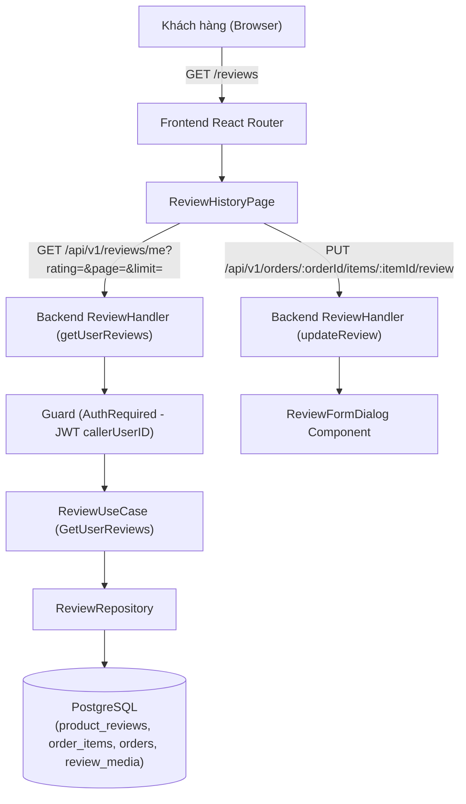

# Tài liệu thiết kế kỹ thuật

## Tổng quan (Overview)

Tài liệu này xác định kiến trúc kỹ thuật và hợp đồng giao tiếp cho tính năng **Lịch sử đánh giá** (`review-history`). Tính năng cung cấp giao diện và API cho phép người dùng đã đăng nhập xem lại danh sách đánh giá sản phẩm của chính mình, lọc theo số sao, phân trang, xem chi tiết đa phương tiện (ảnh/video) và thực hiện chỉnh sửa đánh giá (nếu chưa từng chỉnh sửa).

Tính năng giải quyết toàn bộ các yêu cầu từ Yêu cầu 1 đến Yêu cầu 6 trong `requirements.md`:
- **Yêu cầu 1 (1.1 - 1.6):** Truy cập và hiển thị danh sách đánh giá cá nhân, liên kết sản phẩm và đơn hàng, trạng thái trống.
- **Yêu cầu 2 (2.1 - 2.5):** Bộ lọc số sao (Tất cả, 1-5 sao), phân trang (10 đánh giá/trang).
- **Yêu cầu 3 (3.1 - 3.5):** Chỉnh sửa đánh giá (tối đa 1 lần, `edit_count = 0`), không hỗ trợ xóa.
- **Yêu cầu 4 (4.1 - 4.3):** Xem ảnh phóng to, phát video kèm điều khiển, fallback khi lỗi media.
- **Yêu cầu 5 (5.1 - 5.3):** Điều hướng từ Header/Mobile Drawer, đồng bộ dữ liệu, Full Status Envelope.
- **Yêu cầu 6 (6.1 - 6.4):** Bảo mật dữ liệu người dùng (`callerUserID`), responsive (>= 320px), skeleton loading, khả năng truy cập bàn phím.

## Kiến trúc (Architecture)



### Luồng dữ liệu chính:
1. **Truy vấn danh sách lịch sử đánh giá:**
   - Client gửi request `GET /api/v1/reviews/me?rating={0-5}&page={n}&limit={10}` kèm JWT access token.
   - `Guard` xác thực token và trích xuất `userID`.
   - `ReviewUseCase` điều phối truy vấn từ `ReviewRepository`.
   - `ReviewRepository` thực hiện truy vấn kết hợp (JOIN) giữa `product_reviews`, `order_items`, `orders` theo `orders.user_id = $userID` và điều kiện lọc `rating`. Đồng thời lấy danh sách `review_media` tương ứng.
   - Trả về danh sách `UserReview` chuẩn Full Status Envelope kèm `PaginationMeta`.
2. **Chỉnh sửa đánh giá từ trang lịch sử:**
   - Tái sử dụng endpoint đã có `PUT /api/v1/orders/:orderId/items/:itemId/review` và component `ReviewFormDialog`.
   - Sau khi cập nhật thành công, client cập nhật trực tiếp item trong state cục bộ (`editCount = 1`, `canEdit = false`, `edited = true`) mà không cần tải lại toàn bộ trang.

## Thành phần và Giao diện (Components And Interfaces)

### 1. Backend Boundaries & Interfaces

#### Endpoint API mới:
- **Tên:** Lấy danh sách lịch sử đánh giá của người dùng hiện tại
- **Đường dẫn:** `GET /api/v1/reviews/me`
- **Xác thực:** Bắt buộc (`guard.AuthRequired`)
- **Tham số Query:**
  - `rating`: Số nguyên `0-5` (mặc định `0` nghĩa là lấy tất cả số sao).
  - `page`: Số nguyên `>= 1` (mặc định `1`).
  - `limit`: Số nguyên `1-10` (mặc định `10`).

#### Phản hồi API chuẩn Full Status Envelope:
```json
{
  "success": true,
  "message": "Lấy lịch sử đánh giá thành công",
  "data": {
    "reviews": [
      {
        "id": "c1f72a44-8092-4112-9c17-f58c7365da51",
        "orderItemId": "e3012921-7299-4d26-bbda-7a63d91cf923",
        "order": {
          "id": "a90a4279-8db2-4876-8f3b-b236fa78dc71",
          "createdAt": "2026-08-20T10:15:30Z"
        },
        "product": {
          "id": "b11a9192-5632-44df-9e20-9118c8e19b52",
          "name": "iPhone 15 Pro Max",
          "brandName": "Apple",
          "model": "Titan Tự Nhiên 256GB",
          "imageUrl": "https://example.com/iphone-15.jpg",
          "options": [
            { "groupLabel": "Màu sắc", "valueLabel": "Titan Tự Nhiên" },
            { "groupLabel": "Dung lượng", "valueLabel": "256GB" }
          ]
        },
        "rating": 5,
        "comment": "Máy đẹp, giao nhanh, đóng gói rất cẩn thận.",
        "editCount": 0,
        "canEdit": true,
        "edited": false,
        "media": [
          {
            "id": "d2e3f4a5-1122-3344-5566-778899aabbcc",
            "type": "image",
            "url": "/media/reviews/d2e3f4a5-1122-3344-5566-778899aabbcc",
            "mimeType": "image/jpeg",
            "position": 0
          }
        ],
        "createdAt": "2026-08-25T14:20:00Z",
        "updatedAt": "2026-08-25T14:20:00Z"
      }
    ]
  },
  "error": null,
  "meta": {
    "timestamp": "2026-08-28T13:15:00Z",
    "pagination": {
      "page": 1,
      "limit": 10,
      "total": 1,
      "totalPages": 1,
      "hasNext": false,
      "hasPrev": false
    }
  }
}
```

#### Domain Interface trong Go:
```go
// backend/internal/domain/review.go

type UserReviewProduct struct {
    ID        string       `json:"id"`
    Name      string       `json:"name"`
    BrandName string       `json:"brandName"`
    Model     string       `json:"model"`
    ImageURL  string       `json:"imageUrl"`
    Options   []CartOption `json:"options"`
}

type UserReviewOrder struct {
    ID        string    `json:"id"`
    CreatedAt time.Time `json:"createdAt"`
}

type UserReview struct {
    ID          string            `json:"id"`
    OrderItemID string            `json:"orderItemId"`
    Order       UserReviewOrder   `json:"order"`
    Product     UserReviewProduct `json:"product"`
    Rating      int16             `json:"rating"`
    Comment     string            `json:"comment"`
    EditCount   int16             `json:"editCount"`
    CanEdit     bool              `json:"canEdit"`
    Edited      bool              `json:"edited"`
    Media       []ReviewMedia     `json:"media"`
    CreatedAt   time.Time         `json:"createdAt"`
    UpdatedAt   time.Time         `json:"updatedAt"`
}

type UserReviewsResult struct {
    Reviews []UserReview `json:"reviews"`
    Total   int64        `json:"total"`
}

type ReviewRepository interface {
    // Các phương thức hiện có...
    CreateReview(ctx context.Context, input CreateReviewInput) (*Review, error)
    UpdateReview(ctx context.Context, input UpdateReviewInput) (*Review, []string, error)
    GetReviewByID(ctx context.Context, id string) (*Review, error)
    GetReviewByOrderItemID(ctx context.Context, orderItemID string) (*Review, error)
    ListReviewsByOrderItemIDs(ctx context.Context, orderItemIDs []string) (map[string]*Review, error)
    GetReviewMediaByID(ctx context.Context, mediaID string) (*ReviewMedia, error)
    GetPublicReviewsByProductID(ctx context.Context, productID string, page, limit int) (*ProductReviewsResult, error)
    // Phương thức bổ sung mới:
    GetUserReviews(ctx context.Context, userID string, ratingFilter int16, page, limit int) (*UserReviewsResult, error)
}
```

### 2. Frontend Components & Client

#### Frontend API Client:
```typescript
// frontend/src/api/reviews.ts

export async function getUserReviews(
  params: { rating?: number; page?: number; limit?: number } = {}
): Promise<ApiResponseWithMeta<UserReviewsResponse>> {
  const searchParams = new URLSearchParams()
  if (params.rating !== undefined && params.rating > 0) {
    searchParams.set('rating', String(params.rating))
  }
  if (params.page !== undefined) {
    searchParams.set('page', String(params.page))
  }
  if (params.limit !== undefined) {
    searchParams.set('limit', String(params.limit))
  }

  const queryString = searchParams.toString()
  const path = `/reviews/me${queryString ? `?${queryString}` : ''}`

  return apiClientWithMeta<UserReviewsResponse>(path)
}
```

#### Frontend UI Component Structure:
- `ReviewHistoryPage.tsx`: Trang chính tại route `/reviews`.
  - Header: Tiêu đề "Lịch sử đánh giá", mô tả ngắn, nút "Tiếp tục mua sắm".
  - Rating Tabs Filter: 6 tab ("Tất cả", "5 sao", "4 sao", "3 sao", "2 sao", "1 sao") sử dụng URL query param `?rating=`.
  - Danh sách thẻ đánh giá `ReviewHistoryCard`:
    - Header thẻ: Mã đơn hàng (link đến `/orders/:orderId`), Ngày đặt, Ngày đánh giá.
    - Phần sản phẩm: Ảnh sản phẩm, Tên sản phẩm (link đến `/products/:productId`), Thương hiệu, Model, Badge phân loại options.
    - Phần đánh giá: Dãy sao vàng (`RatingStars`), Nhãn "Đã chỉnh sửa" (nếu `edited`), Nội dung nhận xét.
    - Media Grid: Ảnh thumbnail (mở modal lightbox phóng to), Video player (kèm controls HTML5).
    - Footer thẻ: Nút "Sửa đánh giá" (hiển thị khi `canEdit === true`).
  - Pagination Controls: Phân trang Previous, Next, số trang 1..N.
  - Media Lightbox Dialog: Modal xem ảnh phóng to toàn màn hình.
  - ReviewFormDialog: Mở modal sửa đánh giá khi bấm "Sửa đánh giá".
  - EmptyState: Hiển thị khi không có đánh giá, có nút chuyển tới `/orders?status=reviewable` ("Chờ đánh giá") và `/products`.

## Mô hình dữ liệu (Data Models)

### Truy vấn SQL trong `backend/db/queries/reviews.sql`:

```sql
-- name: CountUserReviews :one
SELECT COUNT(*)::bigint
FROM product_reviews pr
JOIN order_items oi ON oi.id = pr.order_item_id
JOIN orders o ON o.id = oi.order_id
WHERE o.user_id = $1
  AND ($2::smallint = 0 OR pr.rating = $2::smallint);

-- name: ListUserReviews :many
SELECT pr.id, pr.order_item_id, pr.rating, pr.comment, pr.edit_count, pr.created_at, pr.updated_at,
       o.id AS order_id, o.created_at AS order_created_at,
       oi.product_id, oi.brand_name, oi.product_name, oi.model, oi.image_url, oi.options::text AS options,
       oi.unit_price_vnd, oi.quantity, oi.line_total_vnd
FROM product_reviews pr
JOIN order_items oi ON oi.id = pr.order_item_id
JOIN orders o ON o.id = oi.order_id
WHERE o.user_id = @user_id
  AND (@rating_filter::smallint = 0 OR pr.rating = @rating_filter::smallint)
ORDER BY pr.created_at DESC, pr.id DESC
LIMIT @limit_count OFFSET @offset_count;
```

### Cơ chế hydrate Media:
Tái sử dụng query `ListReviewMediaByReviewIDs` hiện có để lấy toàn bộ media cho các `review_id` trong trang kết quả theo một batch duy nhất (tránh N+1 queries).

## Xử lý lỗi (Error Handling)

- **401 Unauthorized (`domain.ErrInvalidToken`):** Khi người dùng chưa đăng nhập hoặc token hết hạn. Frontend tự động điều hướng về `/login?redirect=/reviews`.
- **400 Validation Error (`domain.NewValidationError`):** Khi `rating` filter nằm ngoài khoảng 0-5, hoặc `page`/`limit` không hợp lệ. Trả về cấu trúc lỗi validation tiêu chuẩn với message tiếng Việt.
- **500 Internal Error (`domain.ErrInternal`):** Khi gặp sự cố database hoặc đọc dữ liệu. Ghi log `slog.Error` và trả mã lỗi `"internal"`.
- **Frontend Error Resilience:**
  - Lỗi mạng khi fetch danh sách: Hiển thị error box kèm nút "Thử lại".
  - Lỗi tải ảnh/video riêng lẻ: Hiển thị placeholder fallback, không làm hỏng layout toàn trang.

## Chiến lược kiểm thử (Testing Strategy)

### 1. Backend Tests:
- **Repository Integration Test (`backend/internal/repository/review_repository_integration_test.go`):**
  - Kiểm thử `GetUserReviews` với dữ liệu thực: user có nhiều đánh giá ở các mức sao khác nhau, lọc theo từng số sao, phân trang chính xác.
  - Kiểm tra đảm bảo chỉ lấy đúng review của user chỉ định, không lấy review của user khác.
  - Kiểm tra gán đúng `media` cho từng review.
- **UseCase Test (`backend/internal/usecase/review/review_test.go`):**
  - Kiểm thử logic xử lý tham số `ratingFilter`, phân trang `page`, `limit`.
- **HTTP Handler Test (`backend/internal/delivery/http/review_handler_test.go`):**
  - Kiểm thử `GET /api/v1/reviews/me` khi chưa đăng nhập (401), khi tham số hợp lệ (200), khi lọc sao (200), kiểm tra Full Status Envelope và `PaginationMeta`.

### 2. Frontend Tests:
- **API Test (`frontend/src/api/reviews.test.ts`):**
  - Kiểm thử hàm `getUserReviews` với các tham số rating, page, limit.
- **Component / Page Test (`frontend/src/pages/ReviewHistoryPage.test.tsx`):**
  - Render skeleton khi loading.
  - Render danh sách đánh giá đầy đủ thông tin sản phẩm, đơn hàng, số sao, nhận xét, ảnh/video.
  - Lọc theo số sao khi bấm tab.
  - Chuyển trang phân trang.
  - Mở modal phóng to ảnh khi click ảnh thumbnail.
  - Hiển thị nút "Sửa đánh giá" khi `canEdit = true`, mở `ReviewFormDialog` và cập nhật state thành công sau khi sửa.
  - Không hiển thị nút "Sửa đánh giá" khi `canEdit = false` (`edited = true`).
  - Empty state khi không có đánh giá kèm liên kết tới `/orders?status=reviewable`.
- **Header Navigation Test (`frontend/src/components/Header.test.tsx`):**
  - Hiển thị liên kết "Lịch sử đánh giá" cho người dùng đã đăng nhập trên Desktop và Mobile Drawer.

## Ma trận truy vết yêu cầu (Requirement Traceability)

| Yêu cầu | Thành phần thiết kế | Phương pháp xác minh |
|---|---|---|
| 1.1 | `ReviewHistoryPage` (auth check redirect) | Frontend test redirect `/login?redirect=/reviews` |
| 1.2 | `ReviewRepository.GetUserReviews` (`created_at DESC`) | Integration test query order |
| 1.3 | `UserReview` model, `ReviewHistoryCard` | Frontend snapshot & component test |
| 1.4 | `Link to="/products/:productId"` | Component click navigation test |
| 1.5 | `Link to="/orders/:orderId"` | Component click navigation test |
| 1.6 | `EmptyState` component | Component test with empty review array |
| 2.1 - 2.2 | Rating Tabs filter component, query param `?rating=` | Component test filter tabs & state update |
| 2.3 - 2.4 | `PaginationMeta`, pagination controls | Unit & component test pagination |
| 2.5 | Empty filter state message & reset button | Component test no match filter |
| 3.1 - 3.4 | `canEdit` field, `ReviewFormDialog` integration | Component test edit review workflow |
| 3.5 | Không thiết kế endpoint / nút xóa review | Code review & architecture policy |
| 4.1 | Image thumbnail & Lightbox Dialog | Component test image click modal |
| 4.2 - 4.3 | HTML5 Video Player with controls, media error fallback | Component test video player & error handler |
| 5.1 | `Header.tsx` (Desktop Nav + Mobile Drawer links) | Header component test |
| 5.2 | Update review state synchronization | Integration & e2e review update |
| 5.3 | Full Status Envelope (`writePaginatedSuccess`) | HTTP handler unit test |
| 6.1 | `guard.AuthRequired`, `callerUserID(c)`, `o.user_id = $1` | Security & integration test |
| 6.2 | Tailwind responsive classes (`sm:`, `md:`, `lg:`) | Responsive layout audit (min 320px) |
| 6.3 | Skeleton components during load | Loading state test |
| 6.4 | Semantic button/links, ARIA tags, focus indicators | Accessibility keyboard navigation test |

## Tích hợp hệ thống hiện có (Existing System Integration)

- **Hệ thống đánh giá (`purchased-product-reviews`):** Tái sử dụng bảng `product_reviews`, `review_media`, endpoint `PUT /orders/:id/items/:itemId/review`, quy tắc nghiệp vụ 1 lần chỉnh sửa, và component `ReviewFormDialog`.
- **Hệ thống đơn hàng (`order_placement`):** Tận dụng mối liên kết giữa `product_reviews.order_item_id` và `order_items.order_id` để lấy thông tin đơn hàng và sản phẩm tương ứng.
- **Hệ thống media (`reviewmedia`):** Tiếp tục phục vụ tệp qua endpoint `/media/reviews/:mediaId` đã có.
- **Hệ thống Header:** Bổ sung liên kết điều hướng đồng bộ cho người dùng đã đăng nhập mà không ảnh hưởng đến các liên kết sẵn có.
