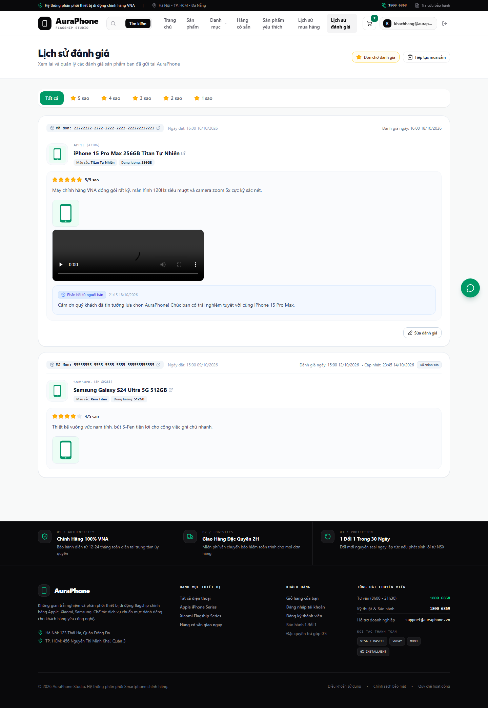
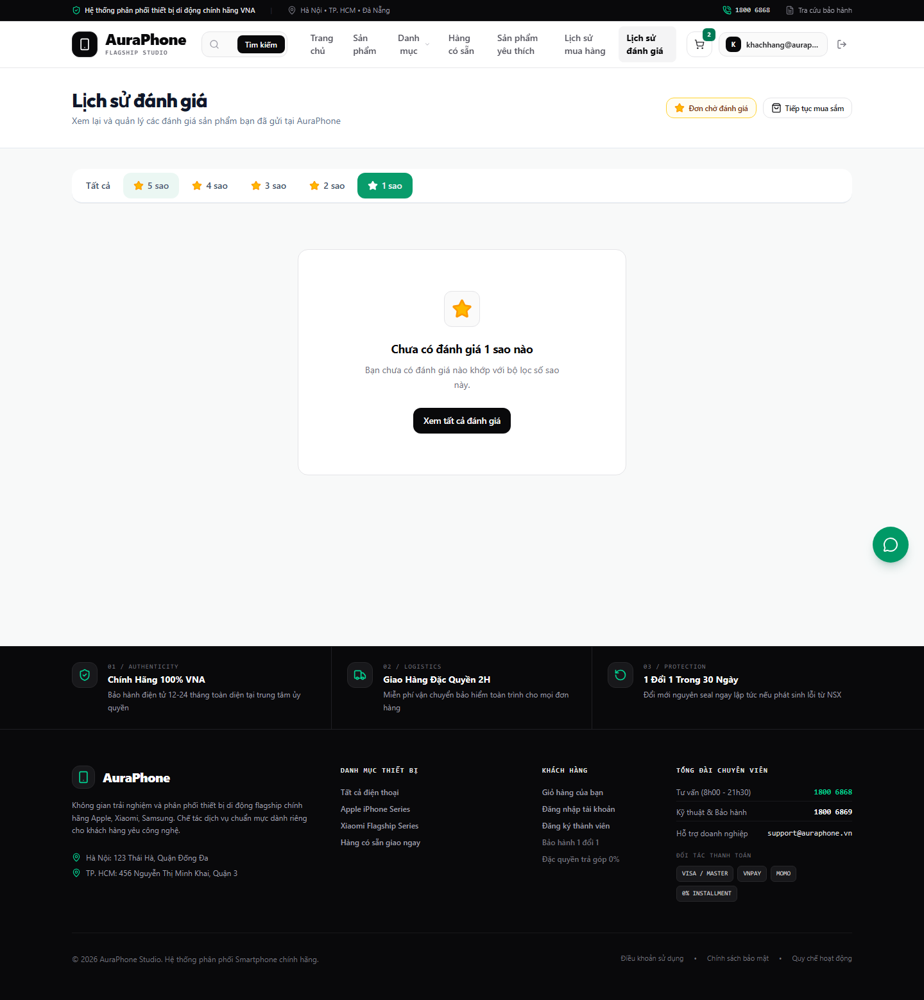
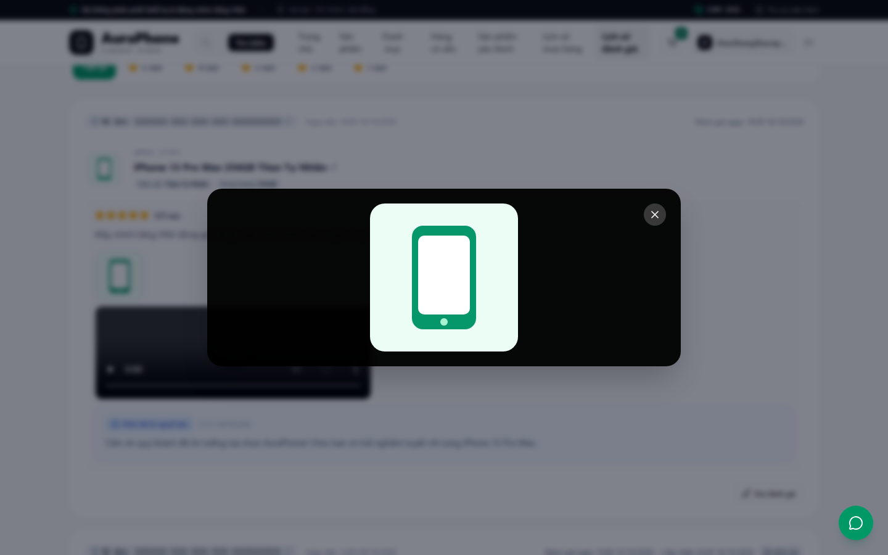
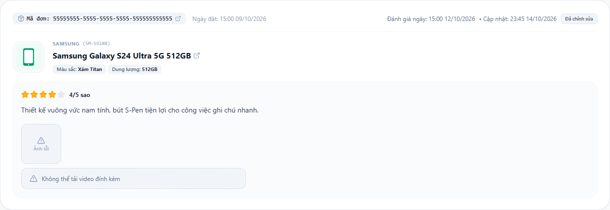
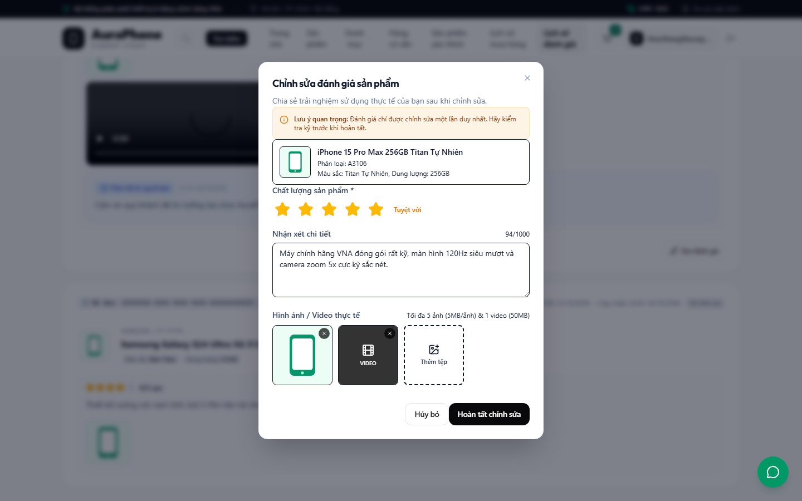
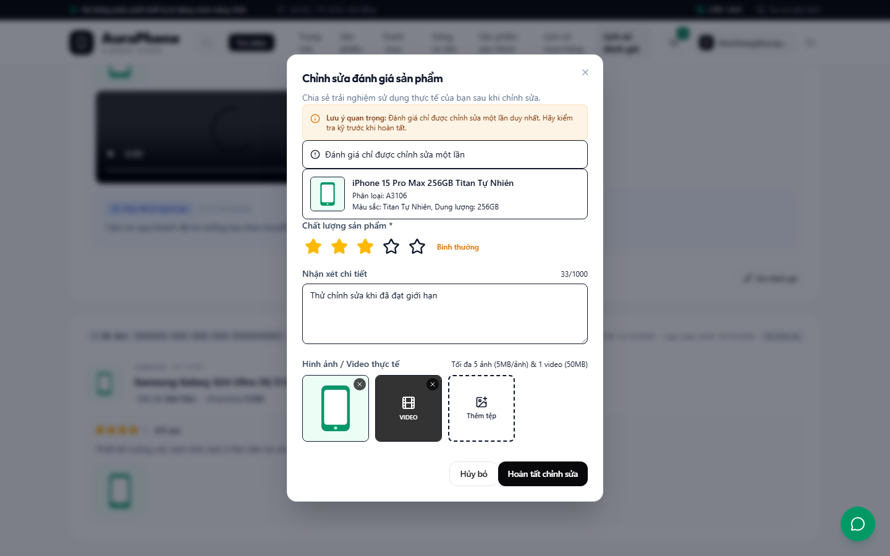
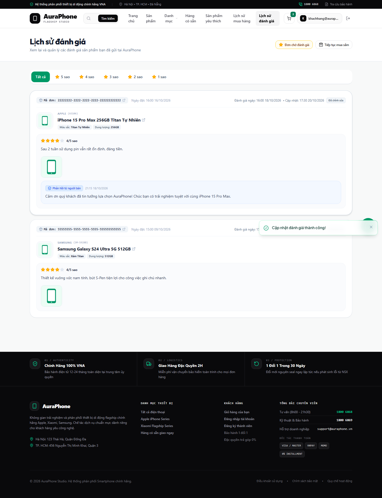
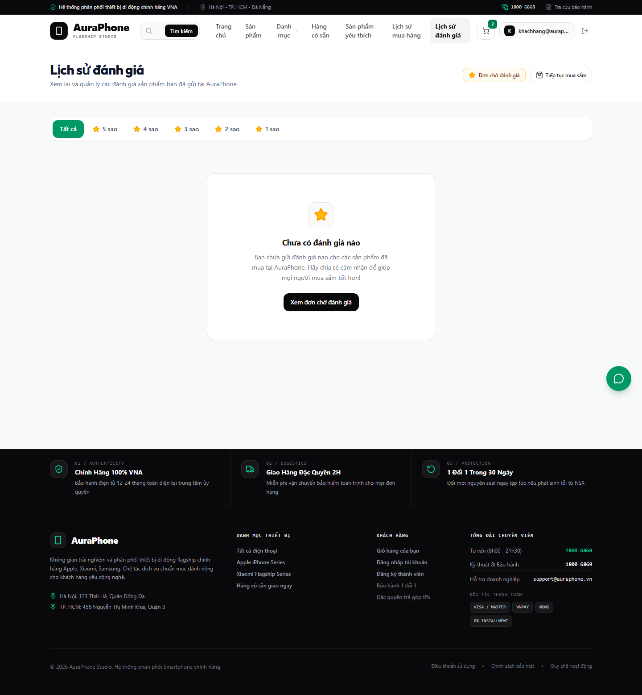
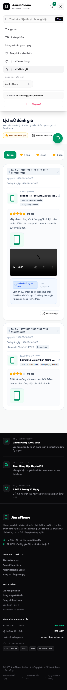

# E2E Verification Report — `review-history`

## Test Summary

- **Test Mode**: `Mode 2: Contract-Verified Mock E2E` (1:1 Backend Contract Lock)
- **Date**: 2026-10-20
- **Total Scenarios**: 8
- **Passed / Failed**: 8 / 0
- **Viewports Verified**: Desktop (`1440x900`), Mobile (`375x812`), Compact (`320x720`)
- **Console / Page Errors**: 0 unexpected errors

## 1:1 Backend Contract Verification Matrix (Mode 2 Mandatory)

| Contract ID | Endpoint | Backend Handler Test (`go test`) | Snapshot Key in `contract-snapshots.json` | Status Codes Verified | Outbound Request Validated |
| --- | --- | --- | --- | --- | --- |
| `API-USER-REVIEWS@1` | `GET /api/v1/reviews/me` | `backend/internal/delivery/http/review_handler_test.go::TestGetUserReviews_HTTPHandler` | `get_user_reviews_200`, `get_user_reviews_empty_200`, `get_user_reviews_validation_400`, `unauthenticated_401` | `200`, `400`, `401` | Yes (`Authorization: Bearer <token>`, `page`, `limit`, `rating` query params) |
| `API-ORDER-ITEM-REVIEW@1` | `PUT /api/v1/orders/:id/items/:itemId/review` | `backend/internal/delivery/http/review_handler_test.go::TestUpdateReview_HTTPHandler` | `update_review_200`, `update_review_validation_400`, `update_review_conflict_409` | `200`, `400`, `409` | Yes (`multipart/form-data` with `rating`, `comment`, `retained_media_ids`) |

## Requirement & Contract Traceability Matrix

| Requirement ID | Contract ID | Test Case | Status | Evidence Image |
| --- | --- | --- | --- | --- |
| `1.1` | `API-USER-REVIEWS@1` | Unauthenticated user visiting `/reviews` is redirected to `/login?redirect=/reviews`, header hides `"Lịch sử đánh giá"`, and unauthenticated API calls return `401 Unauthorized` | PASS | `./imgs/01-desktop-review-history-list.png` |
| `1.2`, `1.3` | `API-USER-REVIEWS@1` | Displays authenticated customer's reviews sorted newest-first (`rev-101` before `rev-102`) with full product metadata (`brandName`, `model`, `options`, `name`, `imageUrl`), order ID & `order.createdAt`, star rating, comment, media attachments, `createdAt`, `updatedAt`, and `"Đã chỉnh sửa"` badge | PASS | `./imgs/01-desktop-review-history-list.png` |
| `1.4`, `1.5` | `API-USER-REVIEWS@1` | Clicking product image or product name navigates to `/products/:productId`; clicking order link navigates to `/orders/:orderId` | PASS | `./imgs/01-desktop-review-history-list.png` |
| `1.6` | `API-USER-REVIEWS@1` | Empty review history (`total === 0`) renders empty state with CTA links to `/orders?status=reviewable` and `/products` | PASS | `./imgs/07-empty-review-history.png` |
| `2.1`, `2.2`, `2.3`, `2.4`, `2.5` | `API-USER-REVIEWS@1` | All 6 star rating filter tabs (`Tất cả`, `5 sao`, `4 sao`, `3 sao`, `2 sao`, `1 sao`), pagination controls (`Trang 1 / 2` -> `Trang 2 / 2`), resetting to `page=1` on filter change, filter empty state with `"Xem tất cả đánh giá"` reset button, and inbound `400 invalid_filter` on `?rating=9` | PASS | `./imgs/02-filter-5-star-and-empty-filter.png` |
| `3.1`, `3.2`, `3.3`, `3.4`, `3.5` | `API-ORDER-ITEM-REVIEW@1` | Shows `"Sửa đánh giá"` when `editCount = 0` (`canEdit: true`), opens pre-filled modal, validates outbound `multipart/form-data`, handles `400 validation_error`, updates review in-place on `200 OK` (`editCount = 1`, `canEdit: false`, `edited: true`) with toast, hides button & rejects subsequent edits with `409 review_edit_limit_reached`, and provides no delete UI/endpoint (`DELETE -> 404`) | PASS | `./imgs/04-edit-review-modal-open.png`, `./imgs/05-edit-review-conflict-409.png`, `./imgs/06-edit-review-success-200.png` |
| `4.1`, `4.2`, `4.3` | `API-USER-REVIEWS@1` | Image thumbnails open/close in Lightbox modal (`Escape` and single close button), `<video controls>` renders without autoplay, and broken image/video URLs render fallback placeholders (`review-media-fallback`) without breaking card layout | PASS | `./imgs/03-media-lightbox-and-fallback.png`, `./imgs/03b-media-fallback-placeholder.png` |
| `5.1`, `5.2`, `5.3` | `API-USER-REVIEWS@1`, `API-ORDER-ITEM-REVIEW@1` | Header navigation link `"Lịch sử đánh giá"` on desktop (`1440x900`) and mobile drawer (`375x812`); cross-page synchronization so `/products/:productId` and `/orders/:orderId` reflect updated rating (`4★`) and comment after editing; Full Status Envelope compliance with Vietnamese business messages | PASS | `./imgs/06-edit-review-success-200.png`, `./imgs/08-mobile-375-and-320-responsive.png` |
| `6.1`, `6.2`, `6.3`, `6.4` | `API-USER-REVIEWS@1` | Account-scoped review list (`Bearer` JWT isolation), responsive layout across `1440x900`, `375x812`, and `320x720` with zero horizontal overflow, loading skeleton (`review-loading-skeleton`) during fetch, and visible keyboard focus indicators (`focus-visible`) & `Escape` dialog dismissal | PASS | `./imgs/01-desktop-review-history-list.png`, `./imgs/08-mobile-375-and-320-responsive.png` |

## Defects Found & Remediation Log (Lịch sử phát hiện lỗi & Khắc phục)

| # | Stage (Giai đoạn phát hiện) | Defect / Gap (Mô tả lỗi / Thiếu sót) | Root Cause (Nguyên nhân gốc) | Fix Action & Files (Động thái khắc phục & Tệp sửa đổi) |
| --- | --- | --- | --- | --- |
| 1 | E2E Mode 2 Implementation | Thẻ đánh giá đã chỉnh sửa (`rev.edited === true`) không hiển thị thời điểm cập nhật (`updatedAt`) (`Req 1.3`) | `ReviewHistoryPage.tsx` chỉ render `createdAt` và huy hiệu `"Đã chỉnh sửa"`, bỏ sót trường `updatedAt` | Bổ sung hiển thị `• Cập nhật: {formatDateTime(rev.updatedAt)}` (`data-testid="review-updated-at"`) trong `frontend/src/pages/ReviewHistoryPage.tsx` và cập nhật unit test `ReviewHistoryPage.test.tsx` |
| 2 | E2E Mode 2 Implementation | Nhấn vào ảnh đại diện sản phẩm trên thẻ đánh giá không điều hướng sang `/products/:productId` (`Req 1.4`) | Ảnh sản phẩm chỉ được bọc trong thẻ `
` tĩnh thay vì `<Link>` | Bọc ảnh sản phẩm trong `<Link to={/products/${rev.product.id}} data-testid="review-product-image-link">` tại `frontend/src/pages/ReviewHistoryPage.tsx` |
| 3 | E2E Mode 2 Implementation | Ảnh và video đính kèm bị lỗi tải (`404`) không hiển thị khung giữ chỗ thay thế (`Req 4.3`) | Sự kiện `onError` của `` chỉ ẩn phần tử (`display = 'none'`) và `<video>` chưa xử lý `onError` | Thêm state `brokenMediaIds` trong `frontend/src/pages/ReviewHistoryPage.tsx` để render placeholder `data-testid="review-media-fallback"` (`"Ảnh lỗi"` / `"Không thể tải video đính kèm"`) |
| 4 | Task 3.1 Review (Round 0) | Modal xem ảnh phóng to (Lightbox) hiển thị 2 nút đóng `X` trùng lặp (`Req 4.1`) | `DialogContent` tự động render nút đóng mặc định bên cạnh nút đóng tùy chỉnh của Lightbox | Truyền prop `hideCloseButton` vào `<DialogContent data-testid="review-lightbox-dialog" hideCloseButton>` trong `frontend/src/pages/ReviewHistoryPage.tsx` |
| 5 | Task 3.1 Review (Round 0) | Tên sản phẩm dài trên màn hình di động (`375px`, `320px`) làm icon `ExternalLink` sát/tràn nhẹ khỏi mép thẻ (`Req 6.2`) | Liên kết tên sản phẩm dùng `inline-flex` với `line-clamp-2` trực tiếp mà chưa giới hạn `max-w-full` + `truncate` | Thêm `max-w-full` trên `<Link>` và bọc tên sản phẩm trong `` tại `frontend/src/pages/ReviewHistoryPage.tsx` |
| 6 | Task 3.1 Review (Round 0) | Truy cập `/reviews?rating=9` không kích hoạt lỗi `400 validation_error` từ API (`Rule 2 & 4`) | `ReviewHistoryPage.tsx` ép `selectedRating` ngoài khoảng `1..5` về `0` trước khi gọi `getUserReviews` | Giữ `selectedRating` (`0..5`) cho UI tab nhưng truyền `rawRating` thực tế từ URL vào `getUserReviews` trong `frontend/src/pages/ReviewHistoryPage.tsx` |
| 7 | Task 3.1 Review (Round 0) | `contract-snapshots.json` thiếu `product.model`, `product.options` và `editCount: 1` trên bản ghi đã sửa (`Req 1.3, 3.3, 3.4`) | Dữ liệu mock trong `backend/internal/delivery/http/review_handler_test.go` để trống `Model`, `Options` và `EditCount` | Cập nhật `review_handler_test.go` với đầy đủ `Model` (`"A3106"`, `"SM-S928B"`), `Options` (`CartOption[]`), `EditCount: 1`, và chạy lại `go test` để sinh mới `.dream/specs/review-history/contract-snapshots.json` |
| 8 | Task 3.1 Review (Round 0) | Chưa kiểm tra đồng bộ dữ liệu liên trang trên `/products/:productId` và `/orders/:orderId` sau khi sửa đánh giá (`Req 5.2`) | Bộ test E2E ban đầu chỉ kiểm tra cập nhật tại chỗ trên `/reviews` | Bổ sung `setupStatefulReviewRoutes` trong `frontend/e2e/review-history.spec.ts` và kịch bản điều hướng sang `/products/prod-101` cùng `/orders/:orderId` để xác minh nội dung đánh giá `4★` mới nhất |

## Visual Walkthrough & Step-by-Step Evidence

### Scenario 1: Danh sách lịch sử đánh giá, thông tin phân loại sản phẩm/đơn hàng, trình phát video, nhãn `"Đã chỉnh sửa"` và phản hồi từ người bán (Req 1.1–1.5, 4.2, 5.1, 6.1, 6.3, 6.4)
- **Action**: Khách hàng đã đăng nhập nhấn liên kết `"Lịch sử đánh giá"` trên thanh Header Desktop (`1440x900`) để điều hướng tới `/reviews`.
- **Expected**: Hiển thị khung xương tải dữ liệu (`review-loading-skeleton`) trước khi hiển thị danh sách đánh giá theo thứ tự mới nhất trước (`rev-101` rồi đến `rev-102`). Thẻ `rev-101` hiển thị thương hiệu `APPLE`, mã model `(A3106)`, tùy chọn phân loại `Màu sắc: Titan Tự Nhiên` và `Dung lượng: 256GB`, 5/5 sao, ảnh đính kèm, trình phát `<video controls>` (không tự động phát), khối `"Phản hồi từ người bán"` và nút `"Sửa đánh giá"`. Thẻ `rev-102` (`editCount: 1, edited: true, canEdit: false`) hiển thị `SAMSUNG (SM-S928B)`, `Màu sắc: Xám Titan`, `Dung lượng: 512GB`, thời điểm `Cập nhật: 23:45 14/10/2026`, huy hiệu `"Đã chỉnh sửa"` và ẩn nút `"Sửa đánh giá"`. Nhấn vào ảnh hoặc tên sản phẩm điều hướng tới `/products/:productId`; nhấn mã đơn hàng điều hướng tới `/orders/:orderId`.
- **Evidence**:
  

### Scenario 2: Bộ lọc theo 6 mức số sao, phân trang, đặt lại về trang 1 và trạng thái trống theo bộ lọc (Req 2.1–2.5)
- **Action**: Người dùng kiểm tra đủ 6 tab bộ lọc (`Tất cả`, `5 sao`, `4 sao`, `3 sao`, `2 sao`, `1 sao`), chuyển sang trang 2 (`Trang 2 / 2`), chọn bộ lọc `5 sao` (tự động đặt lại về `page=1`), sau đó chọn tab `1 sao` (không có kết quả khớp) và kiểm tra truy vấn không hợp lệ `/reviews?rating=9` (`400 invalid_filter`).
- **Expected**: Khi chọn `1 sao`, giao diện hiển thị trạng thái trống `"Chưa có đánh giá 1 sao nào"` cùng nút `"Xem tất cả đánh giá"` để đặt lại bộ lọc về `"Tất cả"`.
- **Evidence**:
  

### Scenario 3: Xem phóng to ảnh đính kèm (Lightbox) và xử lý lỗi tải Media (Req 4.1–4.3, 6.4)
- **Action**: Người dùng nhấn vào ảnh thu nhỏ của đánh giá để mở Lightbox xem ảnh kích thước lớn (kiểm tra đóng bằng phím `Escape` và nút đóng duy nhất); đồng thời kiểm tra thẻ `rev-102` có tệp ảnh và video bị lỗi tải (`404`).
- **Expected**: Hộp thoại Lightbox (`review-lightbox-dialog`) hiển thị ảnh phóng to rõ nét kèm 1 nút đóng duy nhất; các tệp media lỗi hiển thị khung giữ chỗ thay thế (`review-media-fallback`: `"Ảnh lỗi"` và `"Không thể tải video đính kèm"`) mà không làm vỡ bố cục thẻ.
- **Evidence**:
  
  

### Scenario 4: Mở hộp thoại chỉnh sửa đánh giá trực tiếp từ lịch sử (Req 3.1–3.2)
- **Action**: Người dùng nhấn nút `"Sửa đánh giá"` trên thẻ `rev-101` (`editCount: 0, canEdit: true`).
- **Expected**: Hộp thoại `"Chỉnh sửa đánh giá sản phẩm"` mở ra, điền sẵn số sao hiện tại (`5 sao`), nội dung nhận xét và danh sách hình ảnh/video hiện có, kèm lưu ý chỉ được chỉnh sửa một lần duy nhất.
- **Evidence**:
  

### Scenario 5: Xử lý lỗi xung đột `409 Conflict` (`review_edit_limit_reached`) và `400 Bad Request` khi chỉnh sửa (Req 3.4 & Rule 4)
- **Action**: Người dùng gửi biểu mẫu chỉnh sửa khi dữ liệu không hợp lệ (`400 validation_error`) hoặc khi đánh giá đã chạm giới hạn chỉnh sửa 1 lần (`409 review_edit_limit_reached`).
- **Expected**: Hộp thoại giữ nguyên trạng thái mở và hiển thị thông báo lỗi tiếng Việt rõ ràng `"Đánh giá chỉ được chỉnh sửa một lần"`.
- **Evidence**:
  

### Scenario 6: Cập nhật đánh giá thành công, khóa chỉnh sửa lần hai và đồng bộ liên trang (Req 3.3–3.5, 5.2 & Rule 3)
- **Action**: Người dùng chọn `4 sao`, cập nhật nội dung nhận xét và nhấn `"Hoàn tất chỉnh sửa"` (`PUT /api/v1/orders/:id/items/:itemId/review`), sau đó điều hướng sang trang chi tiết sản phẩm (`/products/prod-101`) và trang chi tiết đơn hàng (`/orders/22222222-2222-2222-2222-222222222222`).
- **Expected**: Hộp thoại đóng lại; hiển thị thông báo `"Cập nhật đánh giá thành công!"`; thẻ `rev-101` cập nhật ngay tại chỗ sang `4/5 sao`, nội dung nhận xét mới, hiển thị thời điểm `Cập nhật: 17:30 20/10/2026` cùng huy hiệu `"Đã chỉnh sửa"`, và ẩn nút `"Sửa đánh giá"`. Mọi yêu cầu `PUT` tiếp theo bị chặn với `409 review_edit_limit_reached`, yêu cầu `DELETE` trả về `404`, và cả `/products/prod-101` lẫn `/orders/:orderId` đều phản ánh ngay nội dung đánh giá `4★` mới nhất.
- **Evidence**:
  

### Scenario 7: Trạng thái trống khi khách hàng chưa có đánh giá nào (Req 1.6)
- **Action**: Khách hàng chưa có đánh giá nào (`total: 0`) truy cập `/reviews`.
- **Expected**: Hiển thị thông báo `"Chưa có đánh giá nào"` cùng nút hành động `"Xem đơn chờ đánh giá"` dẫn tới `/orders?status=reviewable` và `"Khám phá sản phẩm"` dẫn tới `/products`.
- **Evidence**:
  

### Scenario 8: Điều hướng trên thiết bị di động (`375x812`) và bố cục thích ứng (`320x720`) (Req 5.1, 6.2)
- **Action**: Mở menu điều hướng trên kích thước màn hình di động `375x812`, nhấn `"Lịch sử đánh giá"` để điều hướng tới `/reviews`, và kiểm tra độ tràn ngang trên màn hình nhỏ `320x720`.
- **Expected**: Menu di động hiển thị mục `"Lịch sử đánh giá"` đang hoạt động; bố cục thẻ đánh giá, tên sản phẩm và bộ lọc thích ứng hoàn toàn, không xảy ra hiện tượng tràn ngang (`scrollWidth <= innerWidth`).
- **Evidence**:
  

## Visual Quality & Layout Audit Checklist

- [x] No horizontal overflow across `1440x900`, `375x812`, and `320x720`
- [x] No overlapping text, clipped buttons, or broken flex/grid cards
- [x] All visible images loaded (`complete === true && naturalWidth > 0`)
- [x] Interactive controls have visible focus-visible styles and accessible labels
- [x] Vietnamese error and status messages match API Contract Standards
