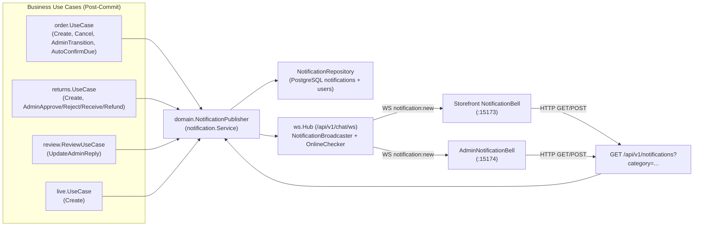

# Tài liệu Thiết kế Kỹ thuật (Design Document)

## Tổng quan (Overview)

Tài liệu thiết kế này hiện thực hóa toàn bộ các yêu cầu `1.1`–`7.4` của tính năng **Thông báo Realtime Toàn Hệ Thống (`system-notifications`)**. Thiết kế mở rộng hạ tầng bảng `notifications`, `ws.Hub` (`/api/v1/chat/ws`) và chuông thông báo hiện có mà không phá vỡ bất kỳ hợp đồng nào của phân hệ Bài viết (`product-referral-posts`), đồng thời tái sử dụng logic hiển thị tên khách hàng từ `users.display_name` (`DB-USER-PROFILE@1`).

Các quyết định kỹ thuật chính (`TD-*`):

- **TD-1 (Bảo toàn envelope 17 trường `NotificationItem`):** Giữ nguyên toàn bộ 17 trường cấp cao nhất của JSON `NotificationItem` để tương thích tuyệt đối với snapshot của `product-referral-posts`. Toàn bộ dữ liệu ngữ cảnh cho đơn hàng, trả hàng, đánh giá, livestream và `targetPath` được đặt bên trong `metadata` (`jsonb`).
- **TD-2 (Tách gói `notification` & tương thích `notificationHandler`):** Tạo domain contracts trong `backend/internal/domain/notification.go`, repository riêng `NotificationRepository` (`backend/internal/repository/notification_repository.go`) và service `backend/internal/usecase/notification` triển khai cả `domain.NotificationUseCase` (phục vụ HTTP `/api/v1/notifications`) lẫn `domain.NotificationPublisher` (được tiêm vào `order`, `returns`, `review`, `live`). Trên `router.Dependencies`, trường `Notification` được bổ sung song song với `Post`: khi `deps.Notification != nil` handler dùng `NotificationUseCase` có lọc `?category=`; khi `deps.Notification == nil` (các bộ test cũ chỉ mock `Post`), handler tự động chuyển sang adapter bọc `deps.Post` và vẫn validate `?category=`.
- **TD-3 (Phát sau commit theo nguyên tắc best-effort):** Các use case (`order`, `returns`, `review`, `live`) gọi `NotificationPublisher` **chỉ sau khi** lệnh repository đã thành công (tức giao dịch DB chính đã commit). Mọi lỗi DB hoặc WebSocket trong `NotificationPublisher` đều chỉ ghi `slog.Warn` (chỉ gồm `notification_type`, `recipient_id`, `entity_id`, `err`) và tuyệt đối không trả lỗi lên luồng nghiệp vụ.
- **TD-4 (Không phá vỡ interface mock của `OrderRepository` & `ReviewUseCase`):**
  - Với `AutoConfirmDue`, giữ nguyên chữ ký `OrderRepository.AutoConfirmDue(ctx, cutoff) error` trên interface gốc để mọi mock hiện tại tiếp tục biên dịch, đồng thời định nghĩa thêm optional interface `AutoConfirmReturningRepository` (`AutoConfirmDueReturning(ctx, cutoff) ([]AutoConfirmedOrder, error)`) trên `*repository.OrderRepository`. `order.UseCase.AutoConfirmDue` kiểm tra type assertion để vừa lấy danh sách đơn vừa xác nhận để bắn `order_confirmed`, vừa tương thích ngược khi test dùng mock cũ.
  - Với `review.ReviewUseCase`, giữ nguyên chữ ký 3 tham số `NewReviewUseCase(repo, mediaStore, catalogRepo, opts ...ReviewOption)` với `WithNotificationPublisher(pub)` để mọi test cũ không cần sửa lời gọi khởi tạo.
  - Với `returns` (`Create`, `ApproveAdmin`, `RejectAdmin`, `ReceiveAdmin`, `RefundAdmin`), `ReturnRepository` đã trả sẵn `ID`, `OrderID`, `UserID`, `RejectReason`, `RefundAmountVND` trên `*domain.ReturnRequest` (được xác nhận trong `return_repository.go`).
- **TD-5 (Livestream batch INSERT + online-only WS push):** Khi `live.UseCase.Create` thành công, repository thực hiện một câu `INSERT INTO notifications ... SELECT ... FROM users WHERE role = 'customer' AND status = 'active' RETURNING ...` để ghi nhận hàng loạt thông báo trong 1 round-trip DB, sau đó ở tầng use case kiểm tra optional interface `OnlineChecker { IsUserOnline(userID string) bool }` (được cài đặt sẵn bởi `*ws.Hub`) trước khi đóng gói và đẩy WS `notification:new` tới từng khách hàng đang trực tuyến.
- **TD-6 (Chiến lược lọc danh mục & đồng bộ badge `unreadCount` ở Frontend):** `unreadCount` trên `NotificationBell` và `AdminNotificationBell` luôn đại diện tổng số thông báo chưa đọc toàn cục (từ `data.unreadCount` của API). Khi chuyển tab danh mục, UI tải lại danh sách theo `?category=` nhưng giữ nguyên đồng bộ chính xác `unreadCount`. Khi có sự kiện WS `notification:new`: luôn cập nhật `unreadCount` cho thông báo mới chưa đọc (dùng `knownNotificationIdsRef` để tránh đếm trùng rollup/trùng ID dù đang ở tab lọc khác), và chỉ chèn vào danh sách hiển thị nếu tab hiện tại là `Tất cả` hoặc trùng `category`.
- **TD-7 (Proxy `/media` cho `frontend-admin`):** Bổ sung rule proxy `/media` trong `frontend-admin/vite.config.ts` trỏ cùng `backendTarget` với `/api` để đồng bộ khả năng truy cập media giữa dev server và backend.
- **TD-8 (Chế độ E2E):** Khóa chế độ kiểm thử trình duyệt ở **`Mode 2: Shape-Locked Mock E2E`** dùng `.dream/specs/system-notifications/contract-snapshots.json` kết hợp `mountContractRoutes` và `page.routeWebSocket(/\/api\/v1\/chat\/ws/, ...)` kiểm chứng đồng thời Storefront (`:15173`) và Admin Portal (`:15174`).

---

## Kiến trúc & Luồng Dữ liệu (Architecture)



---

## Hợp đồng Chia sẻ Ranh giới (Shared Contracts)

#### Contract DB-SYS-NOTIFICATIONS (rev 1)

- **Migration:** `backend/db/migrations/000023_system_notifications_indexes.{up,down}.sql` (tăng tiếp sau `000022_add_user_profile`).
- **Thay đổi schema trên bảng `notifications` (đã tạo ở `000017` và `000018`):**
  1. Thêm ràng buộc danh mục:
     ```sql
     ALTER TABLE notifications
         ADD CONSTRAINT notifications_category_chk
         CHECK (category IN ('post', 'order', 'return', 'review', 'live'));
     ```
  2. Thêm chỉ mục phục vụ truy vấn lọc theo danh mục sắp xếp mới nhất:
     ```sql
     CREATE INDEX idx_notifications_recipient_category_updated
         ON notifications (recipient_id, category, updated_at DESC, id DESC);
     ```
  3. Giữ nguyên `CHECK (category <> 'post' OR post_id IS NOT NULL)` và `idx_notifications_unread_group` (`WHERE is_read = false AND group_key <> ''`) từ các migration trước. Thông báo hệ thống (`order`, `return`, `review`, `live`) luôn để `post_id = NULL`, `comment_id = NULL`, `reaction_type = NULL`, `group_key = ''`, `actor_count = 1`.
- **Down migration:** Drop `idx_notifications_recipient_category_updated` và drop constraint `notifications_category_chk`.

---

#### Contract API-NOTIFICATIONS (rev 3)

*(Mở rộng tương thích ngược từ `API-NOTIFICATIONS@2` trong `product-referral-posts`: bổ sung bộ lọc `?category=` và lỗi `400 invalid_filter`, giữ nguyên hoàn toàn 17 trường cấp 1 của `NotificationItem` và các endpoint `/read`, `/read-all`.)*

- **Endpoint danh sách:** `GET /api/v1/notifications?limit=20&offset=0&category=`
  - **Auth:** Bắt buộc Bearer JWT (`guard.AuthRequired`); thiếu hoặc token không hợp lệ trả về HTTP `401` (`invalid_token`).
  - **Query parameters:**
    - `limit`: integer (mặc định `20`, giới hạn `1..50`).
    - `offset`: integer `>= 0` (mặc định `0`).
    - `category` (tùy chọn): chuỗi rỗng (lấy tất cả) hoặc một trong `post`, `order`, `return`, `review`, `live`.
  - **Lỗi lọc không hợp lệ:** Khi `category` khác rỗng và không thuộc tập hợp 5 giá trị trên:
    - HTTP Status: `400`
    - Envelope:
      ```json
      {
        "success": false,
        "message": "Tiêu chí lọc sản phẩm không hợp lệ",
        "data": null,
        "error": {
          "code": "invalid_filter",
          "message": "Tiêu chí lọc sản phẩm không hợp lệ",
          "fields": {
            "category": "Danh mục thông báo không hợp lệ"
          }
        },
        "meta": { "timestamp": "..." }
      }
      ```
      *(Lưu ý: dùng `domain.NewFilterValidationError(map[string]string{"category": "Danh mục thông báo không hợp lệ"})`, khớp trực tiếp `writeError` trong `backend/internal/delivery/http/error.go:31` trả về HTTP 400 `invalid_filter`.)*
  - **Phản hồi thành công (`200`):** Full Status Envelope với `data`:
    - `items`: `NotificationItem[]` sắp theo `updated_at DESC, id DESC` (chỉ gồm các bản ghi khớp `category` nếu có truyền).
    - `unreadCount`: `number` — **tổng số thông báo chưa đọc toàn cục** (`WHERE recipient_id = $1 AND is_read = false`), không bị giới hạn theo `category` đang lọc.
- **Đánh dấu đọc & đọc tất cả:**
  - `POST /api/v1/notifications/:id/read` -> HTTP `200` `{ id, isRead: true, unreadCount }` (404 `notification_not_found` nếu không tồn tại hoặc không thuộc người gọi).
  - `POST /api/v1/notifications/read-all` -> HTTP `200` `{ unreadCount: 0 }`.
- **Cấu trúc bất biến cấp 1 của `NotificationItem` (17 trường):**
  `id`, `recipientId`, `actorId` (nullable), `actorName` (nullable), `actorRole` (nullable), `groupKey`, `actorCount`, `category`, `notificationType`, `postId` (nullable), `commentId` (nullable), `reactionType` (nullable), `excerpt`, `metadata`, `isRead`, `createdAt`, `updatedAt`.

---

#### Contract TYPE-NOTIFICATION-METADATA (rev 1)

Quy chuẩn các trường bên trong `NotificationItem.metadata` (tất cả key dùng `camelCase`):

| `category` | `notificationType` | Người nhận | `actorId` / `actorName` | Trường trong `metadata` | `targetPath` |
|---|---|---|---|---|---|
| `order` | `order_confirmed`, `order_preparing`, `order_shipped`, `order_delivered`, `order_cancel_approved`, `order_cancel_declined` | Khách hàng (`order.UserID`) | `null` / `null` | `orderId`, `orderShortCode`, `status`, `totalVnd` (nếu có), `targetPath` | `/orders/<orderId>` |
| `return` | `return_approved`, `return_rejected`, `return_received`, `return_refunded` | Khách hàng (`ret.UserID`) | `null` / `null` | `returnId`, `orderId`, `orderShortCode`, `status`, `rejectReason` (khi rejected), `refundAmountVnd` (khi refunded), `targetPath` | `/orders/<orderId>` |
| `review` | `review_replied` | Khách hàng (tác giả review) | `null` / `null` | `reviewId`, `orderId`, `productId`, `productName`, `targetPath` | `/reviews` |
| `live` | `livestream_started` | Toàn bộ Customer `active` | `null` / `null` | `sessionId`, `sessionTitle`, `status: "live"`, `targetPath` | `/live/<sessionId>` |
| `order` | `admin_order_created`, `admin_order_cancel_requested`, `admin_order_cancelled` | Toàn bộ Admin `active` | `order.UserID` / Tên khách (`display_name` priority) | `orderId`, `orderShortCode`, `status`, `totalVnd`, `recentActors`, `targetPath` | `/orders/<orderId>` |
| `return` | `admin_return_created` | Toàn bộ Admin `active` | `ret.UserID` / Tên khách (`display_name` priority) | `returnId`, `orderId`, `orderShortCode`, `status`, `recentActors`, `targetPath` | `/returns/<returnId>` |
| `post` | `post_reaction`, `post_comment`, `comment_reaction`, `comment_reply` | Tác giả bài viết / bình luận | `actor.ID` / Tên theo role | `recentActors` (không đổi hợp đồng cũ) | `/posts/<postId>...` |

- Quy tắc tạo `orderShortCode`: `fmt.Sprintf("#%s", strings.ToUpper(strings.ReplaceAll(orderID, "-", "")[:8]))` (nếu chuỗi ngắn hơn 8 ký tự thì lấy toàn bộ viết hoa).
- Quy tắc `excerpt` tiếng Việt gọn (không vượt 120 ký tự đối với trích dẫn phản hồi đánh giá / lý do từ chối):
  - `order_confirmed`: `"Đơn hàng #XXXXXXXX đã được xác nhận tự động."`
  - `order_preparing`: `"Đơn hàng #XXXXXXXX đang được cửa hàng chuẩn bị."`
  - `order_shipped`: `"Đơn hàng #XXXXXXXX đã được bàn giao cho đơn vị vận chuyển."`
  - `order_delivered`: `"Đơn hàng #XXXXXXXX đã giao thành công."`
  - `order_cancel_approved`: `"Yêu cầu hủy đơn hàng #XXXXXXXX đã được chấp nhận."`
  - `order_cancel_declined`: `"Yêu cầu hủy đơn #XXXXXXXX chưa được duyệt, đơn tiếp tục được xử lý."`
  - `return_approved`: `"Yêu cầu trả hàng cho đơn #XXXXXXXX đã được duyệt."`
  - `return_rejected`: `"Yêu cầu trả hàng cho đơn #XXXXXXXX bị từ chối: <lý do>"`
  - `return_received`: `"Cửa hàng đã nhận được hàng hoàn cho đơn #XXXXXXXX."`
  - `return_refunded`: `"Yêu cầu trả hàng đơn #XXXXXXXX đã được hoàn tiền."`
  - `review_replied`: nội dung `reply` đã cắt gọn tối đa 100 ký tự (`truncateExcerpt`), còn tên sản phẩm nằm trong `metadata.productName`.
  - `livestream_started`: `"Phiên livestream \"<sessionTitle>\" đang phát trực tiếp."`
  - `admin_order_created`: `"Đơn hàng mới #XXXXXXXX"`
  - `admin_order_cancel_requested`: `"Yêu cầu hủy đơn hàng #XXXXXXXX"`
  - `admin_order_cancelled`: `"Đã hủy đơn hàng #XXXXXXXX"`
  - `admin_return_created`: `"Yêu cầu trả hàng mới cho đơn #XXXXXXXX"`

---

#### Contract WS-NOTIFICATIONS (rev 3)

*(Mở rộng tương thích ngược từ `WS-NOTIFICATIONS@2`: bổ sung 16 loại `notificationType` hệ thống và cấu trúc `metadata` theo `TYPE-NOTIFICATION-METADATA@1` trên cùng kênh và phong bì sự kiện `notification:new`.)*

- **Kênh kết nối:** `/api/v1/chat/ws` (do `ws.Hub` quản lý sẵn).
- **Gói tin đẩy từ Server:** `{"type": "notification:new", "payload": <NotificationItem>}` khớp `API-NOTIFICATIONS@3` và `TYPE-NOTIFICATION-METADATA@1`.
- **Chiến lược đẩy theo vai trò:**
  - Mọi thông báo đơn lẻ (`order_*`, `return_*`, `review_replied`) -> `hub.BroadcastNotification(ctx, recipientID, item)`.
  - Mọi thông báo cho Admin (`admin_order_*`, `admin_return_created`) -> repository insert cho từng Admin active và trả slice `[]*domain.NotificationItem`; service lặp gọi `BroadcastNotification(ctx, item.RecipientID, item)`.
  - Thông báo `livestream_started` -> repository batch-insert cho mọi Customer active và trả slice `[]*domain.NotificationItem`; service kiểm tra `onlineChecker.IsUserOnline(item.RecipientID)` (hoặc đẩy thẳng nếu `onlineChecker == nil`) trước khi gọi `BroadcastNotification`.

---

## Thành phần & Giao diện Nội bộ (Components And Interfaces)

### Backend (`backend/`)

1. **`internal/domain/notification.go`:**
   - Mở rộng hằng số `NotificationCategory`: `NotificationCategoryPost = "post"`, `NotificationCategoryOrder = "order"`, `NotificationCategoryReturn = "return"`, `NotificationCategoryReview = "review"`, `NotificationCategoryLive = "live"` cùng method `(c NotificationCategory) IsValid() bool`.
   - Khai báo type `NotificationType` (giữ `PostNotificationType` là alias hoặc tương thích trực tiếp trong `domain/post.go` để code cũ không gãy) với toàn bộ 16 loại mới + 4 loại `post`.
   - Struct `ReviewNotificationContext` (`ReviewID`, `CustomerID`, `OrderID`, `ProductID`, `ProductName`).
   - Struct `AutoConfirmedOrder` (`ID`, `UserID`, `TotalVND`) và interface tùy chọn `AutoConfirmReturningRepository` (bên cạnh `OrderRepository` gốc).
   - Interface `NotificationRepository`:
     - `ListNotificationsByCategory(ctx, recipientID, category, limit, offset) (*NotificationsListResult, error)`
     - `MarkNotificationRead(ctx, notificationID, recipientID) (*NotificationItem, error)`
     - `MarkAllNotificationsRead(ctx, recipientID) error`
     - `GetUnreadNotificationCount(ctx, recipientID) (int, error)`
     - `CreateSystemNotification(ctx, input CreateNotificationInput) (*NotificationItem, error)`
     - `CreateSystemNotificationsForActiveAdmins(ctx, input CreateNotificationInput) ([]NotificationItem, error)`
     - `BatchCreateCustomerLiveNotifications(ctx, excerpt string, metadata map[string]interface{}) ([]NotificationItem, error)`
     - `GetReviewNotificationContext(ctx, reviewID string) (*ReviewNotificationContext, error)`
   - Interface `NotificationUseCase`:
     - `ListNotifications(ctx, recipientID string, category string, limit, offset int) (*NotificationsListResult, error)`
     - `MarkNotificationRead(ctx, recipientID, notificationID string) (*NotificationItem, int, error)`
     - `MarkAllNotificationsRead(ctx, recipientID string) (int, error)`
   - Interface `NotificationPublisher`:
     - `NotifyOrderCreated(ctx, order *Order)`
     - `NotifyOrderCustomerCancelled(ctx, order *Order)`
     - `NotifyOrderTransition(ctx, order *Order, action OrderAdminAction)`
     - `NotifyOrderAutoConfirmed(ctx, orders []AutoConfirmedOrder)`
     - `NotifyReturnCreated(ctx, ret *ReturnRequest)`
     - `NotifyReturnStatusChanged(ctx, ret *ReturnRequest)`
     - `NotifyReviewReplied(ctx, review *Review, replyText string)`
     - `NotifyLivestreamStarted(ctx, session *AdminLiveSession)`

2. **SQL Queries & sqlc (`db/queries/notifications.sql`, `db/queries/orders.sql`):**
   - `notifications.sql`:
     - `ListNotificationsByRecipientFiltered`: tham số `@recipient_id`, `@category` (`text`), `@query_limit`, `@query_offset`; lọc `WHERE n.recipient_id = @recipient_id AND (@category::text = '' OR n.category = @category::text)` với biểu thức `actor_name` ưu tiên `NULLIF(TRIM(u.display_name), '')` giống hệt `posts.sql`.
     - `ListActiveAdminIDs`: `SELECT id FROM users WHERE role = 'admin' AND status = 'active' ORDER BY created_at ASC, id ASC`.
     - `BatchCreateCustomerLiveNotifications`: `INSERT INTO notifications (...) SELECT u.id, NULL::uuid, '', 1, 'live', 'livestream_started', NULL::uuid, NULL::uuid, NULL::text, @excerpt, @metadata::jsonb, now() FROM users u WHERE u.role = 'customer' AND u.status = 'active' RETURNING ...`
     - `GetReviewNotificationContext`: join `product_reviews pr`, `order_items oi`, `orders o` lấy `(review_id, customer_id, order_id, product_id, product_name)`.
   - `orders.sql`: thêm `AutoConfirmDueOrdersReturning :many` với `RETURNING id, user_id, total_vnd::text AS total_vnd`.

3. **Repository (`internal/repository/notification_repository.go`, `order_repository.go`):**
   - `NotificationRepository` tái sử dụng các helper ánh xạ & làm mới tên `recentActors` (`cleanPublicNotificationMetadata`, `refreshNotificationRecentActors`, `resolveActorSummary`) cùng một package `repository`.
   - `OrderRepository.AutoConfirmDueReturning` gọi `AutoConfirmDueOrdersReturning`.

4. **Service & Hook (`internal/usecase/notification/service.go`, `order`, `returns`, `review`, `live`):**
   - `notification.Service` nhận `(repo domain.NotificationRepository, broadcaster domain.NotificationBroadcaster, logger *slog.Logger)`. Nếu `broadcaster` thỏa interface `OnlineChecker { IsUserOnline(string) bool }`, sử dụng kiểm tra này khi phát sự kiện livestream hàng loạt.
   - Các use case nghiệp vụ (`order.UseCase`, `returns.UseCase`, `review.ReviewUseCase`, `live.UseCase`) gọi `NotificationPublisher` chỉ khi đã commit DB thành công; khi `Notifications == nil` thì bỏ qua an toàn.

5. **HTTP Handler & DI (`delivery/http/notification_handler.go`, `router.go`, `cmd/server/{app,wire,wire_gen}.go`):**
   - `notificationHandler` đọc `category := strings.TrimSpace(c.Query("category"))` và truyền vào `NotificationUseCase.ListNotifications`.
   - Wire đăng ký `provideNotificationRepository` và `provideNotificationService`, tiêm vào `order`, `returns`, `review`, `live` và `router.Dependencies.Notification`.

### Frontend Storefront (`frontend/`) & Admin Portal (`frontend-admin/`)

1. **API Clients (`frontend/src/api/posts.ts`, `frontend-admin/src/api/posts.ts`):**
   - Mở rộng kiểu `NotificationCategory = 'post' | 'order' | 'return' | 'review' | 'live'`.
   - Mở rộng `NotificationType` cho 16 loại mới và bổ sung các key tùy chọn trong `NotificationItem['metadata']`.
   - `postsApi.listNotifications` nhận thêm `category?: NotificationCategory | ''`, gắn query `category` khi khác `'all'` và khác rỗng.

2. **UI Components (`NotificationBell.tsx` & `AdminNotificationBell.tsx`):**
   - **Storefront `NotificationBell.tsx`:**
     - Tabs: `Tất cả` (`all`), `Đơn hàng` (`order`), `Đổi trả` (`return`), `Đánh giá` (`review`), `Live` (`live`), `Bài viết` (`post`) dùng vai trò `tablist` / `tab` với `aria-selected`.
     - Hiển thị badge `unreadCount` toàn cục trên nút chuông và đầu tiêu đề; tab đang chọn có trạng thái active rõ ràng, cuộn ngang mượt (`overflow-x-auto`) trên mobile 375px.
     - Avatar tròn / icon phân biệt cho hệ thống (`C` hoặc icon `Package`/`RotateCcw`/`Star`/`Radio` theo loại thông báo) vs chữ cái đầu cho người dùng (`post`), kèm thông điệp tiếng Việt chi tiết (`orderShortCode`, tên sản phẩm/tiêu đề live/lý do từ chối).
     - Click điều hướng theo `targetPath` từ `metadata` (hoặc fallback theo `notificationType` + ID tương ứng), đánh dấu đã đọc và đóng panel.
   - **Admin `AdminNotificationBell.tsx`:**
     - Tabs: `Tất cả` (`all`), `Đơn hàng` (`order`), `Trả hàng` (`return`), `Bài viết` (`post`).
     - Hiển thị `actorName` khách hàng (fallback `'Khách hàng'`), mô tả hành động (`đã đặt đơn hàng mới #XXXXXXXX`, `yêu cầu hủy đơn hàng #XXXXXXXX`, `đã hủy đơn hàng #XXXXXXXX`, `đã gửi yêu cầu trả hàng cho đơn #XXXXXXXX`), và tổng tiền / trạng thái nếu có.
     - Click điều hướng tới `/orders/<orderId>`, `/returns/<returnId>` hoặc `/posts/<postId>`.
   - **Admin Vite Proxy (`frontend-admin/vite.config.ts`):** Thêm `/media` proxy cùng target backend với `/api`.

---

## Xử lý Lỗi (Error Handling)

- **Validation Query (`GET /api/v1/notifications`):** `category` không hợp lệ -> HTTP `400`, `error.code = "invalid_filter"`, `error.fields.category = "Danh mục thông báo không hợp lệ"`.
- **Lỗi DB / WS trên luồng phát thông báo:** Bắt lỗi ngay trong `notification.Service`, ghi `slog.Warn("notification publish failed", "notification_type", ..., "error", err)` mà không log thông tin nhạy cảm, đảm bảo `order.Create`, `order.Cancel`, `order.AdminTransition`, `order.AutoConfirmDue`, `returns.*`, `review.UpdateAdminReply`, `live.Create` không bao giờ thất bại do lỗi thông báo.
- **Dữ liệu `metadata` thiếu trên UI:** Frontend luôn dùng `typeof item.metadata?.targetPath === 'string'` với fallback tính từ `item.metadata?.orderId` / `item.metadata?.returnId` / `item.metadata?.sessionId` / `item.postId` để tránh crash hoặc điều hướng sai khi dữ liệu cũ thiếu field.

---

## Chiến lược Kiểm thử & Xác minh (Testing Strategy)

Cơ chế kiểm thử tuân thủ mức thấp nhất đủ chứng minh từng tiêu chí:

- **`unit`:** `notification/service_test.go`, `order/order_test.go`, `returns/returns_test.go`, `review/review_test.go`, `live/usecase_test.go`, `domain/notification_test.go` — kiểm chứng tạo đúng category/type/excerpt/metadata, phân phối đúng Admin vs Customer, `AutoConfirmDue`, `UpdateAdminReply` nil vs non-nil, kiểm tra `IsUserOnline`, và khả năng không chặn lỗi DB/WS.
- **`integration-db`:** `repository/notification_repository_integration_test.go` & `order_repository_test.go` — kiểm chứng migration `000023` (ràng buộc `notifications_category_chk`, index, round-trip up/down), lọc `category`, đếm `unreadCount` toàn cục, `ListActiveAdminIDs`, batch insert `BatchCreateCustomerLiveNotifications`, `GetReviewNotificationContext`, `AutoConfirmDueOrdersReturning`, và giải quyết `actorName` ưu tiên `users.display_name`.
- **`handler`:** `delivery/http/notification_handler_test.go` & `post_handler_test.go` — kiểm chứng HTTP 200 với `?category=`, HTTP 400 `invalid_filter`, HTTP 401, tương thích ngược toàn bộ test cũ và xuất `.dream/specs/system-notifications/contract-snapshots.json` gồm `unauthenticated_401`, `list_notifications_200` (chứa các phần tử đại diện đủ hình dạng `metadata` cho từng nhóm thông báo sử dụng ở E2E), `list_notifications_invalid_filter_400`, `mark_notification_read_200`, `mark_all_notifications_read_200`, và `ws_notification_new`.
- **`component`:** `frontend/src/components/notifications/NotificationBell.test.tsx`, `frontend/src/api/posts.test.ts` (hoặc tương đương), `frontend-admin/src/components/notifications/AdminNotificationBell.test.tsx` — kiểm chứng chuyển tab gọi `?category=`, WS prepend có/không khớp bộ lọc, `unreadCount` toàn cục, trạng thái loading/empty, mark read, và deep-link `navigate(...)`.
- **`mock-e2e` & `visual` (`Mode 2: Shape-Locked Mock E2E`):** `frontend/e2e/system-notifications.spec.ts` chạy đồng thời trên Storefront (`http://localhost:15173`) và Admin Portal (`http://localhost:15174`) với `mountContractRoutes` + `.dream/specs/system-notifications/contract-snapshots.json` + `page.routeWebSocket(/\/api\/v1\/chat\/ws/, ...)`:
  - Kiểm chứng nhận WS `notification:new` real-time ở cả Admin và Storefront, badge `unreadCount`, lọc tab danh mục giữ nguyên tổng badge, mark-read và deep-link navigation tới `/orders/:id`, `/returns/:id`, `/reviews`, `/live/:sessionId`, `/posts/:id`.
  - Chụp và đọc kiểm tra ảnh tại `.dream/specs/system-notifications/imgs/` trên desktop (`1440x900`) cho Storefront và Admin cùng mobile (`375x812`) cho Storefront, bảo đảm không có tràn ngang (`scrollWidth <= innerWidth`) và xuất `.dream/specs/system-notifications/report.md`.

---

## Bảng Truy vết Yêu cầu (Requirement Traceability)

| Requirement | Thành phần Thiết kế | Mức Xác minh |
|---|---|---|
| **1.1** | `AutoConfirmDueOrdersReturning`, `order.UseCase.AutoConfirmDue`, `notification.Service.NotifyOrderAutoConfirmed` | `unit`, `integration-db` |
| **1.2** | `order.UseCase.AdminTransition`, `notification.Service.NotifyOrderTransition` | `unit` |
| **1.3** | `order.UseCase.AdminTransition` (`approve_cancel`, `decline_cancel`), `NotifyOrderTransition` | `unit` |
| **1.4** | `notification.Service`, `ws.Hub.BroadcastNotification` (`actorId = nil`) | `unit`, `mock-e2e` |
| **2.1** | `returns.UseCase` (`AdminApprove/Reject/Receive/Refund`), `NotifyReturnStatusChanged` | `unit` |
| **2.2** | `review.ReviewUseCase.UpdateAdminReply`, `GetReviewNotificationContext`, `NotifyReviewReplied` | `unit`, `integration-db` |
| **2.3** | `review.ReviewUseCase.UpdateAdminReply` (bỏ qua khi `reply == nil`) | `unit` |
| **2.4** | `live.UseCase.Create`, `BatchCreateCustomerLiveNotifications`, `NotifyLivestreamStarted` | `unit`, `integration-db` |
| **3.1** | `order.UseCase.Create`, `NotifyOrderCreated`, `CreateSystemNotificationsForActiveAdmins` | `unit`, `integration-db` |
| **3.2** | `order.UseCase.Cancel`, `NotifyOrderCustomerCancelled` | `unit` |
| **3.3** | `returns.UseCase.Create`, `NotifyReturnCreated` | `unit` |
| **3.4** | `ListNotificationsByRecipientFiltered` (`NULLIF(TRIM(u.display_name), '')`), `CreateSystemNotificationsForActiveAdmins` | `integration-db` |
| **4.1** | `notificationHandler.listNotifications`, `ListNotificationsByRecipientFiltered`, `CountUnreadNotifications` | `integration-db`, `handler` |
| **4.2** | `NotificationCategory.IsValid()`, `domain.NewFilterValidationError`, `writeError` (`invalid_filter`) | `unit`, `handler` |
| **4.3** | `guard.AuthRequired` trên `/api/v1/notifications*` | `handler` |
| **4.4** | `NotificationItem` 17-key JSON + fallback adapter `deps.Post` trong `router.go` / `notification_handler.go` | `handler` |
| **5.1** | `ws.Hub.BroadcastNotification` (`notification:new`), `notification.Service` | `unit` |
| **5.2** | `BatchCreateCustomerLiveNotifications` + `OnlineChecker.IsUserOnline` trước khi gửi WS | `unit`, `integration-db` |
| **5.3** | Xử lý lỗi best-effort + `slog.Warn` trong `notification.Service` | `unit` |
| **6.1** | Storefront `NotificationBell.tsx` 6 tab lọc + gọi `postsApi.listNotifications({ category })` + giữ `unreadCount` | `component`, `mock-e2e` |
| **6.2** | Storefront `NotificationBell.tsx` `onNotification` lọc theo tab + `knownNotificationIdsRef` cập nhật `unreadCount` | `component`, `mock-e2e` |
| **6.3** | Storefront `NotificationBell.tsx` biểu tượng, nhãn `'Cửa hàng'` và copy tiếng Việt cho từng `notificationType` | `component`, `mock-e2e` |
| **6.4** | Storefront `NotificationBell.tsx` `handleNotificationClick` đánh dấu đọc + `navigate` tới `/orders/:id`, `/reviews`, `/live/:id`, `/posts/:id` | `component`, `mock-e2e` |
| **6.5** | Storefront `NotificationBell.tsx` layout desktop `1440x900` và mobile `375x812` | `mock-e2e`, `visual` |
| **7.1** | Admin `AdminNotificationBell.tsx` 4 tab lọc (`Tất cả`, `Đơn hàng`, `Trả hàng`, `Bài viết`) + giữ `unreadCount` | `component`, `mock-e2e` |
| **7.2** | Admin `AdminNotificationBell.tsx` `onNotification`, hiển thị `actorName` + mã đơn/trả hàng tiếng Việt | `component`, `mock-e2e` |
| **7.3** | Admin `AdminNotificationBell.tsx` `handleNotificationClick` đánh dấu đọc + `navigate` tới `/orders/:id`, `/returns/:id`, `/posts/:id` | `component`, `mock-e2e` |
| **7.4** | Admin `AdminNotificationBell.tsx` layout desktop `1440x900` | `mock-e2e`, `visual` |

---

## Tích hợp Hệ thống Hiện có (Existing System Integration)

1. **Phân hệ Bài viết (`product-referral-posts`):** Bảng `notifications` và endpoint `/api/v1/notifications*` thuộc đồng sở hữu giữa `post` và `notification`. Mọi thông báo `post` vẫn tạo qua `PostRepository.CreateNotification` (giữ nguyên `group_key` và gộp `recentActors`); `NotificationRepository.ListNotificationsByCategory` dùng lại logic `refreshNotificationRecentActors` và `cleanPublicNotificationMetadata` để hiển thị tên tác giả bài viết/bình luận mới nhất sau khi người dùng cập nhật hồ sơ.
2. **Phân hệ Hồ sơ Khách hàng (`customer-account`):** Mọi truy vấn tên hiển thị `actor_name` cho `admin_order_*` và `admin_return_created` phụ thuộc trực tiếp vào cột `users.display_name` (`DB-USER-PROFILE@1`) bằng đúng chuỗi `COALESCE(NULLIF(TRIM(u.display_name), ''), o.recipient_name, a.recipient_name, email_prefix, 'Khách hàng')`.
3. **Các luồng nghiệp vụ gọi sang (`order`, `returns`, `review`, `live`):** Mỗi phân hệ giữ quyền sở hữu transaction DB của riêng mình và chỉ phát sự kiện best-effort thông qua interface `domain.NotificationPublisher` sau khi DB transaction chính hoàn tất.
4. **Hạ tầng Dev/Admin:** `frontend-admin/vite.config.ts` bổ sung proxy `/media` đồng nhất với `/api` trỏ về backend HTTP port.
