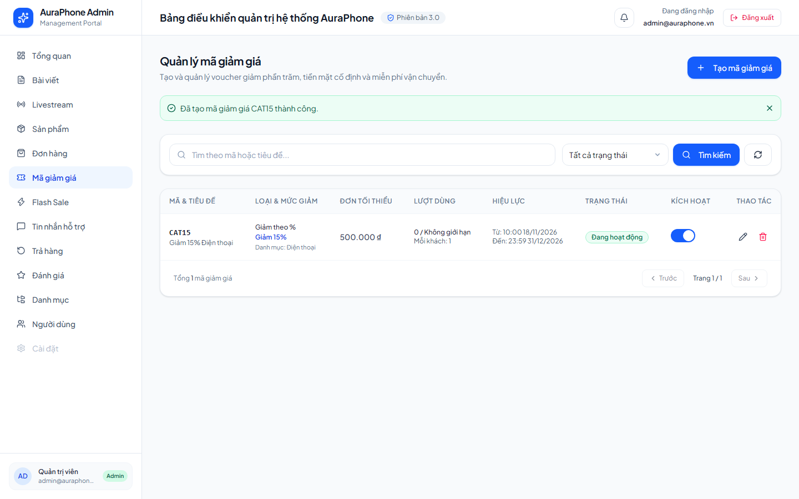
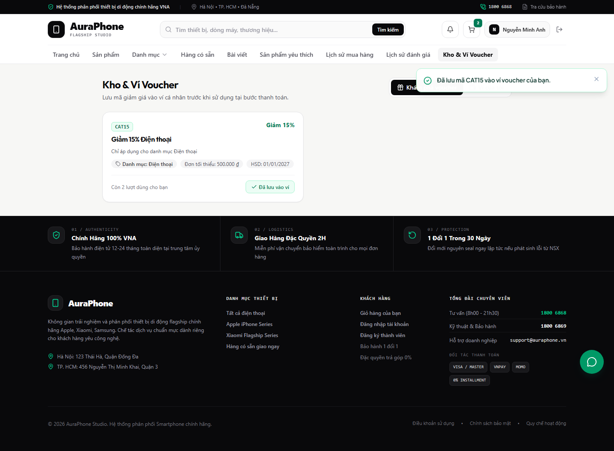
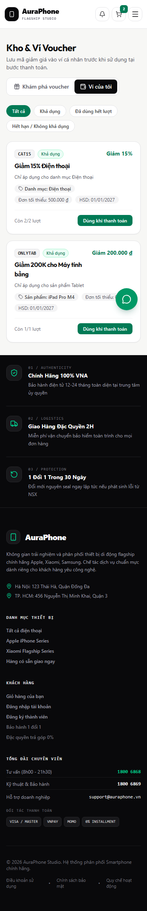
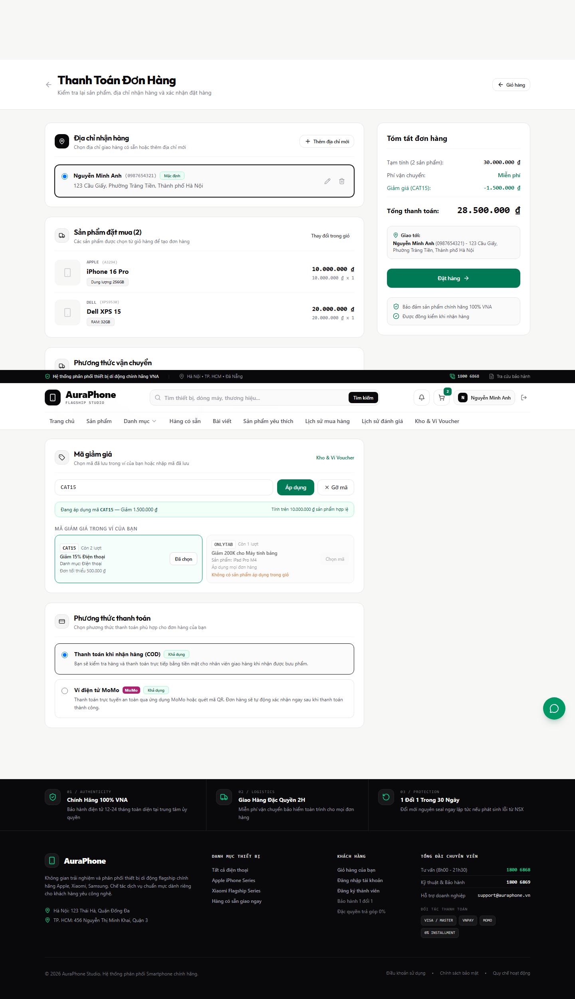

# E2E Verification Report — voucher-wallet-and-scope

- **Status:** PASS
- **Execution Mode:** `Mode 2: Shape-Locked Mock E2E`
- **Evidence Level:** `mock-e2e`
- **Command:** `npx playwright test e2e/voucher-wallet-and-scope.spec.ts` (from `frontend/`)
- **Contracts Verified:** `API-VOUCHER-ADMIN@1 (verifier)`, `API-VOUCHER-CUSTOMER@1 (verifier)`, `API-CHECKOUT-QUOTE-ORDER@1 (verifier)`
- **Requirements Covered:** `1.5, 1.6, 2.1, 2.2, 3.1, 3.2, 3.3, 4.1, 4.2, 4.6, 4.7`
- **Visual Evidence:** `01-admin-voucher-scope-desktop.png`, `02-customer-voucher-hub-desktop.png`, `03-customer-voucher-wallet-mobile.png`, `04-checkout-scoped-quote-desktop.png`

> **Scope note:** This `mock-e2e` run verifies frontend behavior and UI rendering in Chromium against golden response shapes recorded from Go backend handler tests (`.dream/specs/voucher-wallet-and-scope/contract-snapshots.json`). Backend persistence, concurrency, and SQL logic are independently verified by `TestVoucherWalletAndScope_Integration` (`integration-db`) and `go test ./...`.

## Contract Shape Verification Matrix

| Contract ID | Endpoint | Go Handler & Test Source | Inbound Request Assertions | Outbound Envelope & State Assertions |
|---|---|---|---|---|
| `API-VOUCHER-ADMIN@1` | `POST /api/v1/admin/vouchers`, `GET /api/v1/admin/vouchers` | `backend/internal/delivery/http/admin_voucher_handler.go` (`voucher_handler_test.go`) | Admin bearer session, `scopeType: "categories"`, `categoryIds: [CAT_PHONE.id]` | `201 Created` & `200 OK` shape-locked against `admin_voucher_create_categories_201` & `admin_voucher_list_200`; in-memory store updated for subsequent list refresh |
| `API-VOUCHER-CUSTOMER@1` | `GET /api/v1/vouchers/discover`, `POST /api/v1/vouchers/:id/claim`, `GET /api/v1/vouchers/wallet`, `GET /api/v1/vouchers/available` | `backend/internal/delivery/http/voucher_handler.go` (`voucher_handler_test.go`) | Customer bearer session, claim by voucher ID, wallet status query | `200 OK` shape-locked against `vouchers_discover_200`, `vouchers_claim_200`, `vouchers_wallet_200`, `vouchers_available_200`; stateful `cat15Claimed` transition persisted across tabs & checkout |
| `API-CHECKOUT-QUOTE-ORDER@1` | `POST /api/v1/checkout/quote` | `backend/internal/delivery/http/order_handler.go` (`order_handler_test.go`) | `addressId`, `deliveryMethod`, `voucherCode` (`UNCLAIMED99` -> `409`, `CAT15` -> `200`) | Shape-locked against `checkout_quote_not_claimed_409` (`voucher_not_claimed`) and `checkout_quote_scoped_200` (`eligibleSubtotalVnd: "10000000"`, `discountVnd: "1500000"`, `totalVnd: "28500000"`) |

## Scenario Walkthrough & Visual Evidence

### 1. Admin cấu hình voucher theo danh mục (`Req 1.5, 1.6`)
- Mở `http://localhost:15174/vouchers`, mở hộp thoại tạo mã, chọn `Phạm vi áp dụng = Chỉ áp dụng cho danh mục đã chọn`, tích chọn danh mục **Điện thoại**, lưu `CAT15` (`201 Created`), xác nhận bảng hiển thị `CAT15` và `Danh mục: Điện thoại`.
  

### 2. Khách hàng khám phá và lưu (claim) voucher vào ví (`Req 2.1, 2.2, 3.3`)
- Mở `/vouchers`, xem `CAT15` kèm nhãn `Danh mục: Điện thoại`, bấm **Lưu vào ví** (`POST /api/v1/vouchers/:id/claim` -> `200 OK`), xác nhận toast thông báo và trạng thái chuyển sang **Đã lưu vào ví**.
  

### 3. Ví voucher cá nhân trên Mobile (`375x812`) (`Req 3.1, 3.2`)
- Chuyển sang tab **Ví của tôi**, xác nhận hiển thị `CAT15` (`Danh mục: Điện thoại`) và `ONLYTAB` (`Sản phẩm: iPad Pro M4`), trạng thái `Khả dụng`, bộ lọc trạng thái và bố cục responsive sạch sẽ trên `375x812`.
  

### 4. Checkout Quote áp dụng voucher theo phạm vi & từ chối mã chưa lưu (`Req 4.1, 4.2, 4.6, 4.7`)
- Mở `/checkout` với giỏ hàng hỗn hợp gồm `iPhone 16 Pro` (10.000.000 ₫, danh mục `Điện thoại`) và `Dell XPS 15` (20.000.000 ₫, danh mục `Laptop`):
  - Voucher `ONLYTAB` (phạm vi sản phẩm `iPad Pro M4`) bị vô hiệu hóa kèm lý do `Không có sản phẩm áp dụng trong giỏ`.
  - Nhập tay mã chưa lưu `UNCLAIMED99` nhận `409 voucher_not_claimed` và hiển thị thông báo tiếng Việt `Bạn cần lưu mã giảm giá vào ví trước khi sử dụng`.
  - Chọn `CAT15` từ ví -> `POST /api/v1/checkout/quote` trả về giảm `1.500.000 ₫` (`15%` trên `10.000.000 ₫` sản phẩm hợp lệ), tổng thanh toán `28.500.000 ₫`.
  
