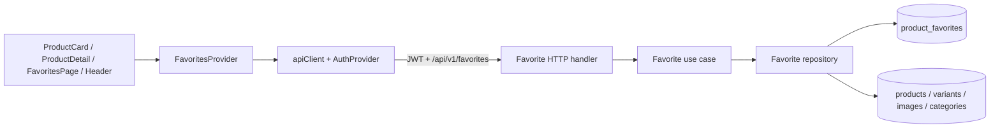

# Design Document

## Overview

Tính năng sản phẩm yêu thích được triển khai như một bounded context mới chạy xuyên backend và storefront:

- Backend sở hữu quan hệ bền vững giữa tài khoản và sản phẩm, xác thực quyền sở hữu từ access token, đọc thông tin sản phẩm hiện hành từ nguồn catalog chuẩn, và cung cấp một API collection được bảo vệ.
- Storefront sở hữu trạng thái phiên của danh sách yêu thích trong một context dùng chung, cung cấp nút chuyển trạng thái tại thẻ sản phẩm và trang chi tiết, cùng trang `/favorites` để quản lý toàn bộ danh sách.
- Các API catalog công khai và quy trình quản trị sản phẩm không thay đổi hợp đồng. Việc soft-delete sản phẩm chỉ đổi cách mục yêu thích được trình bày; quan hệ yêu thích vẫn được giữ.

Thiết kế này bao phủ Requirements 1.1–6.5 và không thêm danh sách tạm cho khách chưa đăng nhập, bộ đếm yêu thích, phân trang, lọc hoặc sắp xếp do người dùng.

## Architecture



### Backend boundaries

Luồng phụ thuộc giữ nguyên quy tắc `delivery -> usecase -> domain`, với repository triển khai interface do domain sở hữu:

1. Nhóm route `/api/v1/favorites` dùng middleware `AuthRequired`; `callerUserID` là nguồn duy nhất của chủ sở hữu danh sách.
2. HTTP handler chuyển đổi domain model sang Full Status Envelope và không nhận `userId` từ client.
3. Use case xác thực UUID, điều phối quy tắc thêm/xóa idempotent và ánh xạ lỗi domain.
4. Repository dùng sqlc/pgx để quản lý quan hệ và đọc dữ liệu hiện hành từ các bảng catalog.
5. Composition root bổ sung repository, use case và router dependency qua Google Wire; mã Wire sinh tự động được commit.

Favorite repository là boundary riêng, không mở rộng `CatalogRepository` bằng cờ “include inactive”. Cách này tránh đưa khả năng đọc sản phẩm đã soft-delete hoặc không khả dụng vào các luồng catalog công khai hoặc tạo hành vi tùy thuộc xác thực cho endpoint công khai hiện có.

### Storefront boundaries

1. `favoritesApi` là module duy nhất biết đường dẫn và wire types của API yêu thích; mọi request đi qua `apiClient`.
2. `FavoritesProvider` nằm bên trong `AuthProvider`, giữ danh sách từ server và cung cấp trạng thái dẫn xuất cho toàn bộ giao diện.
3. `FavoriteToggleButton` đóng gói hành vi đăng nhập/chuyển hướng, trạng thái bật/tắt, pending, keyboard và accessible name.
4. `ProductCard` và `ProductDetailPage` dùng cùng nút chuyển trạng thái; `FavoritesPage` dùng cùng context để tải, thử lại và xóa mục.
5. `Header` chỉ hiển thị liên kết `/favorites` cho khách hàng đã đăng nhập trên desktop và mobile.

### Data flow

#### Khôi phục phiên và tải danh sách

1. `AuthProvider` hoàn tất khôi phục phiên.
2. Nếu tài khoản khách hàng đã xác thực, `FavoritesProvider` gọi `GET /favorites` một lần và thay thế toàn bộ state bằng kết quả server.
3. Nếu không xác thực hoặc đăng xuất, provider xóa ngay danh sách, tập ID, lỗi và pending state cục bộ.
4. Mỗi response bất đồng bộ được ràng buộc với thế hệ user/session đã tạo request; response cũ không được phép điền lại dữ liệu sau đăng xuất hoặc đổi tài khoản.

#### Thêm hoặc bỏ yêu thích

1. Nút lấy `productId` từ `ProductSummary` hoặc `ProductDetail` công khai.
2. Nếu chưa đăng nhập, nút chuyển tới `/login?redirect=<current-path-and-search>` và không gọi API. Sau đăng nhập, người dùng quay lại trang cũ nhưng thao tác không tự chạy lại.
3. Nếu đã đăng nhập, provider đánh dấu riêng `productId` là pending và gọi `PUT` hoặc `DELETE`.
4. Backend thực hiện mutation và đọc danh sách kết quả trong cùng giao dịch, sau đó trả toàn bộ collection theo thứ tự chuẩn.
5. Provider chỉ thay thế state sau response thành công. Khi lỗi, state trước thao tác được giữ nguyên và UI hiển thị thông báo tiếng Việt.

## Components And Interfaces

### Domain model và repository contract

Domain bổ sung trạng thái:

```text
FavoriteAvailability = "active" | "unavailable" | "deleted"
```

`FavoriteProduct` chứa:

| Trường | Kiểu | Ý nghĩa |
|---|---|---|
| `ID` | UUID string | Định danh sản phẩm công khai |
| `Name` | string | Tên hiện hành |
| `Model` | string | Model hiện hành |
| `Brand` | string | Thương hiệu hiện hành |
| `Category` | `Category` | Danh mục hiện hành |
| `PrimaryImageURL` | string | Ảnh đầu tiên hiện hành, chuỗi rỗng nếu không có |
| `Availability` | enum | `deleted` khi sản phẩm đã soft-delete; `unavailable` khi sản phẩm còn active nhưng không có biến thể active; `active` khi sản phẩm và ít nhất một biến thể đang hoạt động |
| `MinPriceVND` | nullable `MoneyVND` | Giá nhỏ nhất của biến thể hoạt động; null khi `unavailable` hoặc `deleted` |
| `MaxPriceVND` | nullable `MoneyVND` | Giá lớn nhất của biến thể hoạt động; null khi `unavailable` hoặc `deleted` |
| `InStock` | nullable boolean | Có ít nhất một biến thể hoạt động còn tồn kho; null khi `unavailable` hoặc `deleted` |
| `FavoritedAt` | timestamp | Nguồn sắp xếp nội bộ, không bắt buộc đưa ra wire response |

Domain sở hữu interface với ba thao tác:

```text
List(ctx, userID) -> []FavoriteProduct
Add(ctx, userID, productID) -> []FavoriteProduct
Remove(ctx, userID, productID) -> []FavoriteProduct
```

`Add` và `Remove` trả collection sau mutation để repository có thể bảo đảm mutation và việc tạo response là một đơn vị giao dịch. Collection không bao giờ là `nil` tại HTTP boundary; danh sách rỗng được serialize thành `[]`.

### Use case

Use case có các trách nhiệm:

- Xác thực `userID` và `productID` là UUID trước khi gọi repository. Lỗi `productID` dùng `ValidationError` với field `productId`.
- `List` chỉ chấp nhận user ID lấy từ middleware.
- `Add` giữ nguyên timestamp và không tạo bản ghi thứ hai khi quan hệ đã tồn tại.
- Nếu quan hệ chưa tồn tại, `Add` chỉ chấp nhận sản phẩm đang công khai theo cùng điều kiện catalog: `products.active = true` và tồn tại ít nhất một biến thể active.
- `Remove` là idempotent: product ID hợp lệ nhưng không có quan hệ vẫn trả danh sách hiện hành thành công.
- Lỗi sản phẩm không tồn tại hoặc không còn công khai khi thêm mới dùng `ErrProductNotFound`.

### HTTP API contract

Tất cả route dưới đây dùng `AuthRequired` và Full Status Envelope:

| Method | Path | Request | Success |
|---|---|---|---|
| `GET` | `/api/v1/favorites` | Không có body | `200`, `data: FavoriteProductResponse[]` |
| `PUT` | `/api/v1/favorites/:productId` | Không có body | `200`, toàn bộ danh sách sau khi thêm, thông báo `Đã thêm sản phẩm vào danh sách yêu thích` |
| `DELETE` | `/api/v1/favorites/:productId` | Không có body | `200`, toàn bộ danh sách sau khi xóa, thông báo `Đã xóa sản phẩm khỏi danh sách yêu thích` |

`PUT` được chọn thay cho `POST` vì URI biểu diễn duy nhất quan hệ user–product và thao tác thêm là idempotent. `DELETE` cũng idempotent. Không route nào chấp nhận `userId`, favorite ID nội bộ hoặc dữ liệu sản phẩm từ client.

Wire response của mỗi mục:

```json
{
  "id": "uuid",
  "name": "string",
  "model": "string",
  "brand": "string",
  "category": { "id": "uuid", "name": "string" },
  "primaryImageUrl": "string",
  "availability": "active | unavailable | deleted",
  "minPriceVnd": "canonical VND integer | null",
  "maxPriceVnd": "canonical VND integer | null",
  "inStock": "boolean | null"
}
```

Quy tắc nullability là bắt buộc:

- `active`: `minPriceVnd`, `maxPriceVnd`, `inStock` không null.
- `unavailable` hoặc `deleted`: cả ba trường trên là null; client không được suy diễn thành giá 0 hoặc trạng thái “Hết hàng”.
- `primaryImageUrl` dùng chuỗi rỗng khi sản phẩm không có ảnh, tương thích catalog hiện tại.

Danh sách được sắp xếp theo `favorited_at DESC, product_id ASC`. Thao tác `PUT` lặp lại không cập nhật `favorited_at`, vì vậy không tự đưa mục cũ lên đầu.

### Frontend types và API service

Storefront bổ sung:

```text
FavoriteAvailability = 'active' | 'unavailable' | 'deleted'
FavoriteProduct = {
  id, name, model, brand, category, primaryImageUrl,
  availability,
  minPriceVnd: string | null,
  maxPriceVnd: string | null,
  inStock: boolean | null
}
```

`favoritesApi.list`, `favoritesApi.add(productId)` và `favoritesApi.remove(productId)` đều trả `Promise<FavoriteProduct[]>` sau khi `apiClient` tự gỡ envelope.

### FavoritesProvider contract

Context cung cấp tối thiểu:

```text
items: FavoriteProduct[]
favoriteIds: ReadonlySet<string>
isLoading: boolean
loadError: string | null
isPending(productId): boolean
refresh(): Promise<void>
add(productId): Promise<void>
remove(productId): Promise<void>
toggle(productId): Promise<void>
```

`favoriteIds` được dẫn xuất từ `items`; không tồn tại nguồn dữ liệu yêu thích thứ hai trong local storage. Provider không cập nhật lạc quan. Mỗi mutation thành công thay thế cả `items` bằng collection server trả về, bảo đảm thứ tự, trạng thái availability và đồng bộ giữa các màn hình.

### UI components và routes

- `FavoriteToggleButton`: icon trái tim có text/accessible name thay đổi giữa “Thêm vào yêu thích” và “Bỏ khỏi yêu thích”, trạng thái pressed, focus-visible và disabled trong khi pending. Trạng thái không chỉ thể hiện bằng màu; icon fill và tên hành động cùng thay đổi.
- `ProductCard`: tích hợp nút ở vùng không chặn các liên kết chi tiết. Dùng provider để hiển thị trạng thái; các trang chủ và danh mục tự nhận hành vi vì đang tái sử dụng component này.
- `ProductDetailPage`: đặt nút cạnh vùng hành động sản phẩm và dùng cùng provider.
- `FavoritesPage` tại `/favorites`: xử lý auth loading, redirect khách, loading, empty, error/retry và collection. Mục active có thể tái sử dụng trình bày của `ProductCard`; mục `deleted` dùng biến thể không có link chi tiết/giá/tồn kho, có nhãn chính xác “Sản phẩm đã bị xóa” và nút bỏ yêu thích; mục `unavailable` dùng cùng giới hạn hành động với nhãn “Sản phẩm hiện không khả dụng”.
- `Header`: thêm liên kết “Sản phẩm yêu thích” cho người dùng đã đăng nhập ở desktop và mobile; không thêm badge count.

## Data Models

### Migration

Thêm cặp migration kế tiếp sau `000010`:

```sql
CREATE TABLE product_favorites (
    user_id      uuid NOT NULL REFERENCES users(id) ON DELETE CASCADE,
    product_id   uuid NOT NULL REFERENCES products(id) ON DELETE CASCADE,
    favorited_at timestamptz NOT NULL DEFAULT now(),
    PRIMARY KEY (user_id, product_id)
);

CREATE INDEX product_favorites_user_order_idx
    ON product_favorites (user_id, favorited_at DESC, product_id);
```

Down migration xóa index thông qua việc xóa bảng, rồi xóa `product_favorites`.

### Invariants

1. Mỗi cặp `(user_id, product_id)` có tối đa một quan hệ.
2. Xóa user vật lý xóa các quan hệ của user; không để dữ liệu mồ côi.
3. Ngừng hoạt động sản phẩm là soft delete nên không xóa quan hệ.
4. Xóa cứng sản phẩm trong một quy trình tương lai sẽ cascade quan hệ vì sản phẩm không còn dữ liệu nhận diện để hiển thị; hành vi này khác với soft-delete hiện có.
5. Favorite không lưu snapshot tên, ảnh, giá hoặc tồn kho. Các trường hiển thị luôn đến từ bảng catalog hiện hành.
6. Chỉ sản phẩm công khai mới được thêm mới; quan hệ đã có vẫn hợp lệ khi sản phẩm chuyển sang `unavailable` hoặc `deleted`.
7. Mutation và truy vấn collection trả về chạy trong cùng transaction. Nếu không thể tạo response sau mutation, transaction rollback và không để client nhận lỗi trong khi mutation đã commit.

### Query semantics

List query bắt đầu từ `product_favorites` được lọc bằng `user_id`, join `products` và `categories`, lấy ảnh đầu tiên theo `position, id`, và tổng hợp các biến thể active:

- `availability = deleted` khi `products.active = false`.
- `availability = unavailable` khi `products.active = true` nhưng không có biến thể active.
- `availability = active` khi `products.active = true` và có ít nhất một biến thể active.
- Giá min/max chỉ tính biến thể active và giữ chuỗi số nguyên VND canonical.
- `inStock` là true khi có biến thể active với `stock_quantity > 0`.
- Nếu `unavailable` hoặc `deleted`, giá và in-stock được trả null dù database còn giữ dữ liệu biến thể.

Sqlc generated models/queries được tái sinh từ migration và query source; không chỉnh sửa thủ công thư mục generated.

## Error Handling

| Tình huống | HTTP | `error.code` | Fields / hành vi |
|---|---:|---|---|
| Thiếu hoặc sai access token | 401 | Cơ chế auth hiện có | Middleware từ chối trước handler; không đọc dữ liệu |
| `productId` sai định dạng | 400 | `validation_error` | `fields.productId` nêu định dạng UUID không hợp lệ |
| Thêm mới sản phẩm không tồn tại hoặc không công khai | 404 | `product_not_found` | Thông báo tiếng Việt; không tạo quan hệ |
| Xóa quan hệ không tồn tại | 200 | Không lỗi | Trả collection hiện hành |
| Thêm quan hệ đã tồn tại | 200 | Không lỗi | Không đổi timestamp, trả collection hiện hành |
| Lỗi database/hệ thống | 500 | `internal` | Không lộ chi tiết; mutation rollback; ghi log có cấu trúc không chứa token |

Frontend dùng `ApiError`:

- Lỗi mutation không thay đổi `items`; hiển thị `err.message` khi là lỗi business, nếu không dùng thông báo tiếng Việt chung.
- Lỗi tải list đặt `loadError` và hiển thị retry; không thay bằng empty state.
- Một lỗi của nút sản phẩm không làm vô hiệu các nút khác.
- Provider xóa dữ liệu ngay khi auth state trở thành unauthenticated, kể cả request cũ hoàn tất muộn.

## Testing Strategy

### Backend

- **Domain/use case tests:** UUID validation, user ID không nhận từ client, add/remove idempotent, lỗi product unavailable, empty slice, và propagation của repository errors.
- **Repository tests:** thứ tự mới nhất, unique invariant, duplicate PUT không đổi timestamp, isolation giữa hai user, active/out-of-stock/unavailable/deleted projection, current catalog values, soft-delete giữ quan hệ, user/product hard-delete cascade và transaction rollback.
- **HTTP tests:** auth guard, ba route/method, Full Status Envelope, exact nullable wire contract, `[]` cho empty, thông báo tiếng Việt, validation fields và stable error codes.
- **Composition tests:** router nhận favorite dependency; Wire generation/build chứng minh graph khởi tạo đầy đủ.
- **Database verification:** áp dụng migration bằng `make db-up`, chạy `make gen`, kiểm tra generated diff, focused repository integration tests, toàn bộ `go test ./...` và `go vet ./...`.

### Storefront

- **API tests:** đúng method/path, không gửi user/favorite ID nội bộ, unwrap danh sách và giữ nullability.
- **Provider tests:** chỉ tải sau auth restore, clear khi logout, bỏ qua stale response, dẫn xuất Set ID, thay toàn bộ list sau mutation, giữ state khi lỗi, pending theo từng product và retry load.
- **Component tests:** trạng thái pressed/name/focus/keyboard của nút, guest redirect gồm current path/search, không tự mutation sau login, ProductCard và detail đồng bộ qua provider.
- **Page tests:** loading khác empty, error/retry, thứ tự server, active link tới detail, deleted/unavailable có ghi chú chính xác, không có link/giá/tồn kho có thể mua và vẫn remove được.
- **Header/router tests:** link desktop/mobile chỉ hiện khi authenticated; `/favorites` đăng ký trong router và guest bị chuyển đến login với redirect.
- **Verification:** focused Vitest, `npm run lint`, `npm test`, `npm run build`, cùng kiểm tra thủ công desktop/mobile, keyboard và focus-visible.

## Requirement Traceability

| Requirement | Design elements | Verification |
|---|---|---|
| 1.1 | `FavoriteToggleButton` trong `ProductCard` | Component tests trên trang chủ/catalog |
| 1.2 | Nút dùng chung trong `ProductDetailPage` | Product detail tests |
| 1.3 | Header link desktop/mobile và route `/favorites` | Header/router tests |
| 1.4 | Guest redirect dùng current path/search | Button và route tests |
| 1.5 | Không local mutation; người dùng phải kích hoạt lại | Redirect/login integration test |
| 2.1 | Authenticated `PUT`, provider thay state sau success | Use case, HTTP và provider tests |
| 2.2 | PK + idempotent PUT, không đổi timestamp | Repository concurrency/idempotency test |
| 2.3 | Authenticated `DELETE`, full-list response | HTTP/provider tests |
| 2.4 | FavoritesPage dùng cùng remove action | Page test |
| 2.5 | Idempotent DELETE | Repository và HTTP test |
| 2.6 | Pending set theo product | Provider/button rapid-click test |
| 2.7 | Không optimistic state; ApiError/toast | Provider failure test |
| 2.8 | Use case ValidationError `productId` | Use case/HTTP validation test |
| 2.9 | Public-product predicate + `product_not_found` | Repository/use case/HTTP test |
| 3.1 | List gồm active/unavailable/deleted, sort server | Repository và page order test |
| 3.2 | Active wire projection | Repository/HTTP serialization test |
| 3.3 | Active item link | Page navigation test |
| 3.4 | Deleted projection và nhãn “Sản phẩm đã bị xóa” | Page test |
| 3.5 | Unavailable projection và nhãn “Sản phẩm hiện không khả dụng” | Page test |
| 3.6 | Null contract + non-link card + remove | HTTP/page test |
| 3.7 | Empty array và EmptyState | HTTP/page empty test |
| 3.8 | Provider/page loading state | Page loading test |
| 3.9 | `loadError` và retry | Provider/page failure test |
| 4.1 | Provider tải sau auth restore, ID Set dùng chung | Provider/integration test |
| 4.2 | Một context và full-list replacement | Cross-component provider test |
| 4.3 | Catalog routes không đổi và button guest-safe | Existing catalog tests + guest test |
| 4.4 | Active + `inStock=false` khác unavailable/deleted | Repository/HTTP/page test |
| 4.5 | Relation giữ lại; unavailable/deleted list projection | Repository soft-delete/no-active-variant test |
| 4.6 | FK không chặn soft delete; không cascade khi update | Admin catalog + repository integration test |
| 4.7 | Query đọc current catalog tables | Repository update-then-list test |
| 5.1 | Persistence table theo user | Integration test qua phiên mới |
| 5.2 | Server-side storage, không phụ thuộc browser | API/provider integration test |
| 5.3 | user ID chỉ từ JWT context | HTTP ownership test |
| 5.4 | Query bắt buộc lọc user ID | Two-user repository/HTTP test |
| 5.5 | `AuthRequired` trên cả route group | Unauthorized HTTP tests |
| 5.6 | URI dùng public `productId` | API contract test |
| 5.7 | Provider clear + stale response guard | Logout/race provider test |
| 6.1 | Icon fill + pressed/name/label | Accessibility component test |
| 6.2 | Semantic button và retry controls | Keyboard tests |
| 6.3 | Dynamic accessible name và pressed state | Accessibility assertions |
| 6.4 | Focus-visible treatment | Keyboard/manual verification |
| 6.5 | Responsive FavoritesPage/Card composition | Mobile/desktop layout verification |

## Existing System Integration

### Supporting dependencies

| Dependency | Canonical source | Design use |
|---|---|---|
| Authenticated user | JWT manager, `AuthRequired`, `callerUserID` | Sở hữu và cô lập mọi favorite operation |
| Public product ID | Existing `ProductSummary`/`ProductDetail` response | Input duy nhất cho PUT/DELETE |
| Current product identity | `products`, `categories`, `product_images` | Nội dung active, unavailable và deleted; không snapshot |
| Current availability/price/stock | `products.active`, active `product_variants` | Phân biệt active, out-of-stock, unavailable và deleted |
| API envelope/errors | `writeSuccess`, `writeError`, `apiClient`, `ApiError` | Contract và xử lý lỗi nhất quán |
| Session restore | `AuthProvider` | Thời điểm bắt đầu/clear favorite state |
| Product presentation | `ProductCard`, catalog types | Tái sử dụng cho active favorites và các entry point |

### Downstream compatibility

- `GET /products`, `GET /products/featured` và `GET /products/:id` giữ nguyên route, payload và tính công khai; không thêm `isFavorite` phụ thuộc người dùng.
- Admin soft delete tiếp tục chỉ cập nhật `products.active`; foreign key không chặn UPDATE và quan hệ favorite không bị xóa.
- Cart, checkout, order và frontend-admin không đổi contract hay dependency.
- Header có thêm liên kết nhưng giữ hành vi giỏ hàng, lịch sử mua hàng và đăng xuất hiện có.
- `ProductCard` nhận thêm điều khiển nhưng vẫn giữ liên kết ảnh/tên/chi tiết, hiển thị giá và trạng thái tồn kho hiện có.

### Migration and generation

Migration cần được áp dụng trước khi server mới chạy. Sau thay đổi schema/query phải chạy `make db-up` và `make -C backend gen` (hoặc root `make build`). Sau khi bổ sung provider/injector phải chạy `make -C backend wire`; không chỉnh sửa trực tiếp sqlc hoặc Wire generated output.

## Alternatives Considered

### Nguồn trạng thái yêu thích trên storefront

- **Chọn: protected favorite collection + shared provider.** Một lần tải cung cấp cả trang danh sách và Set ID cho mọi nút, giữ public catalog ổn định.
- Thêm `isFavorite` vào catalog response bị loại vì làm payload công khai phụ thuộc tùy chọn xác thực và mở rộng nhiều endpoint hiện có.
- Gọi endpoint status cho từng product bị loại vì tạo N+1 request và trạng thái khó đồng bộ.

### Mô hình lưu trữ

- **Chọn: bảng nối `product_favorites`.** Bảo đảm unique, ownership, cascade và truy vấn theo user bằng ràng buộc database.
- Mảng JSON trong `users` bị loại vì cập nhật cạnh tranh, khó bảo toàn tham chiếu và khó truy vấn/sắp xếp.
- Snapshot product bị loại vì mâu thuẫn yêu cầu hiển thị dữ liệu hiện hành.

### Mutation response

- **Chọn: trả toàn bộ collection sau mutation.** Phù hợp mẫu Cart hiện có và cho frontend thay thế state nguyên tử, không phải tự dựng thứ tự hoặc trạng thái availability.
- Delta response bị loại vì buộc client ghép state, xử lý timestamp/order và có thể giữ dữ liệu catalog cũ.
